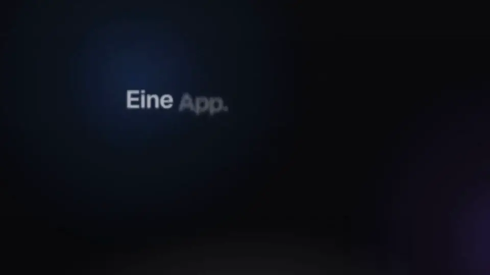

<div align="center">

<h1>Fühlt sich vertraut an. Gehört dir.</h1>

**Kontext: Mail, Kalender, Chat, Dokumente und Telefon für dein Team – auf deinem eigenen Server, Open Source**

Ohne Kosten pro Benutzer. Made in Europe.

[English](README.md) · **Deutsch**

[](https://github.com/firsttris/kontext/actions/workflows/ci.yml)
[](https://github.com/firsttris/kontext/releases/latest)
[](https://hub.docker.com/r/tristanteu/kontext)
[](https://hub.docker.com/r/tristanteu/kontext/tags)
[](https://firsttris.github.io/kontext/)
[](LICENSE)
[](https://stalw.art)
[](https://jmap.io)
[](#-warum-kontext)
[](#-warum-kontext)

[Warum](#-warum-kontext) •
[Installation](#-installation) •
[Funktionen](#-funktionen) •
[Screenshots](#-screenshots) •
[Alternativen](#-kontext-und-die-alternativen) •
[FAQ](#-faq) •
[Dokumentation](https://firsttris.github.io/kontext/)

<a href="https://firsttris.github.io/kontext/"></a>

▶️ **[Den ganzen Film ansehen (2 Minuten)](https://firsttris.github.io/kontext/)** – jedes Modul, aus der echten App

</div>

## 💡 Warum Kontext?

Google Workspace und Microsoft 365 sind bequem, aber jeder Benutzer kostet jeden Monat, und die
Daten liegen bei einem US-Konzern. Kontext fühlt sich im Browser und am Handy genauso an, läuft
aber auf **deinem** Server: einem kleinen VPS ab etwa 5 € im Monat (z. B. bei IONOS oder Hetzner)
oder einem eigenen Rechner.

- **Deine Daten bleiben bei dir (DSGVO)**: Mails, Termine, Kontakte, Chat und Anrufe liegen auf
  deinem Server, in Europa oder im eigenen Büro. Kein US-Anbieter, keine Tracker.
- **Keine Kosten pro Kopf**: Zehn Mitarbeiter kosten dasselbe wie einer; bezahlt wird der Server.
- **Alles zum Kunden an einem Ort**: seine letzten Mails, nächsten Termine, offenen Aufgaben und
  Anrufe – ein kleines CRM ohne Extra-Tool.
- **Eine App statt fünf**: Mail, Kalender, Aufgaben, Team-Chat mit Videocalls, das Firmentelefon
  und Dokumente, mit einer Anmeldung.
- **Auch fürs Handy gebaut**: Jede Ansicht funktioniert am Handy, eine Mail wischt man zur Seite
  ins Archiv, und Kontext lässt sich ohne App Store als App installieren.
- **KI, wenn du willst**: Claude und andere Assistenten finden Kunden, Mails und Termine für dich
  und schreiben Entwürfe – sie senden und löschen nie etwas.
- **Offen, kein Lock-in**: Open Source (AGPL) und Standardprotokolle, damit Outlook, Thunderbird,
  iPhone und Android weiter funktionieren und du jederzeit alles mitnehmen kannst.

**Für wen:** Selbstständige · Handwerk · Kanzleien und Praxen · kleine und mittlere Betriebe ·
Selfhoster, die eine Weboberfläche für [Stalwart](https://stalw.art) suchen.

## 🚀 Installation

### 1. Von einem Agenten aufsetzen lassen

Gib Claude Code oder einem anderen Coding-Agenten dieses Repository und SSH-Zugang zu deinem Server und sag:
„Setz Kontext auf meinem Server auf, nach der [Installationsanleitung](https://firsttris.github.io/kontext/installation.html).“

### 2. Manuell

Auf einem Server mit Docker (oder Podman), eigener Domain und offenen Ports 25, 80, 443, 465, 587 und 993:

```bash
# Die Konfiguration (compose.yaml, .env.example, Caddyfile, Backups); die Programme kommen von Docker Hub
git clone https://github.com/firsttris/kontext /opt/kontext && cd /opt/kontext
cp deploy/.env.example deploy/.env && chmod 600 deploy/.env
nano deploy/.env                              # Domain, Version, Backup-Ziel, jedes change-me ersetzen
docker compose -f deploy/compose.yaml up -d   # lädt Kontext, Stalwart und Caddy und startet sie (oder Podman)
```

Danach die wichtigsten Schritte in Stalwarts Verwaltung (Port 8080, nur über SSH-Tunnel oder
Tailscale); die [Anleitung](https://firsttris.github.io/kontext/installation.html#3-stalwart-einrichten) nennt alle:

1. Domain und DKIM einrichten und das Konto des Chefs anlegen; alle anderen legt der Chef in Kontext an.
2. Kontexts Netz `10.89.250.0/24` als erlaubte IP eintragen, damit falsche Passwörter nie Kontext
   selbst sperren.
3. Den API-Schlüssel für die Firmenverwaltung anlegen, in `deploy/.env` als `STALWART_ADMIN_KEY`
   eintragen und Kontext neu starten ([wie](https://firsttris.github.io/kontext/installation.html#firmenverwaltung-einschalten)).
4. Unter `https://<deine Domain>` anmelden.

Anrufe und Dokumente (Schreibzeug, ohne eigene Installation) sind in `.env.example` schon eingeschaltet; wer sie nicht braucht, nimmt sie
aus `COMPOSE_PROFILES`. Für Telefonie kommt eine kleine Box ins Büro. Für zehn Benutzer reicht ein
VPS mit 2 vCPU und 4 GB RAM. Alles Weitere – DNS, Podman, Backups, Updates – steht in der
[Installationsanleitung](https://firsttris.github.io/kontext/installation.html).

## ✨ Funktionen

| | |
|---|---|
| ✉️ **Mail** | **Gemeinsame Postfächer** wie info@ mit Rechten pro Person, **Kategorien** und **Regeln auf dem Server**, Suche wie in Gmail, später senden, Spam und Papierkorb mit einem Klick leeren, Tabellen, Farben und Bilder beim Schreiben, **„Anhang vergessen?“**, als Anhang weiterleiten (.eml), Marke **„Extern“** mit Rückfrage vor dem Senden nach außen, winmail.dat ausgepackt, **weitere Postfächer** (Gmail, GMX), **Warnungen vor gefälschten Absendern** · [mehr →](https://firsttris.github.io/kontext/mail.html) |
| 📅 **Kalender** | Tag, Woche, Monat, Serien (auch ab einem Termin ändern), **Einladungen mit einem Klick beantworten**, auch **Einladungen aus Outlook und Google direkt in der Mail**, **Wer hat Zeit?**, **Videobesprechung pro Termin**, **Erinnerung als Hinweis oder Mail**, je Kalender voreingestellt, **Termine duplizieren**, geteilte Kalender, **Kalender abonnieren** (iCal), **Termine aus .ics-Dateien übernehmen** mit Vorschau, Feiertage je Bundesland · [mehr →](https://firsttris.github.io/kontext/calendar-contacts.html) |
| 👥 **Kontakte** | **Der Kunde auf einen Blick**: letzte Mails, nächste Termine, offene Aufgaben und Anrufe; Gruppen, vCard, Doppelte zusammenführen, mehrere Kontakte auf einmal (löschen, in eine Gruppe, exportieren) · [mehr →](https://firsttris.github.io/kontext/calendar-contacts.html#kontakte) |
| ✅ **Aufgaben** | **Liste oder Kanban-Board** pro Postfach, **aus einer Mail, einer Chat-Nachricht oder einem verpassten Anruf**, Erinnerungen, per CalDAV in Thunderbird und am Handy · [mehr →](https://firsttris.github.io/kontext/tasks.html) |
| 💬 **Team-Chat & Video** | Kanäle und Direktnachrichten, **Mails und Aufgaben als Karten**, Sprachnachrichten, **Videocalls und Bildschirm teilen** auf dem eigenen Server, Ende-zu-Ende verschlüsselte Unterhaltungen · [mehr →](https://firsttris.github.io/kontext/chat.html) |
| 📞 **Telefonie (CTI)** | **Fritzbox und Nummern bleiben**: Anrufe klingeln in Kontext mit Kontakt und letzter Mail des Anrufers, **Anrufen per Klick**, **Mailbox als Mail**, verpasste Anrufe werden Aufgaben · [mehr →](https://firsttris.github.io/kontext/telephony.html) |
| 🔐 **Verschlüsselung** | **OpenPGP** und **S/MIME**, **vertraulich senden an jeden** über einen Link auf den eigenen Server, verschlüsselte Backups · [mehr →](https://firsttris.github.io/kontext/encryption.html) |
| 📄 **Dokumente** | **Word, Excel, PowerPoint und PDF** in Kontext mit [Schreibzeug](https://github.com/firsttris/schreibzeug), ein Ordner pro gemeinsamem Postfach · [mehr →](https://firsttris.github.io/kontext/documents.html) |
| 🤖 **KI-Agenten (MCP)** | Claude und andere Agenten schlagen Kunden, Mails und Termine mit deinen Rechten nach, **schreiben Entwürfe** und **laden Kollegen zu Terminen ein** – nichts geht nach draußen, kein Löschen, jede Änderung protokolliert · [mehr →](https://firsttris.github.io/kontext/agents.html) |
| 🏢 **Firmenverwaltung** | **Mitarbeiter, gemeinsame Postfächer und Rechte** ohne IT-Kenntnisse, Firmen-Signatur mit Telefon und Position je Person, **Pflichtangaben unter jeder Mail**, **Austritt ohne Löschen**, Datensicherung im Blick, **Umzug von Microsoft 365, Gmail und Outlook** · [mehr →](https://firsttris.github.io/kontext/company.html) |
| 📱 **Auf jedem Gerät** | **Eine App am PC, unter Android und am iPhone** ohne App Store, Benachrichtigungen, hell und dunkel, Anmeldung mit zweitem Faktor, **für Tastatur und Screenreader gebaut**, bei jedem Push automatisch gegen WCAG 2.2 AA geprüft ([Barrierefreiheit](https://firsttris.github.io/kontext/accessibility.html)) · [mehr →](https://firsttris.github.io/kontext/app.html) |


## 📸 Screenshots

<table>
  <tr>
    <td width="50%"><br><sub><b>Gemeinsames Postfach</b> – info@ fürs ganze Team · <a href="https://firsttris.github.io/kontext/mail.html">Doku →</a></sub></td>
    <td width="50%"><br><sub><b>Schreiben</b> – Formatierung, Zitat, Absender · <a href="https://firsttris.github.io/kontext/mail.html#schreiben">Doku →</a></sub></td>
  </tr>
  <tr>
    <td><br><sub><b>Kalender</b> – Woche, Monat, Verfügbarkeit · <a href="https://firsttris.github.io/kontext/calendar-contacts.html">Doku →</a></sub></td>
    <td><br><sub><b>Kontakte</b> – der Kunde auf einen Blick · <a href="https://firsttris.github.io/kontext/calendar-contacts.html#kontakte">Doku →</a></sub></td>
  </tr>
  <tr>
    <td><br><sub><b>Aufgaben</b> – ein Kanban-Board pro Postfach · <a href="https://firsttris.github.io/kontext/tasks.html">Doku →</a></sub></td>
    <td><br><sub><b>Team-Chat</b> – Mails als Karten, Aufgaben aus Nachrichten · <a href="https://firsttris.github.io/kontext/chat.html">Doku →</a></sub></td>
  </tr>
</table>

<p align="center">
  
</p>

<p align="center">
  
  
  
  
</p>

## 🔀 Kontext und die Alternativen

Kontext ist für einen kleinen Betrieb gemacht, der den Komfort von Google Workspace auf dem
eigenen Server will, mit Mail, Kalender, Chat und Firmentelefon an einem Ort.

| | Was es ist | Was Kontext anders macht |
| --- | --- | --- |
| [Google Workspace](https://workspace.google.com) | Gmail, Kalender, Drive und Meet im Abo pro Benutzer | eigener Server, keine Kosten pro Kopf, Daten in Europa |
| [Microsoft 365](https://www.microsoft.com/microsoft-365) | Outlook, Teams und Office im Abo pro Benutzer | läuft im Browser ohne Outlook, Chat und Telefon inklusive, Daten auf dem eigenen Server |
| [Nextcloud](https://nextcloud.com) | selbst gehostete Dateien mit Mail, Kalender und Talk als Apps | um Mail und den Kunden herum gebaut: gemeinsame Postfächer, Regeln und Kategorien fürs Team, das Firmentelefon; Dateien über Schreibzeug |
| [Roundcube](https://roundcube.net), [SOGo](https://www.sogo.nu) | bewährte Webmailer und Groupware für IMAP | moderne Oberfläche fürs Handy, JMAP-Push, Kontakte mit Kundenansicht, Aufgaben und Chat |
| [Zimbra](https://www.zimbra.com), [Open-Xchange](https://www.open-xchange.com) | Groupware-Pakete für Provider und größere Firmen | ein kleiner Server pro Firma, an einem Nachmittag eingerichtet, eine Firmenverwaltung für den Chef |
| [3CX](https://www.3cx.com), [Placetel](https://www.placetel.de) | Telefonanlagen mit CTI-Apps | Fritzbox und Nummern bleiben, Anrufe stehen neben den Mails des Kunden, keine Lizenz pro Nebenstelle |
| [Bulwark](https://www.bulwarkmail.org) | JMAP-Webmail mit Kalender und Kontakten für Stalwart | Kundenansicht, gemeinsame Postfächer fürs Team, Aufgaben, Chat, Telefonie und Firmenverwaltung |

## ❓ FAQ

<details>
<summary><b>Gibt es eine Open-Source-Alternative zu Google Workspace und Microsoft 365?</b></summary>

Ja, Kontext: Mail mit gemeinsamen Postfächern, Kalender, Kontakte, Aufgaben, Team-Chat mit
Videoanrufen und die Telefonanlage in einer Web-App auf deinem eigenen Server, Dokumente über
[Schreibzeug](https://github.com/firsttris/schreibzeug). Siehe [Installation](https://firsttris.github.io/kontext/installation.html).
</details>

<details>
<summary><b>Was kostet das?</b></summary>

Die Software ist kostenlos (AGPL). Du brauchst einen Server – einen VPS ab etwa 5 € im Monat – und
jemanden, der ihn einrichtet und aktuell hält.
</details>

<details>
<summary><b>Gibt es eine Weboberfläche für den Mailserver Stalwart?</b></summary>

Ja, das ist Kontext: ein JMAP-Webclient für Mail, Kalender und Kontakte auf
[Stalwart](https://stalw.art), dazu Aufgaben, Chat, Telefonie und eine Firmenverwaltung, die
Stalwarts Konten und Gruppen pflegt. Siehe [Architektur](https://firsttris.github.io/kontext/architecture.html).
</details>

<details>
<summary><b>Funktioniert Kontext mit meiner Fritzbox (CTI)?</b></summary>

Ja. Eine Telefonbox im Büro meldet sich an der Fritzbox als IP-Telefon an; Anrufe klingeln dann in
Kontext mit Kontakt, letzter Mail und nächstem Termin des Anrufers, und du rufst aus jedem Kontakt
an. Siehe [Telefonie](https://firsttris.github.io/kontext/telephony.html).
</details>

<details>
<summary><b>Läuft das auf meinem eigenen PC oder NAS?</b></summary>

Ja, Kontext läuft überall, wo Docker oder Podman läuft. Um Mails aus dem Internet zu empfangen,
braucht der Rechner aber Port 25 von außen, eine feste IP-Adresse und einen Reverse-DNS-Eintrag;
private Internetanschlüsse sperren Port 25 meist. Zu Hause geht es am besten mit einem Mail-Relay
davor – ein kleiner VPS ist einfacher. Die Telefonbox läuft auf einem NAS, einem Raspberry Pi oder
einem Thin Client im Büro.
</details>

<details>
<summary><b>Ist das DSGVO-konform?</b></summary>

Es ist dafür gebaut: Die Daten bleiben auf deinem Server, ohne Tracker oder Dritte. Einen
Auftragsverarbeitungsvertrag schließt du mit deinem Hoster; bei einem Server im eigenen Haus
nicht einmal das.
</details>

<details>
<summary><b>Ist Kontext GoBD-konform?</b></summary>

Nein, Kontext ist kein Mailarchiv. Die GoBD verlangen, dass geschäftliche Mails über Jahre so
aufbewahrt werden, dass niemand sie löschen oder ändern kann; in Kontext kann man Mails löschen.
Dafür gehört ein GoBD-Archiv daneben. Kontext liefert die Bausteine drumherum: Beim Austritt wird
nichts gelöscht, und Backups gehen verschlüsselt und unveränderbar (Object Lock) auf S3-Speicher.
</details>

<details>
<summary><b>Funktionieren iPhone, Android, Outlook und Thunderbird weiter?</b></summary>

Ja. Stalwart spricht IMAP, SMTP, CalDAV und CardDAV; jedes Mailprogramm und Handy kann sich direkt
verbinden. Kontext ist die Oberfläche im Browser obendrauf, und die Aufgaben sind auch
CalDAV-Aufgabenlisten.
</details>

<details>
<summary><b>Kann ich von Gmail, Microsoft 365 oder Outlook umziehen?</b></summary>

Ja, unter *Einstellungen → Firma → Umzug*: IMAP-Postfächer (abgeglichen, bis der Umzug
abgeschlossen ist), Microsoft 365 über eine App im Microsoft-Konto der Firma, Outlook als PST-Datei,
Kontakte und Kalender aus dem Google-Export. Siehe [Firmenverwaltung und Umzug](https://firsttris.github.io/kontext/company.html).
</details>

<details>
<summary><b>Kann ich meine Gmail-Adresse weiter nutzen?</b></summary>

Ja, unter *Einstellungen → Weitere Postfächer*: Neue Mails kommen in Kontext an, und du sendest als
diese Adresse über den Server des Anbieters, damit Empfänger sie als echt sehen.
</details>

<details>
<summary><b>Kann ich Claude oder andere KI-Agenten mit meinen Mails nutzen?</b></summary>

Ja. Kontext ist ein MCP-Server: Claude und andere Agenten schlagen mit deinen Rechten nach,
schreiben Entwürfe und laden Kollegen zu Terminen ein; nach draußen schicken und löschen sie nie etwas. Siehe [KI-Agenten](https://firsttris.github.io/kontext/agents.html).
</details>

<details>
<summary><b>Welche Sprachen?</b></summary>

Deutsch und Englisch, je Gerät unter *Einstellungen → Darstellung → Sprache* (sonst die Sprache des Browsers). Weitere europäische Sprachen sind geplant.
</details>

<details>
<summary><b>Ist das sicher?</b></summary>

Prüf es selbst, der Code ist offen: Lass deinen Agenten Cloudflares [Security Audit Skill](https://github.com/cloudflare/security-audit-skill) oder
`/security-review` von Claude Code über dieses Repository laufen.
Sicherheitslücken meldest du vertraulich, wie in [SECURITY.md](SECURITY.md) beschrieben.
</details>

## 📚 Dokumentation

Die Dokumentation beginnt mit einem Rundgang in Bildern, gemacht zum Weiterschicken an Kunden: **[auf Deutsch](https://firsttris.github.io/kontext/)** und **[auf Englisch](https://firsttris.github.io/kontext/en/)**.

Die ganze Dokumentation, mit Suche, steht unter **[firsttris.github.io/kontext](https://firsttris.github.io/kontext/)**:
[jede Funktion im Detail](https://firsttris.github.io/kontext/ueberblick.html), [Installation](https://firsttris.github.io/kontext/installation.html),
[Architektur](https://firsttris.github.io/kontext/architecture.html) und
[Entwicklung](https://firsttris.github.io/kontext/development.html). Was sich in jeder Version
geändert hat, samt den Schritten für ein Update, steht im [Changelog](CHANGELOG.md) (Englisch); was
als Nächstes kommt, in der [Roadmap](ROADMAP.md).

## 🛠️ Entwicklung

Benötigt [Bun](https://bun.sh) 1.4 und Linux oder macOS (Windows über WSL).

```bash
git clone https://github.com/firsttris/kontext && cd kontext
bun install
bun run dev   # Stalwart mit Testdaten, Server und App: http://localhost:5173
```

Anmelden als `jonas@weber-haustechnik.test` / `kaffee-werkbank-kontext` (der Chef, sieht auch die
Firmenverwaltung); `anna@`, `sandra@` und `max@` haben dasselbe Passwort, info@ und rechnung@ sind
gemeinsame Postfächer. `bun run dev:stalwart -- --fresh --seed` setzt die Testdaten zurück.

React, TanStack Router/Query, Tailwind und Tiptap im Browser; ein kleiner Bun-Server mit Hono,
Better Auth und SQLite (Drizzle) für Anmeldung, JMAP zu Stalwart, Chat und Aufgaben; LiveKit für
Anrufe, Asterisk in der Telefonbox. Tests, CI und Releases: [Entwicklung](https://firsttris.github.io/kontext/development.html).

## 🧩 Mehr von uns

- Word, Excel und PowerPoint ohne Microsoft 365? **[Schreibzeug](https://github.com/firsttris/schreibzeug)** bearbeitet sie im Browser und speichert sie als .docx, .xlsx und .pptx.
- Machst du deine Buchhaltung selbst? **[Haben](https://github.com/firsttris/haben)**: Rechnungen mit E-Rechnung, Belege, Bankabgleich und die Umsatzsteuer-Voranmeldung an ELSTER.

## 🤝 Mitmachen

Issues und Pull Requests sind willkommen. Ein guter Fehlerbericht nennt Browser oder Handy, die
Ansicht, was passiert ist und die Version von Kontext (ein Screenshot hilft); das
[Formular für Fehlerberichte](https://github.com/firsttris/kontext/issues/new?template=bug_report.yml)
fragt all das ab. Sicherheitslücken bitte vertraulich melden, siehe [SECURITY.md](SECURITY.md). Vor
einem Pull Request bitte die Prüfungen aus [CONTRIBUTING.md](CONTRIBUTING.md) laufen lassen:

```bash
bun run typecheck && bun run lint && bun run test && bun run build   # oder: bun run check
bun run e2e                                                          # Playwright gegen einen eigenen Stalwart
mkdocs build --strict                                                # wenn sich docs/ geändert hat
```

---

<div align="center">

⭐ Gefällt dir Kontext? Ein [Stern auf GitHub](https://github.com/firsttris/kontext) hilft anderen, es zu finden.<br>
🐛 [Fehler melden](https://github.com/firsttris/kontext/issues/new?template=bug_report.yml) · 💡 [Idee vorschlagen](https://github.com/firsttris/kontext/issues/new?template=feature_request.yml)

<sub>Lizenz: <a href="LICENSE">AGPL-3.0</a> · © Tristan Teufel und Mitwirkende · <a href="README.md">English version</a><br>
Wer eine veränderte Version weitergibt oder für andere betreibt, muss ihren Quellcode unter der AGPL anbieten; eine kommerzielle Lizenz ohne diese Pflichten gibt es über <a href="https://teufel-it.de">teufel-it.de</a>.<br>
Kontext steht in keiner Verbindung zu Stalwart Labs, AVM (FRITZ!Box), Snom, Google, Microsoft oder Anthropic.</sub>

</div>
