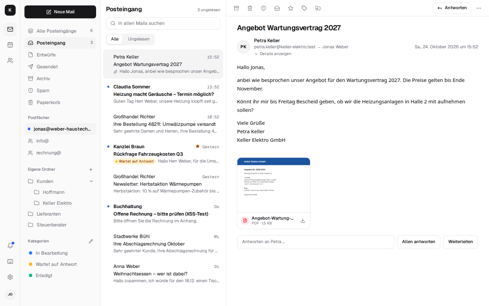

<div align="center">

<h1>Kontext: self-hosted Google Workspace and Microsoft 365 alternative</h1>

**Mail, calendar, contacts, tasks, team chat and phone (CTI) for small businesses – on your own server.**<br>
Shared mailboxes, a team calendar and contacts that connect everything: every customer's mails, appointments, tasks and calls at a glance.<br>
Open source (AGPL), a web app and PWA on top of the Stalwart mail server, no per-seat pricing. Made in Europe.

**English** · [Deutsch](README.de.md)

[](https://github.com/firsttris/kontext/actions/workflows/ci.yml)
[](https://firsttris.github.io/kontext/)
[](LICENSE)
[](https://stalw.art)
[](https://jmap.io)
[](https://firsttris.github.io/kontext/installation.html)

```bash
docker compose -f deploy/compose.yaml up -d
```

[Why](#-why-kontext) •
[Privacy](#-your-data-your-rules) •
[Install](#-install) •
[Features](#-features) •
[Telephony (CTI)](#-telephony-cti-with-the-fritzbox) •
[Screenshots](#-screenshots) •
[Alternatives](#-kontext-and-the-alternatives) •
[FAQ](#-faq) •
[Documentation](https://firsttris.github.io/kontext/)



</div>

## 💡 Why Kontext?

Google Workspace and Microsoft 365 are convenient – but every user costs money every month, and
the data sits with a US corporation. Kontext feels the same in the browser and on the phone, but
runs on **your** server: a small VPS from about €5 a month (e.g. IONOS or Hetzner) or a machine of
your own.

- **You own everything**: mails, appointments, contacts, chat and calls live on your server, not with a provider.
- **No per-seat pricing**: ten people cost the same as one; you pay for the server.
- **Context instead of silos**: every contact with their latest mails, upcoming appointments, open tasks and calls – a small CRM without another tool.
- **One app instead of five**: mail, calendar, tasks, team chat with video calls, the office phone and documents, with one sign-in.
- **Phone and desktop alike**: every view is built for the phone, with a tab bar you can fill with the apps you use most; install it as an app on any device – no app store needed.
- **Open**: open source (AGPL), standard protocols (JMAP, IMAP, SMTP, CalDAV, CardDAV) – Outlook, Thunderbird, iPhone and Android keep working.

**Who it's for:** freelancers and the self-employed, trades, law firms, medical practices and
small and mid-sized businesses (with a company admin area the boss can use without IT skills) –
and self-hosters who want a modern web client for [Stalwart](https://stalw.art).

## 🔒 Your data, your rules

- **GDPR**: the data stays on your server, in a European data centre if you like. No trackers, no ads, no sharing; the only data processing agreement you need is with your hosting provider.
- **GoBD** (German retention rules): nothing is deleted when someone leaves, and backups go encrypted to S3 storage with Object Lock, so they cannot be altered. (Compliance also depends on the company's processes; the software is one part of it.)
- **No lock-in**: take mails, contacts and calendars with you any time via IMAP, vCard and iCalendar; moving *to* Kontext is built in.
- **Secure**: two-factor sign-in, mails rendered in an isolated frame, warnings about forged senders, OpenPGP and S/MIME.

## 🚀 Install

On a server with Docker (or Podman), your own domain and open ports 25, 80, 443, 465, 587 and 993:

```bash
git clone https://github.com/firsttris/kontext /opt/kontext && cd /opt/kontext
cp deploy/.env.example deploy/.env      # domain, mail server name, secrets, backup target
chmod 600 deploy/.env                   # replace every change-me: Kontext refuses to start with them
docker compose -f deploy/compose.yaml up -d
```

Then create the domain, DKIM and users in Stalwart's admin (port 8080, only through an SSH tunnel or Tailscale),
enter Kontext's container network `10.89.250.0/24` as an allowed IP (otherwise wrong passwords can
get Kontext itself banned) and sign in at `https://<your domain>`. Ten users run fine on a VPS with 2 vCPUs and 4 GB RAM. Calls
(LiveKit), telephony and documents are Compose profiles you switch on when you need them. DNS
records, Podman Quadlets, backups and updates are in the
[installation guide](https://firsttris.github.io/kontext/installation.html) (German).

## ✨ Features

### ✉️ Mail

- **Shared mailboxes**: info@ and co. appear in every member's sidebar; replies go out as info@, with the name of the person who answered, and the list shows who already did ("Jonas · 14:02"). Rights per person: none, read only, read and send.
- **All inboxes in one list**, **folders and subfolders**, drag and drop also between info@ and your own folders.
- **Categories**: coloured tags like "In progress", "Waiting for reply", "Done" – several per mail, set by rules, shared in team mailboxes: a small task board.
- **Rules on the server** ("if sender, recipient, subject or text … then move, mark, categorise, forward, create a task") – they run as mail arrives, even when Kontext is closed.
- **Search like Gmail** across folders and mailboxes: `from:`, `to:`, `subject:`, `has:attachment`, `label:`, `in:info@`, `after:`/`before:`.
- **Snooze**, **undo send** and **send later** – the server sends it, even with your computer off. **Text snippets** for standard answers, own and shared.
- **Other mailboxes**: keep Gmail, GMX, WEB.DE and the like – new mail comes in every two minutes, and mail goes out as that address through its own server.
- **Protection against phishing and forged mail**: a warning when the sender is not verified, someone outside pretends to be your company, or replies go to another address; SPF, DKIM, DMARC and spam score in the details; mark as spam, and the filter learns.
- **Pictures from the internet** only when you ask (or at once for senders you trust), **unsubscribe** with one click, **read receipts** that never go out by themselves.
- **Signature per sender address**, **out-of-office reply** with dates, **who is writing?** next to the mail on wide screens (company, appointments, latest mails).
- **Conversations without the clutter**, **attachments with previews** (photos, first PDF page), **rich text**, **printing** on A4, **keyboard shortcuts** like Gmail, **live updates** over JMAP push.

### 📅 Calendar and 👥 contacts

- **Day, week, month and list**, drag to move, recurring events with exceptions, **invitations** with accept and decline.
- **Who is free?** The attendee field suggests colleagues as you type; inviting them shows who is busy and suggests times everyone is free, like Outlook's scheduling assistant.
- **Video meeting per event**: one click adds a link; customers join in the browser without an account.
- **Places as you type**: the location field suggests addresses and businesses (OpenStreetMap, through your own server); "Open in Maps" opens Apple or Google Maps, on the phone straight to navigation.
- **Share calendars and address books** with colleagues – free/busy only, read, or edit.
- **The customer at a glance**: latest mails, upcoming appointments, open tasks, documents and "Call"; **contact photos**, **groups**, **vCard import and export**.
- **Other contacts** like Gmail: everyone you exchanged mails with who is in no address book, saved with one click; **merge and fix** duplicate contacts and names written in capitals.

### ✅ Tasks

- **List or Kanban board** for your own mailbox and one per shared mailbox, with your own columns and **repeating tasks**.
- **From a mail** (`t`), a chat message, a mail rule or a missed call; **quick entry** like "Call Hoffmann tomorrow".
- **Everywhere**: on the contact, in the calendar, in the bell; reminders as push notifications even with Kontext closed.
- **In Thunderbird and on your phone**: your boards as CalDAV task lists (DAVx⁵ with tasks.org, Apple Reminders), both ways.

### 💬 Team chat and video calls

- **Channels** (#allgemein, one per shared mailbox, your own) and **direct messages**, live with "typing …", who is online, **@mentions**, **threads**, **reactions** and a **profile photo** for everyone (also on calls, tasks and mail between colleagues).
- **Mails, tasks, contacts and documents as cards**: "Discuss" on a mail (`b`) talks about it in the channel instead of forwarding it internally – nothing is copied.
- **Photos and files**, **voice messages** as on WhatsApp (record, play right in the conversation, faster at 1.5× or 2×), **search**, **retention** set by the company admin.
- **Calls, video calls and screen sharing** right from a conversation, on your own server with [LiveKit](https://github.com/livekit/livekit); the call stays open while you switch to mail.
- **Confidential conversations**, end-to-end encrypted – messages, files and calls.

### 📞 Telephony (CTI) with the Fritzbox

Computer telephony integration for the office phone: a small **telephone box** (Asterisk in a
container, on a thin client, a Raspberry Pi or a NAS) joins your Fritzbox as an IP phone. Numbers
and desk phones stay as they are; nothing in the office is opened to the internet.


- **Calls ring in Kontext** with who it is – contact, company, last mail, next appointment – on every chosen person's screen and phone; answer in the browser (softphone) or at the desk phone.
- **Click to call** from any contact or mail; a keypad for voice menus; a **call list** with notes and "call back".
- **Missed calls become tasks** that tick themselves off once someone talked to that number.
- **Voicemail as mail**: the greeting is recorded in the browser; messages arrive as mail with the recording.
- **Opening hours** with closed days and public holidays, a **voice menu** ("press 1 for service …"), a **block list**.
- **Transfer, hold, consult and three-way calls**; ring everyone at once or one after another, plus a mobile phone after a while; **direct numbers** per team.
- **Snom desk phones** provisioned by the box, **presence** and *Do not disturb*, the **door intercom**, **fax as PDF mail**, **call recording** with a notice, **call statistics**.

More in the [telephony docs](https://firsttris.github.io/kontext/telephony.html) (being tested).

### 🔐 Encryption

- **OpenPGP in the browser**: your own key, kept locked; read, sign and encrypt mail, keys of others from Autocrypt, WKD and keys.openpgp.org.
- **S/MIME** for authorities and law firms: import your certificate, check signatures with chain and OCSP, find certificates in DNS.
- **Send confidentially to anyone**: recipients with a key get PGP or S/MIME, everyone else a link to your own server and a code you pass on by phone.
- **Basic protection for everything**: TLS on the way (MTA-STS, DANE checked in the company admin), encrypted disk and backups.

The [encryption concept](https://firsttris.github.io/kontext/encryption.html) explains what is protected from whom.

### 📄 Documents

- **Word, Excel, PowerPoint and PDF** in Kontext's window with [Schreibzeug](https://github.com/firsttris/schreibzeug) (optional): no second sign-in, a folder per shared mailbox.
- **Attachments into Documents**, **attach from Documents**, and files linked to tasks, contacts, appointments and chat messages.

### 🤖 AI agents (MCP)

- **Kontext is an MCP server**: add it to Claude as a connector (OAuth) or give an agent an access key. It looks up customers, mails, appointments and tasks with your rights and, if you allow it, writes drafts and creates appointments, contacts and tasks.
- **Nothing leaves by itself**: no sending, no deleting; every change is logged, every connection can be revoked.

### 🏢 Company admin and moving in

- **Add people**, reset passwords and second factors, **lock access**; **shared mailboxes** with rights per person; extra addresses.
- **Out-of-office for colleagues** with a deputy, **company signature** for everyone, **offboarding** without deleting anything.
- **Move in** from Microsoft 365, Gmail, GMX and other IMAP providers (kept in sync until you switch), from Outlook (PST) and from a Google export.

### 📱 On every device

- **An app on every device** (PWA): install it from the browser on desktop, Android and iPhone, unread count on the icon, share photos into a new mail, open `mailto:` links in Kontext.
- **Notifications** even with Kontext closed (Web Push, end-to-end encrypted): new mail, direct messages, @mentions, task reminders and incoming calls.
- **Light or dark** (mails written for white paper follow along), **two-factor sign-in**, **storage at a glance**.

## 📸 Screenshots

<table>
  <tr>
    <td width="50%"><br><sub><b>Shared mailbox</b> – info@ for the whole team · <a href="https://firsttris.github.io/kontext/mail.html">docs →</a></sub></td>
    <td width="50%"><br><sub><b>Writing</b> – rich text, quote, sender · <a href="https://firsttris.github.io/kontext/mail.html#schreiben">docs →</a></sub></td>
  </tr>
  <tr>
    <td><br><sub><b>Calendar</b> – week, month, availability · <a href="https://firsttris.github.io/kontext/calendar-contacts.html">docs →</a></sub></td>
    <td><br><sub><b>Contacts</b> – the customer at a glance · <a href="https://firsttris.github.io/kontext/calendar-contacts.html#kontakte">docs →</a></sub></td>
  </tr>
  <tr>
    <td><br><sub><b>Tasks</b> – a Kanban board per mailbox · <a href="https://firsttris.github.io/kontext/tasks.html">docs →</a></sub></td>
    <td><br><sub><b>Team chat</b> – mails as cards, tasks from messages · <a href="https://firsttris.github.io/kontext/chat.html">docs →</a></sub></td>
  </tr>
</table>

<p align="center">
  
</p>

<p align="center">
  
  
  
  
</p>

## 🔀 Kontext and the alternatives

Kontext is made for a small business that wants Google Workspace comfort on its own server, with
mail, calendar, chat and the office phone in one place.

| | What it is | How Kontext differs |
| --- | --- | --- |
| [Google Workspace](https://workspace.google.com) | Gmail, Calendar, Drive and Meet as a per-user subscription | your own server, no per-seat cost, data in Europe |
| [Microsoft 365](https://www.microsoft.com/microsoft-365) | Outlook, Teams and Office as a per-user subscription | runs in the browser without Outlook, chat and phone included, data on your own server |
| [Nextcloud](https://nextcloud.com) | self-hosted file sync with mail, calendar and Talk as apps | built around mail and the customer: shared mailboxes, team rules and categories, the office phone; files through Schreibzeug |
| [Roundcube](https://roundcube.net), [SOGo](https://www.sogo.nu) | proven webmail and groupware clients for IMAP | modern interface built for the phone, JMAP push, contacts with a customer view, tasks and chat |
| [Zimbra](https://www.zimbra.com), [Open-Xchange](https://www.open-xchange.com) | groupware suites for providers and larger companies | one small server per company, set up in an afternoon, a company admin area for the boss |
| [3CX](https://www.3cx.com), [Placetel](https://www.placetel.de) | phone systems with CTI apps | keeps your Fritzbox and numbers, calls arrive next to the customer's mails, no licence per extension |
| Bulwark | JMAP webmail for Stalwart | calendar, contacts, tasks, chat, telephony and a company admin area |

## ❓ FAQ

### What does it cost?
The software is free (AGPL). You need a server – a VPS from about €5 a month – and someone who
sets it up and keeps it updated.

### Is there a web interface for the Stalwart mail server?
Yes, that is what Kontext is: a JMAP web client for mail, calendar and contacts on
[Stalwart](https://stalw.art), plus tasks, chat, telephony and a company admin area that manages
Stalwart's accounts and groups. See the [architecture](https://firsttris.github.io/kontext/architecture.html).

### Does Kontext work with my Fritzbox (CTI)?
Yes. A telephone box in the office registers as an IP phone at the Fritzbox; calls then ring in
Kontext with the caller's contact, last mail and next appointment, and you call out from any
contact. See [Telephony](https://firsttris.github.io/kontext/telephony.html).

### Can it run on my own PC or NAS?
Yes, Kontext runs wherever Docker or Podman runs. To receive mail from the internet the machine
needs port 25 reachable from outside, a fixed IP address and a reverse DNS entry; home internet
connections usually block port 25. At home it works best with a mail relay in front – a small VPS
is simpler. The telephone box runs on a NAS, a Raspberry Pi or a thin client in the office.

### Is it GDPR compliant?
It is built for it: the data stays on your server, without trackers or third parties. You sign a
data processing agreement with your hosting provider; with a server in your own building not even
that. For German retention rules (GoBD) nothing is deleted when someone leaves, and backups go
encrypted to S3 storage with Object Lock.

### Do iPhone, Android, Outlook and Thunderbird keep working?
Yes. Stalwart speaks IMAP, SMTP, CalDAV and CardDAV; every mail program and phone can connect
directly. Kontext is the browser interface on top, and its tasks are CalDAV task lists too.

### Can I move from Gmail, Microsoft 365 or Outlook?
Yes, under *Settings → Company → Move*: IMAP mailboxes (kept in sync until the move is finished),
Microsoft 365 through an app in the company's Microsoft account, Outlook as a PST file, contacts and
calendars from a Google export. See [Company admin and moving in](https://firsttris.github.io/kontext/company.html).

### Can I keep using my Gmail address?
Yes, under *Settings → Other mailboxes*: new mail comes into Kontext, and you send as that address
through the provider's server, so recipients see it as genuine.

### Can I use Claude or other AI agents with my mail?
Yes, Kontext is an MCP server. An agent works with your rights, writes drafts instead of sending,
and never deletes anything. See [AI agents](https://firsttris.github.io/kontext/agents.html).

### Which languages?
The app is in German for now; English and other European languages are planned.

## 📚 Documentation

The full documentation (German), with search, is at **[firsttris.github.io/kontext](https://firsttris.github.io/kontext/)**.

| | |
| --- | --- |
| [Mail](https://firsttris.github.io/kontext/mail.html) | shared mailboxes, categories, rules, search, other mailboxes, sender checks |
| [Calendar and contacts](https://firsttris.github.io/kontext/calendar-contacts.html) | sharing, availability, video meetings, customer view, vCard |
| [Tasks](https://firsttris.github.io/kontext/tasks.html) | boards, tasks from mails and rules, CalDAV for Thunderbird and phones |
| [Team chat and video calls](https://firsttris.github.io/kontext/chat.html) | channels, cards, LiveKit calls, confidential conversations |
| [Telephony (CTI)](https://firsttris.github.io/kontext/telephony.html) | Fritzbox, telephone box, voicemail, opening hours, transfer, Snom, fax |
| [Documents](https://firsttris.github.io/kontext/documents.html) | Schreibzeug as a module, folders per shared mailbox |
| [Encryption](https://firsttris.github.io/kontext/encryption.html) | OpenPGP, S/MIME, sending confidentially, end-to-end encrypted chat |
| [AI agents (MCP)](https://firsttris.github.io/kontext/agents.html) | tools, OAuth and access keys, what an agent may do |
| [Company admin and moving in](https://firsttris.github.io/kontext/company.html) | employees, shared mailboxes, offboarding, Microsoft 365, Gmail, PST |
| [Installation](https://firsttris.github.io/kontext/installation.html) | server, DNS, Stalwart, calls, telephony, documents, backups, updates |
| [Architecture](https://firsttris.github.io/kontext/architecture.html) | how Kontext, Stalwart, LiveKit and the box fit together |
| [Development](https://firsttris.github.io/kontext/development.html) | local setup with test data, tests, CI and releases |

What comes next is in the [roadmap](ROADMAP.md) (German).

## 🛠️ Development

Needs [Bun](https://bun.sh) 1.4 and Linux or macOS.

```bash
git clone https://github.com/firsttris/kontext && cd kontext
bun install
bun run dev   # Stalwart with test data, server and app: http://localhost:5173
```

Sign in as `jonas@weber-haustechnik.test` / `kaffee-werkbank-kontext` (the boss, sees the company
admin too); `anna@`, `sandra@` and `max@` share the password, info@ and rechnung@ are shared
mailboxes. `bun run dev:stalwart -- --fresh --seed` resets the test data.

React, TanStack Router/Query, Tailwind and Tiptap in the browser; a small Bun server with Hono,
Better Auth and SQLite (Drizzle) for sign-in, JMAP to Stalwart, chat and tasks; LiveKit for calls,
Asterisk in the telephone box. Tests, CI and releases: [Development](https://firsttris.github.io/kontext/development.html).

## 🤝 Contributing

Issues and pull requests are welcome. A good bug report names the browser or phone, the view and
what was shown (a screenshot helps). Before a pull request please run
`bun run check && bun run e2e`.

---

<div align="center">

⭐ Like Kontext? A [star on GitHub](https://github.com/firsttris/kontext) helps others find it.<br>
🐛 [Report a bug](https://github.com/firsttris/kontext/issues/new) · 💡 [Request a feature](https://github.com/firsttris/kontext/issues/new)

<sub>License: <a href="LICENSE">AGPL-3.0</a> · © Tristan Teufel and contributors · <a href="README.de.md">Deutsche Version</a><br>
Changed versions you pass on or run for others must offer their source code under the AGPL; a commercial license without these obligations is available via <a href="https://teufel-it.de">teufel-it.de</a>.<br>
Kontext is not affiliated with Stalwart Labs, AVM (FRITZ!Box), Snom, Google, Microsoft or Anthropic.</sub>

</div>
