<div align="center">

<h1>Feels familiar. Belongs to you.</h1>

**Kontext: mail, calendar, chat, documents and phone for your team – on your own server, open source**

No per-seat pricing. Made in Europe.

**English** · [Deutsch](README.de.md)

[](https://github.com/firsttris/kontext/actions/workflows/ci.yml)
[](https://github.com/firsttris/kontext/releases/latest)
[](https://hub.docker.com/r/tristanteu/kontext)
[](https://hub.docker.com/r/tristanteu/kontext/tags)
[](https://firsttris.github.io/kontext/)
[](LICENSE)
[](https://stalw.art)
[](https://jmap.io)
[](#-why-kontext)
[](#-why-kontext)

[Why](#-why-kontext) •
[Install](#-install) •
[Features](#-features) •
[Screenshots](#-screenshots) •
[Alternatives](#-kontext-and-the-alternatives) •
[FAQ](#-faq) •
[Documentation](https://firsttris.github.io/kontext/)

<a href="https://firsttris.github.io/kontext/en/">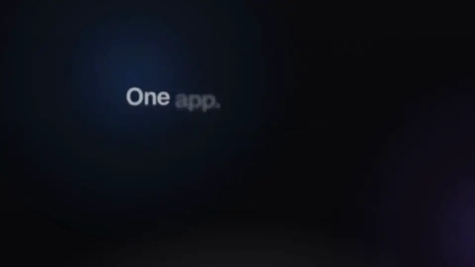</a>

▶️ **[Watch the whole film (2 minutes)](https://firsttris.github.io/kontext/en/)** – every module, made from the real app

🖱️ **[Try the demo](https://firsttris.github.io/kontext/demo/)** – mail, calendar, contacts, documents, chat, tasks and the phone with the test data, in your browser, nothing to install

</div>

## 💡 Why Kontext?

Google Workspace and Microsoft 365 are convenient, but every user costs money every month and the
data sits with a US corporation. Kontext works just as well in the browser and on the phone, and
runs on **your** server: a small VPS from about €5 a month (e.g. at IONOS or Hetzner) or a machine
of your own.

- **Your data stays with you (GDPR)**: mails, appointments, contacts, chat and calls live on your
  server, in Europe or in your own office. No US provider, no trackers.
- **No per-seat pricing**: ten people cost the same as one; you pay for the server.
- **Everything about a customer in one place**: their latest mails, next appointments, open tasks
  and calls – a small CRM without another tool.
- **One app instead of five**: mail, calendar, tasks, team chat with video calls, the office phone
  and documents, with one sign-in.
- **Built for the phone too**: every view works on the phone, swipe a mail to archive it, and it
  installs as an app without an app store.
- **AI if you want it**: Claude and other assistants find customers, mails and appointments for you
  and write drafts – they never send or delete anything.
- **Open, no lock-in**: open source (AGPL) and standard protocols, so Outlook, Thunderbird, iPhone
  and Android keep working and you can take everything with you.

**Who it's for:** freelancers · trades · law firms and medical practices · small and mid-sized
businesses · self-hosters looking for a web client for [Stalwart](https://stalw.art).

## 🚀 Install

### 1. Let an agent set it up

Give Claude Code or another coding agent this repository and SSH access to your server and say:
"Set up Kontext on my server following the [installation guide](https://firsttris.github.io/kontext/installation.html)."

### 2. Manually

On a server with Docker (or Podman), your own domain and open ports 25, 80, 443, 465, 587 and 993:

```bash
# The configuration (compose.yaml, .env.example, Caddyfile, backups); the programs come from Docker Hub
git clone https://github.com/firsttris/kontext /opt/kontext && cd /opt/kontext
cp deploy/.env.example deploy/.env && chmod 600 deploy/.env
nano deploy/.env                              # domain, version, backup target, replace every change-me
docker compose -f deploy/compose.yaml up -d   # pulls Kontext, Stalwart and Caddy and starts them (or Podman)
```

Then the main steps in Stalwart's admin (port 8080, only through an SSH tunnel or Tailscale); the
[guide](https://firsttris.github.io/kontext/installation.html#3-stalwart-einrichten) lists all of them:

1. Set up the domain and DKIM and create the boss's account; the boss adds everyone else in Kontext.
2. Enter Kontext's network `10.89.250.0/24` as an allowed IP, so that wrong passwords never get
   Kontext itself banned.
3. Create the API key for the company admin, put it into `deploy/.env` as `STALWART_ADMIN_KEY` and
   start Kontext again ([how](https://firsttris.github.io/kontext/installation.html#firmenverwaltung-einschalten)).
4. Register Kontext as the first-party OAuth client `kontext` (redirect URI
   `https://kontext.invalid/oauth`) and allow directory queries (*Sharing*); Stalwart 1.0 signs in
   only clients it knows and hides the colleagues otherwise.
5. Sign in at `https://<your domain>`.

Calls and documents (Schreibzeug, no install of its own needed) are switched on in `.env.example`; to leave them out, remove them from
`COMPOSE_PROFILES`. Telephony adds a small box in the office. Ten users run fine on a VPS with
2 vCPUs and 4 GB RAM. Everything else – DNS, Podman, backups, updates – is in the
[installation guide](https://firsttris.github.io/kontext/installation.html) (German).

## ✨ Features

| | |
|---|---|
| ✉️ **Mail** | **Shared mailboxes** like info@ with rights per person, **assign mails** with “Assigned to me” and “Open”, **a deputy in one step**, **categories** and **rules on the server**, search like Gmail, send later and snooze, **other mailboxes** (Gmail, GMX), **warnings about forged senders** · [more →](https://firsttris.github.io/kontext/mail.html) |
| 📅 **Calendar** | Day, week, month and recurring events, **invitations answered with one click** (also from Outlook and Google), **who is free?**, a **video meeting per event**, shared calendars and **subscriptions** (iCal), public holidays and the contacts' birthdays · [more →](https://firsttris.github.io/kontext/calendar-contacts.html) |
| 👥 **Contacts** | **The customer at a glance**: latest mails, next appointments, open tasks and calls; groups, vCard, merging duplicates, several contacts at once (delete, add to a group, export) · [more →](https://firsttris.github.io/kontext/calendar-contacts.html#kontakte) |
| ✅ **Tasks** | **List or Kanban board** per mailbox and per project, **from a mail, a chat message, an appointment or a missed call**, reminders, in Thunderbird and on the phone via CalDAV · [more →](https://firsttris.github.io/kontext/tasks.html) |
| 💬 **Team chat & video** | Channels and direct messages, **mails and tasks as cards**, threads with **"also send to channel"**, **reactions with any emoji**, voice messages, **video calls and screen sharing** on your own server, end-to-end encrypted conversations · [more →](https://firsttris.github.io/kontext/chat.html) |
| 📞 **Telephony (CTI)** | **Your Fritzbox and numbers stay**: calls ring in Kontext with the caller's contact and last mail, **click to call**, **voicemail as mail**, missed calls become tasks · [more →](https://firsttris.github.io/kontext/telephony.html) |
| 🔐 **Encryption** | **OpenPGP** and **S/MIME**, **send confidentially to anyone** through a link to your own server, encrypted backups · [more →](https://firsttris.github.io/kontext/encryption.html) |
| 📄 **Documents** | **Word, Excel, PowerPoint and PDF** in Kontext with [Schreibzeug](https://github.com/firsttris/schreibzeug), a folder per shared mailbox · [more →](https://firsttris.github.io/kontext/documents.html) |
| 🤖 **AI agents (MCP)** | Claude and other agents look up customers, mails and appointments with your rights, **write drafts** and **invite colleagues to appointments** – nothing goes outside the company, no deleting, every change logged · [more →](https://firsttris.github.io/kontext/agents.html) |
| 🏢 **Company admin** | **People, shared mailboxes and rights** without IT skills, **mail rules for each employee**, company signature with each person's phone and position, **legal footer under every mail**, sign-out after inactivity for shared computers, **offboarding without deleting**, backups at a glance, **moving in from Microsoft 365, Gmail and Outlook** · [more →](https://firsttris.github.io/kontext/company.html) |
| 📱 **On every device** | **An app on desktop, Android and iPhone** without an app store, **a short tour on the first start**, push notifications with **badges in the tab bar that show which app has news**, light and dark, two-factor sign-in, **built for keyboard and screen reader**, checked automatically against WCAG 2.2 AA on every push ([accessibility](https://firsttris.github.io/kontext/accessibility.html)) · [more →](https://firsttris.github.io/kontext/app.html) |

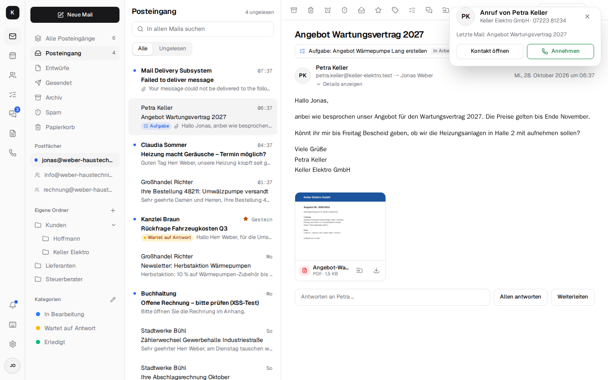

## 📸 Screenshots

<table>
  <tr>
    <td width="50%">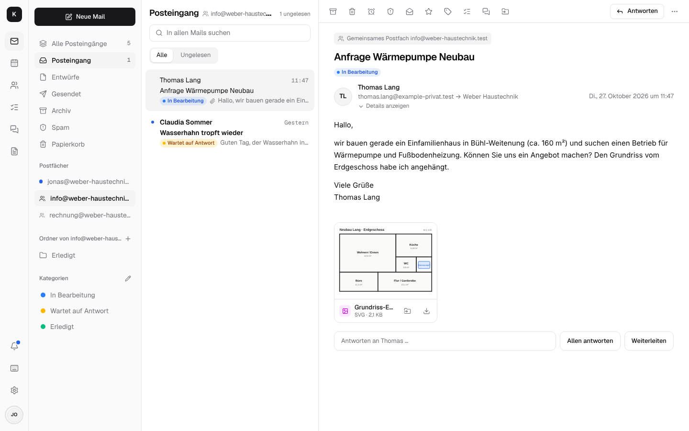<br><sub><b>Shared mailbox</b> – info@ for the whole team · <a href="https://firsttris.github.io/kontext/mail.html">docs →</a></sub></td>
    <td width="50%">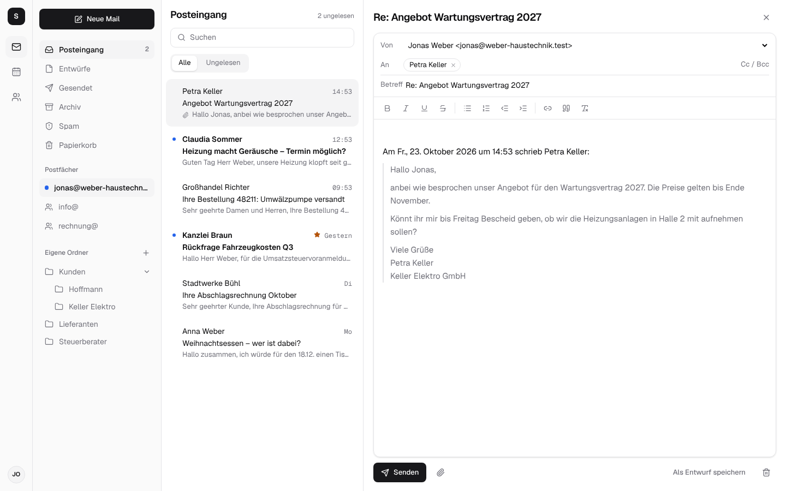<br><sub><b>Writing</b> – rich text, quote, sender · <a href="https://firsttris.github.io/kontext/mail.html#schreiben">docs →</a></sub></td>
  </tr>
  <tr>
    <td>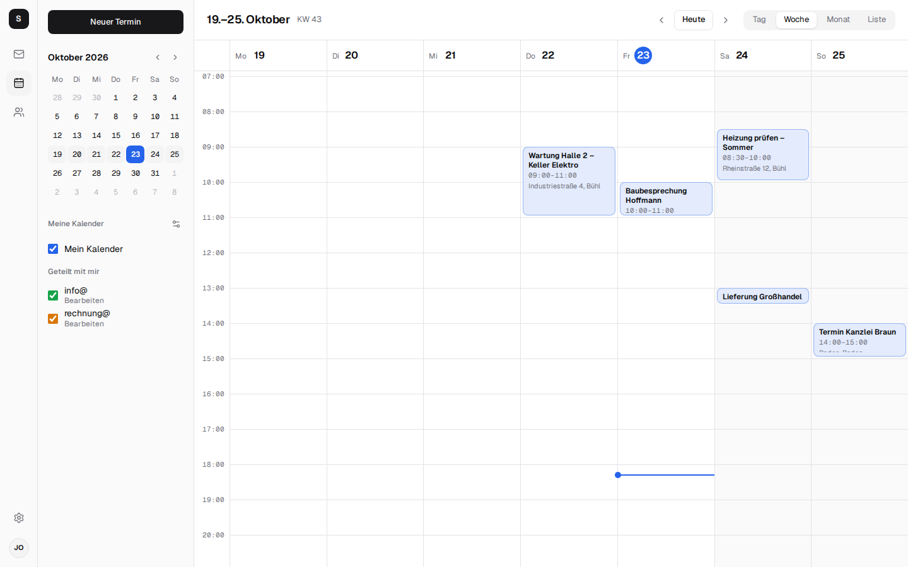<br><sub><b>Calendar</b> – week, month, availability · <a href="https://firsttris.github.io/kontext/calendar-contacts.html">docs →</a></sub></td>
    <td>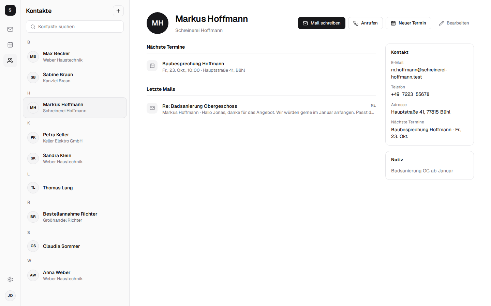<br><sub><b>Contacts</b> – the customer at a glance · <a href="https://firsttris.github.io/kontext/calendar-contacts.html#kontakte">docs →</a></sub></td>
  </tr>
  <tr>
    <td>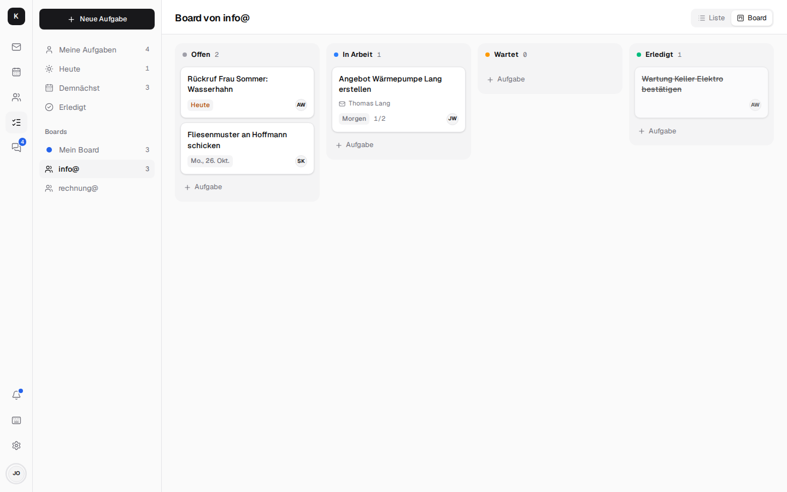<br><sub><b>Tasks</b> – a Kanban board per mailbox · <a href="https://firsttris.github.io/kontext/tasks.html">docs →</a></sub></td>
    <td>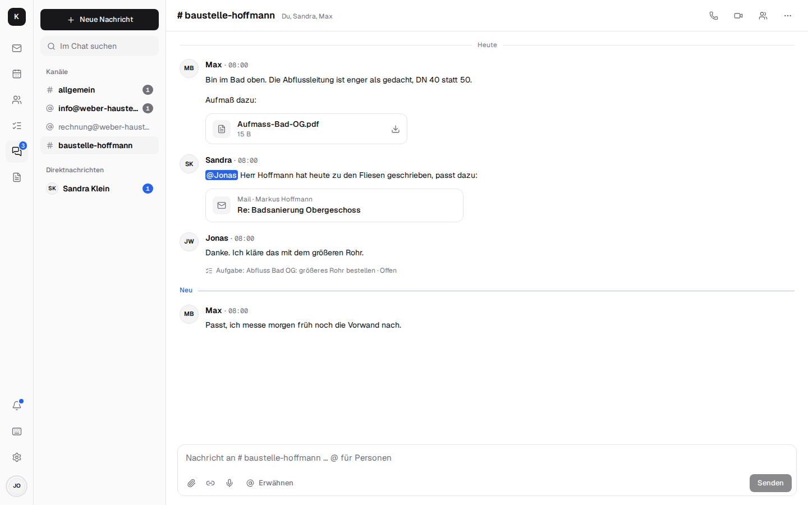<br><sub><b>Team chat</b> – mails as cards, tasks from messages · <a href="https://firsttris.github.io/kontext/chat.html">docs →</a></sub></td>
  </tr>
</table>

<p align="center">
  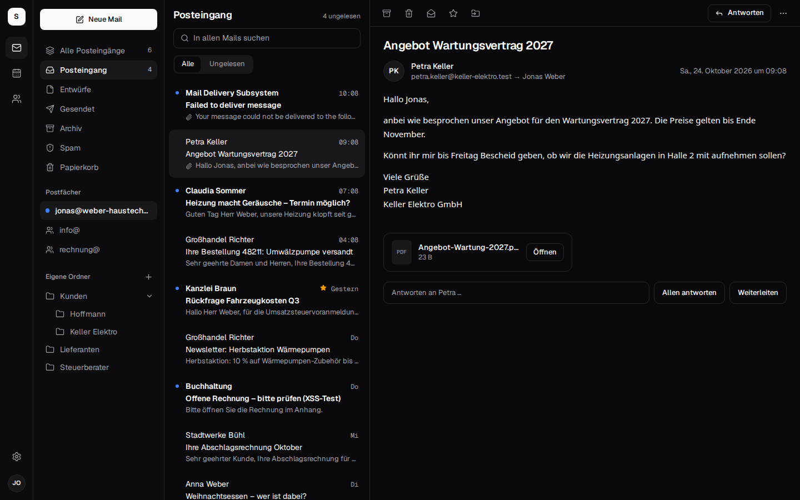
</p>

<p align="center">
  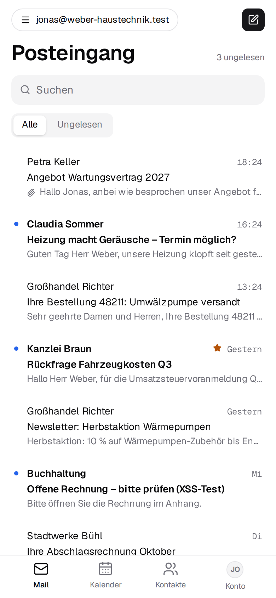
  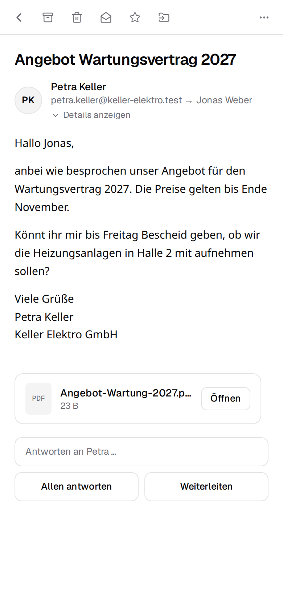
  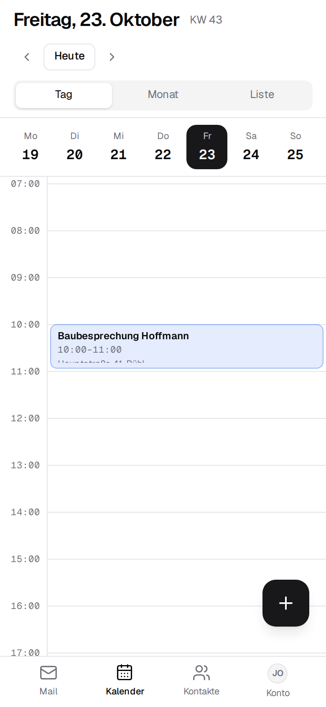
  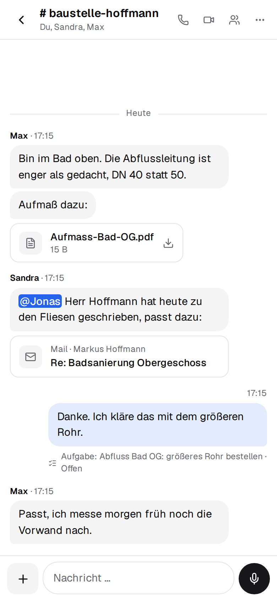
</p>

## 🔀 Kontext and the alternatives

Kontext is made for a small business that wants Google Workspace comfort on its own server, with
mail, calendar, chat and the office phone in one place.

| | What it is | How Kontext differs |
| --- | --- | --- |
| [Google Workspace](https://workspace.google.com) | Gmail, Calendar, Drive and Meet as a per-user subscription | your own server, no per-seat cost, data in Europe |
| [Microsoft 365](https://www.microsoft.com/microsoft-365) | Outlook, Teams and Office as a per-user subscription | runs in the browser without Outlook, chat and phone included, data on your own server |
| [Nextcloud](https://nextcloud.com) | self-hosted file sync with mail, calendar and Talk as apps | built around mail and the customer: shared mailboxes, team rules and categories, the office phone; files through Schreibzeug |
| [Roundcube](https://roundcube.net), [SOGo](https://www.sogo.nu) | proven webmail and groupware clients for IMAP | modern interface built for the phone, JMAP push, contacts with a customer view, tasks and chat |
| [Zimbra](https://www.zimbra.com), [Open-Xchange](https://www.open-xchange.com) | groupware suites for providers and larger companies | one small server per company, set up in an afternoon, a company admin area for the boss |
| [3CX](https://www.3cx.com), [Placetel](https://www.placetel.de) | phone systems with CTI apps | keeps your Fritzbox and numbers, calls arrive next to the customer's mails, no licence per extension |
| [Bulwark](https://www.bulwarkmail.org) | JMAP webmail with calendar and contacts for Stalwart | the customer view, shared mailboxes for the team, tasks, chat, telephony and a company admin area |

## ❓ FAQ

<details>
<summary><b>Is there an open-source alternative to Google Workspace and Microsoft 365?</b></summary>

Yes, Kontext: mail with shared mailboxes, calendar, contacts, tasks, team chat with video calls and
the office phone in one web app on your own server, with documents through
[Schreibzeug](https://github.com/firsttris/schreibzeug). See the [installation guide](https://firsttris.github.io/kontext/installation.html).
</details>

<details>
<summary><b>What does it cost?</b></summary>

The software is free (AGPL). You need a server – a VPS from about €5 a month – and someone who
sets it up and keeps it updated.
</details>

<details>
<summary><b>Is there a web interface for the Stalwart mail server?</b></summary>

Yes, that is what Kontext is: a JMAP web client for mail, calendar and contacts on
[Stalwart](https://stalw.art), plus tasks, chat, telephony and a company admin area that manages
Stalwart's accounts and groups. See the [architecture](https://firsttris.github.io/kontext/architecture.html).
</details>

<details>
<summary><b>Does Kontext work with my Fritzbox (CTI)?</b></summary>

Yes. A telephone box in the office registers as an IP phone at the Fritzbox; calls then ring in
Kontext with the caller's contact, last mail and next appointment, and you call out from any
contact. See [Telephony](https://firsttris.github.io/kontext/telephony.html).
</details>

<details>
<summary><b>Can it run on my own PC or NAS?</b></summary>

Yes, Kontext runs wherever Docker or Podman runs. To receive mail from the internet the machine
needs port 25 reachable from outside, a fixed IP address and a reverse DNS entry; home internet
connections usually block port 25. At home it works best with a mail relay in front – a small VPS
is simpler. The telephone box runs on a NAS, a Raspberry Pi or a thin client in the office.
</details>

<details>
<summary><b>Is it GDPR compliant?</b></summary>

It is built for it: the data stays on your server, without trackers or third parties. You sign a
data processing agreement with your hosting provider; with a server in your own building not even
that.
</details>

<details>
<summary><b>Is Kontext GoBD compliant?</b></summary>

No, Kontext is no mail archive. The German retention rules (GoBD) ask that business mail is kept
for years so that nobody can delete or change it; in Kontext people can delete their mail. For that
a GoBD archive belongs beside it. Kontext gives the pieces around it: nothing is deleted when
someone leaves, and backups go encrypted and unalterable (Object Lock) to S3 storage.
</details>

<details>
<summary><b>Do iPhone, Android, Outlook and Thunderbird keep working?</b></summary>

Yes. Stalwart speaks IMAP, SMTP, CalDAV and CardDAV; every mail program and phone can connect
directly. Kontext is the browser interface on top, and its tasks are CalDAV task lists too.
</details>

<details>
<summary><b>Can I move from Gmail, Microsoft 365 or Outlook?</b></summary>

Yes, under *Settings → Company → Migration*: IMAP mailboxes (kept in sync until the move is finished),
Microsoft 365 through an app in the company's Microsoft account, Outlook as a PST file, contacts and
calendars from a Google export. See [Company admin and moving in](https://firsttris.github.io/kontext/company.html).
</details>

<details>
<summary><b>Can I keep using my Gmail address?</b></summary>

Yes, under *Einstellungen → Weitere Postfächer* (Settings → Other mailboxes): new mail comes into Kontext, and you send as that address
through the provider's server, so recipients see it as genuine.
</details>

<details>
<summary><b>Can I use Claude or other AI agents with my mail?</b></summary>

Yes. Kontext is an MCP server, so Claude and other agents can look things up with your rights,
write drafts and invite colleagues to appointments; they never mail anyone outside or delete anything. See [AI agents](https://firsttris.github.io/kontext/agents.html).
</details>

<details>
<summary><b>Which languages?</b></summary>

German and English, per device under *Settings → Appearance → Language* (otherwise the browser's language). Other European languages are planned.
</details>

<details>
<summary><b>Is it secure?</b></summary>

Check it yourself, the code is open: let your agent run Cloudflare's [Security Audit Skill](https://github.com/cloudflare/security-audit-skill) or
Claude Code's `/security-review` on this repository.
Report vulnerabilities privately as described in [SECURITY.md](SECURITY.md).
</details>

## 📚 Documentation

The documentation opens with a tour in pictures, made to send to customers: **[in English](https://firsttris.github.io/kontext/en/)** and **[in German](https://firsttris.github.io/kontext/)**.

The full documentation (German), with search, is at **[firsttris.github.io/kontext](https://firsttris.github.io/kontext/)**:
[every feature in detail](https://firsttris.github.io/kontext/ueberblick.html), [installation](https://firsttris.github.io/kontext/installation.html),
[architecture](https://firsttris.github.io/kontext/architecture.html) and
[development](https://firsttris.github.io/kontext/development.html). What changed in each release,
with the steps an update needs, is in the [changelog](CHANGELOG.md); what comes next is in the
[roadmap](ROADMAP.md) (German).

## 🛠️ Development

Needs [Bun](https://bun.sh) 1.4 and Linux or macOS (Windows through WSL).

```bash
git clone https://github.com/firsttris/kontext && cd kontext
bun install
bun run dev   # Stalwart with test data, server and app: http://localhost:5173
```

Sign in as `jonas@weber-haustechnik.test` / `kaffee-werkbank-kontext` (the boss, sees the company
admin too); `anna@`, `sandra@` and `max@` share the password, info@ and rechnung@ are shared
mailboxes. `bun run dev:stalwart -- --fresh --seed` resets the test data.

React, TanStack Router/Query, Tailwind and Tiptap in the browser; a small Bun server with Hono,
Better Auth and SQLite (Drizzle) for sign-in, JMAP to Stalwart, chat and tasks; LiveKit for calls,
Asterisk in the telephone box. Tests, CI and releases: [Development](https://firsttris.github.io/kontext/development.html).

## 🧩 More from us

- Word, Excel and PowerPoint without Microsoft 365? **[Schreibzeug](https://github.com/firsttris/schreibzeug)** edits them in the browser and keeps them as .docx, .xlsx and .pptx.
- Doing your own books in Germany? **[Haben](https://github.com/firsttris/haben)**: invoices with e-invoicing, receipts, bank reconciliation and VAT returns via ELSTER.

## 🤝 Contributing

Issues and pull requests are welcome. A good bug report names the browser or phone, the view,
what happened and the Kontext version (a screenshot helps); the
[bug report form](https://github.com/firsttris/kontext/issues/new?template=bug_report.yml) asks for
all of it. Security problems please report privately, see [SECURITY.md](SECURITY.md). Before a pull
request please run the checks from [CONTRIBUTING.md](CONTRIBUTING.md):

```bash
bun run typecheck && bun run lint && bun run test && bun run build   # or: bun run check
bun run e2e                                                          # Playwright against its own Stalwart
mkdocs build --strict                                                # when docs/ changed
```

---

<div align="center">

⭐ Like Kontext? A [star on GitHub](https://github.com/firsttris/kontext) helps others find it.<br>
🐛 [Report a bug](https://github.com/firsttris/kontext/issues/new?template=bug_report.yml) · 💡 [Request a feature](https://github.com/firsttris/kontext/issues/new?template=feature_request.yml)

<sub>License: <a href="LICENSE">AGPL-3.0</a> · © Tristan Teufel and contributors · <a href="README.de.md">Deutsche Version</a><br>
Changed versions you pass on or run for others must offer their source code under the AGPL; a commercial license without these obligations is available via <a href="https://teufel-it.de">teufel-it.de</a>.<br>
Kontext is not affiliated with Stalwart Labs, AVM (FRITZ!Box), Snom, Google, Microsoft or Anthropic.</sub>

</div>
