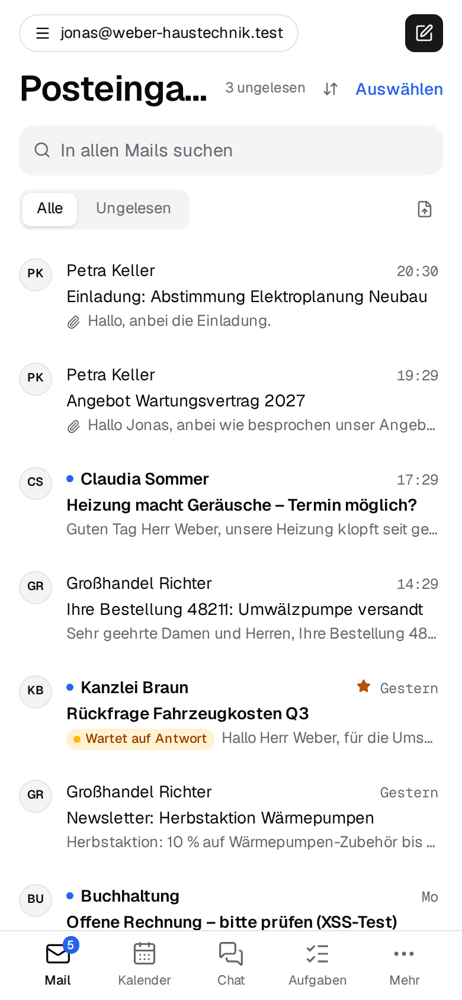
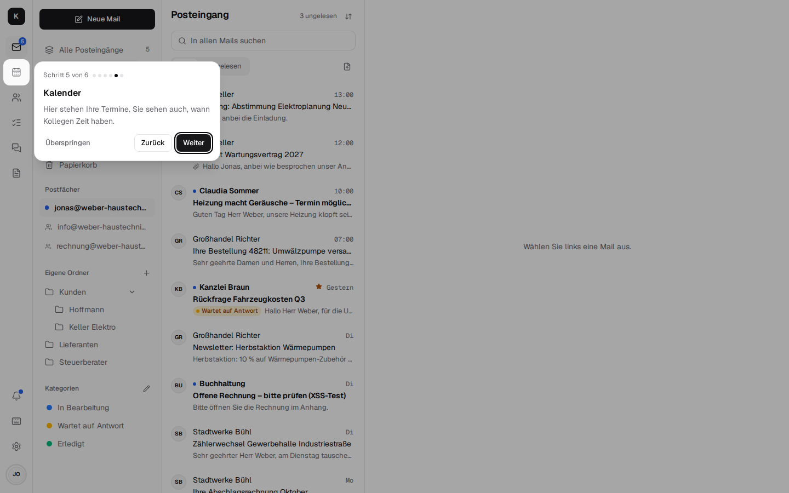
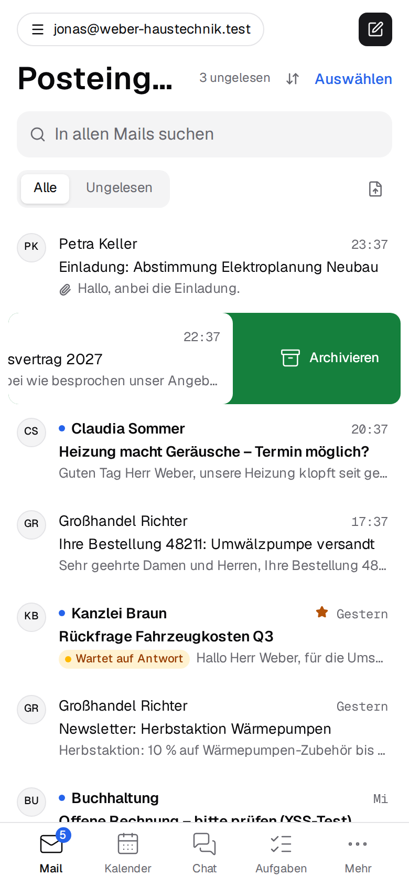

# App, phone and account { #app-handy-und-konto }

Kontext runs in the browser and can be installed like an app on any device – on the PC, on
Android and on the iPhone, without an app store. What is described here everyone sets up
themselves, most switches under *Settings → Appearance*, and they apply to that one device.

{ width="260" }

## Tour on first start { #einfuhrung-beim-ersten-start }

On first start, Kontext shows a short tour in four to six steps: where mail, calendar and chat
are, the "New mail" button and – for those who have one – a shared mailbox like info@. Each step
highlights the spot it is about: on the PC in the bar on the left, on the phone in the tab bar at
the bottom. "Next" and "Back" page through it, "Skip" or Esc end it.

- In a narrow window without the sidebar (between tablet and PC width), the steps about "New
  mail" and the shared mailboxes are left out, as there is nothing to show there.
- It comes once per person and device; so on the phone once more, because Kontext looks
  different there.
- To start it again: on the PC in the menu behind the profile picture at the bottom left, on the
  phone under "More", in both cases "Tour".

## Installing as an app { #als-app-installieren }

- **On the phone**, a card at the top of the mail list offers "Kontext as an app on your phone".
  On Android, "Install" opens the browser's dialog. On iPhone and iPad, tap "Share" in Safari,
  then "Add to Home Screen"; newer iOS versions only show "Share" after a long tap on the address
  bar or under "•••".
- **On the PC**, under *Settings → Appearance → App on this device*, click "Install as app", or
  choose "Install app" in the browser menu.
- Once installed, Kontext has a window and an icon of its own, the number of unread mails on the
  icon (all inboxes together) and shortcuts for New mail, Calendar and Contacts. You stay signed
  in until you sign out.
- **Without a network**, the app still starts and says "No connection"; new mails and changes
  come through as soon as the device is back online.

## Notifications { #benachrichtigungen }

"Notify me on this device" – in the bell at the top, under *Settings → Appearance* or via the
card in the mail list – reports new mails, chat messages to you (direct messages, @mentions), new
tasks, reminders for tasks and appointments and incoming calls, **even when Kontext is completely
closed**.

- Under "Notify about new emails from", mailboxes can be deselected, such as info@ for someone who
  only helps out there; this applies to all of the person's devices.
- On iPhone and iPad, notifications only work in the installed app.
- If the browser blocks them, allow them for Kontext in the browser's site settings.
- When an appointment reminds you, and whether by notification or email, is set on the appointment
  ([Reminder per appointment](calendar-contacts.md#kalender)).
- The bell itself shows unread mails of the last few days, open invitations and today's
  appointments. More on this in the [architecture](architecture.md#benachrichtigungen).

## On the phone { #am-handy }

- Every view is a screen of its own; at the bottom is the **tab bar** with four apps and "More",
  at first Mail, Calendar, Chat and Tasks. Under *Settings → Appearance → Tab bar on phone* you
  choose an app per slot; all others are under "More". "Reset" puts the bar back as it was at
  first.
- A number on the app in the tab bar shows where a notification belongs: unread mails (the same
  number as "All inboxes" and on the app icon), invitations for the next two weeks waiting for a
  reply, newly assigned tasks and unread chat messages. If the app is under "More", "More" carries
  the number. On the PC, the same numbers are on the bar on the left.
- "Back" and swiping from the edge go back to where you came from, such as from the conversation
  to the list.
- **Swiping mails:** in the mail list, swiping a mail to the left archives it, to the right marks
  it read or unread. What each direction does (Archive, Delete, Read / unread, Flag or Nothing) is
  set under *Settings → Appearance → Swiping in the mail list*, per device. It only counts from
  about a third of the width; shorter, the row snaps back. An unread row shown as a conversation
  is marked read with all its unread mails. If a long press has selected the mail, the finger no
  longer swipes after that.

  { width="260" }
- **Sharing into Kontext:** Kontext appears in other apps' share menu. Shared photos, files, texts
  and links Kontext shows first; "Use in new mail" opens a new mail with them as attachments.

## Appearance { #darstellung }

- **Color theme:** "Same as device", "Light" or "Dark", per device.
- **Language:** "Same as device" (the browser's language), "Deutsch" or "English", per device;
  when switching, Kontext reloads. Dates, times and numbers follow the language (English with the
  day before the month and the 24-hour clock).
- **Mail:** "Group emails into conversations" and how long "Undo send" holds a mail back (see
  [Mail](mail.md#schreiben)).
- **Swiping in the mail list:** what swiping left and right does on the phone
  (see [On the phone](#am-handy)).
- **Keyboard shortcuts** are at the bottom of the same page; on the PC, `?` shows them
  everywhere.

## Using it as the mail program { #als-mailprogramm-verwenden }

A click on an email address on a web page (`mailto:`) then opens a new mail in Kontext. The
installed app registers for this through its manifest; in the browser, click "Use as email app"
under *Settings → Appearance → App on this device*, and the browser asks whether Kontext should
open email links. The button only appears in browsers that can do this.

## Version and updates { #version-und-updates }

*Settings → Appearance → App on this device* shows which version is running on the device
("Kontext 0.1.6"). If a newer one is already running on the server, it is shown below. A new
version announces itself with "A new version of Kontext is available." and only takes over after
"Reload" – that way a mail you have started isn't lost. If all windows are closed, the new one
starts the next time anyway. Updates of the server are installed by the operator
([Installation, updates](installation.md#6-updates)).

## Profile, password and sign-in with code { #profil-passwort-und-anmeldung-mit-code }

- **Profile** (*Settings → Profile*): name and photo. Colleagues see the photo in the chat, on
  calls, on tasks and next to the mails.
- **Change password** under *Settings → Password and security*: with the current password and the
  new one twice. It applies to Kontext, phones and mail programs.
- **Sign-in with code** on the same page: in addition to the password, Kontext asks for a code
  from an authenticator app (e.g. Google Authenticator, Microsoft Authenticator, 1Password). "Set
  up", scan the QR code with the app (or enter the key by hand), enter the code shown and the
  password, "Turn on". Turning it off needs the password and a current code. The page shows at a
  glance whether it is on.
- **Access** (*Settings → Access*): who and what accesses your account, in one place. The
  signed-in browsers ("Firefox on Windows", "Safari on iPhone") with "signed in", "last active"
  and IP address; your own is marked "This device". Each other one can be signed out on its own,
  or all others at once – after losing a phone, say. Plus other programs that signed in to the
  mail server directly via OAuth ("Revoke access"), the app passwords, the AI agents and the other
  mailboxes, each with a way to where they are managed. [More](architecture.md#zugange)
- **Lost the phone with the authenticator app:** the company admin resets the sign-in with code
  (*Settings → Company → Employees*); after that you sign in with the password only again and set
  up the code anew ([company admin](company.md)).
- Mail programs and phones keep connecting directly to the mail server (IMAP, SMTP, CalDAV,
  CardDAV); tasks are there as CalDAV task lists ([Tasks](tasks.md)).
