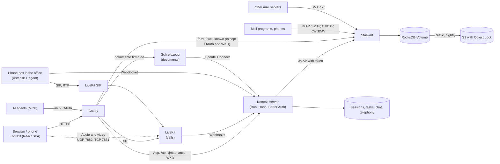
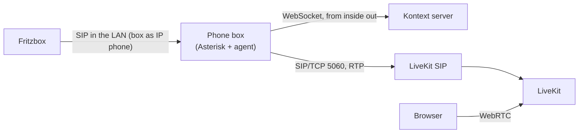
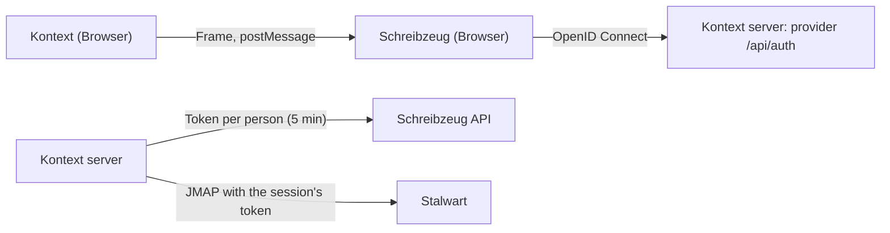

# Architecture { #architektur }

## The parts { #die-teile }

- **Stalwart** (Community Edition, AGPL, version 1.0) is mail, calendar and contacts server in
  one. Since 0.16 its whole configuration lives in its database; the only file on disk is
  `config.json` with the storage location.
- **Kontext** is a single-page app. It speaks [JMAP](https://jmap.io): mail (RFC 8621),
  calendars (JSCalendar) and contacts (JSContact) over the same interface, push over the
  event stream.
- **The Kontext server** (Bun, Hono, Better Auth, SQLite) serves the app, takes care of
  sign-in and passes JMAP through to Stalwart, using the session's Stalwart token; the browser
  knows neither password nor token. Because every sign-in comes from its one address, it slows
  down guessing itself (10 failed attempts per login name in 15 minutes, CalDAV included;
  "jonas" and "jonas@firma.de" count together, and the same wrong password again does not count
  anew – so a phone with an old password does not lock out a whole office) and is on Stalwart's
  list of allowed IPs, or Stalwart would block it.
  A session only ends when Stalwart rejects the refresh token, not when it happens not to
  answer. Anything that changes something with the session cookie (POST, PUT, PATCH, DELETE) must
  come from Kontext's own pages (`Sec-Fetch-Site`, otherwise `Origin`; `server/csrf.ts`) – or a
  page under the same domain, Schreibzeug for instance, could send requests with the cookie.
  No other frame may show Kontext (`frame-ancestors 'self'`).
- **Caddy** gets the certificate and forwards everything to the server, CalDAV/CardDAV for mail
  programs straight to Stalwart (`/dav/cal`, `/dav/card` …, `/.well-known/caldav` and
  `carddav`); the rest of `/dav` is Kontext's task lists. Under `mta-sts.<domain>` it serves
  Stalwart's MTA-STS policy, under `openpgpkey.<domain>` Kontext's WKD.
- **LiveKit** (Apache 2.0, optional) carries the [calls](#anrufe) in the chat: an SFU that
  distributes sound, video and shared screens between the browsers.
- **The phone box** (optional, `box/`) sits in the customer's office: Asterisk and a small agent
  that register with the Fritzbox as an IP phone and bring calls into Kontext over **LiveKit SIP**
  (see [Telephony](#telefonie)).
- **Schreibzeug** (optional) is the [Documents](#dokumente) module, a service of its own under an
  address of its own; Kontext is its sign-in provider.

## Shared mailboxes { #gemeinsame-postfacher }

In Stalwart a shared mailbox is a **group** with an address of its own. Every member sees the
group as an extra account in their JMAP session (`isPersonal: false`) – with folders, mail and a
sender address. Kontext shows these accounts under "Mailboxes"; whoever replies there writes as
info@ automatically. The sender name is then the person and the mailbox, such as "Jonas Weber
(Weber Haustechnik)" – so the customer, and every colleague in the shared Sent folder, can see who
replied.

The rights to a shared mailbox:

| Level                | In Stalwart                                                    | In Kontext                                                   |
| -------------------- | -------------------------------------------------------------- | ------------------------------------------------------------- |
| **Manage**           | member of the group                                            | everything, sending as info@                                  |
| **Read and send**    | member of the group (Stalwart makes no finer distinction)      | like Manage                                                   |
| **Read only**        | folders shared via `shareWith` (`mayReadItems`, `maySetSeen`) | read; Archive, Delete, Move are missing; replies from one's own account |

Kontext sets up the toolbar from the folder's `myRights`. Whoever has no sender address in the
mailbox (Stalwart gives identities to members only) replies from their own account; the reply then
lands in their own Sent folder. Both levels are set in the company admin; "Read only" shares all
the mailbox's existing folders (not folders created later).

The server (tasks, categories, snippets, chat, DAV) does not read the level from the session's
`isReadOnly`: Stalwart (0.16 and 1.0 alike) sends every additional account with `isReadOnly: false`
and `isPersonal: false`, even that of a colleague who only shares an address book. A member of a
group is whoever's account Stalwart gives `mayCreateCalendar` (or `mayCreateAddressBook`); for
everyone else `server/account-rights.ts` asks for the folders with `Mailbox/get`: no folders, no
mailbox; whoever's inbox grants `mayAddItems` may write.

### Assigning mail { #mails-zuweisen }

In a shared mailbox, "Assign" gives a mail to a person and checks it off as done. This is stored
on the mail itself, as shared **JMAP Object Metadata** (draft-ietf-jmap-metadata, new in Stalwart
1.0): under Kontext's namespace `kontext.firsttris.github.io` are `assignee` (the person's
principal id, which in Stalwart is also their account id) and `state: "done"`. Stalwart needs a
vendor name in domain form for custom namespaces (`crates/types/src/metadata/registry.rs`); it only
patches into a namespace once that exists, so Kontext always writes the whole of it
(`src/lib/assignment.ts`).

All members see the value (Email/get with `metadata/kontext.firsttris.github.io`), and
`Email/changes` reports it like any change, so it reaches the other windows by push. Stalwart runs
the filters itself (`crates/jmap/src/email/query.rs`): "Assigned to me" is `metadataTextEquals` on
`assignee` with one's own id and not done, "Open" is everything not done. The assignment lives with
the mail, so it is in the backup and moves with the mailbox; Kontext needs no table of its own for
it. In one's own mailbox there is neither menu nor filter. Snoozed mail that has come back is not
pinned to the top in these two filters – it belongs to somebody, after all. Only whoever the folder
grants `maySetMetadata` may write the assignment; "Read only" does not grant it, which is why the
menu is missing there.

The menu offers only the mailbox's members, plus whoever has the mail right now. JMAP does not name
the members of a group (the principal has none, `crates/jmap-proto/src/object/principal.rs`), so
the Kontext server reads them with its Stalwart key: `GET /api/company/mailbox-members` gives
everyone signed in the members of the mailboxes they are a member of themselves, without locked
accounts (`server/company/mailbox-members.ts`). If there is no answer, without the company admin
for instance, the menu offers everyone in the company.

### Moving between mailboxes { #verschieben-zwischen-postfachern }

"Move to …" shows the folders of all mailboxes, grouped by mailbox, the mail's own first
(`src/lib/move-targets.ts`); folders without `mayAddItems` are left out. Within one account the app
changes `mailboxIds` (`Email/set`). Into another account – from info@ into one's own folder
"Steuerberater" (tax adviser), say – it goes with `Email/copy` and `onSuccessDestroyOriginal` (RFC
8620 §5.4, RFC 8621 §4.7): Stalwart creates the mail there and deletes it here in the same request.
The copy only takes keywords and date along if they are sent with it; the app sends `keywords` and
`receivedAt` along, so read and flagged are kept.

The same works with the mouse: drag a row of the list onto a folder or a mailbox in the sidebar
(`src/features/mail/mail-drag.ts`, HTML drag and drop). Only mail from folders with
`mayRemoveItems` can be dragged; on the phone the menu remains.

So that one can see where a mail is, "Shared mailbox info@…" stands above the subject ("Mailbox
of …" for mailboxes handed over or shared by [delegation](#vertretung)), the label in "All inboxes"
carries the group icon, and the sidebar calls the folders of a shared mailbox "info@'s folders".

## Images from the internet { #bilder-aus-dem-internet }

Images from the internet tell the sender that the mail was opened. The mail only shows them on
request ("Load"); "Always from …" remembers the sender on the Kontext server (`image_senders`,
`/api/image-senders`, per person on all devices). Allowed are addresses, whole domains
(`@firma.de`) and, on request, every sender in one's own contacts (`@contacts`), in the settings
under "Password and security". Images load right away only if the mail really comes from the sender
(`src/lib/remote-images.ts`): a mail from outside must be verified for that sender's domain (DMARC,
or SPF/DKIM aligned); one with no check at all (imported, from colleagues) counts, one that failed
never does – a forged sender unlocks no images.

Blocked means: `sanitizeMailHtml` (`src/lib/html.ts`, CSS in `src/lib/mail-css.ts`) removes every
address the browser would fetch – `src`, `background`, `poster`, `href` of SVG images, `//host/…`
too, and in CSS `url(…)` and addresses in `image-set(…)` or in custom properties (`--u: "…"`) in
`style` attributes, in all other attributes that can be CSS (SVG: `fill`, `mask` …), and in
`<style>`; `@import` is dropped entirely – and counts them for "Load". For this the CSS is broken
up the way the browser reads it (CSS Syntax 3, `src/lib/css-tokens.ts`: comments, escapes, an open
`url(` at the end), the addresses the way the URL parser reads them (tabs and control characters are
dropped). Whatever fetches nothing stays character for character as it was: embedded images and
fonts (`cid:`, `data:`), text like `content: "https://…"`; once the images are allowed, also every
attribute except `style`. Behind that, a Content Security Policy in the frame's document
(`mailDocument`) forbids loading from outside until the images are allowed; the print page
(`src/lib/print.ts`) always forbids it.

## Delivery receipt { #zustellbestatigung }

A delivery status notification (DSN) comes from the mail server, not from the recipient
(`src/lib/envelope.ts`, `src/lib/dsn.ts`, `src/jmap/delivery-reports.ts`,
`src/features/mail/delivery-reports.tsx`):

- **Requesting:** With the switch in "New mail" the `EmailSubmission` gets an `envelope` of its own
  (RFC 8621 §7): every recipient from To, Cc and Bcc with `NOTIFY=SUCCESS,FAILURE`, `mailFrom` with
  `RET=HDRS` (the report brings back only the headers) and `ENVID` (RFC 3461). The mail gets its
  `Message-ID` from Kontext; its local part is the `ENVID`. Together with "Undo" or "Schedule send",
  `HOLDFOR`/`HOLDUNTIL` sits next to it.
- **Stalwart 0.16:** accepts the parameters and passes them on to its SMTP session
  (`crates/jmap/src/submission/set.rs`); the queue writes the report (`crates/smtp/src/queue/dsn.rs`)
  – also for delivery within its own server, with `Original-Envelope-Id` and the mail's headers as
  `message/rfc822`. The `EmailSubmission`'s `dsnBlobIds` stays empty; so Kontext looks for the
  reports among the mails.
- **Seeing:** Whether a sent mail asked for a report is in its `EmailSubmission`
  (`EmailSubmission/query` with `emailIds`). The search is for mails from the time of sending with
  its subject (Stalwart indexes the returned headers, not the status part), page by page in 50s up
  to 1000 mails – a failure report can arrive days later, after many mails with the same words;
  kept is whatever is a `multipart/report; report-type=delivery-status` and whose
  `Original-Envelope-Id` matches. A report itself shows its `message/delivery-status` part (RFC
  3464) at the top in readable form: per recipient delivered, not delivered, delayed or passed on
  without confirmation, the time and the `Diagnostic-Code`; the part no longer appears among the
  attachments.
- **Limits:** Whether a foreign server sends a report is up to it; if it cannot do DSN, the last
  server that can reports "passed on without confirmation" (`relayed`). Encrypted and signed mails
  (which Kontext builds itself and sends via `Email/import`) request no report. A mail without a
  subject looks for its report among the first 50 mails after sending.

## Read receipt { #lesebestatigung }

Stalwart does not know JMAP MDN (RFC 9007); Kontext builds read receipts per RFC 8098 itself
(`src/lib/mdn.ts`, `src/jmap/receipts.ts`, `src/features/mail/receipts.tsx`):

- **Requesting:** The switch with the checkmark envelope in the "New mail" window sets
  `Disposition-Notification-To` to one's own address.
- **Answering:** A mail with the request shows "… is asking for a read receipt" with "Send" and
  "Don't send" – never on its own. The app builds the receipt as `multipart/report` (one sentence
  for people, `message/disposition-notification` for programs, `In-Reply-To` pointing to the mail),
  puts it into "Sent" via `Email/import` and sends it from the address the mail went to. Both set
  `$MDNSent` (RFC 3503), after which nobody asks again – Stalwart returns keywords in lower case, so
  the comparison ignores case.
- **Seeing:** A sent mail with the request shows "Read by … · time". A receipt names the mail in
  `In-Reply-To`/`References` – or, with some programs, only in the `Original-Message-ID` field of
  its report part (RFC 8098 §3.2.5), often under a different subject ("Read: …", "Gelesen: …",
  "Zur Kenntnis genommen"). Stalwart indexes neither these headers nor the report part
  (`crates/email/src/message/index/search.rs`: `Headers` only when specially switched on). So the
  search, from the time of sending, is for mails **from one of the recipients or with the
  subject** (up to 20 recipients, page by page up to 500 hits, like the delivery reports through
  `src/jmap/search-pages.ts`); kept is whatever is a receipt (`Content-Type`) and names this mail.
  The app loads the report part only when the headers do not already name it.
- **Filing quietly:** Incoming receipts for one's own sent mail belong with the sent mail, not in
  the inbox. For every mailbox one may take mail out of (one's own and shared ones), on every change
  the app looks for unread receipts from the last 14 days in the inbox (`QuietReceipts`,
  `receiptsToFile`; the newest 100 first, so that other unread mail does not hide new receipts),
  reads their report part and compares it with the newest 200 sent mails to their senders. Only a
  receipt that names a mail in "Sent" which itself asked for a receipt moves, read, to the archive
  (created as when archiving, if there is none yet). Everything else – a mail that only looks like a
  receipt, one for an unknown mail – stays where it is. This happens in the open app, not on the
  server: Sieve could only go by appearance and cannot check a sent mail.

## Unsubscribing from newsletters { #newsletter-abbestellen }

If a mail has `List-Unsubscribe` (RFC 2369), "Unsubscribe" appears next to "Show details"
(`src/features/mail/unsubscribe.tsx`, route: `server/unsubscribe/unsubscribe.ts`):

- **With one click** (RFC 8058: an https address and `List-Unsubscribe-Post:
  List-Unsubscribe=One-Click`): the Kontext server sends the POST, because the browser may not post
  to other sites (`/api/unsubscribe`). It reads the address from the mail itself, with the signed-in
  person's access – so nobody can point it at other addresses. Only https, only addresses on the
  internet (none from internal networks, `private-address.ts`), one attempt, no redirects, ten
  seconds.
- **By mail** (`mailto:`): the app sends the unsubscribe mail from the address the newsletter went
  to (info@ for the newsletter to info@), with subject and text from the link.
- **On the website:** it opens in a new tab.

Afterwards the mail carries the keyword `kontext.unsubscribed` ("Unsubscribed") and can, on request,
go straight to the trash.

## Checking the sender { #prufung-des-absenders }

When a mail arrives from the internet (port 25), Stalwart checks the sender and writes the result
as `Authentication-Results` (RFC 8601) at the top of the mail, plus `X-Spam-Score`
(`crates/smtp/src/inbound/data.rs`, `crates/spam-filter/src/analysis/score.rs`). The app fetches
these headers with `header:…:asText:all` and takes the **topmost** one each time: without `:all`
JMAP would return the bottom one (RFC 8621 §4.1.3), and everything below Stalwart's header came with
the mail and may be forged by the sender. Mails without this header did not come from outside (from
colleagues over one's own server, or from a move); they are not rated.

The rules are in `src/lib/sender-check.ts`:

| Warning                                           | When                                                                                                   |
| ------------------------------------------------- | ------------------------------------------------------------------------------------------------------ |
| "claims to be from weber-haustechnik.de"          | sender from one's own company (domain of one's own mailbox), but from outside and not verified       |
| "Sender not verified"                             | DMARC failed, or SPF failed hard without a valid DKIM signature                                        |
| "Replies go to …"                                 | `Reply-To` points to a different domain than the sender – a pattern in invoice fraud                   |

A sender is verified if DMARC passed, or SPF or DKIM for their domain (subdomains too, RFC 7489
§3.1). An SPF "softfail" alone gives no warning, because forwarded mail often has one; "not set up"
is common with small companies and only appears in the details.

"Mark as spam" (`!`) moves the mail to the spam folder and sets `$junk`, "Not spam" brings it back
to the inbox and sets `$notjunk` (IANA keywords, RFC 8621 §2). Stalwart learns from both, from the
move and from the keyword (`crates/jmap/src/email/set.rs`).

Archiving, moving to the trash, spam/not spam and moving within one mailbox are an `Email/set`
that takes one folder out of `mailboxIds` and adds another. "Undo" in the notice that follows (and
`z`, Ctrl+Z outside text fields) does the same the other way round (`reverseMove` in
`src/lib/undo-move.ts`): the mails go back to their folder, keywords that were set are removed and
removed ones set – after spam that is `$notjunk`, as with "Not spam". A mail's other folders stay
untouched. Deleting for good (in Trash and Spam) and moving into another mailbox (a copy with new
ids) cannot be undone.

"Report as phishing" creates a mail to the address from the company administration
(`company_setting` `phishingReport`, `GET /api/company/phishing-report`) in Drafts, with the
reported mail as a `message/rfc822` attachment by its blob, and sends it with
`onSuccessDestroyEmail` (RFC 8621 §7.5): once sent it is deleted, nothing stays in "Sent". Then
the mail goes to spam as with "Mark as spam" (`src/jmap/phishing-report.ts`).

"Show details" under the sender expands sender, recipients, reply-to, date, size, attachments and
message ID, next to them the individual checks (SPF, DKIM, DMARC, reverse DNS) and the spam score
(`src/features/mail/message-details.tsx`).

## Company admin { #firmenverwaltung }

Under *Settings → Company* the boss manages employees and shared mailboxes. This does not go over
JMAP with the session's token, but through the Kontext server (`/api/company`, `server/company/`):
it talks to Stalwart's management objects (`x:Account`, `x:Role`, `x:Domain`) with an API key of
its own and allows only what the company admin needs.

- **Who may:** accounts with the Stalwart role `Firmenverwaltung (Kontext)` in addition to the role
  *User*. The role has no rights in Stalwart, it is only the marker; Kontext creates it on the first
  call. One's own account cannot take the right away from itself and cannot lock itself out.
- **Whom it shows:** users with the role *User* (with or without the marker) and groups with the
  default role. Stalwart's admins and accounts with other roles stay with the operator.
- **Creating:** Kontext generates a starting password (four groups of four without characters that
  are easily mixed up, 80 bits) and shows it once. New accounts get German and Europe/Berlin.
- **Locking** takes the `authenticate` right away from the account: no more sign-in to Kontext,
  IMAP, SMTP or DAV, but mail to the address keeps arriving. Kontext also ends all of the person's
  sessions for this, as it does after a new password.
- **Additional addresses** are Stalwart's aliases (`aliases`), only in the server's domains.
- **Shared mailboxes** are groups; a member is whoever has the group in `memberGroupIds`.
  "Read only" goes to whoever has all of the mailbox's folders shared with them via `shareWith`
  (`mayReadItems`, `maySetSeen`); the app reads this off the inbox.
- **Absence** of an employee (in case of illness, say) is their `VacationResponse`; the stand-in is
  a line of its own in the message. If they have rules, it runs in their script (see
  [Rules](#regeln)); the server uses the same code as the app for this.
- **Out-of-office templates:** a list of title and text as JSON in `company_setting` (key
  `vacationTemplates`), read by anyone signed in (`GET /api/company/vacation-templates`), changed
  as a whole only by the company admin (`PUT`). The app fills one in when it is picked
  (`src/lib/vacation-template.ts`); as always, only the finished text of the `VacationResponse` is
  saved.

- **Company signature:** a template with `[Name]` and `[E-Mail]`, stored in Kontext's SQLite
  database (`company_setting`). "Apply to everyone" writes it into every sender address
  (`Identity`) of all active employees, filled in with the identity's name and address; new
  employees get it when they are created. `[Telefon]`, `[Mobil]`, `[Position]` and `[Abteilung]`
  (phone, mobile, position, department) each person enters themselves (*Settings → Profile*,
  `/api/signature-details`, table `signature_detail`; Stalwart's `x:Account` has no fields for
  them). Saving writes the company signature into one's own sender addresses again at once. A line
  with a placeholder that has no value is dropped (`server/company/signature.ts`): in the text the
  line, in the HTML its text along with the ` ` and whatever it leaves empty (bold, a whole
  paragraph), in a table the whole row including its label (and the table, if no row is left);
  intentional blank lines in the template stay.
- **"External" hint:** the switch is in `company_setting`, the partner domains in the table
  `partner_domain` (`server/company/external-hint.ts`). `GET /api/company/external-hint` may be
  read by anyone signed in – the app needs the company's own domains for it (`x:Domain`, read with
  Kontext's Stalwart key) –, changed (`PUT`) only by the company admin. Whether an address is
  outside is decided by the app itself (`src/lib/external-hint.ts`: domain including subdomains);
  the question before sending comes after "Forgot the attachment?", for appointments only for
  attendees who were not invited before.
- **Legal footer:** plain text in `company_setting` (key `legalFooter`), read by anyone signed in
  (`GET /api/company/legal-footer`), changed only by the company admin (`PUT`). The app only adds it
  when sending (`src/lib/legal-footer.ts`: HTML escaped, text part with a blank line) – to the
  normal, the encrypted and the signed mail and to the mail with the link from "Send
  confidentially"; autosave and "Save as draft" take the text without it, so it does not appear
  twice after a draft is opened again. A mail brought back with "Undo" was sent with it; when it is
  opened as a draft, the composer takes it out (`withoutLegalFooter`, at the block
  `data-legal-footer`). It is added by the app, not by the mail server; so it only applies to mail
  from Kontext.
- **Sign-out after inactivity:** the time in minutes in `company_setting` (key `idleLogout`, 0 =
  off; allowed are 15, 30, 60, 240 and 480), read by anyone signed in
  (`GET /api/company/idle-logout`), changed only by the company admin (`PUT`,
  `server/company/idle-logout.ts`). The app does the counting itself: `src/lib/idle-logout.ts` is
  the state active → warning → expired over the time of the last input, `src/auth/idle-guard.tsx`
  feeds it with `pointerdown`, `pointermove`, `keydown`, `wheel`, `touchstart` and the tab becoming
  visible (which first catches up on a timer delayed in the background, then counts); a running
  call counts as input every 20 seconds. While the question is shown, input does not count, only
  "Stay signed in". When the time is up, every open composer saves what changed since the last
  autosave (`src/features/mail/draft-flush.ts`, for at most 10 seconds, so that a hanging request
  does not hold up the sign-out), then the app signs out the usual way (`logout` in
  `src/auth/auth.tsx`). Even while the feature is off, the app writes the time of the last input:
  if the company admin turns it on, the time counts from then and not from the sign-in, which may
  be hours ago.

  *Several tabs:* the time of the last input is in `localStorage` (`kontext.lastActive`, written at
  most once a second); the `storage` event tells the other tabs. So typing in one tab keeps all of
  them signed in, all tabs ask at the same time, and a tab that is opened again after the time has
  run out (browser closed instead of signed out) signs out at once. A sign-in resets the time.
  `BroadcastChannel` would have been the alternative, but it only knows open tabs – not the closed
  browser. Where the browser refuses `localStorage`, each tab counts on its own.

  *Only in the browser, not on the server:* the server sees no input, only requests – and the app
  makes requests with nobody in front of it too (live connection, push, updates). Expiring the
  Better Auth session after inactivity would therefore need a "someone typed here" message from the
  browser, that is the same trust in the browser as signing out there, plus a count of its own per
  session, and the sessions for IMAP, CalDAV and agents would have to be exempt. The feature
  protects against the next person at the same computer, not against a stolen cookie; for that the
  browser is enough. The session itself stays at 90 days.
- **Leaving:** lock the access, hand the mailbox over to a colleague (all folders via `shareWith`
  with all rights except sharing), forward new mail and reply automatically once a day.
  Forwarding and reply are one Sieve script (`kontext-austritt`, `redirect` and `vacation`),
  because Stalwart runs only one active script per account; it replaces the out-of-office note and
  the rules until the access is released again (see [Rules](#regeln)). Nothing is deleted.
- **Availability in the calendar:** as in Outlook, everyone sees when colleagues are busy (see
  [Availability](#verfugbarkeit)). New employees share their calendars with all colleagues, for
  availability only, when they are created, and whoever still shows their calendars to everyone
  shows them to the newcomer too; whoever has turned it off for a calendar keeps it that way.
  "Turn on for everyone" shares every calendar of every employee like this with everyone
  (`server/company/availability.ts`, `calendars.ts`, at most 16 accounts per request). If sharing
  fails on creation, the account stays and the starting password is shown anyway.
- In mail, Kontext shows mailboxes handed over under "Mailboxes" like shared ones: another
  account counts as a mailbox if it is a group or shows folders (someone who only shares a calendar
  shows none).

- **Backup:** Kontext does not back up itself and has no access to the host, to Restic or to the
  credentials. It talks to the host only through files in its own volume, under
  `/data/backup-control/` (`server/company/backup.ts`): Kontext writes `settings.json`
  (`{"enabled":true,"time":"03:00"}`, atomically through a file next to it) and, for "Back up now",
  the marker `run-now`; the host writes `status.json` (state, last run, size, warning limit, next
  run, target as a display name without keys) and `log.txt` (the last 200 lines of `backup.sh`). On
  the host, `kontext-backup-control.path` watches both files and starts
  `deploy/backup-control.sh apply`: it takes only `true`/`false` from `settings.json` and a time
  that is exactly `HH:MM`, writes them as a drop-in into the timer
  (`kontext-backup.timer.d/time.conf`, time zone Europe/Berlin) and starts the backup for
  `run-now`. `kontext-backup.service` calls `backup.sh` (which takes a lock itself with `flock`, so
  even by hand or by cron two backups never run at the same time) and writes the status at the
  start and at the end, also after an abort (`ExecStopPost`). The script enters the directory in the
  volume once, checks that it really is there, and from then on works only with names inside it;
  writing goes through a file next to it and `mv -T`. So Kontext cannot redirect it to other paths
  with a link, not even by swapping the directory during a run. If `status.json` is missing or the
  host does not pick up a request within three minutes (or a run is more than six hours overdue),
  the app shows "Control isn't set up on the server" or "The server isn't responding". Not
  `/data/backup/`: that is where `backup.sh` puts the copy of the database, and the directory is
  backed up too.

For folders, absence, signatures and Sieve the server works over JMAP *in the account* of the
employee or the group. Stalwart allows this with the `impersonate` right: then the key counts as a
member of every account (`AccessToken::is_member`). `server/company/management.ts` talks to the
management objects, `server/company/mailstore.ts` to the accounts.

Stalwart does not let the key grant roles or rights it does not have itself. So the role of the
server account inherits *User* (otherwise it could not give anyone the role *User*) and has, on
top of that, only the rights for accounts, roles and domains (see [Installation](installation.md)).

## Migration { #umzug }

Under *Settings → Company → Migration* the boss fetches an employee's data from the old system, in
two ways. Both write into the new mailbox with the server key (`server/migration/importer.ts`) and
skip duplicates: mails with a known Message-ID, contacts with the same name and the same first
address, appointments with a known UID. So a migration can safely be repeated.

**Categories** come along (`server/migration/categories.ts`): from Microsoft 365 the mails' Outlook
categories, with the colour from `masterCategories` (for this the app also needs
`MailboxSettings.Read`; without it they get colours of their own); over IMAP the keywords,
Thunderbird's `$label1`–`$label5` under their German names ("Wichtig", "Arbeit", …). If a category
is missing in the new mailbox, it is created. Not from Outlook files (PST): `readpst` writes out
categories only for contacts and appointments, not for mails.

### Connecting a mailbox over IMAP (Gmail, GMX, WEB.DE, Telekom, IONOS, STRATO, your own server) { #postfach-verbinden-per-imap-gmail-gmx-webde-telekom-ionos-strato-eigener-server }

Kontext reads the old mailbox over IMAP (`imapflow`), read-only, and syncs it in one direction:
the first run fetches everything, after that every 15 minutes what is new, until the boss finishes
the migration. So the old mailbox keeps running alongside as long as senders still use the old
address. Mails over 50 MB are not taken over (they count as failed); each one is fetched at most up
to this size, whatever the server says about it.

- **Sign-in**: address and password – for Gmail an app password (2-Step Verification required).
  Kontext checks the sign-in at once and stores the password encrypted (AES-GCM with the server
  secret, like the Stalwart tokens). If the provider rejects it later, the migration shows "Sign-in
  rejected" until a new password is entered. On finishing, it is deleted.
- **Folders** by their special use (RFC 6154), so in any language: Inbox, Sent, Drafts, Archive go
  to the standard folders. Gmail's labels become folders; a mail with several labels comes into the
  mailbox **once** and sits in all matching folders (JMAP allows several `mailboxIds`). "All Mail",
  "Important", "Starred", Spam and Trash are left out; starred mails are flagged via `$flagged`.
- **State**: per folder `UIDVALIDITY` and the last UID taken over (RFC 9051) in SQLite
  (`mail_sync`); a run only fetches higher UIDs. If `UIDVALIDITY` changes, the folder starts over –
  duplicates drop out by Message-ID.
- **Limits**: Gmail hands out about 2.5 GB a day over IMAP; a large mailbox takes several days, and
  the sync carries on by itself. With "Other server" only the IMAP ports 993 (TLS) and 143
  (STARTTLS) are allowed.
- **Not included**: sending as the old address and a sync in both directions. Whoever wants to keep
  the old address for good connects it themselves as an [other mailbox](#weitere-postfacher).
  For Gmail, contacts and calendars come through Google's export (see below).

Migration and other mailboxes share the sync of a folder (`server/migration/folder-sync.ts`).

### Microsoft 365 { #microsoft-365 }

For Microsoft 365 there is no IMAP with a password any more; Kontext reads over Microsoft Graph
with an app that the customer's admin registers and approves once in their tenant (application
permissions `Mail.Read`, `Contacts.Read`, `Calendars.Read`, `User.Read.All`, optionally
`MailboxSettings.Read` for the colours of the categories, token via client credentials). The
credentials are stored encrypted in Kontext's SQLite database (`company_setting`); then the boss
assigns each employee a mailbox from the tenant (the one with the same name before the @ is
suggested). `server/migration/m365/`:

- **Mails** per folder with Graph's delta query (`messages/delta`); the delta link is kept in the
  migration's state, so a later run only fetches what is new. Each new mail comes as MIME
  (`messages/{id}/$value`) via `Email/import` into the same folder, with read and flagged. Kontext
  recognises the standard folders by Graph's fixed names (`inbox`, `sentitems`, `drafts`,
  `archive` – in any language); Deleted Items, Junk Email, Outbox and the like are left out.
- **Contacts** of the default folder become JSContact, **appointments** JSCalendar, series with
  their rule (`recurrence` → `recurrenceRule`), read in German time
  (`Prefer: outlook.timezone="W. Europe Standard Time"`). Single changed occurrences of a series do
  not come along yet, only the series.
- If Graph throttles (429), Kontext waits the time given and tries again.

For development and tests, `dev/fake-graph.ts` plays Microsoft's sign-in and Graph
(`M365_LOGIN_URL`, `GRAPH_URL`).

### Uploading a file (Outlook PST, contacts as vCard, calendars as iCalendar) { #datei-hochladen-outlook-pst-kontakte-als-vcard-kalender-als-icalendar }

The app sends the file in chunks of 8 MB (`PUT /api/company/migrations/:id/file`); if the
connection breaks, the server says how much it has. Then the server works through the migrations
one after another (`server/migration/runner.ts`), also after a restart:

1. **PST**: `readpst` (libpst) splits the file into one file per mail, contact and appointment,
   with one directory per Outlook folder (without parallel workers: with them readpst sometimes
   finishes before all files are written). Inbox, Sent Items, Deleted Items, Drafts, Junk Email and
   Archive (German or English) land in the standard folders, everything else under the same path;
   tasks and notes are left out.
2. **Mails** go into the matching folder with `Email/import` (RFC 8621), with original date and
   read status; up to 25 mails and 6 MB per request, the blobs via `Blob/upload` in the same
   request, larger mails one at a time through the upload.
3. **Contacts** (`.vcf`, Google's export with many cards too) and **appointments** (`.ics`, one file
   with many appointments) are read by Stalwart itself (`ContactCard/parse`, `CalendarEvent/parse`);
   they go into the default address book or the default calendar, appointments prepared as when
   [taking them over from a file](#termine-aus-einer-datei). readpst only numbers appointments
   ("0x1268"); then Kontext forms the UID from the content.

The progress is in SQLite (`migration_job`); the file stays next to the database under
`migrations/` until the end and is deleted after a successful migration.

## Other mailboxes { #weitere-postfacher }

Under *Settings → Other mailboxes* each person connects their other addresses (Gmail, GMX, WEB.DE,
Telekom, IONOS, STRATO, 1&1 or their own server) to use them from Kontext for good – unlike the
[migration](#umzug), which the boss sets up for a switch. `server/external/`, table
`external_account`, routes under `/api/external-accounts` (only one's own accounts, recognised by
the personal account of the JMAP session).

Stalwart is a mail server, not a mail program: it does not fetch other mailboxes, and a mail "from
@gmail.com" must not go out beyond one's own server, or it fails SPF and DMARC at the recipient. So
the Kontext server does both:

- **Receiving** (`fetcher.ts`): every two minutes (or "Fetch now") the provider's inbox over IMAP,
  read-only, with the same folder sync as the migration. Only what arrives after connecting is
  fetched – on request the current inbox too. The mails land via `Email/import` (server key) in the
  inbox or in a folder of their own with the address as its name; duplicates drop out by
  Message-ID. The comparison is with the mails from one day before the oldest new one, not with the
  whole account (`Email/query` with `after`; a search by Message-ID would need Stalwart's header
  index, which is off by default). On the first run, and when the provider has rebuilt the inbox
  (new `UIDVALIDITY`, all mails appear again), Kontext compares with the whole account. Mails and
  push appear like any other mail, on the phone and in the mail program too.
- **Kontext leads**: read, moving and deleting stay in Kontext; nothing is changed or deleted at the
  provider. That makes a sync in both directions unnecessary; whoever wants to go back takes
  everything with them at the provider.
- **Sending** (`send.ts`): in the "New mail" window the addresses appear under "From" (identifier
  `external:<id>`, with the signature of one's own address); when replying, the address the mail
  went to is chosen. The app files the mail as a draft as usual and calls
  `POST /api/external-accounts/:id/send`. The server reads it with the session's token, checks that
  "From" is the account's address, takes out the `Bcc` header (RFC 5322 §3.6.3), hands it to the
  provider's SMTP server (465 with TLS or 587 with STARTTLS, nodemailer, `smtp.ts`) and then files
  it under Sent. If the provider rejects some recipients and accepts the others, the mail counts as
  sent (it reached the others, and sending it again would arrive there twice); the app names the
  rejected addresses. Gmail puts a copy in its Sent folder itself, the others do not.
- **Sign-in**: address and (app) password; when connecting, Kontext checks IMAP and SMTP and stores
  the password encrypted (AES-GCM with the server secret). With "Other server" only IMAP 993/143 and
  SMTP 465/587, and only servers on the internet (no address in one's own network,
  `server/internet-host.ts`); this also applies to the migration from another server and to every
  fetch and send. Kontext connects to exactly the address that was checked (TLS still checks the
  name), so the name cannot point inwards between checking and connecting. Wrong passwords count per
  person (10 in 15 minutes): otherwise the form could be used to guess a colleague's password at
  one's own Stalwart, where Kontext is an allowed address.
- **Limits**: Undo, "Schedule send", encrypting and signing do not work through another mailbox yet
  (the server sends at once); read receipts and unsubscribe mails still go from one's own address.
  Sending as this address only works in Kontext, not from Thunderbird or the phone's Mail app, which
  connect straight to Stalwart. Gmail via OAuth ("Sign in with Google") would need Google to review
  the app; until then an app password. Rules run in Stalwart on arrival over SMTP; fetched mails do
  not go through them.

Without a Stalwart key (`STALWART_ADMIN_KEY`) the feature does not exist; the entry in the settings
is then missing (the route is missing, the server answers with 404 or, with `STATIC_DIR`, with the
app's `index.html` – both mean "not offered" to the app). The "New mail" window only chooses the
sender once the other mailboxes have loaded too.

## Rules { #regeln }

Rules sort new mail on arrival, on the server: Kontext writes them as **one Sieve script**
(`kontext-regeln`, RFC 5228) and uploads it over JMAP (`SieveScript/set`, RFC 9661) into one's own
account. So they work even when nobody is signed in, and on every device at once.

- **Conditions:** sender (`address "from"`), recipient (`address ["to", "cc"]`), subject
  (`header`), text (`body :text`), each with "contains", "does not contain" or "is exactly"; all of
  them or any one.
- **Actions:** into a folder (`fileinto :mailboxid`, with the path as a fallback in case the id is
  missing), mark as read or flag (`addflag`), forward a copy (`redirect :copy`; Stalwart forwards a
  mail at most once), no further rules, **create a task**: the script sets the keyword
  `kontext.task`; every minute the Kontext server looks in all mailboxes that someone signed in may
  write to for mails marked like this, takes the marker off and creates the task – on the
  mailbox's board, linked to the mail, in one's own mailbox for its owner
  (`server/tasks/from-rules.ts`). Applied to existing mail, no task is created, just as nothing is
  forwarded.
- **Order:** all matching rules act from top to bottom; the **first folder wins**, so that a mail
  does not land as a copy in several folders. The script remembers the folder and "done" in
  variables (RFC 5229) and files once at the end.
- **Spam** leaves the script beforehand (`spamtest :percent` ≥ 50, like Stalwart's limit): Stalwart
  only puts a mail into "Junk" if the script has not filed it anywhere (`is_spam &&
  !did_file_into`, `crates/email/src/sieve/ingest.rs`).
- **Absence:** Stalwart runs only one active script per account, and `VacationResponse` is one
  itself (`vacation`, `crates/jmap/src/vacation/set.rs`), which switches off all others when it is
  switched on. So (`server/rules/filters.ts`, used by app and server): without rules everything
  stays with `VacationResponse`; with rules `VacationResponse` stays "off", keeps text and period,
  and the rules script includes it with `include :personal :optional "vacation"`. Whether the
  absence is on is then recorded in the rules script.
- **Stored** are the rules as JSON in a comment line of the script (`# kontext:{…}`); the app reads
  only this line, never Sieve. User texts are escaped for Sieve, `${` too, which would otherwise be
  read as a variable.
- **One's own mailbox:** in the settings; "Create rule …" on a mail in one's own mailbox fills in
  the sender.
- **Shared mailboxes** (info@, rechnung@): on delivery Stalwart runs the active script of the
  recipient account, so the group's too (`crates/email/src/message/
  delivery.rs`). The boss maintains the rules in the company admin ("Rules" on the mailbox); the
  server writes them with its key into the group account (`/api/company/mailboxes/:id/rules`), with
  the same code as the app.
- **Employees:** the same on the person's entry (`/api/company/employees/:id/rules`, both through
  `server/company/rules-routes.ts`): the server writes the script into the personal account, that is
  the same one the person reads and writes over JMAP in their settings – there are no "boss's rules"
  separate from their own, and their out-of-office note stays as it is. The routes sit behind the
  company admin check (admins only, otherwise 403) and accept only accounts that count as employees
  of the company (`userOf`), otherwise 404.
- **Apply to existing mail** (checkbox in the dialog): the saved rule runs once over the newest
  1,000 mails in the inbox, with the same logic as the script (`server/rules/match.ts`: substring
  ignoring case, first folder wins, "no further rules"), and moves and flags via `Email/set`.
  Nothing is forwarded in the process. One difference: Sieve ignores case only for ASCII
  (`i;ascii-casemap`), the app for umlauts too.
- **Leaving:** it activates `kontext-austritt`. As long as that runs, Kontext activates neither rules
  nor absence; the company admin says at "Set out of office" that the person has left. When the
  access is released again, the leaving ends: the script is switched off, rules and absence run
  again as stored.

## Categories { #kategorien }

Coloured markers on mails, several per mail, besides the one folder the mail is in. A mail can so
be "Quote" and "Waiting for reply" at the same time, without lying twice in two folders as with
Gmail's labels.

- **On the mail** a category is a JMAP keyword (RFC 8621 §4.1.1, a flag in IMAP), written readably
  like `wartet-auf-antwort`. Thunderbird shows it as a tag; phone apps ignore custom keywords.
- **Name, colour and order** belong to the mailbox and are stored in Kontext's SQLite database
  (`mail_categories`), because Stalwart has no place for them. Without a list of one's own, "In
  progress", "Waiting for reply" and "Done" apply. `/api/categories` returns the categories of all
  mailboxes of the signed-in person; which mailbox someone may open is said by Stalwart's JMAP
  session with their token, and whoever may do more than read may change them.
- **Renaming** keeps the keyword, so the mails keep their category. Removing only hides it; the
  keyword stays on the mails.
- **Shared mailboxes:** all members see categories on a mail in info@. So info@ becomes a small
  task list ("In progress" → "Done").
- **Setting** in the mail's "Category" menu (several one after another, the menu stays open);
  **finding** through the sidebar, which searches `in:info@ kategorie:"…"`, or with
  `kategorie:`/`label:` in the search; **automatically** by rule ("Set category": Sieve
  `addflag "<keyword>"`).

## App (PWA) { #app-pwa }

Kontext can be installed as an app (Chrome, Edge, Safari, Android, iPhone): its own window, icon,
shortcuts (New mail, Calendar, Contacts). Built with `vite-plugin-pwa` and Workbox; the manifest is
in `vite.config.ts`, the service worker in `src/sw/service-worker.ts`.

- **Updates arrive safely.** The server always serves `service-worker.js`, `index.html` and the
  manifest with `cache-control: no-cache`, the building blocks under `/assets/` with a hash in the
  name for good. Every build is a new worker with a new list of the files and their hashes; Workbox
  loads only what changed and clears away the old cache (`cleanupOutdatedCaches`). The app asks for
  a new version every hour and every time it comes back to the foreground
  (`src/pwa/pwa-status.tsx`).
- **Reload on request.** A new version waits and announces itself with "A new version of Kontext is
  available – Reload"; it only takes over after the click, so that a mail being written is not
  lost. Before the reload the click saves every open mail as a draft (`flushDrafts`, as for the
  sign-out after inactivity); if that fails, the page reloads anyway. Other open tabs, which
  the new worker reloads as well, first save their open mails the same way (`onNeedReload`). After the click the page
  always reloads – also a tab that was loaded past the service worker
  with Ctrl+Shift+R, or when another tab has already taken over the new version
  (`src/pwa/activate-update.ts`). If all windows are closed, the next opening starts the new one
  anyway.
- **Which version is running:** *Settings → Appearance → App on this device* shows the version of
  the loaded app ("Kontext 0.1.5", from `package.json` at build time). The server names its own at
  `/api/version` (without sign-in, like `/healthz`; the app's public files give it away anyway). If
  the two differ – a new one is already running on the server, the device still has the old one in
  the service worker –, the server's appears below, and the app asks for the new one at once, so
  that "Reload" appears straight away (`src/features/settings/version-row.tsx`).
- **What is cached:** only the app itself (HTML, scripts, styles, fonts, icons). Mail, calendar and
  sign-in (`/jmap`, `/api`) never go through a cache. Without a network the app starts and says
  "No connection"; new data comes as soon as the device is online again.
- **Small over mobile data.** The first visit needs around 150 kB of script (Brotli); each page
  loads its part only when it is needed. Large libraries only come with their job: OpenPGP.js and
  node-forge with an encrypted or signed mail, tiptap with writing, LiveKit with a call, pdf.js
  with a PDF preview. That is why none of them is imported statically in code the lists need
  (`src/lib/fingerprint.ts` instead of `server/pgp/keys.ts`), and the texts only as `m.name`
  (`src/messages-usage.test.ts`): a computed `m[…]` would have brought all texts into every page.
  Everything needed without a network is precached; LiveKit, node-forge, pdf.js and the font cuts
  for Cyrillic and Vietnamese are not (they sit in the browser cache after first use).
- **Brotli.** `bun run build` puts a `.br` and a `.gz` next to every text file
  (`dev/precompress.ts`); the server serves the one the browser accepts (`precompressed` in
  `server/app.ts`), and Caddy passes it on unchanged. Caddy itself cannot do Brotli and Safari
  cannot do zstd; Caddy compresses JMAP responses with zstd or gzip as before.
- **As the mail program:** `mailto:` links open a new mail in Kontext – in the installed app through
  the manifest (`protocol_handlers`), in the browser through *Settings → Appearance → Use as email
  app* (`registerProtocolHandler`). `/compose?mailto=…` evaluates recipients, Cc, subject and text
  (`src/lib/mailto.ts`, RFC 6068).
- **Sharing into Kontext:** on the phone, Kontext appears in other apps' share menu (Web Share
  Target). The service worker accepts photos, files, texts and links, puts them briefly in a cache of
  its own and shows them first: only "Use in new mail" opens a new mail with them, the files then
  already attached (`shared-offer.tsx`). For any page can send a form there; one with a foreign
  referrer would land straight in the inbox, and without a referrer the question stops it.
- **Notifications** go through the service worker (`showNotification`), because installed apps on
  Android may only do it that way; a click opens the mail or the appointment, even with the window
  closed. With the app fully closed they come as Web Push from the Kontext server, see
  [Notifications](#benachrichtigungen).
- **Unread count on the app icon** (Badging API) as the sum of all inboxes.
- **Languages:** German (`messages/de.json`, the base language) and English (`messages/en.json`),
  through Paraglide's `m.*`. The language is fixed once per page load: the one chosen in the
  settings (`kontext.language` in localStorage, a Paraglide strategy of its own in
  `src/lib/locale.ts`, because Paraglide's localStorage strategy stores the detected language at once
  and "Same as device" could then no longer be told apart), otherwise the browser's, otherwise
  German. `LOCALE` formats dates and numbers (`de-DE` or `en-GB`). A test keeps both files the same
  (`dev/messages.test.ts`); the unit tests run in German.
- **App icon:** a folded paper plane, drawn once in `dev/icons.ts` and written in all sizes into
  `public/` with `bun run icons` (favicon, manifest, Apple, maskable). In the maskable icon the plane
  is smaller: Android shows only its inner circle (72 of 108 dp), some home screens put a ring over
  it as well, and the tip should not touch the edge there.
  The small icon of the notifications (`badge-96.png`) is a white plane on transparency: Android
  draws it in the status bar and the notification from the alpha channel only, so an opaque image
  would become a white square there.
- **Keyboard on the phone:** on the iPhone it covers the lower part without making the page
  shorter, and Safari then pushes the whole page up. So the app is as tall as the visible part
  (`--app-height` from `visualViewport`, `src/components/use-visible-height.ts`) and stays at the
  top; lists of messages stay at the bottom if one was at the bottom (`use-scroll-place.ts`). On
  Android (Chrome, Brave, Edge, Samsung Internet, Firefox) `interactive-widget=resizes-content` (in
  `index.html`) makes the page itself shorter by the keyboard, and the app follows in the same
  frame by CSS alone (`100dvh`), without a height from script. An earlier approach laid the
  keyboard over the page (VirtualKeyboard API, `overlaysContent`) and shortened the app by its
  height in script. But Chrome reports the final height before the keyboard opens, and briefly
  shrinks its view while doing so (`CompositorViewHolder.java`): the input field jumped up ahead of
  the keyboard and back again, however the heights were held. What shows below a shrinking page and
  behind the navigation bar is, in the browser, the app's background (`html`), in the installed app
  the `background_color` from the manifest, the app's dark (`#09090b`, `vite.config.ts`); no white
  strip.
  Fixed elements hang on the page, not on the visible part: on the iPhone a dialog at the bottom
  (bottom sheet) would sit under the keyboard. So it moves up by `--keyboard-height` and is at most
  as tall as the visible part (`src/components/ui/dialog.tsx`); from `md` (tablet) it sits in the
  middle of `--app-height`, not of the whole page. Hints (`toast.tsx`), the app's banner
  (`pwa-status.tsx`) and the "New event" button in the calendar move up by `--keyboard-height`
  likewise. Zoomed in with two fingers, the page stays as it is.
- **Short conversations sit at the bottom:** if a history is shorter than the screen, an empty
  element above it fills the height (`grow` in `conversation.tsx`), and the messages sit at the
  field as in a messenger, not at the top with a gap below.
- **A conversation opens at the bottom:** a chat opens at the newest message and stays there, even
  when images, previews or decrypted texts grow afterwards. Until one scrolls oneself (finger, mouse
  wheel, keys), every scroll event pulls the list back down: Safari on the iPhone resets a position
  just set on a freshly built list to the very top shortly afterwards (`use-scroll-place.ts`).
- **No zoom into the field on the iPhone:** Safari zooms into every field with text below 16 px and
  stays zoomed in afterwards; the page then sticks out on the right and slides under Safari's glass
  bar at the top. So fields, select lists and the mail editor have 16 px there (`src/styles.css`,
  checked by `src/lib/ios-zoom.test.ts`).
- **Top edge of the installed app on the iPhone:** iOS 26 lays a blur ("Liquid Glass") over the top
  40 pt or so below the status bar, over the page, which can be switched off neither by CSS nor by
  meta tag. In the installed app in portrait the content therefore starts 2.5 rem lower
  (`--safe-top` in `src/styles.css`, checked by `src/lib/ios-edge-blur.test.ts`); Safari tabs,
  landscape and other systems stay at the edge of the status bar.
- **Back on the phone:** a screen opened from another (conversation from the list, thread from the
  conversation) carries `fromParent` in its history entry; its "Back" then goes back in the
  browser's history, so that a swipe afterwards does not land on it again. Without this marker
  (link, notification, reloaded) the parent screen takes its place (`src/components/use-back.ts`).

## Tasks { #aufgaben }

Tasks (`src/features/tasks/`, server `server/tasks/`) are stored in Kontext's SQLite (`tasks`,
`task_links`): Stalwart knows tasks only as CalDAV VTODO, with no link to mails, columns or order.

- **Whom they belong to:** every task belongs to an account – one's own mailbox or a shared one
  like info@. `/api/tasks` returns all tasks of the accounts in the signed-in person's JMAP
  session; whoever may do more than read the mailbox may create, change and delete. Whoever is
  assigned a task sees and changes it on a colleague's own board too; only she may move and delete
  it there. Done tasks stay in the lists for 30 days.
- **Views:** "My tasks" are the ones assigned to me and the ones in my own mailbox with nobody
  responsible; "Today" includes what is overdue, and what was done today stays there struck
  through. One board per mailbox (and project) with the columns Open, In progress, Waiting, Done
  (`status`); the order is `position`, and dragging places a task between its neighbours.
- **Boards for projects:** besides its board an account has further ones (`task_projects`, id
  `p-…`, at most 50 per account); a task sits on one of them (`project_id`) or, without one, on the
  account's board. Whoever sees the mailbox sees its projects; whoever may write to it may create,
  rename and delete them (`/api/tasks/projects`). A board is called by its key everywhere
  (`boardKey`: project id, otherwise account id) – in the URL (`?board=`), with the columns and
  under `/dav/`. A project belongs to exactly one account: moved to another account, a task lands
  on that account's board, unless a project there is named. When a project is deleted, its tasks go
  to the account's board, into the same column if it exists there, otherwise to "Open".
- **Custom columns:** "Columns" on the board renames, adds (up to ten), moves and deletes
  (`task_boards` for an account's board, `task_projects.columns` for a project; JSON). "Open" stays
  in front, "Done" at the back, and only "Done" counts as finished; custom columns are called
  `c-…`. Tasks of a deleted column and tasks that move to a board without their column land in
  "Open".
- **Repeating:** daily, on weekdays, weekly, monthly, yearly (`repeat`). When one is done, the
  server creates the next one at once – open, steps not checked off, due on the next day after the
  old due date, but never in the past (`nextDue`); the reminder keeps its distance in local time.
  The done one does not repeat any more afterwards, so reopening it creates no duplicate.
- **From a mail:** "Task" in the toolbar (key `t`): title from the subject without "AW:/Re:",
  linked to the mail and its conversation (`threadId`); on request the mail is archived afterwards
  (the browser remembers this). The mail shows its task in the list and the reading pane.
- **From several mails:** "Create tasks" in the selection bar makes one task per mail, with a shared
  day, person responsible and board. If the other side of the mail has a contact card, it is
  linked too (with a single mail as well).
- **On the contact:** the tasks linked to the card or to a mail the person sent or received (From,
  To, Cc, any address on the card), however old and in whichever mailbox – one's own or a shared one
  one can open (`src/lib/task-context.ts`). Instead of searching for the mails with the person, the
  app looks the other way round at the mails tasks point to: one `Email/get` with `from`, `to`, `cc`
  per account (`participants` in `src/jmap/correspondence.ts`), at most 500 per account, those of
  the most recently changed tasks first; all contacts share the result. A mail is recognised by
  account and id, not just by the conversation. "Task" creates a linked one.
- **On the appointment:** "Task for the appointment" in the appointment (desktop and phone alike)
  opens the dialog with the appointment's title and links it (`kind: "event"`, `eventLink`); the
  task shows the appointment with day and time, and a click opens it in the calendar. Because the
  calendar only finds what it is showing, the link carries the appointment's day in `threadId` (for
  mails the conversation); for a series it is the one occurrence.
- **In the calendar:** my open tasks on the day they are due, overdue ones on today, in red; in week
  and day view at their time in the grid next to the appointments, without a time (and overdue)
  with the all-day ones. Checking off with "Undo" (the circle is small, the area to hit around it
  larger, so that a click next to it does not open the task); can be hidden under "My calendars"
  (the browser remembers this like hidden calendars).
- **In the bell:** "New for you" – what someone else assigned to me in the last 7 days
  (`assigned_by`, `assigned_at`; unseen ones count towards the dot on the bell) – and "Tasks due"
  from today and before.
- **Push:** whoever assigns a task to someone else sends her a notification. A reminder
  (`remind_at`, "Remind" in the task and already in the "New task" dialog, which sends it along on
  creation: at the due time, 15 minutes or an hour before, in the morning, the day before, or any
  time) is sent by the server every minute (`server/tasks/notices.ts`, `REMINDER_TICK_MS`) to the
  person responsible, or with nobody responsible to whoever created it – even with the app closed,
  once (`reminded_at`). If the day is moved, the reminder moves with it.
- **In other apps (CalDAV):** Kontext offers the boards under `/dav/` as task lists (RFC 4791,
  VTODO only; `server/dav/`), at the address from the settings: one list per board one has, "My
  tasks (Kontext)" and "Tasks info@", a project as "Baustelle Hoffmann (Kontext)" or "… (info@)".
  Sign-in is with mail address and password; Kontext asks Stalwart's JMAP session with them and
  remembers the answer for a minute (so a locked account counts at most a minute later). Clients
  read by PROPFIND (with `getctag` and `sync-token`) and REPORT
  `calendar-multiget`/`calendar-query`/`sync-collection`, write with PUT (`If-Match` on the ETag)
  and delete with DELETE. Title, note, due date (times in UTC going out; coming in, in the zone of
  the `TZID`, with no or an unknown zone as Berlin time), done, repetition (`RRULE`, only what
  Kontext knows) and reminder (`VALARM`) go back and forth; "in progress" is `IN-PROCESS` in the
  client and the first column after "Open" in Kontext. Checklist and links stay in Kontext. What a
  client creates keeps its file name and its UID (`dav_name`, `dav_uid`).
- **`sync-collection`** (RFC 6578, `server/dav/sync.ts`): the sync token is the board's ctag as a
  URI (`urn:kontext:sync:<ctag>`; the ctag is a hash over the ID and change time of every listed
  task). Kontext keeps no change log; instead the server remembers in memory which tasks with which
  ETag a board had at the last 50 tokens handed out. With one of them it compares that state with
  today's: new and changed tasks come with an ETag (and with content on request), vanished ones –
  deleted or done for more than 30 days – as 404. A token it does not know (any more), after a
  restart for instance, it rejects with `DAV:valid-sync-token`; the client then syncs once from
  scratch (RFC 6578 §3.2), as it would always do without `sync-collection`.
- **App passwords** (`server/dav/app-passwords.ts`, table `app_password`): with 2-step
  verification, Thunderbird and phones do not ask for a code. So under *Settings → Tasks in other
  apps* one creates a password per app (`/api/app-passwords`): for this Kontext asks for password
  and code again, signs in to Stalwart with them and keeps the tokens in a session of its own (like
  an [access key for agents](#agenten-mcp)); the password is shown only once and stored only as
  SHA-256 (random, about 100 bits – a slow hash would gain nothing). `/dav` recognises it by its
  form (five groups of four) and its hash, checks the mail address with it and gets the session
  with this session's token; "last used" is updated at most once a minute. It does not apply to
  signing in to Kontext – that goes to Stalwart, which does not know it. Revoking deletes the
  session along with its tokens; the check runs on every request, so a revoked password fails at
  once. A wrong or revoked one goes to Stalwart like any other password and counts towards the
  failed attempts.
- **Quick entry** (`src/lib/tasks.ts`): a last word "heute", "morgen", "übermorgen" (today,
  tomorrow, the day after tomorrow), a weekday or a date like "30.10." becomes the due date. A date
  that does not exist ("31.4.", "29.2." outside a leap year) stays part of the title; the server
  accepts only real calendar days as a due date.
- **Sync in the team:** after every change the server reports over the
  [live connection](#live-verbindung) which board changed; everyone who can open this mailbox, and
  the people responsible, reload the tasks. The app shows one's own changes at once and corrects
  them if the server says something else.

## Team chat { #team-chat }

The chat (`src/features/chat/`, server `server/chat/`) is stored in Kontext's SQLite
(`chat_channels`, `chat_members`, `chat_messages`, `chat_reads`, `chat_reactions`); Stalwart has no
chat.
People are their personal account ID from the JMAP session (in Stalwart also the principal ID);
the app gets the names through the principals, as with the tasks.

- **Channels:** `#allgemein` for everyone in the company; one channel per shared mailbox (info@,
  rechnung@), seen by whoever has the mailbox in their JMAP session – whoever leaves info@ loses
  the channel too; custom channels with chosen members (names in lower case with hyphens,
  "Baustelle Hoffmann" becomes `#baustelle-hoffmann`); direct messages to one or several people –
  the same people always land in the same conversation (`direct_key`). The server creates
  `#allgemein` and the mailbox channels the first time someone looks into the chat.
- **Who sees what:** `canSee` in `server/chat/chat.ts` – every request and every live event goes
  only to people who may see the channel.
- **Read and unread:** per person and channel, the time up to which it has been read; what one
  writes oneself is read. The server counts unread messages and mentions, and the app shows them on
  the chat in the rail and tab bar and on the app icon. In direct messages "Seen" appears below
  one's own last message.
- **@mentions:** while typing, the app suggests people (in channels and direct messages only
  members) and sends their IDs along; only names that were really mentioned are highlighted. A
  mention or direct message becomes a notification on the device if notifications are turned on
  there and Kontext is in the background.
- **History:** 50 messages per page, older ones at the push of a button; messages from one person
  in quick succession stand under one name, and a "New" line shows where the unread part begins.
- **Bubbles** (`message-run.tsx`): on every screen size one's own messages stand on the right in
  `--bubble-own` (a light accent tone), the others' on the left in `--bubble` under name and (from
  `md`) photo; a bubble is at most 42rem or 80 % wide. Both tones keep 4.5:1 with text, links
  (`accent-ink`) and "edited" (`muted`), in light and dark.
- **Replying in a thread:** "Reply" on a message opens its thread – on wide screens next to the
  conversation, on the phone in its place (there without the keyboard, which only comes with a tap
  into the field). Replies carry `parent_id`, do not appear in the channel and do not count as
  unread there; under the message it says "3 replies · last 10:42" with the faces, and "New" if
  some came since the last read. Whoever wrote in the thread (the first message included) gets new
  replies on their device (`notifyWho`). There are no replies to replies.
- **Also send to channel:** below the field in the thread there is a checkbox "Also send to
  channel" (like Slack's "Also send to channel"); it applies to one reply. Such a reply carries
  `also_in_channel` (migration `0040_chat_also_in_channel`) and also appears in the channel's
  history, with the line "Replied to a thread: …" above it, which leads into the thread
  (`thread-note.tsx`); in the thread "Also sent to the channel" appears below it. It counts as
  unread in the channel, moves it up in the list and is its last message; the notification stays
  that of a reply. In confidential channels it is encrypted like every message; the marker itself
  is in the clear, and the line decrypts the thread's first message in the browser to show its
  text.
- **Actions on a message** (`src/features/chat/message-actions.tsx`): on the PC, hovering shows a
  small bar floating over the outer top corner of the bubble (right for one's own, left for
  others') (React, Reply, "…" with Task, Edit, Delete); it takes up no space and nothing shifts. On
  the phone there is nothing next to the bubbles: a long press (`use-long-press.ts`) opens a sheet
  from the bottom with the reactions in a row and below them Reply in thread, Copy text, Task, Edit
  and Delete, as in messengers. Text in bubbles cannot be selected there (the long press belongs to
  the message), so there is "Copy text". A screen reader reaches the sheet through an invisible
  "Message actions" button.
- **Reactions:** 👍 ❤️ 😂 🎉 👀 ✅ 🙏 via the smiley on every message (on the phone in the sheet), each
  emoji once per person (`chat_reactions`); a click on a reaction sets or removes one's own, and the
  tooltip says who. Arrives for everyone at once, without a notification.
- **Any emoji:** "+" after the seven (on the phone in the sheet) opens `emoji-picker.tsx`: a search
  by German and English words ("daumen", "thumbs", umlauts also as ae/oe/ue/ss), a row of
  categories and a good 430 emojis in a grid. The list is text in `src/lib/emoji-faces.ts` and
  `emoji-things.ts`, one line per emoji with its words, without a library: a complete Unicode list
  with names in two languages would be many times larger, and whatever is missing the device's
  keyboard provides. The server accepts any single emoji (`isOneEmoji` in `server/chat/chat.ts`):
  exactly one grapheme cluster (`Intl.Segmenter`, UAX #29) of emoji characters, with skin tone, ZWJ
  sequences, flags (two regional indicators or England's tag sequence) and keycaps ("1️⃣"); not
  words, digits or several emojis in a row, at most 32 characters.
- **Retention:** the company admin sets under "Team chat" how long messages stay (unlimited, 30
  days to 5 years; `company_setting` `chat_retention_days`). The server deletes older ones on
  saving, on start and every hour (`server/chat/retention.ts`), along with cards, reactions, photos
  and files; a thread only goes once its last reply is that old too. The start of the history says
  how long messages stay.
- **Photos and files:** up to 10 per message, 25 MB per file; via the paper clip, camera (phone),
  dragging onto the conversation or pasting. The app scales photos down first (longer side 2048 px,
  JPEG) so that they arrive quickly on the road too, and sends a preview image along (640 px,
  `<id>.thumb`), which the history loads instead of the photo; opened large, the photo itself comes.
  The server stores them under `chat-files/` next to the database (`chat_files`,
  `server/chat/files.ts`) and gives them only to people who see the channel; photos (JPEG, PNG,
  WebP, GIF) the browser displays, everything else is downloaded
  (`Content-Security-Policy: sandbox`, never HTML or SVG from the same origin). Uploads that were
  never sent are deleted by the server after a day.
  "Download" on a photo opens the share menu on the iPhone and iPad ("Save Image",
  `use-shared-file.ts`): Safari's download page would have no way back in the installed app. Other
  files open there next to the app; Android and desktop download as usual.
- **Voice messages:** the app records with `MediaRecorder` (Opus in WebM, in Safari AAC in MP4;
  `src/lib/voice.ts`) and uploads the recording like a file, with `kind=voice`: Bun reads the type
  of a file in the form from its name (`.webm` would be `video/webm`), so the server sets it by the
  extension (`voiceType` in `server/chat/chat.ts`). Audio (`AUDIO_TYPES`) it serves like photos with
  its type, and with byte ranges (`Range`, `server/chat/range.ts`), without which Safari plays
  nothing. The app computes length and waveform from the decoded sound (`OfflineAudioContext`),
  because a browser's WebM recording does not state its length; for one's own recording already
  from the local file while it uploads (`use-attachments.ts`, cached under the file ID), so that
  the sent message appears with its waveform straight away. Until then the recording bar stays, and
  the file does not appear as an attachment above the field. The level during recording is read by
  an `AnalyserNode` on the microphone (`use-voice-recorder.ts`, `liveLevel` in
  `src/lib/voice.ts`); the progress while playing the app reads every frame
  (`requestAnimationFrame`), because `timeupdate` only comes about four times a second. When
  playing, the app sets the audio session to "playback" (`src/lib/audio-session.ts`, Audio Session
  API): on the iPhone, decoding otherwise makes it "ambient" (muted by the silent switch), a
  recording leaves it at "play-and-record" (quiet, at the earpiece), and the first playback would
  stay silent. Under "playback", though, Safari ends the microphone: as long as a recording or a call
  holds it (`holdMicrophone`), the session stays with the browser, and a new recording pauses
  playback first. In a confidential channel the recording goes encrypted like any file.
- **Cards:** mails, tasks and contacts are attached to a message as a card (`chat_cards`). The card
  records what it is about (subject, sender, time; title; name, company) – but only someone who may
  see the mail, task or contact anyway can open it. Everyone else sees "Belongs to …; can only be
  opened there"; nothing is copied. A task card shows its current state.
- **Mail as a copy:** when discussing an open mail, it can be "Shared as a copy": the app uploads
  sender, recipients, date and text as a file (type `application/vnd.kontext.mail+json`, not shown
  among the files), the attachments as files of the message; the card points to the copy
  (`copy_id`). Whoever cannot open the mailbox reads it through the card – the text sanitised again,
  images from the internet blocked. The copy stays even if the mail is deleted later.
- **Talking about a mail:** "Discuss" in the mail's toolbar (key `b`) sends it as a card with a
  message to a channel or a person, instead of forwarding it internally. Suggested first are
  channels in which the same conversation (`threadId`) has already been discussed, then those in
  which the same sender came up, then the mailbox's channel. The mail then shows "Discussed in #… ·
  n replies" and leads to the spot in the chat.
- **Editing and deleting:** only one's own messages; an edited one carries "(edited)", a deleted one
  keeps its place ("Message deleted"), and text, cards, photos and files are then really gone. Both
  arrive for the others at once.
- **Search:** across all channels one sees – in the text and in the cards (subject, title, name),
  from two letters; a hit leads to the spot in the history, a reply into its thread. Upper and lower
  case do not matter, umlauts included: every message carries its text and the titles of its cards
  in lower case (`folded`, filled in for older messages on start), since SQLite only compares
  case-insensitively for ASCII.
- **Muting, leaving, deleting:** muted channels do not count towards the unread count on the chat
  and the app icon and give no notifications. Any member can leave a custom channel (the last one
  takes it along, as when deleting); only whoever created it can delete it – with all messages and
  files.
  `#allgemein`, mailbox channels and direct messages can only be muted.
- **New here:** whoever joins a channel has read it up to then; in `#allgemein` and the mailbox
  channels, without a read marker only the last seven days count as unread.
- **Task from a message:** in every message's menu; the task is linked to the message
  (`kind: "chat"`), the message shows the task with its state, and the task leads back to the
  message. From the channel of a shared mailbox it lands on that mailbox's board.

## Calls { #anrufe }

From any conversation in the chat: "Call" and "Video call" in direct messages, "Start meeting" in
channels (`src/features/calls/`, server `server/calls/`). Sound and video run over
[LiveKit](https://github.com/livekit/livekit), which runs next to Stalwart on the same server;
Kontext only builds the interface and decides who may come in.

- **One room per channel:** every conversation has its LiveKit room (`kontext-<Kanal-ID>`).
  Whoever may see the channel (`canSee`) gets a ticket from the server
  (`POST /api/calls/:kanal/join`): a JWT signed with LiveKit's API key, valid for ten minutes, with
  the personal account ID as identity. There is no separate system of rights.
- **LiveKit says what is running:** the server keeps the calls only in memory and learns through
  LiveKit's webhooks (`/api/calls/webhook`, signed with the key and with a SHA-256 of the content)
  who joins and leaves. From this comes the live event `call` for everyone who sees the channel;
  after a restart the server asks LiveKit who is in which room right now.
- **Ringing:** a new call in a direct message rings for the others – in the open app as a card at
  the top right (with sound), otherwise as a notification (Web Push, as with messages). The server
  reports "Decline" to the caller (`call-declined`); if everyone has declined, or nobody answers
  within 45 seconds, the caller's app hangs up. In channels nothing rings: there the header shows
  "Join" as long as someone is in the call.
- **In the history:** when a call ends, the server writes a line into the conversation
  (`chat_messages.call`, as the caller): "Call · 5 min", "Video call · under 1 min", "Meeting · 3
  on the call · 40 min". A call nobody answered shows for the person called as "Missed call" with
  "Call back" (and replaces the ringing notification), for the caller as "No answer" with "Call
  again". The duration counts from answering for calls, from the start for meetings.
- **The call:** a window at the bottom right (can be enlarged), the whole screen on the phone; it
  stays open while one switches between mail, chat and calendar. Microphone, camera, screen sharing
  (on the computer) and hang up; whoever is speaking has a green border. LiveKit's code
  (`livekit-client`, `@livekit/components-react`) only loads with the first call.
- **Arrangement of the videos** (`src/lib/call-layout.ts`): with two people, the other person fills
  the area and one's own video sits small in the corner (upright on the phone). From three people on,
  a grid that fills the area; the number of columns follows the measured size, so that the videos
  are as large as possible – stacked on a phone held upright, side by side on the computer,
  scrollable with very many. A shared screen gets the area, the cameras a strip below it.
- **Connection:** signalling goes through Caddy (`/rtc`, WebSocket on Kontext's address), sound and
  video straight to the server: UDP 7882 for all calls, TCP 7881 when UDP is blocked. Both are
  encrypted (WebRTC, DTLS-SRTP); LiveKit itself can record, Kontext does not.
- **Video meeting on an appointment:** "Add video meeting" in the appointment creates a link
  `https://kontext.firma.de/meet/<id>` (`/api/meet`, 128 random bits, nothing stored – the link is
  the key). It goes into the appointment as `virtualLocations` (in iCalendar `CONFERENCE`) and also
  as a line in the notes, because not every guest's mail program shows online locations. On the
  appointment, "Join" leads there.
- **Guests:** the page `/meet/<id>` works without sign-in. Colleagues join as themselves, at any
  time; guests give their name and only get in once someone from the company is there (until then
  the page asks every few seconds). So a forwarded link never opens an empty room for strangers.
  Guests appear in the tiles as "Name · Guest".
- **Without LiveKit** (no `LIVEKIT_*` settings) calls are off: the app asks `/api/calls` and shows
  no buttons; the appointment offers no video meeting.

## Telephony { #telefonie }

Kontext makes phone calls through a **phone box** in the customer's office: a container with
Asterisk and the box agent (`box/`), on a thin client, a Pi, the company server or a NAS. In the
office network the box registers with the Fritzbox as an IP phone; the Fritzbox stays on the line,
and the numbers and desk phones stay as they are. Kontext itself (server `server/phone/`, app
`src/features/phone/`) keeps running on the VPS.

- **No open ports at the customer's:** the box opens a WebSocket connection to Kontext
  (`/api/phone/box`) and keeps it open. Kontext sends it the whole desired state (Fritzbox
  registration, access to LiveKit SIP) with a version, the box writes Asterisk's configuration from
  it (`box/agent/asterisk-config.ts`) and reports calls back: ringing, answered, ended (with a
  Q.850 cause). Events carry a running number; after a dropout the box resends whatever Kontext has
  not confirmed. Without Kontext it keeps making calls with the last configuration
  (`/data/config.json`).
- **Applying the configuration:** the agent writes the files to `/etc/asterisk` and reloads
  Asterisk through the manager interface (AMI, 127.0.0.1 only) with `core reload`; for this its user
  needs the `command` right (`box/entrypoint.sh`). If Asterisk refuses, the box reports an error for
  the configuration instead of reporting it as applied (`refusalOf`). It resolves the Fritzbox's name
  to IPv4 beforehand (`box/agent/registrar.ts`): `fritz.box` also points to its IPv6 address, but
  the box's transports are IPv4 – otherwise Asterisk would never send the registration, and calls
  from the IPv4 address would match no endpoint.
- **Pairing:** in the company admin under Telephony there is a code (valid for 30 minutes). The box
  exchanges it once for a token (`POST /api/phone/box/pair`); both are stored in the database only
  as SHA-256. After 10 wrong codes in 15 minutes Kontext accepts none from the same IP address for a
  while. The code is given to the box on its first start or on its status page
  (`http://<box>:8089`), which otherwise only shows whether it is connected and registered with the
  Fritzbox (once paired it reloads every 5 seconds). The company admin likewise checks every 3
  seconds as long as a box is waiting, offline or not registered.
- **A call comes in:** the Fritzbox rings the box (and the desk phones). The box reports "ringing";
  Kontext creates the call but does not look into the address book – the app does that with the
  rights of the signed-in person (`contactOfNumber`, numbers in E.164, `server/phone/numbers.ts`).
  For the people selected under Telephony a card appears: contact, company, latest mail, next
  appointment, "Answer" – as Web Push too.
- **Answering in Kontext:** Kontext gives the call a room and tells the box "answer". Only then does
  Asterisk dial LiveKit SIP (`<uuid>@…`, the dispatch rule turns that into the room
  `kontext-phone-<uuid>`) and connect the caller – until then the desk phones keep ringing, and
  whoever picks up first has it. If someone picks up at a desk phone, the call appears in the list
  as "Answered on the phone" (cause 26), otherwise as "Missed".
- **Calling:** "Call" on the contact or on the Phone page: Kontext creates call and room, the person
  joins the room, the box first dials LiveKit SIP (this room) and then the number through the
  Fritzbox (national with 0, abroad with 00). A keypad sends tones (DTMF) for voice menus.
- **Missed calls as tasks:** if a board is chosen in the company admin (a person's own or that of a
  shared mailbox), a missed call creates "Zurückrufen: <number>" (call back) there, due today and
  linked to the call (`callbackTask`). If someone then talks to the number – a call back from
  Kontext, or its next call is answered –, the server checks the task off (`answeredCallbacks`).
  Withheld numbers get no task.
- **Announcements:** spoken in the company admin (MediaRecorder) or uploaded; the browser turns them
  into WAV with 8 kHz, mono, 16 bit (`src/lib/wav.ts`), the server only checks
  (`server/phone/sounds.ts`) and stores them under their checksum next to the database
  (`phone/sounds/`). The configuration names the announcements the box needs; it downloads each one
  once (`/api/phone/box/files/sounds/<id>`, with its token) before applying the rest.
- **Voicemail:** if it is on, a call rings for as long as set, then the box picks up
  (`kontext-mailbox`): event "mailbox" (the card in Kontext disappears), announcement, beep,
  `Record()` up to two minutes. When the caller hangs up, the agent uploads the recording
  (`PUT /api/phone/box/files/voicemail/<anruf>`), and only then reports the end. Kontext stores it
  with the call (`phone/voicemail/`, playable in the list) and puts a mail with the recording into
  the chosen mailbox: with `Email/import` through the sign-in of someone who may write there
  (`server/jmap-server.ts`), as with the tasks from rules.
- **Opening hours:** the box checks them itself, so that they apply without Kontext too: at the
  start of every call closed days, then the open periods, both with `GotoIfTime` in Europe/Berlin
  (`box/agent/dialplan.ts`). Outside them it reports "closed" instead of "ringing" – Kontext creates
  the call without ringing and without Web Push as "Outside opening hours" –, plays the
  announcement and, if voicemail is on, records a message. Asterisk knows no years for days; so
  Kontext only sends days from today up to before the same date next year (a day further away would
  close the same date this year) and resends the configuration once a day. Days that do not exist
  ("2026-02-30") the company admin does not accept. The holidays of the chosen federal state come
  from `src/lib/holidays.ts` (see [Holidays](#feiertage)).
- **Extensions:** every further number is a further IP phone on the same Fritzbox that reacts there
  only to that number; the box registers with each (`fritzbox-<id>`). Calls come in over the first
  endpoint (matched by address) and give away their line through the dialled number, the user name
  (`contact_user`, in the dialplan `${EXTEN}` → `Line`). Kontext then rings only the people of this
  extension (all at once). Whoever is on an extension calls out with it: the agent sets
  `KONTEXT_OUT=fritzbox-<id>` on the originate.
- **Desk phones (Snom):** register with the box, not with the Fritzbox (PJSIP endpoint
  `desk-<id>`, the box is their registrar). They fetch their settings from the box
  (`http://<box>:8089/snom/<mac>.xml`, `box/agent/snom.ts`): account, language, tones, time zone.
  The SIP password only goes out once in this, on the first fetch after creation
  (`box/agent/handed-out.ts`) – otherwise anyone in the office network could fetch the address with
  the MAC; later the phone keeps its password. They ring together with Kontext (`Dial` instead of
  `Wait`, per line its phones: a person's on that person's numbers, a shared one on the first);
  whoever picks up reports through `kontext-answered-here` with its endpoint. They reach each other
  by short code; calls to the outside go through the Fritzbox (with their person's extension) and
  appear in the list. Kontext reaches them by short code, when transferring too.
- **Voice menu:** after the opening hours the box picks up (`kontext-menu`), plays the announcement
  with `Background()` and waits for a key. A key sets `KONTEXT_CHOICE` and rings (Kontext rings the
  people of this key, all at once, and shows the topic on the call) or leads to voicemail (through
  `kontext-in,mailbox`, which reports "mailbox" with caller and key, so that Kontext creates the
  call the message belongs to); without a key it rings as usual. Because the call has then already
  been answered, the box plays the ringing tone itself (`Playtones(ring)`).
- **Block list:** the box checks it at the very start, before opening hours and ringing: the
  blocked numbers in every form in which the Fritzbox may deliver them (national, `+49`, `0049`,
  `49`, `numberForms`), and withheld ones on request. It reports "blocked" and rejects (cause 21);
  Kontext puts the call into the list as "Blocked", without ringing. At most 1000 numbers
  (`MAX_BLOCKED_NUMBERS`), so that the configuration with all forms fits into the protocol.
- **Statistics:** `GET /api/phone/stats` computes from the calls one may see
  (`server/phone/stats.ts`): calls, answered and how fast, missed (by weekday and hour in
  Europe/Berlin), outside hours, messages, who answered.
- **Door intercom:** the Fritzbox's door intercom calls its phones over an internal number (usually
  `**11`). If a call comes from it, it rings for the people chosen for it with "Open door": Kontext
  sends the box `door-open`, it redirects the line to `kontext-door-open`, picks up, sends the code
  as DTMF (`SendDTMF`) and hangs up. With "Talk" one answers as usual.
- **Fax:** one of the box's lines is the fax number (best a number of its own, so a further IP
  phone). The box answers calls on it like a fax machine (`kontext-fax`, `ReceiveFAX` with
  res_fax_spandsp), reports "fax" and at the end the path; the agent makes a PDF with `tiff2pdf` and
  uploads it (`PUT /api/phone/box/files/fax/<anruf>`). Kontext stores it with the call
  (`phone/fax/`) and puts a mail with the PDF into the chosen mailbox, as with voicemail.
- **Recording calls:** if the company admin allows it, the call window has "Record". Kontext sends
  `record`; the box takes the outside line out of the room (`kontext-record-call`), plays the chosen
  announcement ("Dieses Gespräch wird aufgezeichnet" – this call is being recorded – the consent
  required by § 201 StGB), starts `MixMonitor` (both directions, `a` appends on a restart) and dials
  it back into the room. "Stop recording" sends `record-stop` (`StopMixMonitor`). At the end of the
  call `kontext-ended` reports the file as `Talk`, the agent uploads it
  (`PUT /api/phone/box/files/recording/<anruf>`), Kontext stores it with the call
  (`phone/recordings/`); the list shows "Recording m:ss" with the voice-message player from the chat
  (`VoiceMessage`; the browser's built-in one arranges itself differently on Android on every load).
  It is not mailed.
- **Presence:** whoever is in a phone room or talking on the desk phone is "on a call" – that goes
  out as `phone-people` to everyone (the chat shows it on the person). Do not disturb and Away
  (until a time) are stored in `phone_status`; whoever is unavailable drops out of the ringing plan
  (`withoutUnavailable`, with "in order" too), gets no Web Push, and their desk phone does not ring
  (the box gets a new configuration, also when "Away until" runs out: with every configuration the
  service sets an alarm for the next end, at most six hours, and after a restart it sends it when
  the box connects anyway).
- **Who rings when:** everyone at once or in order (each person for a while, then everyone,
  `ringingFor`). The app works out the order itself from start and plan (the card appears when it
  is one's turn); Web Push goes each time to those whose turn it is. After the set time the box
  rings a mobile phone as well, through the Fritzbox (`Dial` in `kontext-in`, second line; if the
  time is past the ringing duration, it does not ring); if it picks up, the box reports "answered"
  with `forwarded` and the call appears in the list as "Answered on mobile". As long as it rings,
  one can still answer it in Kontext (Redirect ends the `Dial`).
- **Transferring:** a call lives in its LiveKit room, so transferring means who is in the room
  (`server/phone/transfer.ts`). To a colleague: the call rings for her (`offeredTo`); if she
  answers, it is hers and she joins the room; as soon as LiveKit's webhook reports her in the room,
  the person handing over leaves it. To a number or a phone on the Fritzbox (`**610`): the box dials
  it into the same room (second line through the Fritzbox, which needs two free lines for this);
  once it is picked up, one leaves, and both carry on talking through the room. Kontext remembers
  who from Kontext is in which room; if only one side is left (people in the room plus connected
  lines, `roomIsOver`), it hangs up the remaining lines – also if the caller hangs up and only the
  colleague's mobile would still be on.
- **Hold, consultation, three-way conference:** "Hold" sends the box `hold`: it redirects the
  outside line to `kontext-hold` (music on hold), which takes it out of the room; "Resume"
  (`resume`) dials the room again (`kontext-resume`). A held line still counts as a side, so the
  room does not end. "Add to call" is an offer as when handing over, except that the call stays with
  the person asking (`offeredJoin`); whoever is in the room may hold and hang up. If colleagues are
  still in the call, the red button is called "Leave call" and hangs up nothing.
- **End of a call:** the outside line reports it itself, wherever it is at the moment (ringing, in
  the room, on hold, on voicemail): a hangup handler (`kontext-ended`) instead of the
  `h` extension per context. A call to the outside that is not answered reports its end over the
  line into the room (`kontext-out-ended`, reason from `DIALSTATUS`). CI lets Asterisk read the
  configuration with all features (`box/sample-config.ts`).
- **Hanging up:** in Kontext (the box hangs up, with all lines added), at the caller's end (the box
  reports the end) or when the person leaves the room, because the tab is closed for instance
  (LiveKit's webhook) and nobody is left.
- **LiveKit SIP** needs Redis (to coordinate with LiveKit). On start Kontext sets up an inbound trunk
  with a password (only the boxes) and the dispatch rule (`server/phone/livekit-sip.ts`); the
  company admin shows whether that worked.
- **Emergency and short numbers:** 110, 112 and other short numbers (115, 116117, 11880) the box
  dials as they are, through the Fritzbox – the same line as for the desk phones (`dialTarget`). If
  the internet goes down, the phones on the Fritzbox remain.

## Live connection { #live-verbindung }

Every open app keeps a connection `/api/live` (server-sent events, `server/live/`). The server only
remembers who is connected (`hub.ts`) and sends every event to those allowed to see it: new
messages, "is typing …", read markers, changed channels, who is online, changed task boards, calls
and phone calls. Stalwart still reports mail itself (JMAP Push).

- A comment every 25 seconds, so that proxies do not close the quiet connection; Caddy does not
  compress the two streams (`deploy/Caddyfile`), or events would arrive late.
- The server asks Stalwart who may see what (JMAP session) and remembers it per session for half a
  minute; a changed permission applies at the latest after that.
- After 15 minutes the server ends the connection, and the browser rebuilds it at once – with the
  current rights from the JMAP session. After an interruption the app reloads chat and tasks, so
  that nothing is missing.

## Printing { #drucken }

"Print" in the mail's "…" menu, `p` or Ctrl+P (Cmd+P) prints the open mail, not the app around it:
`src/lib/print.ts` builds a page of its own (subject, From, To, Cc, date, for shared mailboxes the
mailbox, the text, the names of the attachments; light, A4), `print-mail.ts` loads it into an
invisible frame without scripts and opens the browser's print dialog. The text is the same
sanitised one as in the reading pane, and embedded images come along. Images from the internet come
along exactly when the reading pane shows them: the sender is trusted and verified, or one clicked
"Load" on this mail. This choice is remembered per mail for the session by
`src/features/mail/remote-images.ts`, and the reading pane and printing read it from there. Even
then the frame stays without scripts, and the page has a Content Security Policy of its own
(`printPolicy` in `print.ts`): only images may come from outside, no stylesheets, fonts or media. A
slow image holds up the print dialog for at most eight seconds (`print-frame.ts`).

The calendar prints the same way (`src/features/calendar/print-calendar.ts`): the printer in the
calendar's header, `p` or Ctrl+P. What goes on the sheet is worked out by
`src/lib/calendar-print.ts` – per day the appointments of the calendars shown, all-day ones first,
then by start; an appointment that begins before the day or ends after it appears as "22:00–" or
"–10:00", a day it fills from midnight to midnight as all-day. In the month, weeks without a day of
the month are dropped, and every day gets as many lines as fit with four to six weeks on A4
landscape (`monthLines`); the rest appears as "+2 more". `src/lib/calendar-print-document.ts`
builds the page from it (A4 landscape, week as seven columns with location, month as a grid with
only start and title). Titles and locations come from others (invitations, shared calendars) and
are escaped; the calendars' colours go into the CSS only as a hex code or colour name
(`safeColor`), and the page has the same Content Security Policy as the mail. The week is printed
from week and day view (both have loaded the week), the list prints its first seven days, because
that is all it has loaded – a week from Monday would need appointments before its first day. Mail
and calendar share the invisible frame (`src/components/print-frame.ts`), and Ctrl+P too
(`src/components/use-print-key.ts`).

## Selecting several mails { #mehrere-mails-auswahlen }

On the desktop every row has a column of its own on the left with a faint checkbox that becomes
strong on hover; a click anywhere in the column selects without opening the mail, because the
column lies next to the link, not on top of it. Ctrl/⌘-click on the row selects it, Shift-click adds
the range up to the last selected mail, `x` the open mail. A plain click still opens the mail, as in
Gmail: list and reading pane stand side by side, and the selection stays. On the phone selecting
starts with "Select" or a long press on a mail; while it is on, a tap on the row selects instead of
opening the mail (`rowClick` in `src/lib/selection.ts`, `src/components/use-long-press.ts`). As
long as something is selected, a bar replaces the list's title: archive, delete, spam,
read/unread, flag, category, move.

Selection is by account and mail (`src/lib/selection.ts`), because "All inboxes" and the search mix
mailboxes. Actions run per account and folder the mails come from; category and move are only
offered when all selected mails are in one mailbox, because categories and folders belong to the
mailbox. Whatever is no longer in the list drops out of the selection; another folder or a new
search starts without a selection.

## Search { #suche }

The search (`/mail/all/search?q=…`) runs across all folders and mailboxes, trash and spam only with
`in:papierkorb` / `in:spam`. `src/lib/mail-search.ts` splits the text into words and operators
(German and English: `von:`/`from:`, `an:`, `betreff:`, `hat:anhang`, `ist:ungelesen`,
`ist:markiert`, `in:`, `nach:`, `vor:`, `kategorie:`/`label:`) and builds an `Email/query` filter
per account from them; the accounts' lists are mixed as for "All inboxes".

Stalwart searches with word stems; a word that is already its own stem ("Angebot") it finds only in
exactly that form. So for every word the app also asks for its base form ("Angebote" → "Angebot",
"Rechnungen" → "Rechnung"). Compound words ("Wartungsvertrag" for "Wartung") Stalwart does not find.

**Attachments:** since Stalwart 1.0 the `text` filter also searches the text in PDF, Word, Excel,
PowerPoint, OpenDocument, EPUB and RTF attachments (`crates/jmap/src/email/query/text.rs`, field
`Attachment`), so also in mails that Kontext files from other mailboxes. With every search page the
app asks for `SearchSnippet/get` (RFC 8621 §5, in the same request by back-reference to the ids).
Stalwart highlights only subject and text there; a hit for a free word without a highlight, in a
mail with an attachment, whose word is in no address either (not in Cc or Bcc, which the filter
searches as well), was in the attachment and gets "in attachment" (`src/lib/attachment-hit.ts`). A
mail without an attachment never gets it: Stalwart also finds word forms that the snippet does not
highlight ("Haus" in "Häuser"). If Stalwart rejects `SearchSnippet/get`, the app asks for the page
without it and shows the hits without the hint. Operators like `von:` do not search in attachments.

**Search index:** after the switch to 1.0 Stalwart rebuilds the index (`stalwart-migrate` does not
copy it); until then the search does not find everything. The company admin then shows "Search is
still being built" with the number of entries waiting, from `x:IndexQueueStatus`
(`server/company/search-index.ts`, right `sysIndexQueueStatusGet` of the role `Kontext-Server`).

Suggestions while typing come from the contacts (for `von:`/`an:`), the folders (for `in:`), the
operators and the recent searches (per device in the browser).

## Conversations { #unterhaltungen }

The list stays the way the mails come in; the conversation appears where it helps – when reading
(`src/features/mail/conversation.tsx`, `src/lib/conversation.ts`). The basis is JMAP's threads (RFC
8621 §3): Stalwart keeps every mail in a conversation, across all folders of an account – the
replies in the Sent folder too.

- **When reading:** above the mail, collapsed, "3 earlier messages in this conversation", below it
  the replies that came since. Trash, spam and drafts do not count. A row leads to the mail; replies
  from the mailbox itself carry "Sent", in shared mailboxes with the colleague's name instead of
  "(Allgemeine Anfragen)".
- **Quotes collapsed:** the quoted original below a reply is collapsed ("Show quoted text") –
  recognised by Kontext's own quote ("Am … schrieb …:" and `blockquote`), by Gmail's
  `.gmail_quote`, Outlook's `#divRplyFwdMsg`, Thunderbird's `.moz-cite-prefix`, in text mails by
  "> " lines. If a mail consists only of the quote (a forward), it stays whole.
- **Who replied:** mails with `$answered` show a small arrow in the list, in shared mailboxes with
  name and time of the reply from the Sent folder ("Jonas · 14:02") – so that two people do not
  reply to the same customer. The list fetches the threads for this in one request per mailbox.
- **Grouped, on request:** "Group emails into conversations" (Settings → Appearance, per device)
  shows one row per conversation (`collapseThreads`, RFC 8621 §4.4.3) with the participants and the
  number of mails; archive, delete, move and spam then apply to all of the conversation's mails in
  the folder, flagging to the one. The search still shows single mails.
- **Sorting:** one choice per device for all lists (`src/features/mail/sort-setting.ts`, in
  `localStorage` like the grouping). `src/lib/mail-sort.ts` turns it into the `sort` of
  `Email/query` (RFC 8621 §4.4.2) with "newest first" as the second criterion; Stalwart (0.16.27 and
  1.0.1 alike) can do `receivedAt`, `size`, `from`, `subject` and the keyword criteria
  (`crates/jmap/src/email/query.rs`). Unread is `hasKeyword $seen` ascending (those without
  first), "with category" one criterion per category of the account in its order. Grouped,
  `someInThreadHaveKeyword` or `allInThreadHaveKeyword` apply, so that the whole conversation
  counts. The server sorts, so the order is right when loading more too; the query key contains the
  criteria.

## Undo send and schedule send { #senden-ruckgangig-und-spater-senden }

Stalwart does both itself: it holds a mail in its queue (FUTURERELEASE, RFC 4865 – `HOLDFOR` in
seconds, `HOLDUNTIL` with a point in time, up to 7 days ahead) and releases it as long as it is
there (`undoStatus: "canceled"`, RFC 8621 §7). It then takes the recipients from the headers
(`src/jmap/mail.ts` `sendEmail`, `src/jmap/submissions.ts`).

- **Undo:** every mail waits a few seconds after "Send" (Settings → Appearance, per device: off, 5,
  10, 20 or 30 seconds; default 10). For that long "Undo" is shown on the message; after that it is
  on its way ("Too late – the email is already on its way").
- **Schedule send:** the arrow next to "Send" – today at 1 or 5 pm (as long as that is still to
  come), tomorrow at 8 am, Monday at 8 am (on Mondays before 8 am: today at 8 am, never more than the
  7 days the server holds), or a time of one's choice. Until then the mail sits in the Sent folder
  under "Scheduled", with its time in the list and "Unsend" in the mail.
- **Bringing back:** first the sending is stopped, then the mail goes back to the drafts and opens
  for editing – a mail that went out after all never sits among the drafts.

## Snippets { #textbausteine }

Standard replies are stored in Kontext's SQLite (`snippets`, `server/snippets/`), per account: one's
own only for oneself, those of a shared mailbox for everyone who works in it – whoever may do more
than read the mailbox may create and change them. They are managed under Settings → Snippets; in
the compose window "Insert snippet" (at the end of the formatting bar) offers one's own and those of
the sender mailbox. The text goes in at the cursor. `src/lib/snippet-fill.ts` (pure, with tests)
fills in the placeholders: `{Vorname}` and `{Name}` (first name, name) from the first recipient,
`{Datum}` (today's date, `dateStyle: "medium"` in `LOCALE`) and `{Absender}` (one's own name, as it
appears in From) – for these four, case does not matter. Every other `{Wort}` (a letter at the
front, up to 40 characters, spaces allowed) is a field of its own: `snippetFields` lists them, and
"Fill in the snippet" asks for all of them at once. The snippet's HTML is filled first
(`textToHtml`), and the values are escaped in the process – so paragraphs and links stay, and a `<`
in an answer is text. Unanswered fields stay as they are. The window only opens once the menu is
closed: the menu's focus trap would otherwise pull the focus back out of the first field.

## Snooze { #wiedervorlage }

A mail "out of the way until …": the button with the alarm clock above the mail or `w` – today at 1
or 5 pm, tomorrow or Monday at 8 am, in a week, or a time of one's choice (up to a year).

- **Folder:** the mail moves into the folder with the JMAP role `snoozed` ("Snoozed", in IMAP
  `\Snoozed`, so visible in Thunderbird too); Kontext creates it the first time. There every mail
  says "Back …", the next one first, and the mail itself offers "Bring back now".
- **Time:** JMAP knows no snoozing; the times are stored in Kontext's SQLite (`snoozes`,
  `server/snooze/`), per account – in info@ the team sees when a mail comes back. First the time is
  stored, then the mail moved; a time without a mail in the folder lapses.
- **Back:** every minute the server brings back what is due (`waker.ts`), with the token of the
  newest session of whoever snoozed the mail – if they are signed out, with that of a colleague who
  may write to the mailbox. The mail comes back unread into the inbox, with the keyword
  `kontext.resurfaced`, and whoever snoozed it gets a notification – if it came through a
  colleague's session, without sender and subject (they might have lost the mailbox in the
  meantime). No background job takes expired sessions.
  If someone has moved the mail elsewhere in the meantime, it stays where it is.
- **Several at once:** the bar above selected mails offers the alarm clock if every mail is in a
  folder it may leave (not Drafts, Sent or a read-only folder; `snoozeTargets` in
  `src/lib/selection.ts`) – otherwise not at all, rather than snoozing only some of them. One call
  per account and folder, each mail into its account's snooze folder; one "Undo" brings them all
  back. If one account fails, the mails of the others come straight back (all or nothing), and the
  message names the error. In "All inboxes" mails are told apart by account and ID: Stalwart counts
  IDs per account.
- **Resurfaced:** the inbox shows such mails, as long as they are unread, at the top in a group of
  their own – by date they would be far down. Once read, Kontext takes the keyword off again, and
  the mail sits in its place. For this "All inboxes" asks each inbox separately
  (`resurfacedFilter`, `pinResurfaced` in `src/lib/inboxes.ts`) and shows the mails of all accounts
  together at the top.

## All inboxes { #alle-posteingange }

`/mail/all/inbox` shows the inboxes of one's own account and of the shared mailboxes in one list.
Each account loads its pages as in the folder view (the same cache, so that read, move and delete
arrive the same everywhere); the app merges the already sorted lists in the chosen order
(`mergeFeeds`, `src/lib/inboxes.ts`) without changing the order of any account. As long as an
account can still load more mails, the list ends where that account's loaded mails end, so that the
order is right. An open mail carries its account in the URL (`account`); so replies go out from the
right mailbox.

## Reading view on wide screens { #leseansicht-auf-breiten-bildschirmen }

The text column stays at most 780 px wide (about 80 characters per line, easy to read) and sits in
the middle of the reading pane; left-aligned, it left an empty half next to it on wide screens.
From 1536 px (`2xl`) a column on the right fills the space (`src/features/mail/sender-panel.tsx`):
the person the mail is with – the sender, for one's own mails (from info@ too) the first other
recipient (`src/lib/correspondent.ts`) –, their contact card if there is one, otherwise "Save as
contact" into one's own address book; along with mail, appointment and call, the next appointments
(`useEventsWith`) and the latest mails with them from the mailbox of the open mail.

A frame with its own style shows the content of the mail (`mailDocument` in `src/lib/html.ts`). It
adjusts these things in other people's mails:

- **Wide mails:** newsletters are mostly built 600 px wide and bring rules for small screens in the
  `<head>` (`@media (max-width: 600px)`). `sanitizeMailHtml` keeps these stylesheets with
  `headStyles` (sanitised like those in the body); the quote in the compose window and the printout
  go without them, as their rules would apply to the whole page there (in the printout also to the
  subject and header above the mail). If the mail is still wider than the frame after that,
  `useFittedFrame` (`src/components/use-fitted-frame.ts`) scales it down to the frame's width with
  `zoom`, as Gmail and Apple Mail do; otherwise it would be cut off on the right on the phone. The
  frame is as tall as the mail and adjusts when images load or it gets wider.

- **Outlook lines:** Outlook writes every line as a paragraph `MsoNormal` and takes away its spacing
  in a `<style>` that gets lost when forwarding (Gmail). Kontext sets the spacing of these
  paragraphs to 0 itself; otherwise every line would stand on its own.
- **Dark theme:** fixed colours for white paper (Outlook: `color:black;background:white`, its dark
  blue `#1F497D`) would be unreadable on a dark background or show as a white bar.
  `sanitizeMailHtml` inverts them with `dark` (`src/lib/mail-colors.ts`), as Gmail and Outlook on
  the web do: the lightness is inverted, hue and saturation stay. A light background becomes as dark
  as the page – saturated colours whose lightness is in the middle too (Outlook's yellow
  highlight) –, dark text light, until it stands out from both by 4.5:1. Darker colours (a blue
  button) stay; black text turned white is readable on them too. This applies to `style`,
  ``, `bgcolor` and the colours in the mail's `<style>`. Reply quote and print keep the
  mail's colours.

## Attachments { #anhange }

Every attachment is a card (`src/features/mail/attachments.tsx`): a preview at the top, type, name,
size and download at the bottom. Photos (PNG, JPEG, GIF, WebP, AVIF, BMP, SVG; up to 15 MB) the
browser shows itself; for PDFs (up to 25 MB) pdf.js draws the first page as an image. pdf.js is only
loaded when a PDF is to be seen, and computes in its worker (same origin, the CSP allows `'self'`);
as a pure build dependency it does not go into the server image. Everything else gets a coloured
tile by file type (`src/lib/attachment-kind.ts`).

A click on the preview opens PDFs and photos in a new tab – from the blob the preview has already
loaded, so that the browser does not block the tab. SVG, HTML and everything else is only
downloaded: as a `blob:` page it would run with the app's rights. What opens is decided by the type
the file really has, never by its name (a "Rechnung.pdf" can be HTML). Every blob from a mail gets
its type from Kontext (`src/lib/safe-blob.ts`): download links (PGP, "Send confidentially",
confidential chat files) are `application/octet-stream`, embedded images (`cid:`) only raster
images as `blob:` (even without an image type, recognised by their first bytes) or SVG as a
`data:` address, which no tab opens as a page; other parts get no address. The server sends
downloads via `/jmap/download/…` with `Content-Security-Policy: sandbox` and `nosniff`, and whatever
is neither an image nor a PDF as `application/octet-stream` – so no `<script src>` loads an
attachment as a script either (`server/headers.ts`). The server sets the app's Content Security
Policy itself; Caddy only adds it where a response has none of its own. It allows no
`'unsafe-eval'`; that is why Zod runs without JIT (`z.config({ jitless: true })` in
`src/lib/zod.ts`, the app takes `z` only from there), otherwise the browser reports a violation in
the console at Zod's probe with `new Function`. The test data has real PDFs (`dev/pdf.ts`) and a
floor plan as SVG.

## Appearance and keyboard shortcuts { #darstellung-und-tastaturkurzel }

Light or dark is a class on `<html>`: `public/theme.js` sets it before the first frame from the
choice in the settings (stored per device in the browser) or from the device's setting; as a file
of its own, so that the Content Security Policy need not allow inline scripts.

The sidebar next to the app rail is equally wide in mail, calendar, tasks, chat and settings
(`w-sidebar`, 236 px, in `src/styles.css`), so that nothing jumps when switching between the
modules. Contacts has no sidebar: the column there is the contact list and as wide as the mail list
(320 px).

On the phone the tab bar shows four apps next to "More", at first Mail, Calendar, Chat and Tasks.
Under Settings → Appearance → "Tab bar on phone" one chooses an app per slot; choosing an app that
already has a slot swaps the two. Only apps one has are offered (Documents with Schreibzeug, Phone
with a phone box and permission); all the others are under "More". The choice applies per device
(stored in the browser, `kontext.tabbar`); an app that no longer exists drops out, and the slots
fill up with the default (`src/lib/tab-bar.ts`). "Reset" restores it.

The tour on first start (`src/features/tour/`) is a dialog of its own without a library: Radix
Dialog (already in the project) keeps the focus in the card and ends it with Esc; a darkened frame
with a cut-out highlights the spot. The steps per screen (rail on the PC, tab bar on the phone with
"More" as a stand-in, shared mailboxes only for those who have them, "New mail" and shared mailboxes
on the PC only with the sidebar from `lg`), the paging and where the card sits next to its target
are pure functions in `src/lib/tour.ts`. The targets carry `data-tour` (rail, tab bar, "New mail",
the first shared mailbox); if none is visible or the card fits nowhere next to it, it sits in the
middle. "Seen" is stored in the browser (`kontext.tour.seen`, the addresses of those who have seen
it), so per person and device: the server has no storage for personal settings, a table with a
migration is not worth it for one flag, and on the phone the tour points to other spots than on the
PC. The e2e tests mark it as seen in `login()` (`e2e/helpers.ts`), except with `{ tour: true }`.

Keyboard shortcuts are single keys as in Gmail and are listed in `src/lib/shortcuts.ts`; the help
(`?` or the keyboard icon at the bottom of the rail) and the settings show the same list. As long as
an input field or a dialog has the focus, no key takes effect.

## Notifications { #benachrichtigungen }

The bell in the rail (`src/features/notifications/`) shows what follows from the server's state:
unread mails of the last three days in all inboxes (one's own and shared ones), invitations in one's
own calendar that are still waiting for an answer (the same check as in the calendar,
`isInvitation`), and the rest of the day's appointments. Push keeps it current like any other view;
whoever reads a mail on the phone sees it disappear here. Nothing is stored on the server: the dot
on the bell is there for mails that came after the last opening and for invitations that were not
there yet at that time – the browser remembers both.

On the phone there is no bell; so that after a push notification one knows where the new thing is,
the apps in the tab bar (and on the PC in the rail) carry a number from the same state
(`app-badges.ts`, `appBadges` in `src/lib/notifications.ts`): Mail all unread mails of the inboxes
(one's own and shared ones), the same number as "All inboxes" in the sidebar and on the app icon –
so the sidebar leads to the mailbox they are in; Calendar the unanswered invitations whose
appointment is in the next 14 days (ones further away would otherwise pile up into a number nobody
notices any more); Tasks the ones assigned to me that I have not seen yet, Chat the unread
messages. Reading, replying or opening the tasks makes the number go away; tasks count as seen as
soon as one opens the app or the bell (`kontext.notifications.seen` in the browser). If an app is
under "More", "More" adds up its numbers.

"Notify me on this device" (in the bell and under Settings → Appearance) asks the browser for
permission and registers the device for **Web Push**. Whether the permission still holds, the app
checks through the Permissions API; if it is withdrawn in the browser, the switch turns off.

So that nobody has to look for switches and browser menus, a card sits at the top of the mail list
(`src/features/notifications/device-offer.tsx`, rules in `offer.ts`) – only ever one:

1. **Install as app**, on the phone, as long as Kontext is not installed. On Android (Chromium)
   "Install" opens the browser's dialog (`beforeinstallprompt`); whoever declines there has chosen
   "Later". Safari on iPhone and iPad has no such button, so the card shows the steps through
   "Share" → "Add to Home Screen"; newer iOS versions show "Share" only after a long tap on the
   address bar or under "•••". On the computer this card does not exist; there installing is in the
   settings.
2. **Notifications**, on every device on which the switch has never been set. Only its "Turn on"
   button asks the browser – Safari and Firefox only ask after a tap anyway, and whoever declines in
   the browser's dialog cannot be asked again by the page. On iPhone and iPad it only comes in the
   installed app, which has its own storage.

"Later" hides a card (then the next one comes); a week later it comes one last time ("No,
thanks"). This is remembered in the browser, per device.

- **With the app closed:** new mail in all inboxes, chat messages to oneself (direct messages,
  @mentions, not from muted channels) and incoming [calls](#anrufe) come as push, even when Kontext
  is fully closed. The Kontext server sends the push (`server/push/`): with its VAPID key (RFC 8292,
  generated on first start and stored sealed in the database) and end-to-end encrypted for the one
  device (RFC 8291) – the push service of Google, Apple, Mozilla or Microsoft does not see the
  content. For mail, the server listens to Stalwart's JMAP event stream for this, per person with
  the token of their most recent session. (Stalwart could send push itself, but a browser has only
  one sender key, and that is already the chat's.)
- **Which mailboxes:** below the switch, mailboxes can be deselected (info@, say, for someone who
  only helps out there); this applies to all of the person's devices (`push_mailboxes_off`).
- **Where to:** only to the browsers' push services (no arbitrary address – the server must not be
  sent inwards). A device's registration belongs to its session: whoever signs out gets no more
  pushes there; on the next opening the device registers again.
- **In front:** if Kontext is open and in front, the service worker shows nothing; the app shows it
  itself. Mail and chat carry the same `tag` as the open app's messages, so nothing appears twice.
- **iPhone and iPad:** Web Push exists there only for the installed app ("Add to Home Screen").
- **Appointment reminders** also come as push with the app closed, if the appointment reminds by
  notification; see [Appointment reminders](#erinnerungen-an-termine).

## Storage { #speicherplatz }

The ring around one's own picture (rail, on the phone the tab bar) shows the storage of one's own
mailbox from `Quota/get` (RFC 9425, `octets`): yellow from 80 %, red from 95 % (`src/lib/storage.ts`);
tooltip and user menu give the numbers. Shared mailboxes have their own quota; it appears as a bar
at the bottom of their folder list. The test data gives each user 5 GB.

## Photos { #fotos }

A picture appears wherever a person appears (`src/components/ui/avatar.tsx`); without a photo it
shows the initials. Two sources:

- **Colleagues' profile photos.** Under *Settings → Profile* everyone chooses a photo; the app crops
  the middle into a square, turns it the right way up by EXIF and scales it down to 256 px as JPEG
  (`src/features/photos/make-photo.ts`). Stalwart has no image field for people (neither
  `x:Account` nor JMAP `Principal`, RFC 9670), so it is kept by the Kontext server:
  `photos/<Konto-ID>.jpg` next to the database (`server/photos/`), at most 200 KB, JPEG only
  (checked by the first bytes). `GET /api/photos` tells everyone signed in the photos with their
  version (the file's change time); the app loads `/api/photos/<id>?v=<Version>`, which the browser
  may keep for good. Everyone can change and delete only their own. It shows in the chat, in calls,
  on tasks, in the employee list, when sharing and next to mails from colleagues (found by account
  ID or mail address, `src/lib/photo.ts`).
- **Photos in contacts.** JSContact keeps them in `media` with `kind: "photo"` (RFC 9553 §2.6.4).
  Stalwart accepts only `uri` there, no `blobId` (`crates/jmap/src/contact/set.rs`), so the app
  writes the photo into the card as a `data:` URI; over CardDAV it reaches the phone as `PHOTO`. The
  app shows only photos contained in the card: a link to an image elsewhere would tell its server
  when one looks at the contact. From the iPhone or Mac (vCard 3.0, `PHOTO;ENCODING=b;TYPE=JPEG`)
  the photo comes from Stalwart without an image type as `data:;base64,…` (calcard 0.3.14,
  `src/vcard/utils.rs`); the app then recognises JPEG, PNG, GIF and WebP by the first bytes, SVG
  never. Logos and sounds in `media` are kept on saving. Stalwart 1.0 only hands out a stored photo
  as a `blobId`; `listContacts` fetches the bytes with `Blob/get` (RFC 9404, `data:asBase64`) and
  puts them back in as a `data:` URI (`src/jmap/contacts.ts`). In an address book a colleague
  shares, Stalwart 1.0.1 rejects `Blob/get` (`accountNotSupportedByMethod`); the contacts then
  appear without these photos.

A mail itself brings no photo: Gmail shows profile pictures from Google's own accounts, not from the
mail. Next to a mail Kontext shows the photo of the colleague or contact with the sender's address,
but only if the mail may count as theirs (`fromSender`, see
[Checking the sender](#prufung-des-absenders)): a forged "chef@firma.de" from outside gets no face.
The mail list shows the same picture on every row (`src/lib/row-face.ts`): for that it loads
`header:Authentication-Results:asText:all` with every mail (`SUMMARY_PROPERTIES`) and checks as the
reading pane does. In "Sent" and "Drafts" it is the first recipient, for a conversation shown as one
row its latest sender. `usePhotoOf()` runs once for the whole list, not per row, because it loads
the address books. None of this asks an outside server: no company logos, favicons or BIMI, which
would tell when one looks at which mail.

## Contact groups { #kontaktgruppen }

A group is a JSContact card with `kind: "group"`; its `members` holds the members' `uid`s (RFC
9553). Stalwart stores it like any contact. Members always come from the same account, because a
`uid` is only unique there.

## vCard import and export { #vcard-import-und-export }

On import Stalwart reads the file (`ContactCard/parse`, mapping per RFC 9555). Because `parse` reads
only one card per blob, the app splits the file into single cards and creates them as blobs with
`Blob/upload` (RFC 9404) in the same request, 50 per request. Cards already in the address book
(same `uid`, or same name and same mail address) are skipped; before creating, the app shows how
many are new. The export writes vCard 4.0 (RFC 6350) from the fields the app edits, groups with
`MEMBER` too.

## Sharing address books and calendars { #adressbucher-und-kalender-teilen }

Address books and calendars are shared through their `shareWith` (draft-ietf-jmap-contacts and
-calendars): per colleague (principal ID, in Stalwart also the account ID) the rights. Kontext
offers two levels, a third for calendars:

| Level                  | Address book                       | Calendar                                                                              |
| ---------------------- | ---------------------------------- | ------------------------------------------------------------------------------------- |
| **Availability only**  | –                                  | `mayReadFreeBusy` (see [Availability](#verfugbarkeit))                                |
| **View**               | `mayRead`                          | `mayReadFreeBusy`, `mayReadItems`                                                     |
| **Edit**               | `mayRead`, `mayWrite`, `mayDelete` | plus `mayWriteAll`, `mayWriteOwn`, `mayUpdatePrivate`, `mayRSVP`                      |

For address books Stalwart allows only creating and changing with `mayWrite`; deleting contacts
needs `mayDelete`. For calendars `mayWriteAll` already includes deleting. Sharing on (`mayShare`)
and deleting the whole calendar stay with the owner.

Whoever has something shared with them sees the colleague's account as an extra account in their
JMAP session. That is why in mail only accounts of **groups** count as shared mailboxes (via
`Principal/get`). Contacts and appointments are always queried per address book or calendar
(`inAddressBook`, `inCalendar`), one's own too; so the app shows exactly what is in the visible
address books and calendars. Every appointment carries the account it comes from; changing, moving
and deleting go to that account.

An appointment in someone else's calendar may be changed with "Edit" if one oneself or the
calendar's owner organises it. Accepting and declining exist only in one's own calendar.

### Deputy { #vertretung }

*Settings → Deputy* shares all folders of one's own mailbox, all one's own calendars and address
books with a colleague in one step (`src/lib/deputy.ts` computes, `src/jmap/deputy.ts` sends one
`…/set` per kind in one request). Only the path `shareWith/<Principal-ID>` is written, so the shares
with others stay untouched; before every write the app reloads the objects, so that folders created
in the meantime are included.

| Level          | Folders (RFC 8621 §2)                                                          | Calendars, address books            |
| -------------- | ------------------------------------------------------------------------------ | ----------------------------------- |
| **View**       | `mayReadItems`, `maySetSeen`, `maySetKeywords` (like "Read only"; one ACL)     | "View" as above                     |
| **Edit**       | plus `mayAddItems`, `mayRemoveItems`                                          | "Edit" as above                     |

Creating, renaming, deleting and sharing on folders, and `maySubmit`, stay off: Stalwart gives
sender addresses (`Identity/get`) only to owners of the account anyway ("You are not an owner of
account"), so the deputy replies from their own account. The colleague then sees the account in
her session (`isPersonal: false`), and mail shows it under "Mailboxes" because it has folders.
Whoever gets only calendars sees no mailbox; Stalwart then rejects `AddressBook/get` for the account
entirely (checked against 0.16.27).

"Share" sets exactly the chosen level; whoever had more already gets the chosen one. "Who has
access" lists every colleague with read or write rights on one of the objects, from the sharing
dialogs too, with the highest level per kind and "2 of 3" if not everything is shared. "Revoke all"
takes **all** these rights away from her, not just those from the deputy feature: a list that still
left something open after it was emptied would be misleading, and Kontext nowhere remembers where a
share came from. The exception is availability: if all other colleagues see the free and busy times
of a calendar (the company default), she keeps that; otherwise the entry goes away entirely. Shares
with groups (shared mailboxes) the list does not show and leaves in place.
Which calendars are shown is recorded in their `isVisible` (draft-ietf-jmap-calendars), which
Stalwart stores per person: so a calendar is hidden on every device, a colleague's one that one may
only view as well (since Stalwart 1.0; 0.16 only allowed this with write access, which is why until
then the app kept the choice per device in the browser). What a device had hidden this way before,
the app sets on the server once on the first load and forgets in the browser
(`src/lib/calendar-visibility.ts`); what fails in the process stays in the browser and is tried
again on the next load. Birthdays and Tasks due are not calendars and stay per device. For the
calendars of shared mailboxes Stalwart 1.0.1 takes over one member's settings on another's next
`Calendar/set` (`inherit_owner_preferences`): if Anna changes colour, sharing or reminder of
info@'s calendar, which Jonas has hidden, it would be off for her too. So every change sends one's
own `isVisible` along (`withOwnVisibility`).

## Availability { #verfugbarkeit }

While typing, the "Attendees" field first suggests the company's people (`Principal/get`, the same
list in which availability finds its colleagues), then contact groups and contacts
(`src/lib/suggestions.ts`); the "To" field when writing a mail does the same.

When colleagues are invited to an appointment, the editor shows whether they are free at that time,
and the next times at which everyone is free (like Outlook's Scheduling Assistant). The basis is
`Principal/getAvailability` (draft-ietf-jmap-calendars, capability
`urn:ietf:params:jmap:principals:availability`): per colleague the busy periods without titles, with
`busyStatus` (confirmed, tentative, unavailable). Kontext asks for all attendees in one request (up
to 16 calls, Stalwart's `maxCallsInRequest`), for the day shown and the two weeks in which the
suggestions look (from the day shown, for a past one from today). Stalwart merges adjoining and
overlapping periods into one (the IDs of the appointments only come with `showDetails` and read
access to the appointments). So when an appointment is changed, the editor cuts its old time out of
the period that contains it, for everyone it went to; an appointment right before or after it stays
busy that way (`withoutEvent` in `src/lib/availability.ts`).

Stalwart only answers from calendars whose availability one may read (`mayReadFreeBusy` or
`mayReadItems` in `shareWith`), and leaves out appointments set to "Free"
(`freeBusyStatus: "free"`, "Show as" in the editor), private or cancelled
(crates/jmap/src/principal/availability.rs). Calendars with `includeInAvailability: "none"` do not
count. Whoever shares nothing therefore looks free; the editor says so. External attendees (no
person of the company under `Principal/get`) it shows as "No info".

A share for availability only does not attach the colleague's account to the JMAP session (unlike
View); their appointments stay invisible. That is why the company can turn this on for everyone
without calendars showing up under "Shared with me".

- **Sharing:** the level "Availability only" (`mayReadFreeBusy`) per colleague, plus "All colleagues"
  for everyone at once and "Include in availability" (`includeInAvailability`) per calendar.
- **Suggestions** (`src/lib/availability.ts`): on the half hour, Mon–Fri 7 am–6 pm, in the length of
  the appointment; tentative appointments count as busy. When an appointment is changed, its old
  time is left out for those who already have it; whoever is only now being added has a real other
  appointment at that same time.
- **View:** on the desktop one row per attendee with bars across the day, the chosen time framed;
  on the phone the status per attendee and a schedule with time running downwards.

## Recurring appointments { #wiederkehrende-termine }

In Stalwart a series is **one** appointment with `recurrenceRule` (JSCalendar, RFC 8984; Stalwart
0.16 and 1.0 take the singular). The calendar views query with `expandRecurrences` and get every
single occurrence with its own ID, `baseEventId` and `recurrenceId`. Since Stalwart 1.0 such a query
may cover at most 365 days (`maxExpandedQueryDuration`); `queryEvents` queries longer periods
(holidays of two years, splitting a long series, agents) in sections. The single occurrences come
with `utcStart`/`utcEnd`, a series with `recurrenceOverrides`: Stalwart 1.0 rejects both together
(`src/jmap/calendar.ts`).

- **This event only**: change or delete by the ID of the single occurrence; Stalwart records this
  in the series' `recurrenceOverrides` (as `excluded` when deleting).
- **Whole series**: change or delete by the `baseEventId`. If the time is changed in the process,
  the start of the series moves by the same amount.
- **This and all following** (`src/lib/series-split.ts`, `src/features/calendar/split-series.ts`):
  the series gets `until` one minute before the occurrence (instead of `count`), and changed
  occurrences from there drop out of `recurrenceOverrides`. When changing, Kontext creates a new
  series from the occurrence on with the form's details (new `uid`); if the old one ended after a
  count, the new one gets what is left of it, so that there are as many in total (skipped and moved
  occurrences count, RFC 8984 §4.3.3). The new series is created first and the old one ended only
  afterwards: if creating fails, the old one stays whole. Both go through `saveEvent`: attendees get
  the changed old series and an invitation to the new one, as with Outlook. If the occurrence is the
  first of the series, this is the same as "All events in the series".
- Rules the form does not represent ("last Friday of the month" from another program, say) stay
  unchanged on saving.

Dragging in the week grid always changes only the one occurrence.

## Appointment reminders { #erinnerungen-an-termine }

Every appointment has at most one reminder, stored as a JSCalendar alert (RFC 8984 §4.5.2, in
iCalendar a `VALARM`): an offset before the start (`OffsetTrigger`, `relativeTo: "start"`) and
`action` "display" (notification) or "email" (mail). The form offers no more than one, because
Stalwart only fires an appointment's first reminder (`next_alarm` in
`crates/groupware/src/calendar/alarm.rs`). The choices are "At the start" to "1 week before"; for
all-day appointments "On the day" to "1 week before", each at 9 am (`src/lib/reminders.ts`).
Reminders from other programs that the form does not represent (several, after the end, at a fixed
time) it shows as "Own" and leaves unchanged on saving. New appointments with a time remind 15
minutes before by notification, as Kontext used to do for every appointment; appointments without a
reminder do not remind.

Stalwart fires both, even when Kontext is closed (`crates/services/src/task_manager/alarm.rs`):

- **Mail:** Stalwart sends it to one's own address, sender "Stalwart Calendar" (configurable under
  `x:CalendarAlarm`, `fromName`), with its own English text. For this the account needs the
  permission `calendarAlarmsSend`, which users in Stalwart have by default.
- **Notification:** Stalwart puts a `calendarAlert` into the JMAP event stream
  (`crates/jmap/src/api/event_source.rs`). The Kontext server is listening there for new mail anyway
  for everyone with a push registration (`server/push/mail-watch.ts`, types
  `Email,CalendarAlert`), fetches the appointment and sends the push "Reminder: <title>" with day,
  time and location (`server/push/reminders.ts`). The open app shows the same reminder itself
  (`src/features/notifications/announcements.ts`) under the same `tag`
  (`reminder-<Konto>/<Termin>[/<Datum der Serie>]`), so it appears only once. A click opens the
  appointment; because the views load single occurrences of a series with their own ID, the
  calendar page also searches by the ID of the stored appointment and the day (`findLinkedEvent`).

All-day appointments have no time zone; Stalwart computes their reminder in UTC
(`next_alarm(now, Tz::Floating)`), so mail and push come at 10 am (11 am in summer time) instead of
9 am. Reminders for appointments in calendars of shared mailboxes go to everyone who sees the
mailbox.

## Public holidays { #feiertage }

`src/lib/holidays.ts` computes the statutory public holidays of the 16 federal states: the nine
nationwide ones and each state's own (Epiphany, International Women's Day, Easter and Whit Sunday in
Brandenburg and Hesse, Corpus Christi, Assumption Day in Saarland, World Children's Day,
Reformation Day, All Saints' Day, Day of Repentance and Prayer in Saxony); Easter by Gauss. Days that
only some municipalities observe (Assumption Day in Bavaria, Corpus Christi in parts of Saxony and
Thuringia, the Augsburg Peace Festival) are missing.

The same choice of federal state is in the opening hours of telephony: there the button enters the
public holidays from today for about a year as closed days (`comingHolidays`).

"Add public holidays" (`src/features/calendar/holiday-queries.ts`) looks in one's own account for
the calendar "Feiertage <Bundesland>" or creates it, reads its appointments of the current and the
next year and creates the missing ones (same day, same name) with one `CalendarEvent/set`: all-day
(`showWithoutTime`, without a time zone), `freeBusyStatus: "free"` and without invitations
(`sendSchedulingMessages: false`). This is not a subscription that updates itself; in exchange the
calendar is in Stalwart like any other and on the phone over CalDAV.

## Birthdays { #geburtstage }

The "Birthdays" calendar is made in the browser, not in Stalwart: `src/lib/birthdays.ts` reads the
anniversary of the kind `birth` (JSContact `anniversaries`, RFC 9553 §2.8.1) from the contacts of
all address books one sees (one's own, shared ones, those of info@ & co.) and turns it into all-day,
"free" appointments for the days of the open view. The date is a `PartialDate` with or without a
year (a vCard with `BDAY:--0504` gives none) or a `Timestamp`, whose date counts in UTC. If the year
is known, the age the person turns on that day follows the name ("Petra Keller (52)"), and nothing
appears before the year of birth; without a year only the name. Whoever has their birthday on 29
February appears on 28 February in years without that day. If the same person is in two address
books, they appear once (same name on the same day; case and spaces do not count).

Why no calendar on the server: a created calendar would have to be updated every time a contact
changes, and would be one more pile of appointments per account. In the browser it is always as
current as the contacts, needs no storage and cannot falsify anything; in exchange it is not on the
phone over CalDAV and does not count for availability. The appointments carry the contact along
(`contact`), and a click opens it (`src/features/calendar/event-link.tsx`) instead of an
appointment. Showing and hiding works as for the tasks, through the hidden calendars in the browser
(key `birthdays`, `src/features/calendar/hidden-calendars.ts`).

## Subscribing to calendars { #kalender-abonnieren }

Stalwart knows no subscribed calendars (JMAP Calendars has none), so the Kontext server fetches the
file (`server/subscriptions/`) and writes it with its key (`impersonate`) into a calendar of its own
in the person's account, with `includeInAvailability: "none"`. The subscription itself (address,
calendar, state) is stored in the table `calendar_subscription`.

- **Fetching** (`fetch-calendar.ts`): `webcal://` counts as `https://`; only https on the internet
  (`internet-host.ts`), the connection goes to exactly the address that was checked
  (`pinned-get.ts`, no DNS rebinding), redirects by hand and each one checked, at most 5 MB and 15
  seconds, and the response must begin with `BEGIN:VCALENDAR`. So the server cannot be pointed at
  Stalwart, the cloud's metadata or other machines in the network. On creation the server fetches
  the file first: it reports a wrong address at once, and nothing is created.
- **Reading:** `CalendarEvent/parse` (as in the migration). Stalwart itself sorts changed
  occurrences of a series into the series' `recurrenceOverrides`. One only comes as an entry of its
  own (the date only under `iCalendar.properties`, `recurrence-id`) if its series is not in the
  file; then Kontext takes it over as a single appointment (`sync-plan.ts`).
- **Syncing:** one appointment per `uid`. Created what was added; deleted what the file no longer
  has; changed what changed since the last write. The comparison is with the fingerprint of what
  Kontext last wrote (`written` per subscription), not with what Stalwart returns – Stalwart adds
  default values, so otherwise every appointment would look changed on every run. A change sets
  everything the file no longer has (description, location, …) to `null`, because Stalwart keeps
  whatever a patch leaves out. Without invitations (`sendSchedulingMessages: false`).
- **When:** on creation, on "Update now" and every six hours (checked every 15 minutes, one
  subscription after another; only one run at a time per subscription, otherwise appointments would
  be duplicated). Errors are shown on the subscription, and a faulty subscription does not hold up
  the others. If someone deletes the calendar like any other, the subscription ends on the next run;
  "End subscription" deletes the calendar along with it. At most 20 subscriptions per person; without
  `STALWART_ADMIN_KEY` there are none.

## Appointments from a file { #termine-aus-einer-datei }

"Import from a file" (`src/features/calendar/ics-import.tsx`) runs entirely in the browser with the
person's token, without the server's key:

- **Reading:** the file goes by upload as a blob into one's own account, and `CalendarEvent/parse`
  turns it into JSCalendar (`src/jmap/ics-import.ts`) – the same parser as in the migration and for
  subscriptions, not one of its own. Changed occurrences of a series are then already in its
  `recurrenceOverrides`; one without its series becomes an appointment of its own
  (`src/lib/ics-import.ts`). An appointment without a UID gets one from its content, so that a second
  import recognises it.
- **Comparing:** Stalwart allows a UID only once per account, not per calendar
  (`crates/jmap/src/calendar_event/mod.rs`, `assert_is_unique_uid`). So whatever has the same UID
  anywhere in the target account counts as "already there"; if it is in a calendar the person does
  not see, Stalwart rejects the creation, and that counts as there too.
- **Writing:** `CalendarEvent/set` in the account of the target calendar, 100 appointments at a
  time, with `sendSchedulingMessages: false`. `method` (Google's export carries `METHOD:PUBLISH`) is
  dropped: Stalwart rejects it on creation as immutable (`crates/jmap/src/calendar_event/set.rs`).
  The migration uses the same preparation (`prepareEvent`).

## Locations in appointments { #orte-im-termin }

The "Location" field (`src/features/calendar/place-field.tsx`) suggests places while typing, like
the "Attendees" field: arrow keys, Enter, and Escape closes the list and not the appointment. Free
text stays as it is; a suggestion writes a one-line address into the field (JSCalendar
`locations`, RFC 8984 – only the name, as before).

- **Where from:** after a short pause in typing (from three letters) the app asks the Kontext
  server, `GET /api/places?q=…` (`server/places/routes.ts`, signed in only). It asks
  [Photon](https://github.com/komoot/photon), komoot's place search on OpenStreetMap
  (`https://photon.komoot.io/api/?q=…&limit=5&lang=de`), with its own user agent, four seconds and
  at most 120 characters. From the GeoJSON response `server/places/places.ts` makes the line "Name,
  street house number, postcode town" (without duplicates, the country only outside Germany). If
  Photon does not answer or answers nonsense, there are no suggestions – the field stays a text
  field.
- **Privacy:** the browser talks only to Kontext (`connect-src 'self'` stays), and people's IP
  addresses do not go to komoot. The place typed, however, goes from the Kontext server to Photon –
  with the server's IP. Whoever does not want that sets `PLACES_URL=` (empty: no suggestions) or
  runs their own Photon and enters its `/api/`
  ([Installation](installation.md#ortsvorschlage)).
- **Open in maps** (`src/lib/maps.ts`): a plain link, no map and no map library in the app. On
  iPhone, iPad and Mac `https://maps.apple.com/?q=…`, otherwise
  `https://www.google.com/maps/search/?api=1&query=…`; on the phone both open the maps app. There is
  none for meeting links and other web addresses in the location.

## Invitations { #einladungen }

Kontext sends invitations itself, not Stalwart. Stalwart's own mail (iMIP,
`crates/services/src/task_manager/imip.rs`) carries its logo and buttons pointing to
`https://<STALWART_HOSTNAME>/calendar/rsvp` (`crates/common/src/config/groupware.rs`); there Caddy
answers and not Stalwart, and only the Enterprise edition can do custom templates and logos
(`crates/common/src/enterprise/config.rs`). So in Stalwart under `x:CalendarScheduling`
**`httpRsvpEnable` stays off**, but scheduling itself (`enable`) on: it reads the answers (REPLY)
that come back.

**Sending** (`src/jmap/invitations.ts`): an appointment with attendees goes to Stalwart with
`sendSchedulingMessages: false`. Then the app compares the stored appointment before and after
(`src/lib/invitation-plan.ts`) and sends each attendee a mail of their own from the organiser – as
from the "New mail" window, with `Email/import` and `EmailSubmission/set`, and the copy is in
"Sent":

| What                                    | Who gets what                                 | iCalendar                       |
| --------------------------------------- | --------------------------------------------- | ------------------------------- |
| new appointment                         | everyone: "… is inviting you"                 | `METHOD:REQUEST`                |
| time, location, title, note, series changed | everyone except those who declined: "… changed the event" | `REQUEST`, `SEQUENCE` + 1 |
| new attendee                            | them: the invitation                          | `REQUEST`, `SEQUENCE` + 1       |
| attendee removed                        | them: "… removed you from this event"         | `CANCEL` only with them, `SEQUENCE` + 1 |
| appointment deleted                     | everyone: "… canceled the event"              | `CANCEL`, `STATUS:CANCELLED`    |

Answers, or who else is coming, do not count as a change; past appointments get no mail (like
Stalwart's `EventInPast`). Kontext only sends if one may send as the organiser (an identity with
their address in the calendar's account); if one changes an appointment in a colleague's shared
calendar that she organises, Stalwart keeps sending. Accepting in one's own calendar goes through
Stalwart as before (REPLY to the organiser).

**The mail** (`src/lib/invitation-mail.ts`): HTML in the Kontext look (zinc colours, tables and
inline styles for mail programs), the same details as text, and the iCalendar twice – as
`text/calendar; method=…` in `multipart/alternative`, so that Gmail, Outlook and Apple show their
own buttons (RFC 6047), and as `invite.ics`. `src/lib/itip.ts` builds the iCalendar from the
JSCalendar appointment Stalwart returns: JMAP has no export (in
`crates/jmap-proto/src/request/method.rs` there is only `CalendarEvent/parse`, the other direction,
and an appointment has no `blobId`). It contains `UID`, `SEQUENCE`, `ORGANIZER`, every attendee as
`ATTENDEE;PARTSTAT=…;RSVP=TRUE`, series with `RRULE`, `EXDATE` and one `VEVENT` per changed
occurrence (`RECURRENCE-ID`), all-day ones as `VALUE=DATE` and a `VTIMEZONE` for the time zone
(`src/lib/ical-zone.ts`, from the browser's time zone data, with a yearly rule where it fits;
otherwise – Israel, Egypt, Chile, Morocco – every change up to the end of the series, for a series
without an end ten years), and a series' rule with everything other programs write (`BYSETPOS`,
`BYMONTH` …). It is Kontext that counts up `SEQUENCE`: on a change and when attendees are added or
leave, the app writes `sequence` + 1 into the appointment – otherwise someone who was removed and
is invited again would get an invitation under the number of their cancellation, and Stalwart, like
other programs, discards it (`OutOfSequence`).

**Colleagues on the same server** get the same mail. Stalwart reads the `text/calendar` part of
every mail it delivers if the sender was signed in (`crates/email/src/message/ingest.rs`,
`itip_ingest`), and enters the appointment into their calendar – exactly how Stalwart's own
invitations arrived too. They then accept in the calendar as before.

**Yes / No / Maybe** in the mail lead to `/rsvp?t=<token>&r=<antwort>` – a Kontext page without
sign-in (`src/features/calendar/rsvp-page.tsx`). The server signs the token
(`/api/invitations/links`, only for the organiser, who can read the appointment with their own
token): HMAC-SHA-256 with a key derived from `BETTER_AUTH_SECRET`, for one account, one
appointment, its UID and one attendee, valid until 60 days after the appointment (for series after
the last one, without an end a good year; `server/invitations/`). The page shows the appointment and
enters the answer with the server's key (`STALWART_ADMIN_KEY`, `impersonate` like the company admin)
as `participationStatus` at the organiser's, for colleagues in their own copy too; then it says "You
accepted.", and the answer can be changed. The page sends the answer, not merely opening the link –
so a virus scanner that opens links in mails accepts nothing. Attempts count per address like
sign-ins (`SIGN_IN_PER_MINUTE`). Without `STALWART_ADMIN_KEY` invitations go out without these
buttons.

**Mail programs and phones** (CalDAV) stay with Stalwart's scheduling: whoever invites on the iPhone
sends Stalwart's mail.

### Invitations in mail { #einladungen-in-der-mail }

A mail with an invitation carries the iCalendar object as `text/calendar; method=…` (RFC 6047) or as
an `.ics` file. The bar above the text (`src/features/mail/invitation-bar.tsx`) has Stalwart read it
(`CalendarEvent/parse`, which returns JSCalendar with the iTIP method in `method`) and looks in the
mail's account for the appointment with the same `uid` (`CalendarEvent/query`). What it shows is
decided by `src/lib/mail-invitation.ts`: for `request` Accept / Maybe / Decline (with the answer so
far, from the calendar if the appointment is there) and "Add to calendar"; for `cancel` "Remove from
calendar" (if the organiser cancels only one day of a series, the cancellation carries
`RECURRENCE-ID` and Kontext takes out only that day, as an exception in `recurrenceOverrides`; if the
calendar has a higher `SEQUENCE` than the cancellation, the organiser invited again afterwards, and
the button is missing); for `publish` or an `.ics` without a method only "Add to calendar". One's own
invitations and answers (`reply`) show nothing; Stalwart enters those itself. The unnamed
`text/calendar` part no longer appears as an attachment.

Stalwart only enters an invitation from outside itself if DMARC passes **and** the sender is in the
contacts or `autoAddInvitations` is on (`itip_ingest` in `crates/groupware/src/calendar/itip.rs`,
`crates/email/src/message/ingest.rs`). Otherwise Kontext creates the appointment. **Kontext sends the
answer itself** (`src/jmap/mail-invitations.ts`): an appointment the attendee created over JMAP is
known to Stalwart without a `schedule_tag`, and a change to it counts for Stalwart as a new
appointment, for which only the organiser may send (`itip_create` and `NotOrganizer` in
`crates/jmap/src/calendar_event/set.rs`, `crates/groupware/src/scheduling/event_create.rs`). So
Kontext writes the answer into the appointment with `sendSchedulingMessages: false` (if the mail
carries a newer version, that is a higher `SEQUENCE`, it takes it over completely in the process)
and then sends a mail to the organiser – from the identity with one's own address among the
invitees, with a line of text and the iTIP `REPLY` as `text/calendar; method=REPLY`
(`src/lib/invitation-reply.ts`; only UID, SEQUENCE, ORGANIZER and one's own ATTENDEE with PARTSTAT,
RFC 5546 §3.2.3), subject as with Outlook ("Accepted: …"). The copy is in "Sent". If the organiser
set `RSVP=FALSE`, no answer goes out. This applies to appointments Stalwart entered itself too: it
then does not send a second answer.

## Sign-in { #anmeldung }

Users and passwords stay in Stalwart. On sign-in the app sends email, password and – if set up –
the authenticator app's code to the server (`POST /api/auth/sign-in/stalwart`). It signs in through
Stalwart's OAuth (authorisation code with PKCE, without a redirect), creates a Better Auth session
and sets an httpOnly cookie. For this it sends the credentials together with the authorisation
request to Stalwart's `/api/auth` and reads the code from the redirect Stalwart returns
(`server/stalwart.ts`). Stalwart 1.0 only accepts clients it knows: Kontext is registered there as
the OAuth client `kontext`, with the scope `full` and the redirect URI
`https://kontext.invalid/oauth`, which is never opened
([Installation](installation.md#3-stalwart-einrichten), step 12). Kontext requests
`urn:stalwart:oauth:scope:full` and so gets all the account's rights (for `x:AccountSettings`,
`x:AccountPassword` and `x:OAuthGrant` in the settings too), not just the scopes `mail`,
`calendars` …; since Stalwart 1.0.3 there is no *first-party* for this any more, and a client gets
only what it requests and is allowed (`crates/common/src/auth/oauth/scope.rs`). The consent that
Stalwart has every client obtain, Kontext sends along, because the sign-in happens in Kontext
itself. The Stalwart tokens are stored encrypted (AES-GCM) in SQLite, per session. The access token
is renewed with the refresh token when needed; Stalwart extends the latter as long as it is used. So
the app on the phone stays signed in until one signs out (session 90 days, renewed with use).

If Stalwart rejects an access token that has not expired yet (401), it no longer knows the grant –
after the move to a new Stalwart (0.16 to 1.0), for instance, or a restore. Then Kontext forgets
the grant (`Grants.forget`) and ends the session: the proxy answers "Anmeldung abgelaufen" (sign-in
expired), and the mail push stops for this session (`server/push/mail-watch.ts`). If the proxy only
passed the 401 on, the app would try again and again with the same token, and after a few failed
attempts Stalwart would block the person's address (it comes along in `X-Forwarded-For`).

When a session ends (signing out, "Sign out" in Access, a revoked app password or a disconnected
agent, the company admin ending all of a person's sessions), the server first revokes its refresh
token at Stalwart (RFC 7009, `/auth/revoke`, `Grants.end` in `server/auth.ts`). That ends the grant
in Stalwart along with all its tokens; without this it would stay in the list of grants until the
refresh token expires, even though nobody has it any more.

### Access { #zugange }

*Settings → Access* shows in one place who and what accesses the account:

- **Signed-in browsers** from Better Auth's session table (`/api/access/sessions`,
  `server/access/`): browser and system from the user agent, IP address, signed in since and last
  active (the last renewal of the Stalwart token, about hourly with use). The sessions behind app
  passwords and agents do not count, as they have sections of their own, and expired ones do not
  either: Better Auth only deletes a session when its cookie comes once more, and a cookie that
  expired with it never comes again.
  Signing out works for any other session of the person or for all others at once; one's own ends
  with "Sign out" in the menu.
- **Other programs:** Stalwart's grants (`x:OAuthGrant`, new in 1.0) for programs that sign in to
  Stalwart directly by OAuth. Every user may read and delete their own (`sysOAuthGrant*` is among
  the default rights, `crates/common/src/auth/permissions.rs`), so the app asks Stalwart itself
  (`src/jmap/oauth-grants.ts`). Deleting ends access and refresh tokens at once. Kontext's own grants
  (client `kontext`) are missing here: those are the browsers above, whose grant Kontext cannot
  match, because Stalwart's tokens are encrypted.
- **App passwords, AI agents, other mailboxes:** the existing lists, with "Manage" leading to the
  respective section.

**Passkeys later:** Better Auth comes with a passkey plugin. When a passkey is set up, the server
creates an app password for the device in Stalwart and stores it encrypted; a passkey sign-in uses
it to get the Stalwart token. Nothing else changes.

Kontext is also a **sign-in provider**: by OpenID Connect for Schreibzeug, see
[Documents](#dokumente), and by OAuth 2.1 for AI agents, see [Agents (MCP)](#agenten-mcp). Both
share one provider (Better Auth allows only one, `server/oidc/provider.ts`). On every sign-in Kontext
matches the name Schreibzeug sees with the sender name in Stalwart.

## Documents { #dokumente }

The "Documents" module is [Schreibzeug](https://github.com/firsttris/schreibzeug): a service of its
own with its own sessions, data and releases, which also runs without Kontext. The two are connected
only through standards: OpenID Connect for sign-in, HTTP with tokens between the servers and
`postMessage` between the pages. Both run under the same domain (`kontext.firma.de`,
`dokumente.firma.de`), so that Schreibzeug's cookies apply in the frame.

**Sign-in.** Better Auth's plugin `@better-auth/mcp` – `@better-auth/oauth-provider` with the MCP
resource for the [agents](#agenten-mcp), plus the `jwt` plugin for the keys – makes Kontext the
provider (`server/oidc/provider.ts`): discovery under `/api/auth/.well-known/openid-configuration`
(Caddy gives the root's `/.well-known` to Stalwart, except for the agents' OAuth discovery),
authorisation with PKCE, token, UserInfo and keys (JWKS) under `/api/auth`. Schreibzeug is a fixed
client from the environment (`SCHREIBZEUG_URL`, `SCHREIBZEUG_CLIENT_ID`,
`SCHREIBZEUG_CLIENT_SECRET`); the server enters it into the database on start, without a consent
page, because both services belong to the same operator. Agents register themselves and need the
person's consent; no client can be created or changed through the API while signed in. Whoever comes
without a session lands on Kontext's sign-in page; it sends the signed request back with the sign-in
(`src/auth/oauth-query.ts`), and the server redirects on to Schreibzeug. In the frame Schreibzeug
asks with `prompt=none`: with a session the code comes back at once, without one
`login_required`.

**The module.** With `SCHREIBZEUG_URL` Kontext shows "Documents" as the sixth module (shortcut 6,
on the phone under "More" unless it has been put into the tab bar). `/documents/…` shows Schreibzeug
in a frame in the content area (`src/features/documents/documents-host.tsx`), which is created on the
first visit and stays in place when switching to mail and back, so that an open document stays open.
The address follows the page in the frame (`/documents/edit/…`, without a history entry of its own:
the frame has that), and Kontext's navigation to such an address opens the page in the frame. On the
phone the tab bar sits below the lists of Documents, not below an open file, once the frame reports
the editor: there the screen belongs to the editor, and its Back leads to the lists. If the frame
stays empty (Schreibzeug not reachable), the tab bar stays. Kontext sends light/dark and, on sign-out,
`logout` (and waits up to two seconds for `signed-out`); Schreibzeug reports the page, the document's
name, unsaved changes (a dot on "Documents" in the rail) and Kontext's keyboard shortcuts pressed
outside fields and the document. Messages only count from the frame with Schreibzeug's origin
(`src/features/documents/messages.ts`); the table of all messages is in
[Schreibzeug's docs](https://firsttris.github.io/schreibzeug/kontext/#messages).

**Files between mail and Documents.** On every attachment, "Save to Documents" puts the file into a
chosen folder ("Save and open" then opens it in the module); when writing, "Attach from Documents"
attaches a file. This goes from server to server, never through the browser (`server/documents/`):
the mail side with the session's Stalwart token (JMAP download and upload), the Documents side with
a token that Kontext signs for the person with its provider keys (valid for 5 minutes, audience
`SCHREIBZEUG_URL`). Schreibzeug checks it against Kontext's keys and acts with exactly the person's
rights. A name already taken comes back with Schreibzeug's message. The only exception: for a mail
that is to go out encrypted, the browser fetches the file itself (`POST /api/documents/download`)
and keeps it until it is encrypted with the mail – it should not reach Stalwart unencrypted
([Encryption](encryption.md#grenzen-und-offene-punkte)).

**Documents wherever they belong.** A file from Documents can be shared in the chat as a card ("Link
an email, task, contact or document", tab "Document"; without Documents the button is called "Link an
email, task or contact"), linked to a task ("Link document" in the task), attached to an appointment
(in the appointment editor) and linked to a contact (section "Documents" on the contact, if one may
change the address book). A click opens it in the module. On the appointment it is a link of the
appointment (JSCalendar `links`, RFC 8984 §4.2.7, key `kontext-document-<id>`) with the address
`https://<Kontext>/documents/edit/<id>`, which Thunderbird and phones show too; on the contact
likewise a link of the card (JSContact `links`, RFC 9553 §2.6.3, `uri` and `label`). Links from
other people's invitations and vCards stay in place. The logic is in `src/lib/document-links.ts`.

So that the others may open the file too, Kontext shares it with them in Schreibzeug for viewing
(`POST /api/documents/share`, `src/features/documents/use-share-with.ts`; whoever already has it,
for editing say, keeps their share): in the chat with all readers of the channel (in the team
channel everyone, in named and direct ones the members, in the channel of a shared mailbox its
people), for a task with the person responsible (after a change too) and, on the board of a shared
mailbox, its people, for an appointment with the invitees from the company (people from outside
cannot sign in to Schreibzeug), for a contact in the address book of a shared mailbox its people.
Who the people of a mailbox are, only Kontext's server knows (below); the browser only names the
account. Whoever has never been in Documents has no account there yet: Schreibzeug notes the share
for the address and grants it on the first sign-in through Kontext. Only the file's owner can share
it; otherwise the link stays and a message says why the others cannot open it. Whether someone may
open a card, Schreibzeug decides on opening.

**Documents of shared mailboxes.** Every shared mailbox (info@, rechnung@) has a folder of its own in
Documents, named after its address (`server/documents/mailboxes.ts`); Kontext remembers its ID
(table `mailbox_folders`), because members may rename it. It belongs to the mailbox itself, not to
whoever files something first: Kontext acts there as the mailbox, with a token for
`mailbox:<Konto-ID>` and the mailbox's address, which Schreibzeug treats like a person. Kontext shares
the folder with the mailbox's people as Stalwart has them (read with the admin key as in the company
admin, `server/documents/company-mailboxes.ts`): members may change, readers may open; whoever is no
longer part of it loses it. This is synced on app start (`GET /api/documents/mailboxes`, re-read at
most every 30 seconds) and at once when the company admin changes the members or readers of a
mailbox – on the mailbox as on the employee, on creating, locking and leaving (locked people do not
count). In Kontext the folders appear at the top of the selection dialog, and an attachment of a
mail from info@ lands in its folder first; in Schreibzeug they appear under "Für mich freigegeben"
(shared with me). A file in them belongs to the mailbox; so if the person may not share it
themselves, Kontext shares it as the mailbox they work in. Without `STALWART_ADMIN_KEY` there are no
mailbox folders.

**Signing out, locking and leaving.** Schreibzeug does not ask Kontext again after the sign-in; its
session would otherwise carry on. So whoever signs out of Kontext is also signed out of Documents
from the server (`POST /api/auth/sign-out` in `server/app.ts`), even if the frame has not been open
since the last reload and its `logout` message would have reached nobody. Wherever the company admin
ends Kontext's sessions (locking, leaving, new password), Kontext's server therefore ends those in
Documents too (`DELETE /api/sessions` with the person's token, `endSessionsOf` in `server/app.ts`);
whoever has no account there does not get one.

## Agents (MCP) { #agenten-mcp }

Through the [Model Context Protocol](https://modelcontextprotocol.io) an AI agent (Claude Code,
Claude Desktop and other MCP clients) works with Kontext: it looks up customers, mails,
appointments and tasks and, on request, creates drafts, appointments, contacts and tasks – with the
rights of the person who connected it (`server/mcp/`).

- **Interface:** `/mcp` on the Kontext server, Streamable HTTP without an MCP session: every request
  gets a fresh server from the MCP SDK, which answers with JSON (`server/mcp/server.ts`). The tools
  use the app's building blocks (`src/jmap/`, `src/lib/`) with the connection's Stalwart token;
  which accounts an agent sees is decided, as in the app, by Stalwart's JMAP session, shared
  mailboxes and "Read only" included. Tasks go through the same routes as in the app
  (`server/tasks/routes.ts`, called in process), with their rights, pushes to the people responsible
  and live updates.
- **Tools for reading** (`server/mcp/read-tools.ts`, `readOnlyHint`):

  | Tool                | Returns                                                                           |
  | ------------------- | --------------------------------------------------------------------------------- |
  | `list_accounts`     | one's own mailbox and shared mailboxes, what is in them, whether read-only        |
  | `search_contacts`   | contacts by name, company, address or number                                     |
  | `customer_overview` | contact, latest mails (all mailboxes), appointments before and after, tasks       |
  | `search_mail`       | search with the search field's language (`von:`, `nach:`, `in:info@`, `ist:ungelesen` …) |
  | `get_mail`          | one mail as text, with folders and attachment names                               |
  | `get_thread`        | the mails of a conversation                                                       |
  | `list_events`       | appointments between two days, series as single occurrences                      |
  | `list_colleagues`   | the company's people that tasks can be given to                                   |
  | `list_tasks`        | open (on request done) tasks of one's own boards and the assigned ones            |

  Answers are kept small: text instead of HTML (`server/mcp/format.ts`), times in Europe/Berlin,
  long texts shortened with a note, plus the ids for follow-up questions. The customer overview
  searches mails by the addresses of the matching contacts (or the address entered, `@firma.de`
  too), appointments and tasks by attendees, name and company.
- **Tools for creating and changing** (`server/mcp/write-tools.ts`, `server/mcp/writer.ts`), only
  with the right "Can create and change":

  | Tool             | Does                                                                                |
  | ---------------- | ----------------------------------------------------------------------------------- |
  | `create_draft`   | mail as a draft in "Drafts" (one's own or a shared mailbox); as a reply with recipients, "Re:", quote and thread headers as in the app (`startCompose`) |
  | `create_event`   | appointment in a calendar; invites colleagues (address or id from `list_colleagues`), nobody from outside |
  | `create_contact` | contact in an address book                                                          |
  | `update_contact` | change fields of a contact                                                          |
  | `create_task`    | task on a board, with due date, person responsible and link to mail and contact     |
  | `update_task`    | change a task, completing it too                                                    |

  **Nothing leaves the building by itself:** there is no deleting and no mail to the outside; a
  draft waits until someone sends it in Kontext. An appointment invites only colleagues: every
  address must belong to a person of the company (`Principal/get`, like `list_colleagues`), or
  `create_event` rejects the whole appointment (`colleagueAddresses`). It is saved as in the app with
  `saveEvent` ([Invitations](#einladungen)): Kontext sends the invitation from the organiser,
  Stalwart enters it for the colleagues, and they accept in the calendar – answer links are not
  signed for this. Mails are foreign text and can slip instructions to an agent (prompt injection);
  the description of `get_mail` and the server's instructions tell it to take mail text only as
  information.
- **Log and limit:** every change is recorded with its message in `mcp_log` and in the settings with
  the connection ("Recent changes"). The server rejects more than 100 changes per hour.
- **Connecting, two ways:** both give the agent **a session of its own with a Stalwart token of its
  own** (`server/mcp/connections.ts`, table `mcp_key`): one enters one's password (and the code)
  again, and the server signs in to Stalwart anew with it. So the connection survives signing out in
  the browser and can be disconnected on its own; disconnecting deletes the session, and with it
  token and log. Locking an employee ends all their sessions and so their agents too. Stalwart
  extends the refresh token as long as the agent works.
  - **Sign-in (OAuth 2.1):** for Claude (app, desktop, claude.ai) and other clients that only know an
    address. Kontext is the authorisation server for this: Better Auth's MCP plugin
    (`@better-auth/mcp` on `@better-auth/oauth-provider`, `jwt` for the keys;
    `server/mcp/oauth.ts`). The flow follows the MCP specification: `/mcp` without a token answers
    401 with `WWW-Authenticate: Bearer resource_metadata=…` (RFC 9728), the client reads
    `/.well-known/oauth-protected-resource/mcp` and `/.well-known/oauth-authorization-server/api/auth`
    (RFC 8414), registers – by Client ID Metadata Document (`@better-auth/cimd`, fetching only public
    addresses without redirects) or dynamically (RFC 7591) – and sends the person with PKCE to
    `/api/auth/oauth2/authorize`. Without a session this leads to the sign-in (`/login` passes the
    signed `oauth_query` along, `src/auth/oauth-query.ts`), then to the consent (`/agent-consent`):
    which agent, what it may do, "Can create and change" only if it asks for `write`, and the
    password. `POST /api/mcp-oauth/consent` (`server/mcp/oauth-routes.ts`) checks the password, lets
    the provider complete the consent (it checks the signature) and only then creates the
    connection. Tokens are JWTs with `aud` = `<Adresse>/mcp` (RFC 8707), valid for an hour, with a
    refresh token; `/mcp` checks them against its own keys (JWKS, read internally over
    `127.0.0.1`) and looks up the connection by person (`sub`) and client (`azp`). If it is missing
    (disconnected, or ended with all of the person's sessions: new password, locked, leaving) or its
    Stalwart token has expired, the client gets the 401 with `resource_metadata` again; consent and
    refresh tokens are deleted in the process, so that the person is asked again. Only
    `authorization_code` and `refresh_token`: behind every token there is a person.
    A client with a redirect to `localhost` (Claude Code) counts as a native app (RFC 8252).
  - **Access key:** for Claude Code, scripts and clients without sign-in in the browser: created
    under "AI agents"; SQLite holds only the SHA-256, and the key itself can be seen once. The agent
    sends it as `Authorization: Bearer kontext_…`.
- **Password attempts:** creating a key and consenting check the password at Stalwart; both count
  per person against the same limit as the sign-in (`SIGN_IN_PER_MINUTE`, `server/mcp/attempts.ts`),
  so that a browser left open and signed in is no way to guess password or code.
- **Discovery and Caddy:** the two `/.well-known/oauth-*` paths are at the root and go to Better Auth
  (`server/app.ts`); Caddy gives them to Kontext instead of Stalwart (`deploy/Caddyfile`).

### Assistant in the chat { #assistent-im-chat }

The same toolbox without an agent of one's own: `/api/assistant` (`server/assistant/`) lets Claude
work with `TOOLS` through the Messages API, as the signed-in person – with the Stalwart token of
their browser session, so with their rights (`createToolContext` in `server/mcp/routes.ts`, as for
`/mcp`). The loop (`agent.ts`): Claude asks for tools, the server checks the input against the
schema, runs them (`runTool`) and sends the results back until an answer in text comes; at most
ten rounds, and tools from a cut-off answer (`max_tokens`, `refusal`) do not run. Instructions as
for `/mcp` (mail text is someone else's text), plus the person and the date; the system prompt
and the tools are cached (`cache_control`), `effort: medium` keeps the cost down.

- **On and off:** the Firmenverwaltung sets key and model (`/api/company/assistant`,
  `server/company/assistant.ts`); the key is sealed in `company_setting` and never goes back to
  the browser, only its last four characters. `GET /api/assistant` tells the app whether there is
  one, and then it is at the top of the chat (`src/features/assistant/`). The demo has none.
- **Conversation:** stays in the app, in the query cache, which signing out or in clears; every
  question sends the earlier questions and answers along as text (answers without text left
  out), the server keeps nothing. What was created comes back as the writer's message and is
  listed under the answer.
- **Limits:** ten questions and twenty changes per person and minute (in memory, like
  `server/mcp/attempts.ts`); changes do not go into `mcp_log`, since they can be seen in the app. As with `/mcp`, outside mail text
  can try to trigger changes (prompt injection); nothing beyond what the tools allow is possible:
  drafts, appointments only with colleagues, contacts and tasks, nothing sent outside, no deleting.

**Later:** calls and chat as tools; the assistant also through Amazon Bedrock (EU).

## Code { #code }

| Folder          | Contents                                                                                                                   |
| --------------- | -------------------------------------------------------------------------------------------------------------------------- |
| `src/jmap/`     | JMAP client (session, methods, upload/download, push) and the calls for mail, calendars, contacts                         |
| `src/lib/`      | pure functions: folder tree, addresses, replies, search, HTML sanitising, JSCalendar and JSContact conversion, PGP and S/MIME – with unit tests |
| `src/features/` | the views, each with its data hooks (`queries.ts`): mail, calendar, contacts, tasks, chat, calls (`calls/`), telephony (`phone/`), documents, agents, company admin, settings, encryption (`pgp/`, `smime/`, `secure/`) |
| `src/routes/`   | TanStack Router routes; a view's state is in the URL (open mail, folder, appointment)                                     |
| `src/sw/`       | service worker: app cache, Web Push, sharing into Kontext                                                                  |
| `server/`       | Kontext server: sign-in and JMAP pass-through, one folder per feature – company admin (`company/`), migration (`migration/`), other mailboxes (`external/`), rules, categories, tasks and CalDAV (`tasks/`, `dav/`), chat, calls (`calls/`), telephony (`phone/`), push, live connection, snooze, snippets, encryption (`pgp/`, `smime/`, `secure/`), provider for Schreibzeug (`oidc/`, `documents/`), agents over MCP (`mcp/`) |
| `box/`          | the phone box: Asterisk and the box agent, which writes configuration and dialplan                                         |
| `dev/`          | local Stalwart, test data (seed), fakes (Graph, Photon, Schreibzeug, phone box)                                            |
| `deploy/`       | Caddy, Compose, Quadlets, LiveKit, backup                                                                                  |
| `e2e/`          | Playwright tests against a Stalwart of their own                                                                           |
