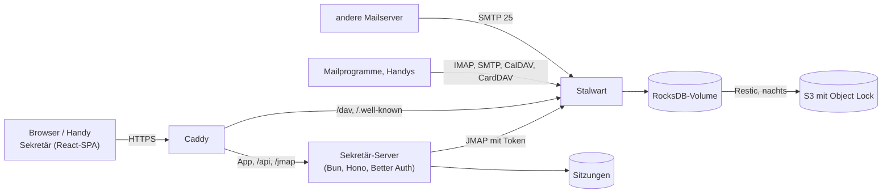

# Architektur

## Die Teile

- **Stalwart** (Community Edition, AGPL) ist Mail-, Kalender- und Kontaktserver in einem. Seit
  0.16 liegt die ganze Konfiguration in seiner Datenbank; auf der Platte steht nur `config.json`
  mit dem Speicherort.
- **Sekretär** ist eine Single-Page-App. Sie spricht [JMAP](https://jmap.io): Mail (RFC 8621),
  Kalender (JSCalendar) und Kontakte (JSContact) über dieselbe Schnittstelle, Push über den
  Event-Stream.
- **Der Sekretär-Server** (Bun, Hono, Better Auth, SQLite) liefert die App aus, kümmert sich um
  die Anmeldung und reicht JMAP an Stalwart durch. Dabei setzt er den Stalwart-Token der Sitzung
  ein; der Browser kennt weder Passwort noch Token.
- **Caddy** holt das Zertifikat und leitet alles an den Server weiter, CalDAV/CardDAV für
  Mailprogramme direkt an Stalwart.

## Gemeinsame Postfächer

Ein gemeinsames Postfach ist in Stalwart eine **Gruppe** mit eigener Adresse. Jedes Mitglied sieht
die Gruppe als zusätzliches Konto in seiner JMAP-Session (`isPersonal: false`) – mit Ordnern,
Mails und einer Absenderadresse. Sekretär zeigt diese Konten unter „Postfächer“; wer dort
antwortet, schreibt automatisch als info@.

## Wiederkehrende Termine

Eine Serie ist in Stalwart **ein** Termin mit `recurrenceRule` (JSCalendar, RFC 8984; Stalwart
0.16 nimmt die Einzahl). Die Kalenderansichten fragen mit `expandRecurrences` ab und bekommen
jeden einzelnen Termin mit eigener ID, `baseEventId` und `recurrenceId`.

- **Nur dieser Termin**: Ändern oder Löschen über die ID des einzelnen Termins; Stalwart trägt das
  in `recurrenceOverrides` der Serie ein (beim Löschen als `excluded`).
- **Ganze Serie**: Ändern oder Löschen über die `baseEventId`. Wird dabei die Uhrzeit geändert,
  verschiebt sich der Beginn der Serie um denselben Betrag.
- Regeln, die das Formular nicht abbildet (etwa „letzter Freitag im Monat“ aus einem anderen
  Programm), bleiben beim Speichern unverändert.

Ziehen im Wochenraster ändert immer nur den einen Termin.

## Anmeldung

Benutzer und Passwörter bleiben in Stalwart. Bei der Anmeldung schickt die App E-Mail, Passwort
und – wenn eingerichtet – den Code der Authenticator-App an den Server
(`POST /api/auth/sign-in/stalwart`). Der meldet sich über Stalwarts OAuth an (Autorisierungscode
mit PKCE, ohne Umleitung), legt eine Better-Auth-Sitzung an und setzt ein httpOnly-Cookie. Die
Stalwart-Tokens liegen verschlüsselt (AES-GCM) in SQLite, je Sitzung. Der Zugriffstoken wird bei
Bedarf mit dem Refresh-Token erneuert; Stalwart verlängert diesen, solange er benutzt wird. So
bleibt die App am Handy angemeldet, bis man sich abmeldet (Sitzung 90 Tage, bei Nutzung erneuert).

**Passkeys später:** Better Auth bringt ein Passkey-Plugin mit. Beim Einrichten eines Passkeys legt
der Server in Stalwart ein App-Passwort für das Gerät an und speichert es verschlüsselt; eine
Passkey-Anmeldung holt damit den Stalwart-Token. Am Rest ändert sich nichts.

## Code

| Ordner          | Inhalt                                                                                                                     |
| --------------- | -------------------------------------------------------------------------------------------------------------------------- |
| `src/jmap/`     | JMAP-Client (Session, Methoden, Upload/Download, Push) und die Aufrufe für Mail, Kalender, Kontakte                        |
| `src/lib/`      | reine Funktionen: Ordnerbaum, Adressen, Antworten, HTML-Bereinigung, JSCalendar- und JSContact-Umrechnung – mit Unit-Tests |
| `src/features/` | die Ansichten von Mail, Kalender und Kontakten, je mit ihren Daten-Hooks (`queries.ts`)                                    |
| `src/routes/`   | TanStack-Router-Routen; der Zustand einer Ansicht steht in der URL (offene Mail, Ordner, Termin)                           |
| `dev/`          | lokaler Stalwart, Testdaten (Seed)                                                                                         |
| `deploy/`       | Caddy, Compose, Quadlets, Backup                                                                                           |
| `e2e/`          | Playwright-Tests gegen einen eigenen Stalwart                                                                              |
