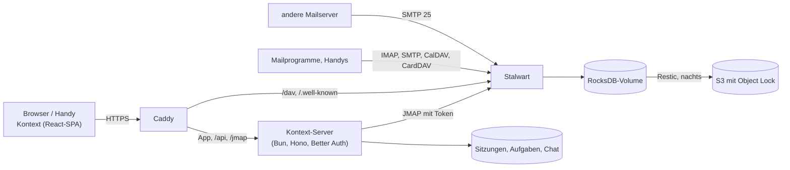

# Architektur

## Die Teile

- **Stalwart** (Community Edition, AGPL) ist Mail-, Kalender- und Kontaktserver in einem. Seit
  0.16 liegt die ganze Konfiguration in seiner Datenbank; auf der Platte steht nur `config.json`
  mit dem Speicherort.
- **Kontext** ist eine Single-Page-App. Sie spricht [JMAP](https://jmap.io): Mail (RFC 8621),
  Kalender (JSCalendar) und Kontakte (JSContact) über dieselbe Schnittstelle, Push über den
  Event-Stream.
- **Der Kontext-Server** (Bun, Hono, Better Auth, SQLite) liefert die App aus, kümmert sich um
  die Anmeldung und reicht JMAP an Stalwart durch. Dabei setzt er den Stalwart-Token der Sitzung
  ein; der Browser kennt weder Passwort noch Token.
- **Caddy** holt das Zertifikat und leitet alles an den Server weiter, CalDAV/CardDAV für
  Mailprogramme direkt an Stalwart.

## Gemeinsame Postfächer

Ein gemeinsames Postfach ist in Stalwart eine **Gruppe** mit eigener Adresse. Jedes Mitglied sieht
die Gruppe als zusätzliches Konto in seiner JMAP-Session (`isPersonal: false`) – mit Ordnern,
Mails und einer Absenderadresse. Kontext zeigt diese Konten unter „Postfächer“; wer dort
antwortet, schreibt automatisch als info@. Als Absendername steht dann die Person und das
Postfach, etwa „Jonas Weber (Weber Haustechnik)“ – so sieht der Kunde und im gemeinsamen
Gesendet-Ordner jeder Kollege, wer geantwortet hat.

Die Rechte am gemeinsamen Postfach:

| Stufe                | In Stalwart                                                    | In Kontext                                                   |
| -------------------- | -------------------------------------------------------------- | ------------------------------------------------------------- |
| **Verwalten**        | Mitglied der Gruppe                                            | alles, Senden als info@                                       |
| **Lesen und senden** | Mitglied der Gruppe (Stalwart trennt das nicht weiter)         | wie Verwalten                                                 |
| **Nur lesen**        | Ordner per `shareWith` geteilt (`mayReadItems`, `maySetSeen`) | lesen; Archivieren, Löschen, Verschieben fehlen; Antworten vom eigenen Konto |

Kontext richtet die Werkzeugleiste nach den `myRights` des Ordners. Wer keine Absenderadresse
im Postfach hat (Stalwart gibt Identitäten nur Mitgliedern), antwortet vom eigenen Konto; die
Antwort liegt dann im eigenen Gesendet-Ordner. Beide Stufen setzt die Firmenverwaltung; „Nur
lesen“ teilt dabei alle vorhandenen Ordner des Postfachs (später angelegte Ordner nicht).

### Verschieben zwischen Postfächern

„Verschieben nach …“ zeigt die Ordner aller Postfächer, nach Postfach gruppiert, das der Mail
zuerst (`src/lib/move-targets.ts`); Ordner ohne `mayAddItems` fehlen. Innerhalb eines Kontos
ändert die App `mailboxIds` (`Email/set`). In ein anderes Konto – etwa von info@ in den eigenen
Ordner „Steuerberater“ – geht es mit `Email/copy` und `onSuccessDestroyOriginal` (RFC 8620 §5.4,
RFC 8621 §4.7): Stalwart legt die Mail dort an und löscht sie hier im selben Request. Die Kopie
übernimmt Stichwörter und Datum nur, wenn man sie mitschickt; die App schickt `keywords` und
`receivedAt` mit, damit gelesen und markiert erhalten bleiben.

Mit der Maus geht dasselbe: eine Zeile der Liste auf einen Ordner oder ein Postfach in der
Seitenleiste ziehen (`src/features/mail/mail-drag.ts`, HTML-Drag-and-Drop). Ziehen lassen sich
nur Mails aus Ordnern mit `mayRemoveItems`; auf dem Handy bleibt das Menü.

Damit man sieht, wo eine Mail liegt, steht über dem Betreff „Gemeinsames Postfach info@…“ (bei
übergebenen Postfächern „Übergebenes Postfach …“), das Etikett in „Alle Posteingänge“ trägt das
Gruppen-Symbol, und die Seitenleiste nennt die Ordner eines gemeinsamen Postfachs „Ordner von
info@“.

## Prüfung des Absenders

Kommt eine Mail aus dem Internet an (Port 25), prüft Stalwart den Absender und schreibt das
Ergebnis als `Authentication-Results` (RFC 8601) oben in die Mail, dazu `X-Spam-Score`
(`crates/smtp/src/inbound/data.rs`, `crates/spam-filter/src/analysis/score.rs`). Die App holt diese
Header mit `header:…:asText:all` und nimmt jeweils den **obersten**: Ohne `:all` gäbe JMAP den
untersten zurück (RFC 8621 §4.1.3), und alles unter Stalwarts Header kam mit der Mail und kann
vom Absender gefälscht sein. Mails ohne diesen Header kamen nicht von außen (von Kollegen über
den eigenen Server, oder aus einem Umzug); sie werden nicht bewertet.

Die Regeln stehen in `src/lib/sender-check.ts`:

| Warnung                                           | Wann                                                                                                   |
| ------------------------------------------------- | ------------------------------------------------------------------------------------------------------ |
| „gibt sich als Absender aus weber-haustechnik.de aus“ | Absender aus der eigenen Firma (Domain eines eigenen Postfachs), aber von außen und nicht bestätigt |
| „Absender nicht bestätigt“                        | DMARC fehlgeschlagen, oder SPF hart fehlgeschlagen ohne gültige DKIM-Signatur                          |
| „Antworten gehen an …“                            | `Reply-To` zeigt auf eine andere Domain als der Absender – ein Muster bei Rechnungsbetrug              |

Bestätigt ist ein Absender, wenn DMARC bestanden hat oder SPF bzw. DKIM für seine Domain (auch
Subdomain, RFC 7489 §3.1). Ein SPF-„softfail“ allein warnt nicht, weil weitergeleitete Mails das
oft haben; „nicht eingerichtet“ ist bei kleinen Firmen häufig und steht nur in den Details.

„Als Spam markieren“ (`!`) verschiebt die Mail in den Spam-Ordner und setzt `$junk`, „Kein Spam“
holt sie in den Posteingang und setzt `$notjunk` (IANA-Stichwörter, RFC 8621 §2). Stalwart lernt
aus beidem, aus dem Verschieben und aus dem Stichwort (`crates/jmap/src/email/set.rs`).

„Details anzeigen“ unter dem Absender klappt Absender, Empfänger, Antwort an, Datum, Größe,
Anhänge und Nachrichten-ID auf, daneben die einzelnen Prüfungen (SPF, DKIM, DMARC, Reverse DNS)
und die Spam-Bewertung (`src/features/mail/message-details.tsx`).

## Firmenverwaltung

Unter *Einstellungen → Firma* verwaltet der Chef Mitarbeiter und gemeinsame Postfächer. Das läuft
nicht über JMAP mit dem Token der Sitzung, sondern über den Kontext-Server (`/api/company`,
`server/company/`): Er spricht Stalwarts Verwaltungsobjekte (`x:Account`, `x:Role`, `x:Domain`)
mit einem eigenen API-Schlüssel an und erlaubt nur, was die Firmenverwaltung braucht.

- **Wer darf:** Konten mit der Stalwart-Rolle `Firmenverwaltung (Kontext)` zusätzlich zur Rolle
  *User*. Die Rolle hat keine Rechte in Stalwart, sie ist nur die Markierung; Kontext legt sie
  beim ersten Aufruf an. Das eigene Konto kann sich das Recht nicht selbst nehmen und sich nicht
  sperren.
- **Wen es zeigt:** Benutzer mit der Rolle *User* (mit oder ohne Markierung) und Gruppen mit der
  Standardrolle. Stalwarts Admins und Konten mit anderen Rollen bleiben beim Betreiber.
- **Anlegen:** Kontext erzeugt ein Startpasswort (vier Vierergruppen ohne verwechselbare
  Zeichen, 80 Bit) und zeigt es einmal an. Neue Konten bekommen Deutsch und Europe/Berlin.
- **Sperren** nimmt dem Konto das Recht `authenticate`: keine Anmeldung mehr in Kontext, IMAP,
  SMTP oder DAV, Mails an die Adresse kommen aber weiter an. Kontext beendet dazu alle Sitzungen
  der Person, ebenso nach einem neuen Passwort.
- **Weitere Adressen** sind Stalwarts Aliase (`aliases`), nur in den Domains des Servers.
- **Gemeinsame Postfächer** sind Gruppen; Mitglied ist, wer die Gruppe in `memberGroupIds` hat.
  „Nur lesen“ bekommt, wem alle Ordner des Postfachs per `shareWith` geteilt sind
  (`mayReadItems`, `maySetSeen`); die App liest das am Posteingang ab.
- **Abwesenheit** eines Mitarbeiters (etwa bei Krankheit) ist dessen `VacationResponse`; die
  Vertretung steht als eigene Zeile in der Nachricht. Hat er Regeln, läuft sie in deren Skript
  (siehe [Regeln](#regeln)); der Server nimmt dafür denselben Code wie die App.

- **Firmen-Signatur:** eine Vorlage mit `[Name]` und `[E-Mail]`, gespeichert in der
  SQLite-Datenbank von Kontext (`company_setting`). „Für alle übernehmen“ schreibt sie in jede Absenderadresse
  (`Identity`) aller aktiven Mitarbeiter, ausgefüllt mit Name und Adresse der Identität; neue
  Mitarbeiter bekommen sie beim Anlegen.
- **Austritt:** Zugang sperren, das Postfach einer Kollegin übergeben (alle Ordner per
  `shareWith` mit allen Rechten außer Teilen), neue Mails weiterleiten und einmal am Tag
  automatisch antworten. Weiterleitung und Antwort sind ein Sieve-Skript
  (`kontext-austritt`, `redirect` und `vacation`), weil Stalwart nur ein aktives Skript pro
  Konto ausführt; es ersetzt dabei Abwesenheitsnotiz und Regeln, bis der Zugang wieder
  freigegeben wird (siehe [Regeln](#regeln)). Gelöscht wird nichts.
- In der Mail zeigt Kontext übergebene Postfächer unter „Postfächer“ wie gemeinsame: als
  Postfach zählt ein fremdes Konto, wenn es eine Gruppe ist oder Ordner zeigt (wer nur einen
  Kalender teilt, zeigt keine).

Für Ordner, Abwesenheit, Signaturen und Sieve arbeitet der Server per JMAP *im Konto* des Mitarbeiters bzw. der
Gruppe. Das erlaubt Stalwart mit dem Recht `impersonate`: dann gilt der Schlüssel als Mitglied
jedes Kontos (`AccessToken::is_member`). `server/company/management.ts` spricht die
Verwaltungsobjekte an, `server/company/mailstore.ts` die Konten.

Stalwart lässt den Schlüssel keine Rollen oder Rechte vergeben, die er nicht selbst hat. Die
Rolle des Server-Kontos erbt deshalb *User* (sonst könnte es niemandem die Rolle *User* geben)
und hat dazu nur die Rechte für Konten, Rollen und Domains (siehe [Installation](installation.md)).

## Umzug

Unter *Einstellungen → Firma → Umzug* holt der Chef die Daten eines Mitarbeiters aus dem alten
System, auf zwei Wegen. Beide schreiben mit dem Server-Schlüssel in das neue Postfach
(`server/migration/importer.ts`) und überspringen Doppeltes: Mails mit bekannter Message-ID,
Kontakte mit gleichem Namen und gleicher erster Adresse, Termine mit bekannter UID. Ein Umzug
lässt sich deshalb gefahrlos wiederholen.

**Kategorien** kommen mit (`server/migration/categories.ts`): aus Microsoft 365 die Outlook-
Kategorien der Mails, mit der Farbe aus `masterCategories` (dafür braucht die App zusätzlich
`MailboxSettings.Read`; ohne bekommen sie eigene Farben); per IMAP die Schlagworte, Thunderbirds
`$label1`–`$label5` unter ihren deutschen Namen („Wichtig“, „Arbeit“, …). Fehlt eine Kategorie im
neuen Postfach, wird sie angelegt. Aus Outlook-Dateien (PST) nicht: `readpst` schreibt Kategorien
nur für Kontakte und Termine aus, nicht für Mails.

### Postfach verbinden per IMAP (Gmail, GMX, WEB.DE, Telekom, IONOS, STRATO, eigener Server)

Kontext liest das alte Postfach per IMAP (`imapflow`), nur lesend, und gleicht es in eine Richtung
ab: der erste Lauf holt alles, danach alle 15 Minuten das Neue, bis der Chef den Umzug abschließt.
So läuft das alte Postfach parallel weiter, solange Absender noch die alte Adresse nutzen.

- **Anmeldung**: Adresse und Passwort – bei Gmail ein App-Passwort (Bestätigung in zwei Schritten
  nötig). Kontext prüft die Anmeldung sofort und speichert das Passwort verschlüsselt (AES-GCM mit
  dem Server-Geheimnis, wie die Stalwart-Tokens). Lehnt der Anbieter es später ab, steht der Umzug
  auf „Anmeldung abgelehnt“, bis ein neues Passwort eingetragen ist. Beim Abschließen wird es
  gelöscht.
- **Ordner** nach ihrer besonderen Verwendung (RFC 6154), also in jeder Sprache: Posteingang,
  Gesendet, Entwürfe, Archiv auf die Standardordner. Gmails Labels werden Ordner; eine Mail mit
  mehreren Labels kommt **einmal** ins Postfach und liegt in allen passenden Ordnern (JMAP erlaubt
  mehrere `mailboxIds`). „Alle Nachrichten“, „Wichtig“, „Markiert“, Spam und Papierkorb bleiben weg;
  markierte Mails sind über `$flagged` markiert.
- **Stand**: pro Ordner `UIDVALIDITY` und die letzte übernommene UID (RFC 9051) in SQLite
  (`mail_sync`); ein Lauf holt nur höhere UIDs. Ändert sich `UIDVALIDITY`, beginnt der Ordner von
  vorn – Doppeltes fällt durch die Message-ID heraus.
- **Grenzen**: Gmail gibt per IMAP etwa 2,5 GB am Tag heraus; ein großes Postfach braucht
  mehrere Tage, der Abgleich macht von selbst weiter. Bei „Anderer Server“ sind nur die IMAP-Ports
  993 (TLS) und 143 (STARTTLS) erlaubt.
- **Nicht dabei**: Senden als alte Adresse über den alten Anbieter (Relay) und ein Abgleich in
  beide Richtungen. Kontakte und Kalender kommen bei Gmail über den Google-Export (siehe unten).

### Microsoft 365

Für Microsoft 365 gibt es kein IMAP mit Passwort mehr; Kontext liest über Microsoft Graph mit
einer App, die der Admin des Kunden einmal in seinem Mandanten registriert und freigibt
(Anwendungsberechtigungen `Mail.Read`, `Contacts.Read`, `Calendars.Read`, `User.Read.All`,
optional `MailboxSettings.Read` für die Farben der Kategorien,
Token per Client Credentials). Die Zugangsdaten liegen verschlüsselt in der SQLite-Datenbank von Kontext
(`company_setting`); danach ordnet der Chef pro Mitarbeiter ein Postfach aus dem Mandanten zu
(vorgeschlagen wird das mit gleichem Namen vor dem @). `server/migration/m365/`:

- **Mails** pro Ordner mit Graphs Delta-Abfrage (`messages/delta`); der Delta-Link steht im
  Stand des Umzugs, ein späterer Lauf holt nur das Neue. Jede neue Mail kommt als MIME
  (`messages/{id}/$value`) per `Email/import` in denselben Ordner, mit Gelesen und Markierung.
  Die Standardordner erkennt Kontext an Graphs festen Namen (`inbox`, `sentitems`, `drafts`,
  `archive` – in jeder Sprache); Gelöschte Elemente, Junk-E-Mail, Postausgang und ähnliche
  bleiben weg.
- **Kontakte** des Standardordners werden JSContact, **Termine** JSCalendar, Serien mit ihrer
  Regel (`recurrence` → `recurrenceRule`), in deutscher Zeit gelesen
  (`Prefer: outlook.timezone="W. Europe Standard Time"`). Einzeln geänderte Termine einer Serie
  kommen noch nicht mit, nur die Serie.
- Drosselt Graph (429), wartet Kontext die angegebene Zeit und versucht es erneut.

Für Entwicklung und Tests spielt `dev/fake-graph.ts` Microsofts Anmeldung und Graph
(`M365_LOGIN_URL`, `GRAPH_URL`).

### Datei hochladen (Outlook-PST, Kontakte als vCard, Kalender als iCalendar)

Die App schickt die Datei in Stücken zu 8 MB (`PUT /api/company/migrations/:id/file`); bricht
die Verbindung ab, sagt der Server, wie viel er hat. Danach arbeitet der Server die Umzüge
nacheinander ab (`server/migration/runner.ts`), auch nach einem Neustart:

1. **PST**: `readpst` (libpst) zerlegt die Datei in eine Datei pro Mail, Kontakt und Termin, mit
   einem Verzeichnis pro Outlook-Ordner (ohne parallele Worker: mit ihnen endet readpst manchmal,
   bevor alle Dateien geschrieben sind). Posteingang, Gesendete Elemente, Gelöschte Elemente,
   Entwürfe, Junk-E-Mail und Archiv (deutsch oder englisch) landen in den Standardordnern, alles
   andere unter demselben Pfad; Aufgaben und Notizen bleiben weg.
2. **Mails** gehen mit `Email/import` (RFC 8621) in den passenden Ordner, mit Originaldatum und
   Gelesen-Status; bis zu 25 Mails und 6 MB pro Request, die Blobs per `Blob/upload` im selben
   Request, größere Mails einzeln über den Upload.
3. **Kontakte** (`.vcf`, auch Googles Export mit vielen Karten) und **Termine** (`.ics`, eine
   Datei mit vielen Terminen) liest Stalwart selbst (`ContactCard/parse`, `CalendarEvent/parse`);
   sie kommen ins Standard-Adressbuch bzw. den Standardkalender. readpst nummeriert Termine nur
   („0x1268“); dann bildet Kontext die UID aus dem Inhalt.

Der Fortschritt steht in SQLite (`migration_job`); die Datei liegt bis zum Ende neben der
Datenbank unter `migrations/` und wird nach einem erfolgreichen Umzug gelöscht.

## Regeln

Regeln sortieren neue Mails beim Eingang, auf dem Server: Kontext schreibt sie als **ein
Sieve-Skript** (`kontext-regeln`, RFC 5228) und lädt es per JMAP (`SieveScript/set`, RFC 9661)
ins eigene Konto. So wirken sie auch, wenn niemand angemeldet ist, und gleich auf jedem Gerät.

- **Bedingungen:** Absender (`address "from"`), Empfänger (`address ["to", "cc"]`), Betreff
  (`header`), Text (`body :text`), je mit „enthält“, „enthält nicht“ oder „ist genau“; alle oder
  eine davon.
- **Aktionen:** in einen Ordner (`fileinto :mailboxid`, mit dem Pfad als Ersatz, falls die Id
  fehlt), als gelesen markieren oder markieren (`addflag`), weiterleiten mit Kopie
  (`redirect :copy`; Stalwart leitet eine Mail höchstens einmal weiter), keine weiteren Regeln.
- **Reihenfolge:** Alle passenden Regeln wirken von oben nach unten; der **erste Ordner
  gewinnt**, damit eine Mail nicht als Kopie in mehreren Ordnern landet. Das Skript merkt sich
  Ordner und „fertig“ in Variablen (RFC 5229) und legt am Ende einmal ab.
- **Spam** verlässt das Skript vorher (`spamtest :percent` ≥ 50, wie Stalwarts Grenze): Stalwart
  legt eine Mail nur in „Junk“, wenn das Skript sie nirgends abgelegt hat (`is_spam &&
  !did_file_into`, `crates/email/src/sieve/ingest.rs`).
- **Abwesenheit:** Stalwart führt nur ein aktives Skript pro Konto aus, und `VacationResponse`
  ist selbst eines (`vacation`, `crates/jmap/src/vacation/set.rs`), das beim Einschalten alle
  anderen abschaltet. Darum gilt (`server/rules/filters.ts`, von App und Server genutzt):
  ohne Regeln bleibt alles bei `VacationResponse`; mit Regeln bleibt `VacationResponse` „aus“,
  behält Text und Zeitraum, und das Regel-Skript bindet es mit
  `include :personal :optional "vacation"` ein. Ob die Abwesenheit an ist, steht dann im
  Regel-Skript.
- **Gespeichert** werden die Regeln als JSON in einer Kommentarzeile des Skripts
  (`# kontext:{…}`); die App liest nur diese Zeile, nie Sieve. Nutzertexte werden für Sieve
  maskiert, auch `${`, das sonst als Variable gelesen würde.
- **Eigenes Postfach:** in den Einstellungen; „Regel erstellen …“ an einer Mail im eigenen
  Postfach füllt den Absender vor.
- **Gemeinsame Postfächer** (info@, rechnung@): Stalwart führt bei der Zustellung das aktive
  Skript des Empfängerkontos aus, also auch das der Gruppe (`crates/email/src/message/
  delivery.rs`). Der Chef pflegt die Regeln in der Firmenverwaltung („Regeln“ am Postfach); der
  Server schreibt sie mit seinem Schlüssel ins Gruppenkonto (`/api/company/mailboxes/:id/rules`),
  mit demselben Code wie die App.
- **Auf vorhandene Mails anwenden** (Häkchen im Dialog): Die gespeicherte Regel läuft einmal
  über die neuesten 1.000 Mails im Posteingang, mit derselben Logik wie das Skript
  (`server/rules/match.ts`: Teiltext ohne Groß/Klein, erster Ordner gewinnt, „keine weiteren
  Regeln“), und verschiebt und markiert per `Email/set`. Weitergeleitet wird dabei nichts.
  Unterschied: Sieve vergleicht Groß/Klein nur bei ASCII (`i;ascii-casemap`), die App auch bei
  Umlauten.
- **Austritt:** Er aktiviert `kontext-austritt`. Solange das läuft, aktiviert Kontext weder
  Regeln noch Abwesenheit; die Firmenverwaltung sagt bei „Abwesenheit eintragen“, dass die
  Person ausgetreten ist. Wird der Zugang wieder freigegeben, endet der Austritt: das Skript
  wird abgeschaltet, Regeln und Abwesenheit laufen wieder wie gespeichert.

## Kategorien

Farbige Markierungen an Mails, mehrere je Mail, neben dem einen Ordner, in dem sie liegt. Eine
Mail kann damit gleichzeitig „Angebot“ und „Wartet auf Antwort“ sein, ohne doppelt in zwei Ordnern
zu liegen wie bei Gmails Labels.

- **An der Mail** ist eine Kategorie ein JMAP-Keyword (RFC 8621 §4.1.1, in IMAP ein Flag), lesbar
  geschrieben wie `wartet-auf-antwort`. Thunderbird zeigt sie als Schlagwort; Handy-Apps
  übergehen eigene Keywords.
- **Name, Farbe und Reihenfolge** gehören zum Postfach und liegen in der SQLite-Datenbank von Kontext
  (`mail_categories`), weil Stalwart dafür keinen Platz hat. Ohne eigene Liste gelten „In
  Bearbeitung“, „Wartet auf Antwort“ und „Erledigt“. `/api/categories` liefert die Kategorien
  aller Postfächer der angemeldeten Person; wer welches Postfach öffnen darf, sagt Stalwarts
  JMAP-Session mit ihrem Token, ändern darf, wer nicht nur lesen darf.
- **Umbenennen** behält das Keyword, die Mails behalten also ihre Kategorie. Entfernen blendet
  sie nur aus; das Keyword bleibt an den Mails.
- **Gemeinsame Postfächer:** Kategorien an einer Mail in info@ sehen alle Mitglieder. So wird
  info@ zur kleinen Aufgabenliste („In Bearbeitung“ → „Erledigt“).
- **Setzen** im Menü „Kategorie“ der Mail (mehrere nacheinander, das Menü bleibt offen);
  **finden** über die Seitenleiste, die `in:info@ kategorie:"…"` sucht, oder per
  `kategorie:`/`label:` in der Suche; **automatisch** per Regel („Kategorie setzen“: Sieve
  `addflag "<keyword>"`).

## App (PWA)

Kontext lässt sich als App installieren (Chrome, Edge, Safari, Android, iPhone): eigenes Fenster,
Symbol, Kurzbefehle (Neue Mail, Kalender, Kontakte). Gebaut mit `vite-plugin-pwa` und Workbox;
das Manifest steht in `vite.config.ts`, der Service Worker in `src/sw/service-worker.ts`.

- **Updates kommen sicher an.** Der Server liefert `service-worker.js`, `index.html` und das
  Manifest immer mit `cache-control: no-cache`, die Bausteine unter `/assets/` mit Hash im Namen
  dauerhaft. Jeder Build ist ein neuer Worker mit einer neuen Liste der Dateien und ihrer Hashes;
  Workbox lädt nur Geändertes und räumt den alten Cache weg (`cleanupOutdatedCaches`). Die App
  fragt stündlich und jedes Mal, wenn sie wieder in den Vordergrund kommt, nach einer neuen
  Version (`src/pwa/pwa-status.tsx`).
- **Neu laden auf Wunsch.** Eine neue Version wartet und meldet sich mit „Eine neue Version von
  Kontext ist da – Neu laden“; sie übernimmt erst nach dem Klick, damit eine angefangene Mail
  nicht verloren geht. Sind alle Fenster zu, startet beim nächsten Öffnen ohnehin die neue.
- **Was gecacht wird:** nur die App selbst (HTML, Skripte, Styles, Schriften, Symbole). Mails,
  Kalender und Anmeldung (`/jmap`, `/api`) gehen nie über einen Cache. Ohne Netz startet die App
  und sagt „Keine Verbindung“; neue Daten kommen, sobald das Gerät wieder online ist.
- **Als Mailprogramm:** `mailto:`-Links öffnen eine neue Mail in Kontext – in der installierten
  App über das Manifest (`protocol_handlers`), im Browser über *Einstellungen → Darstellung →
  Als Mailprogramm verwenden* (`registerProtocolHandler`). `/compose?mailto=…` wertet Empfänger,
  Cc, Betreff und Text aus (`src/lib/mailto.ts`, RFC 6068).
- **Teilen in Kontext:** Auf dem Handy erscheint Kontext im Teilen-Menü anderer Apps (Web Share
  Target). Der Service Worker nimmt Fotos, Dateien, Texte und Links an, legt sie kurz in einem
  eigenen Cache ab und öffnet eine neue Mail damit; die Dateien sind dann schon Anhänge.
- **Benachrichtigungen** gehen über den Service Worker (`showNotification`), weil installierte Apps
  auf Android nur so dürfen; ein Klick öffnet die Mail oder den Termin, auch bei geschlossenem
  Fenster. Sie kommen, solange Kontext geöffnet ist (auch im Hintergrund); bei ganz geschlossener
  App braucht es Web Push; Stalwart kann ihn selbst senden (`urn:ietf:params:jmap:webpush-vapid`), siehe [Roadmap](https://github.com/firsttris/kontext/blob/main/ROADMAP.md).
- **Ungelesen-Zahl am App-Symbol** (Badging API) als Summe aller Posteingänge.

## Aufgaben

Aufgaben (`src/features/tasks/`, Server `server/tasks/`) liegen in Kontexts SQLite (`tasks`,
`task_links`): Stalwart kennt Aufgaben nur als CalDAV-VTODO, ohne Verknüpfung zu Mails, Spalten
oder Reihenfolge.

- **Wem sie gehören:** Jede Aufgabe gehört zu einem Konto – dem eigenen Postfach oder einem
  gemeinsamen wie info@. `/api/tasks` liefert alle Aufgaben der Konten in der JMAP-Session der
  angemeldeten Person; anlegen, ändern und löschen darf, wer das Postfach nicht nur lesen darf.
  Erledigtes bleibt 30 Tage in den Listen.
- **Ansichten:** „Meine Aufgaben“ sind mir zugewiesene und die im eigenen Postfach ohne
  Zuständigen; „Heute“ nimmt Überfälliges mit, heute Erledigtes bleibt durchgestrichen stehen. Ein
  Board pro Postfach mit den festen Spalten Offen, In Arbeit, Wartet, Erledigt (`status`); die
  Reihenfolge ist `position`, beim Ziehen wird zwischen die Nachbarn gesetzt.
- **Aus einer Mail:** „Aufgabe“ in der Werkzeugleiste (Taste `t`): Titel aus dem Betreff ohne
  „AW:/Re:“, verknüpft mit der Mail und ihrer Unterhaltung (`threadId`), auf Wunsch wird die
  Mail danach archiviert (merkt sich der Browser). Die Mail zeigt ihre Aufgabe in Liste und
  Lesebereich.
- **Schnelleingabe** (`src/lib/tasks.ts`): ein letztes Wort „heute“, „morgen“, „übermorgen“, ein
  Wochentag oder ein Datum wie „30.10.“ wird zur Fälligkeit.
- **Abgleich im Team:** Nach jeder Änderung meldet der Server über die
  [Live-Verbindung](#live-verbindung), welches Board sich geändert hat; alle, die dieses Postfach
  öffnen können, laden die Aufgaben neu. Eigene Änderungen zeigt die App sofort und korrigiert
  sie, wenn der Server etwas anderes sagt.

## Team-Chat

Der Chat (`src/features/chat/`, Server `server/chat/`) liegt in Kontexts SQLite
(`chat_channels`, `chat_members`, `chat_messages`, `chat_reads`); Stalwart hat keinen Chat.
Personen sind ihre persönliche Konto-ID aus der JMAP-Session (in Stalwart zugleich die
Principal-ID), die Namen holt die App wie bei den Aufgaben über die Principals.

- **Kanäle:** `#allgemein` für alle in der Firma; ein Kanal pro gemeinsamem Postfach (info@,
  rechnung@), den sieht, wer das Postfach in seiner JMAP-Session hat – wer aus info@ austritt,
  verliert auch den Kanal; eigene Kanäle mit ausgewählten Mitgliedern (Namen klein mit
  Bindestrich, „Baustelle Hoffmann“ wird `#baustelle-hoffmann`); Direktnachrichten an eine oder
  mehrere Personen – dieselben Personen landen immer in derselben Unterhaltung (`direct_key`).
  `#allgemein` und die Postfach-Kanäle legt der Server beim ersten Blick in den Chat an.
- **Wer was sieht:** `canSee` in `server/chat/chat.ts` – jede Anfrage und jedes Live-Ereignis
  geht nur an Personen, die den Kanal sehen dürfen.
- **Gelesen und Ungelesen:** pro Person und Kanal der Zeitpunkt, bis zu dem gelesen ist; was man
  selbst schreibt, ist gelesen. Ungelesen und Erwähnungen zählt der Server, die App zeigt sie am
  Chat in Leiste und Tab-Leiste und am App-Symbol. In Direktnachrichten steht „Gelesen“ unter der
  eigenen letzten Nachricht.
- **@Erwähnungen:** Beim Tippen schlägt die App Personen vor (in Kanälen und Direktnachrichten
  nur Mitglieder) und schickt deren IDs mit; markiert werden nur Namen, die wirklich erwähnt
  wurden. Eine Erwähnung oder Direktnachricht wird zur Benachrichtigung auf dem Gerät, wenn sie
  dort eingeschaltet ist und Kontext im Hintergrund liegt.
- **Verlauf:** 50 Nachrichten je Seite, ältere auf Knopfdruck; Nachrichten einer Person kurz
  hintereinander stehen unter einem Namen, eine Linie „Neu“ zeigt, wo das Ungelesene beginnt.
  Aufbewahrt wird unbegrenzt.

## Live-Verbindung

Jede offene App hält eine Verbindung `/api/live` (Server-Sent Events, `server/live/`). Der Server
merkt sich nur, wer verbunden ist (`hub.ts`), und schickt jedes Ereignis an die, die es sehen
dürfen: neue Nachrichten, „schreibt …“, Gelesen-Marken, geänderte Kanäle, wer online ist und
geänderte Aufgaben-Boards. Mails meldet Stalwart weiter selbst (JMAP Push).

- Alle 25 Sekunden ein Kommentar, damit Proxys die ruhige Verbindung nicht schließen; Caddy
  komprimiert die beiden Streams nicht (`deploy/Caddyfile`), sonst kämen Ereignisse verzögert an.
- Nach 15 Minuten beendet der Server die Verbindung, der Browser baut sie sofort neu auf – mit den
  aktuellen Rechten aus der JMAP-Session. Nach einer Unterbrechung lädt die App Chat und Aufgaben
  neu, damit nichts fehlt.

## Drucken

„Drucken“ im Menü „…“ der Mail, `p` oder Strg+P (Cmd+P) druckt die offene Mail, nicht die App
darum: `src/lib/print.ts` baut eine eigene Seite (Betreff, Von, An, Cc, Datum, bei gemeinsamen
Postfächern das Postfach, der Text, die Namen der Anhänge; hell, A4), `print-mail.ts` lädt sie in
ein unsichtbares Frame ohne Skripte und öffnet den Druckdialog des Browsers. Der Text ist derselbe
bereinigte wie im Lesebereich, eingebettete Bilder kommen mit, Bilder aus dem Internet nicht.

## Mehrere Mails auswählen

Wie in Gmail: am Desktop erscheint beim Überfahren einer Zeile links ein Kästchen, Shift-Klick
nimmt den Bereich bis zur zuletzt gewählten Mail dazu, `x` die offene Mail; am Handy schaltet
„Auswählen“ die Kästchen ein. Solange etwas gewählt ist, ersetzt eine Leiste den Titel der Liste:
archivieren, löschen, Spam, gelesen/ungelesen, markieren, Kategorie, verschieben.

Gewählt wird nach Konto und Mail (`src/lib/selection.ts`), denn „Alle Posteingänge“ und die Suche
mischen Postfächer. Ausgeführt wird je Konto und Ordner, aus dem die Mails kommen; Kategorie und
Verschieben gibt es nur, wenn alle gewählten Mails in einem Postfach liegen, weil Kategorien und
Ordner zum Postfach gehören. Was nicht mehr in der Liste steht, fällt aus der Auswahl; ein anderer
Ordner oder eine neue Suche beginnt ohne Auswahl.

## Suche

Die Suche (`/mail/all/search?q=…`) läuft über alle Ordner und Postfächer, Papierkorb und Spam
nur mit `in:papierkorb` / `in:spam`. `src/lib/mail-search.ts` zerlegt den Text in Wörter und
Operatoren (deutsch und englisch: `von:`/`from:`, `an:`, `betreff:`, `hat:anhang`,
`ist:ungelesen`, `ist:markiert`, `in:`, `nach:`, `vor:`, `kategorie:`/`label:`) und baut daraus pro Konto einen
`Email/query`-Filter; die Listen der Konten werden wie bei „Alle Posteingänge“ gemischt.

Stalwart sucht mit Wortstämmen, findet ein Wort, das schon sein eigener Stamm ist („Angebot“),
aber nur genau so. Deshalb fragt die App für jedes Wort auch seine Grundform ab („Angebote“ →
„Angebot“, „Rechnungen“ → „Rechnung“). Zusammengesetzte Wörter („Wartungsvertrag“ für „Wartung“)
und Text in PDF-Anhängen findet Stalwart nicht; Text- und HTML-Anhänge schon.

Vorschläge beim Tippen kommen aus den Kontakten (für `von:`/`an:`), den Ordnern (für `in:`), den
Operatoren und den letzten Suchen (pro Gerät im Browser).

## Alle Posteingänge

`/mail/all/inbox` zeigt die Posteingänge des eigenen Kontos und der gemeinsamen Postfächer in
einer Liste. Jedes Konto lädt seine Seiten wie in der Ordneransicht (derselbe Cache, damit
Gelesen, Verschieben und Löschen überall gleich ankommen); die App mischt sie nach Datum. Solange
ein Konto noch ältere Mails nachladen kann, zeigt die Liste nichts, was älter ist als dessen
älteste geladene Mail, damit die Reihenfolge stimmt. Eine geöffnete Mail trägt ihr Konto in der
URL (`account`); Antworten gehen deshalb aus dem richtigen Postfach.

## Leseansicht auf breiten Bildschirmen

Die Mail steht linksbündig unter der Werkzeugleiste, die Textspalte bleibt höchstens 780 px breit
(etwa 70 Zeichen pro Zeile, gut zu lesen). Ab 1536 px (`2xl`) füllt eine Spalte rechts den Platz
(`src/features/mail/sender-panel.tsx`): die Person, mit der die Mail ist – der Absender, bei
eigenen Mails (auch aus info@) der erste andere Empfänger (`src/lib/correspondent.ts`) –, ihre
Kontaktkarte, falls es eine gibt, sonst „Als Kontakt speichern“ ins eigene Adressbuch; dazu Mail,
Termin und Anrufen, die nächsten Termine (`useEventsWith`) und die letzten Mails mit ihr aus dem
Postfach der geöffneten Mail.

## Anhänge

Jeder Anhang ist eine Karte (`src/features/mail/attachments.tsx`): oben eine Vorschau, unten Typ,
Name, Größe und Herunterladen. Fotos (PNG, JPEG, GIF, WebP, AVIF, BMP, SVG; bis 15 MB) zeigt der
Browser selbst; von PDFs (bis 25 MB) zeichnet pdf.js die erste Seite als Bild. pdf.js wird erst
geladen, wenn ein PDF zu sehen ist, und rechnet in seinem Worker (gleiche Herkunft, die CSP
erlaubt `'self'`); als reine Build-Abhängigkeit kommt es nicht ins Server-Image. Alles andere
bekommt eine farbige Kachel nach Dateityp (`src/lib/attachment-kind.ts`).

Ein Klick auf die Vorschau öffnet PDFs und Fotos in einem neuen Tab – aus dem Blob, den die
Vorschau schon geladen hat, damit der Browser den Tab nicht blockiert. SVG, HTML und alles andere
wird nur heruntergeladen: als `blob:`-Seite liefe es mit den Rechten der App. Die Testdaten haben
echte PDFs (`dev/pdf.ts`) und einen Grundriss als SVG.

## Darstellung und Tastaturkürzel

Hell oder dunkel ist eine Klasse an `<html>`: `public/theme.js` setzt sie vor dem ersten Bild aus
der Wahl in den Einstellungen (pro Gerät im Browser gespeichert) oder aus der Einstellung des
Geräts; als eigene Datei, damit die Content-Security-Policy keine Inline-Skripte erlauben muss.

Tastaturkürzel sind einzelne Tasten wie in Gmail und stehen als Liste in `src/lib/shortcuts.ts`;
die Hilfe (`?` oder das Tastatur-Symbol unten in der Leiste) und die Einstellungen zeigen dieselbe
Liste. Solange ein Eingabefeld oder ein Dialog den Fokus hat, greift keine Taste.

## Benachrichtigungen

Die Glocke in der Leiste (`src/features/notifications/`) zeigt, was aus dem Stand des Servers
folgt: ungelesene Mails der letzten drei Tage in allen Posteingängen (eigene und gemeinsame),
Einladungen im eigenen Kalender, die noch auf Antwort warten (dieselbe Prüfung wie im Kalender,
`isInvitation`), und die restlichen Termine des Tages. Push hält das aktuell wie jede andere
Ansicht; wer eine Mail am Handy liest, sieht sie hier verschwinden. Auf dem Server wird nichts
gespeichert: Den Punkt an der Glocke gibt es für Mails, die nach dem letzten Öffnen kamen, und für
Einladungen, die damals noch nicht da waren – beides merkt sich der Browser.

„Auf diesem Gerät benachrichtigen“ (in der Glocke und unter Einstellungen → Darstellung) nutzt die
Notification-API des Browsers: neue Mail, solange Kontext im Hintergrund ist, und eine Erinnerung
15 Minuten vor einem Termin (`src/lib/notifications.ts`). Ob die Erlaubnis noch besteht, fragt die
App über die Permissions-API ab; nimmt man sie im Browser zurück, schaltet sich der Schalter aus.
Benachrichtigungen kommen nur, solange Kontext in einem Tab offen ist.

## Speicherplatz

Der Ring um das eigene Bild (Leiste, am Handy die Tableiste) zeigt den Speicher des eigenen
Postfachs aus `Quota/get` (RFC 9425, `octets`): gelb ab 80 %, rot ab 95 % (`src/lib/storage.ts`);
Tooltip und Benutzermenü nennen die Zahlen. Gemeinsame Postfächer haben ihr eigenes Kontingent; es
steht als Balken unten in ihrer Ordnerliste. Die Testdaten geben jedem Benutzer 5 GB.

## Kontaktgruppen

Eine Gruppe ist eine JSContact-Karte mit `kind: "group"`; ihr `members` hält die `uid`s der
Mitglieder (RFC 9553). Stalwart speichert sie wie jeden Kontakt. Mitglieder kommen immer aus
demselben Konto, weil eine `uid` nur dort eindeutig ist.

## vCard-Import und -Export

Beim Import liest Stalwart die Datei (`ContactCard/parse`, Abbildung nach RFC 9555). Weil
`parse` nur eine Karte pro Blob liest, teilt die App die Datei in einzelne Karten und legt sie mit
`Blob/upload` (RFC 9404) im selben Request als Blobs an, 50 pro Request. Karten, die es im
Adressbuch schon gibt (gleiche `uid`, oder gleicher Name und gleiche Mail-Adresse), werden
übersprungen; vor dem Anlegen zeigt die App, wie viele neu sind. Der Export schreibt vCard 4.0
(RFC 6350) aus den Feldern, die die App bearbeitet, auch Gruppen mit `MEMBER`.

## Adressbücher und Kalender teilen

Adressbücher und Kalender werden über ihr `shareWith` geteilt (draft-ietf-jmap-contacts und
-calendars): pro Kollege (Principal-ID, in Stalwart zugleich die Konto-ID) die Rechte. Kontext
bietet zwei Stufen:

| Stufe          | Adressbuch                         | Kalender                                                                              |
| -------------- | ---------------------------------- | ------------------------------------------------------------------------------------- |
| **Lesen**      | `mayRead`                          | `mayReadFreeBusy`, `mayReadItems`                                                     |
| **Bearbeiten** | `mayRead`, `mayWrite`, `mayDelete` | dazu `mayWriteAll`, `mayWriteOwn`, `mayUpdatePrivate`, `mayRSVP`                      |

Stalwart erlaubt bei Adressbüchern mit `mayWrite` nur Anlegen und Ändern; Löschen von Kontakten
braucht `mayDelete`. Bei Kalendern enthält `mayWriteAll` das Löschen schon. Weiterteilen
(`mayShare`) und Löschen des ganzen Kalenders bleiben beim Besitzer.

Wer etwas geteilt bekommt, sieht das Konto des Kollegen als weiteres Konto in seiner JMAP-Session.
Deshalb gelten in der Mail nur Konten von **Gruppen** als gemeinsame Postfächer (über
`Principal/get`). Kontakte und Termine werden immer pro Adressbuch bzw. Kalender abgefragt
(`inAddressBook`, `inCalendar`), auch die eigenen; so zeigt die App genau, was in den sichtbaren
Adressbüchern und Kalendern steht. Jeder Termin trägt das Konto, aus dem er kommt; Ändern,
Verschieben und Löschen gehen an dieses Konto.

Einen Termin in einem fremden Kalender darf man mit „Bearbeiten“ ändern, wenn man selbst oder der
Besitzer des Kalenders ihn organisiert. Zusagen und Absagen gibt es nur im eigenen Kalender.
Welche Kalender eingeblendet sind, merkt sich die App pro Gerät im Browser: Stalwart 0.16 lässt
das per Benutzer gespeicherte `isVisible` bei fremden Kalendern nur mit Schreibrecht ändern.

## Wiederkehrende Termine

Eine Serie ist in Stalwart **ein** Termin mit `recurrenceRule` (JSCalendar, RFC 8984; Stalwart
0.16 nimmt die Einzahl). Die Kalenderansichten fragen mit `expandRecurrences` ab und bekommen
jeden einzelnen Termin mit eigener ID, `baseEventId` und `recurrenceId`.

- **Nur dieser Termin**: Ändern oder Löschen über die ID des einzelnen Termins; Stalwart trägt das
  in `recurrenceOverrides` der Serie ein (beim Löschen als `excluded`).
- **Ganze Serie**: Ändern oder Löschen über die `baseEventId`. Wird dabei die Uhrzeit geändert,
  verschiebt sich der Beginn der Serie um denselben Betrag.
- Regeln, die das Formular nicht abbildet (etwa „letzter Freitag im Monat“ aus einem anderen
  Programm), bleiben beim Speichern unverändert.

Ziehen im Wochenraster ändert immer nur den einen Termin.

## Anmeldung

Benutzer und Passwörter bleiben in Stalwart. Bei der Anmeldung schickt die App E-Mail, Passwort
und – wenn eingerichtet – den Code der Authenticator-App an den Server
(`POST /api/auth/sign-in/stalwart`). Der meldet sich über Stalwarts OAuth an (Autorisierungscode
mit PKCE, ohne Umleitung), legt eine Better-Auth-Sitzung an und setzt ein httpOnly-Cookie. Die
Stalwart-Tokens liegen verschlüsselt (AES-GCM) in SQLite, je Sitzung. Der Zugriffstoken wird bei
Bedarf mit dem Refresh-Token erneuert; Stalwart verlängert diesen, solange er benutzt wird. So
bleibt die App am Handy angemeldet, bis man sich abmeldet (Sitzung 90 Tage, bei Nutzung erneuert).

**Passkeys später:** Better Auth bringt ein Passkey-Plugin mit. Beim Einrichten eines Passkeys legt
der Server in Stalwart ein App-Passwort für das Gerät an und speichert es verschlüsselt; eine
Passkey-Anmeldung holt damit den Stalwart-Token. Am Rest ändert sich nichts.

## Code

| Ordner          | Inhalt                                                                                                                     |
| --------------- | -------------------------------------------------------------------------------------------------------------------------- |
| `src/jmap/`     | JMAP-Client (Session, Methoden, Upload/Download, Push) und die Aufrufe für Mail, Kalender, Kontakte                        |
| `src/lib/`      | reine Funktionen: Ordnerbaum, Adressen, Antworten, HTML-Bereinigung, JSCalendar- und JSContact-Umrechnung – mit Unit-Tests |
| `src/features/` | die Ansichten von Mail, Kalender, Kontakten und Firmenverwaltung, je mit ihren Daten-Hooks (`queries.ts`)                 |
| `server/`       | Kontext-Server: Anmeldung, JMAP-Weiterleitung, Firmenverwaltung (`server/company/`)                                       |
| `src/routes/`   | TanStack-Router-Routen; der Zustand einer Ansicht steht in der URL (offene Mail, Ordner, Termin)                           |
| `dev/`          | lokaler Stalwart, Testdaten (Seed)                                                                                         |
| `deploy/`       | Caddy, Compose, Quadlets, Backup                                                                                           |
| `e2e/`          | Playwright-Tests gegen einen eigenen Stalwart                                                                              |
