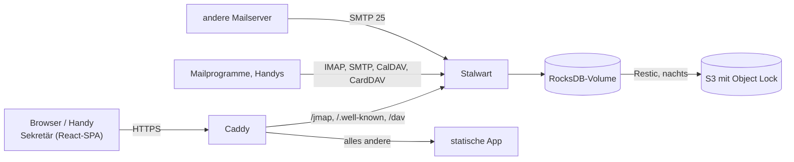

# Architektur

## Die Teile

- **Stalwart** (Community Edition, AGPL) ist Mail-, Kalender- und Kontaktserver in einem. Seit
  0.16 liegt die ganze Konfiguration in seiner Datenbank; auf der Platte steht nur `config.json`
  mit dem Speicherort.
- **Sekretär** ist eine Single-Page-App ohne eigenen Server. Sie spricht ausschließlich
  [JMAP](https://jmap.io) mit Stalwart: Mail (RFC 8621), Kalender (JSCalendar) und Kontakte
  (JSContact) über dieselbe Schnittstelle, Push über den Event-Stream.
- **Caddy** liefert die App aus, holt das Zertifikat und leitet JMAP an Stalwart weiter. App und
  JMAP laufen unter derselben Adresse, deshalb braucht es kein CORS.

## Gemeinsame Postfächer

Ein gemeinsames Postfach ist in Stalwart eine **Gruppe** mit eigener Adresse. Jedes Mitglied sieht
die Gruppe als zusätzliches Konto in seiner JMAP-Session (`isPersonal: false`) – mit Ordnern,
Mails und einer Absenderadresse. Sekretär zeigt diese Konten unter „Postfächer“; wer dort
antwortet, schreibt automatisch als info@.

## Anmeldung

Die App schickt Benutzername und Passwort als Basic-Auth an Stalwart (nur über HTTPS, gleiche
Adresse). Sie liegen im `sessionStorage` des Tabs und sind beim Schließen weg. Später kommt OAuth
mit Stalwart als Anbieter dazu, damit die App am Handy angemeldet bleiben kann.

## Code

| Ordner          | Inhalt                                                                                                                     |
| --------------- | -------------------------------------------------------------------------------------------------------------------------- |
| `src/jmap/`     | JMAP-Client (Session, Methoden, Upload/Download, Push) und die Aufrufe für Mail, Kalender, Kontakte                        |
| `src/lib/`      | reine Funktionen: Ordnerbaum, Adressen, Antworten, HTML-Bereinigung, JSCalendar- und JSContact-Umrechnung – mit Unit-Tests |
| `src/features/` | die Ansichten von Mail, Kalender und Kontakten, je mit ihren Daten-Hooks (`queries.ts`)                                    |
| `src/routes/`   | TanStack-Router-Routen; der Zustand einer Ansicht steht in der URL (offene Mail, Ordner, Termin)                           |
| `dev/`          | lokaler Stalwart, Testdaten (Seed)                                                                                         |
| `deploy/`       | Caddy, Compose, Quadlets, Backup                                                                                           |
| `e2e/`          | Playwright-Tests gegen einen eigenen Stalwart                                                                              |
