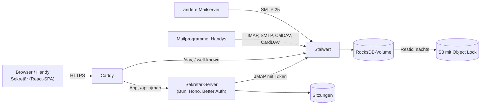

# Architektur

## Die Teile

- **Stalwart** (Community Edition, AGPL) ist Mail-, Kalender- und Kontaktserver in einem. Seit
  0.16 liegt die ganze Konfiguration in seiner Datenbank; auf der Platte steht nur `config.json`
  mit dem Speicherort.
- **Sekretär** ist eine Single-Page-App. Sie spricht [JMAP](https://jmap.io): Mail (RFC 8621),
  Kalender (JSCalendar) und Kontakte (JSContact) über dieselbe Schnittstelle, Push über den
  Event-Stream.
- **Der Sekretär-Server** (Bun, Hono, Better Auth, SQLite) liefert die App aus, kümmert sich um
  die Anmeldung und reicht JMAP an Stalwart durch. Dabei setzt er den Stalwart-Token der Sitzung
  ein; der Browser kennt weder Passwort noch Token.
- **Caddy** holt das Zertifikat und leitet alles an den Server weiter, CalDAV/CardDAV für
  Mailprogramme direkt an Stalwart.

## Gemeinsame Postfächer

Ein gemeinsames Postfach ist in Stalwart eine **Gruppe** mit eigener Adresse. Jedes Mitglied sieht
die Gruppe als zusätzliches Konto in seiner JMAP-Session (`isPersonal: false`) – mit Ordnern,
Mails und einer Absenderadresse. Sekretär zeigt diese Konten unter „Postfächer“; wer dort
antwortet, schreibt automatisch als info@. Als Absendername steht dann die Person und das
Postfach, etwa „Jonas Weber (Weber Haustechnik)“ – so sieht der Kunde und im gemeinsamen
Gesendet-Ordner jeder Kollege, wer geantwortet hat.

Die Rechte am gemeinsamen Postfach:

| Stufe                | In Stalwart                                                    | In Sekretär                                                   |
| -------------------- | -------------------------------------------------------------- | ------------------------------------------------------------- |
| **Verwalten**        | Mitglied der Gruppe                                            | alles, Senden als info@                                       |
| **Lesen und senden** | Mitglied der Gruppe (Stalwart trennt das nicht weiter)         | wie Verwalten                                                 |
| **Nur lesen**        | Ordner per `shareWith` geteilt (`mayReadItems`, `maySetSeen`) | lesen; Archivieren, Löschen, Verschieben fehlen; Antworten vom eigenen Konto |

Sekretär richtet die Werkzeugleiste nach den `myRights` des Ordners. Wer keine Absenderadresse
im Postfach hat (Stalwart gibt Identitäten nur Mitgliedern), antwortet vom eigenen Konto; die
Antwort liegt dann im eigenen Gesendet-Ordner. Beide Stufen setzt die Firmenverwaltung; „Nur
lesen“ teilt dabei alle vorhandenen Ordner des Postfachs (später angelegte Ordner nicht).

## Firmenverwaltung

Unter *Einstellungen → Firma* verwaltet der Chef Mitarbeiter und gemeinsame Postfächer. Das läuft
nicht über JMAP mit dem Token der Sitzung, sondern über den Sekretär-Server (`/api/company`,
`server/company/`): Er spricht Stalwarts Verwaltungsobjekte (`x:Account`, `x:Role`, `x:Domain`)
mit einem eigenen API-Schlüssel an und erlaubt nur, was die Firmenverwaltung braucht.

- **Wer darf:** Konten mit der Stalwart-Rolle `Firmenverwaltung (Sekretär)` zusätzlich zur Rolle
  *User*. Die Rolle hat keine Rechte in Stalwart, sie ist nur die Markierung; Sekretär legt sie
  beim ersten Aufruf an. Das eigene Konto kann sich das Recht nicht selbst nehmen und sich nicht
  sperren.
- **Wen es zeigt:** Benutzer mit der Rolle *User* (mit oder ohne Markierung) und Gruppen mit der
  Standardrolle. Stalwarts Admins und Konten mit anderen Rollen bleiben beim Betreiber.
- **Anlegen:** Sekretär erzeugt ein Startpasswort (vier Vierergruppen ohne verwechselbare
  Zeichen, 80 Bit) und zeigt es einmal an. Neue Konten bekommen Deutsch und Europe/Berlin.
- **Sperren** nimmt dem Konto das Recht `authenticate`: keine Anmeldung mehr in Sekretär, IMAP,
  SMTP oder DAV, Mails an die Adresse kommen aber weiter an. Sekretär beendet dazu alle Sitzungen
  der Person, ebenso nach einem neuen Passwort.
- **Weitere Adressen** sind Stalwarts Aliase (`aliases`), nur in den Domains des Servers.
- **Gemeinsame Postfächer** sind Gruppen; Mitglied ist, wer die Gruppe in `memberGroupIds` hat.
  „Nur lesen“ bekommt, wem alle Ordner des Postfachs per `shareWith` geteilt sind
  (`mayReadItems`, `maySetSeen`); die App liest das am Posteingang ab.
- **Abwesenheit** eines Mitarbeiters (etwa bei Krankheit) ist dessen `VacationResponse`; die
  Vertretung steht als eigene Zeile in der Nachricht.

- **Firmen-Signatur:** eine Vorlage mit `[Name]` und `[E-Mail]`, gespeichert in Sekretärs
  SQLite (`company_setting`). „Für alle übernehmen“ schreibt sie in jede Absenderadresse
  (`Identity`) aller aktiven Mitarbeiter, ausgefüllt mit Name und Adresse der Identität; neue
  Mitarbeiter bekommen sie beim Anlegen.
- **Austritt:** Zugang sperren, das Postfach einer Kollegin übergeben (alle Ordner per
  `shareWith` mit allen Rechten außer Teilen), neue Mails weiterleiten und einmal am Tag
  automatisch antworten. Weiterleitung und Antwort sind ein Sieve-Skript
  (`sekretaer-austritt`, `redirect` und `vacation`), weil Stalwart nur ein aktives Skript pro
  Konto ausführt; es ersetzt dabei die Abwesenheitsnotiz. Gelöscht wird nichts.
- In der Mail zeigt Sekretär übergebene Postfächer unter „Postfächer“ wie gemeinsame: als
  Postfach zählt ein fremdes Konto, wenn es eine Gruppe ist oder Ordner zeigt (wer nur einen
  Kalender teilt, zeigt keine).

Für Ordner, Abwesenheit, Signaturen und Sieve arbeitet der Server per JMAP *im Konto* des Mitarbeiters bzw. der
Gruppe. Das erlaubt Stalwart mit dem Recht `impersonate`: dann gilt der Schlüssel als Mitglied
jedes Kontos (`AccessToken::is_member`). `server/company/management.ts` spricht die
Verwaltungsobjekte an, `server/company/mailstore.ts` die Konten.

Stalwart lässt den Schlüssel keine Rollen oder Rechte vergeben, die er nicht selbst hat. Die
Rolle des Server-Kontos erbt deshalb *User* (sonst könnte es niemandem die Rolle *User* geben)
und hat dazu nur die Rechte für Konten, Rollen und Domains (siehe [Installation](installation.md)).

## Umzug

Unter *Einstellungen → Firma → Umzug* holt der Chef die Daten eines Mitarbeiters aus dem alten
System, auf zwei Wegen. Beide schreiben mit dem Server-Schlüssel in das neue Postfach
(`server/migration/importer.ts`) und überspringen Doppeltes: Mails mit bekannter Message-ID,
Kontakte mit gleichem Namen und gleicher erster Adresse, Termine mit bekannter UID. Ein Umzug
lässt sich deshalb gefahrlos wiederholen.

### Postfach verbinden (Gmail, GMX, WEB.DE, Telekom, IONOS, STRATO, eigener Server)

Sekretär liest das alte Postfach per IMAP (`imapflow`), nur lesend, und gleicht es in eine Richtung
ab: der erste Lauf holt alles, danach alle 15 Minuten das Neue, bis der Chef den Umzug abschließt.
So läuft das alte Postfach parallel weiter, solange Absender noch die alte Adresse nutzen.

- **Anmeldung**: Adresse und Passwort – bei Gmail ein App-Passwort (Bestätigung in zwei Schritten
  nötig). Sekretär prüft die Anmeldung sofort und speichert das Passwort verschlüsselt (AES-GCM mit
  dem Server-Geheimnis, wie die Stalwart-Tokens). Lehnt der Anbieter es später ab, steht der Umzug
  auf „Anmeldung abgelehnt“, bis ein neues Passwort eingetragen ist. Beim Abschließen wird es
  gelöscht.
- **Ordner** nach ihrer besonderen Verwendung (RFC 6154), also in jeder Sprache: Posteingang,
  Gesendet, Entwürfe, Archiv auf die Standardordner. Gmails Labels werden Ordner; eine Mail mit
  mehreren Labels kommt **einmal** ins Postfach und liegt in allen passenden Ordnern (JMAP erlaubt
  mehrere `mailboxIds`). „Alle Nachrichten“, „Wichtig“, „Markiert“, Spam und Papierkorb bleiben weg;
  markierte Mails sind über `$flagged` markiert.
- **Stand**: pro Ordner `UIDVALIDITY` und die letzte übernommene UID (RFC 9051) in SQLite
  (`mail_sync`); ein Lauf holt nur höhere UIDs. Ändert sich `UIDVALIDITY`, beginnt der Ordner von
  vorn – Doppeltes fällt durch die Message-ID heraus.
- **Grenzen**: Gmail gibt per IMAP etwa 2,5 GB am Tag heraus; ein großes Postfach braucht
  mehrere Tage, der Abgleich macht von selbst weiter. Bei „Anderer Server“ sind nur die IMAP-Ports
  993 (TLS) und 143 (STARTTLS) erlaubt.
- **Nicht dabei**: Senden als alte Adresse über den alten Anbieter (Relay) und ein Abgleich in
  beide Richtungen. Kontakte und Kalender kommen bei Gmail über den Google-Export (siehe unten).

### Datei hochladen (Outlook-PST, Kontakte als vCard, Kalender als iCalendar)

Die App schickt die Datei in Stücken zu 8 MB (`PUT /api/company/migrations/:id/file`); bricht
die Verbindung ab, sagt der Server, wie viel er hat. Danach arbeitet der Server die Umzüge
nacheinander ab (`server/migration/runner.ts`), auch nach einem Neustart:

1. **PST**: `readpst` (libpst) zerlegt die Datei in eine Datei pro Mail, Kontakt und Termin, mit
   einem Verzeichnis pro Outlook-Ordner (ohne parallele Worker: mit ihnen endet readpst manchmal,
   bevor alle Dateien geschrieben sind). Posteingang, Gesendete Elemente, Gelöschte Elemente,
   Entwürfe, Junk-E-Mail und Archiv (deutsch oder englisch) landen in den Standardordnern, alles
   andere unter demselben Pfad; Aufgaben und Notizen bleiben weg.
2. **Mails** gehen mit `Email/import` (RFC 8621) in den passenden Ordner, mit Originaldatum und
   Gelesen-Status; bis zu 25 Mails und 6 MB pro Request, die Blobs per `Blob/upload` im selben
   Request, größere Mails einzeln über den Upload.
3. **Kontakte** (`.vcf`, auch Googles Export mit vielen Karten) und **Termine** (`.ics`, eine
   Datei mit vielen Terminen) liest Stalwart selbst (`ContactCard/parse`, `CalendarEvent/parse`);
   sie kommen ins Standard-Adressbuch bzw. den Standardkalender. readpst nummeriert Termine nur
   („0x1268“); dann bildet Sekretär die UID aus dem Inhalt.

Der Fortschritt steht in SQLite (`migration_job`); die Datei liegt bis zum Ende neben der
Datenbank unter `migrations/` und wird nach einem erfolgreichen Umzug gelöscht.

## Suche

Die Suche (`/mail/all/search?q=…`) läuft über alle Ordner und Postfächer, Papierkorb und Spam
nur mit `in:papierkorb` / `in:spam`. `src/lib/mail-search.ts` zerlegt den Text in Wörter und
Operatoren (deutsch und englisch: `von:`/`from:`, `an:`, `betreff:`, `hat:anhang`,
`ist:ungelesen`, `ist:markiert`, `in:`, `nach:`, `vor:`) und baut daraus pro Konto einen
`Email/query`-Filter; die Listen der Konten werden wie bei „Alle Posteingänge“ gemischt.

Stalwart sucht mit Wortstämmen, findet ein Wort, das schon sein eigener Stamm ist („Angebot“),
aber nur genau so. Deshalb fragt die App für jedes Wort auch seine Grundform ab („Angebote“ →
„Angebot“, „Rechnungen“ → „Rechnung“). Zusammengesetzte Wörter („Wartungsvertrag“ für „Wartung“)
und Text in PDF-Anhängen findet Stalwart nicht; Text- und HTML-Anhänge schon.

Vorschläge beim Tippen kommen aus den Kontakten (für `von:`/`an:`), den Ordnern (für `in:`), den
Operatoren und den letzten Suchen (pro Gerät im Browser).

## Alle Posteingänge

`/mail/all/inbox` zeigt die Posteingänge des eigenen Kontos und der gemeinsamen Postfächer in
einer Liste. Jedes Konto lädt seine Seiten wie in der Ordneransicht (derselbe Cache, damit
Gelesen, Verschieben und Löschen überall gleich ankommen); die App mischt sie nach Datum. Solange
ein Konto noch ältere Mails nachladen kann, zeigt die Liste nichts, was älter ist als dessen
älteste geladene Mail, damit die Reihenfolge stimmt. Eine geöffnete Mail trägt ihr Konto in der
URL (`account`); Antworten gehen deshalb aus dem richtigen Postfach.

## Darstellung und Tastaturkürzel

Hell oder dunkel ist eine Klasse an `<html>`: `public/theme.js` setzt sie vor dem ersten Bild aus
der Wahl in den Einstellungen (pro Gerät im Browser gespeichert) oder aus der Einstellung des
Geräts; als eigene Datei, damit die Content-Security-Policy keine Inline-Skripte erlauben muss.

Tastaturkürzel sind einzelne Tasten wie in Gmail und stehen als Liste in `src/lib/shortcuts.ts`;
die Hilfe (`?`) und die Einstellungen zeigen dieselbe Liste. Solange ein Eingabefeld oder ein
Dialog den Fokus hat, greift keine Taste.

## Kontaktgruppen

Eine Gruppe ist eine JSContact-Karte mit `kind: "group"`; ihr `members` hält die `uid`s der
Mitglieder (RFC 9553). Stalwart speichert sie wie jeden Kontakt. Mitglieder kommen immer aus
demselben Konto, weil eine `uid` nur dort eindeutig ist.

## vCard-Import und -Export

Beim Import liest Stalwart die Datei (`ContactCard/parse`, Abbildung nach RFC 9555). Weil
`parse` nur eine Karte pro Blob liest, teilt die App die Datei in einzelne Karten und legt sie mit
`Blob/upload` (RFC 9404) im selben Request als Blobs an, 50 pro Request. Karten, die es im
Adressbuch schon gibt (gleiche `uid`, oder gleicher Name und gleiche Mail-Adresse), werden
übersprungen; vor dem Anlegen zeigt die App, wie viele neu sind. Der Export schreibt vCard 4.0
(RFC 6350) aus den Feldern, die die App bearbeitet, auch Gruppen mit `MEMBER`.

## Adressbücher und Kalender teilen

Adressbücher und Kalender werden über ihr `shareWith` geteilt (draft-ietf-jmap-contacts und
-calendars): pro Kollege (Principal-ID, in Stalwart zugleich die Konto-ID) die Rechte. Sekretär
bietet zwei Stufen:

| Stufe          | Adressbuch                         | Kalender                                                                              |
| -------------- | ---------------------------------- | ------------------------------------------------------------------------------------- |
| **Lesen**      | `mayRead`                          | `mayReadFreeBusy`, `mayReadItems`                                                     |
| **Bearbeiten** | `mayRead`, `mayWrite`, `mayDelete` | dazu `mayWriteAll`, `mayWriteOwn`, `mayUpdatePrivate`, `mayRSVP`                      |

Stalwart erlaubt bei Adressbüchern mit `mayWrite` nur Anlegen und Ändern; Löschen von Kontakten
braucht `mayDelete`. Bei Kalendern enthält `mayWriteAll` das Löschen schon. Weiterteilen
(`mayShare`) und Löschen des ganzen Kalenders bleiben beim Besitzer.

Wer etwas geteilt bekommt, sieht das Konto des Kollegen als weiteres Konto in seiner JMAP-Session.
Deshalb gelten in der Mail nur Konten von **Gruppen** als gemeinsame Postfächer (über
`Principal/get`). Kontakte und Termine werden immer pro Adressbuch bzw. Kalender abgefragt
(`inAddressBook`, `inCalendar`), auch die eigenen; so zeigt die App genau, was in den sichtbaren
Adressbüchern und Kalendern steht. Jeder Termin trägt das Konto, aus dem er kommt; Ändern,
Verschieben und Löschen gehen an dieses Konto.

Einen Termin in einem fremden Kalender darf man mit „Bearbeiten“ ändern, wenn man selbst oder der
Besitzer des Kalenders ihn organisiert. Zusagen und Absagen gibt es nur im eigenen Kalender.
Welche Kalender eingeblendet sind, merkt sich die App pro Gerät im Browser: Stalwart 0.16 lässt
das per Benutzer gespeicherte `isVisible` bei fremden Kalendern nur mit Schreibrecht ändern.

## Wiederkehrende Termine

Eine Serie ist in Stalwart **ein** Termin mit `recurrenceRule` (JSCalendar, RFC 8984; Stalwart
0.16 nimmt die Einzahl). Die Kalenderansichten fragen mit `expandRecurrences` ab und bekommen
jeden einzelnen Termin mit eigener ID, `baseEventId` und `recurrenceId`.

- **Nur dieser Termin**: Ändern oder Löschen über die ID des einzelnen Termins; Stalwart trägt das
  in `recurrenceOverrides` der Serie ein (beim Löschen als `excluded`).
- **Ganze Serie**: Ändern oder Löschen über die `baseEventId`. Wird dabei die Uhrzeit geändert,
  verschiebt sich der Beginn der Serie um denselben Betrag.
- Regeln, die das Formular nicht abbildet (etwa „letzter Freitag im Monat“ aus einem anderen
  Programm), bleiben beim Speichern unverändert.

Ziehen im Wochenraster ändert immer nur den einen Termin.

## Anmeldung

Benutzer und Passwörter bleiben in Stalwart. Bei der Anmeldung schickt die App E-Mail, Passwort
und – wenn eingerichtet – den Code der Authenticator-App an den Server
(`POST /api/auth/sign-in/stalwart`). Der meldet sich über Stalwarts OAuth an (Autorisierungscode
mit PKCE, ohne Umleitung), legt eine Better-Auth-Sitzung an und setzt ein httpOnly-Cookie. Die
Stalwart-Tokens liegen verschlüsselt (AES-GCM) in SQLite, je Sitzung. Der Zugriffstoken wird bei
Bedarf mit dem Refresh-Token erneuert; Stalwart verlängert diesen, solange er benutzt wird. So
bleibt die App am Handy angemeldet, bis man sich abmeldet (Sitzung 90 Tage, bei Nutzung erneuert).

**Passkeys später:** Better Auth bringt ein Passkey-Plugin mit. Beim Einrichten eines Passkeys legt
der Server in Stalwart ein App-Passwort für das Gerät an und speichert es verschlüsselt; eine
Passkey-Anmeldung holt damit den Stalwart-Token. Am Rest ändert sich nichts.

## Code

| Ordner          | Inhalt                                                                                                                     |
| --------------- | -------------------------------------------------------------------------------------------------------------------------- |
| `src/jmap/`     | JMAP-Client (Session, Methoden, Upload/Download, Push) und die Aufrufe für Mail, Kalender, Kontakte                        |
| `src/lib/`      | reine Funktionen: Ordnerbaum, Adressen, Antworten, HTML-Bereinigung, JSCalendar- und JSContact-Umrechnung – mit Unit-Tests |
| `src/features/` | die Ansichten von Mail, Kalender, Kontakten und Firmenverwaltung, je mit ihren Daten-Hooks (`queries.ts`)                 |
| `server/`       | Sekretär-Server: Anmeldung, JMAP-Weiterleitung, Firmenverwaltung (`server/company/`)                                       |
| `src/routes/`   | TanStack-Router-Routen; der Zustand einer Ansicht steht in der URL (offene Mail, Ordner, Termin)                           |
| `dev/`          | lokaler Stalwart, Testdaten (Seed)                                                                                         |
| `deploy/`       | Caddy, Compose, Quadlets, Backup                                                                                           |
| `e2e/`          | Playwright-Tests gegen einen eigenen Stalwart                                                                              |
