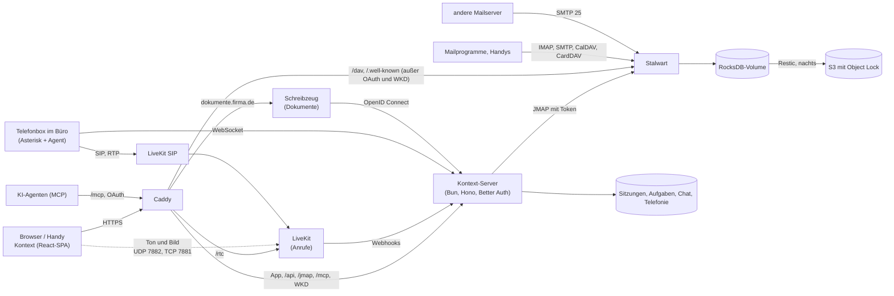
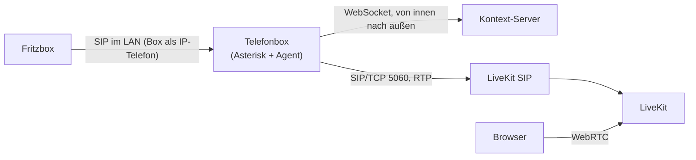
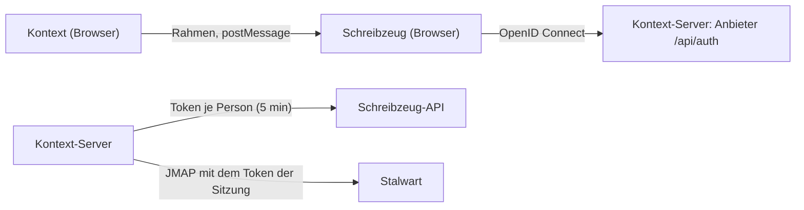

# Architektur

## Die Teile

- **Stalwart** (Community Edition, AGPL) ist Mail-, Kalender- und Kontaktserver in einem. Seit
  0.16 liegt die ganze Konfiguration in seiner Datenbank; auf der Platte steht nur `config.json`
  mit dem Speicherort.
- **Kontext** ist eine Single-Page-App. Sie spricht [JMAP](https://jmap.io): Mail (RFC 8621),
  Kalender (JSCalendar) und Kontakte (JSContact) über dieselbe Schnittstelle, Push über den
  Event-Stream.
- **Der Kontext-Server** (Bun, Hono, Better Auth, SQLite) liefert die App aus, kümmert sich um
  die Anmeldung und reicht JMAP an Stalwart durch. Dabei setzt er den Stalwart-Token der Sitzung
  ein; der Browser kennt weder Passwort noch Token. Weil alle Anmeldungen von seiner einen
  Adresse kommen, bremst er das Raten selbst (10 Fehlversuche je Anmeldename in 15 Minuten, auch
  für CalDAV; „jonas“ und „jonas@firma.de“ zählen zusammen, und dasselbe falsche Passwort noch
  einmal zählt nicht neu – ein Handy mit altem Passwort sperrt so kein ganzes Büro) und steht in Stalwart unter den erlaubten IPs, sonst würde Stalwart ihn sperren.
  Eine Sitzung endet nur, wenn Stalwart den Refresh-Token ablehnt, nicht wenn es gerade nicht
  antwortet. Was mit dem Sitzungs-Cookie etwas ändert (POST, PUT, PATCH, DELETE), muss von
  Kontexts eigenen Seiten kommen (`Sec-Fetch-Site`, sonst `Origin`; `server/csrf.ts`) – sonst
  könnte eine Seite unter derselben Domain, etwa Schreibzeug, mit dem Cookie Anfragen schicken.
  Kein fremder Rahmen darf Kontext zeigen (`frame-ancestors 'self'`).
- **Caddy** holt das Zertifikat und leitet alles an den Server weiter, CalDAV/CardDAV für
  Mailprogramme direkt an Stalwart (`/dav/cal`, `/dav/card` …, `/.well-known/caldav` und
  `carddav`); der Rest von `/dav` sind Kontexts Aufgabenlisten. Unter `mta-sts.<domain>` liefert
  er Stalwarts MTA-STS-Richtlinie aus, unter `openpgpkey.<domain>` Kontexts WKD.
- **LiveKit** (Apache 2.0, optional) trägt die [Anrufe](#anrufe) im Chat: ein SFU, der Ton, Bild
  und geteilte Bildschirme zwischen den Browsern verteilt.
- **Die Telefonbox** (optional, `box/`) steht im Büro des Kunden: Asterisk und ein kleiner Agent,
  die sich als IP-Telefon an der Fritzbox anmelden und Anrufe über **LiveKit SIP** in Kontext
  bringen (siehe [Telefonie](#telefonie)).
- **Schreibzeug** (optional) ist das Modul [Dokumente](#dokumente), ein eigener Dienst unter einer
  eigenen Adresse; Kontext ist sein Anmeldeanbieter.

## Gemeinsame Postfächer

Ein gemeinsames Postfach ist in Stalwart eine **Gruppe** mit eigener Adresse. Jedes Mitglied sieht
die Gruppe als zusätzliches Konto in seiner JMAP-Session (`isPersonal: false`) – mit Ordnern,
Mails und einer Absenderadresse. Kontext zeigt diese Konten unter „Postfächer“; wer dort
antwortet, schreibt automatisch als info@. Als Absendername steht dann die Person und das
Postfach, etwa „Jonas Weber (Weber Haustechnik)“ – so sieht der Kunde und im gemeinsamen
Gesendet-Ordner jeder Kollege, wer geantwortet hat.

Die Rechte am gemeinsamen Postfach:

| Stufe                | In Stalwart                                                    | In Kontext                                                   |
| -------------------- | -------------------------------------------------------------- | ------------------------------------------------------------- |
| **Verwalten**        | Mitglied der Gruppe                                            | alles, Senden als info@                                       |
| **Lesen und senden** | Mitglied der Gruppe (Stalwart trennt das nicht weiter)         | wie Verwalten                                                 |
| **Nur lesen**        | Ordner per `shareWith` geteilt (`mayReadItems`, `maySetSeen`) | lesen; Archivieren, Löschen, Verschieben fehlen; Antworten vom eigenen Konto |

Kontext richtet die Werkzeugleiste nach den `myRights` des Ordners. Wer keine Absenderadresse
im Postfach hat (Stalwart gibt Identitäten nur Mitgliedern), antwortet vom eigenen Konto; die
Antwort liegt dann im eigenen Gesendet-Ordner. Beide Stufen setzt die Firmenverwaltung; „Nur
lesen“ teilt dabei alle vorhandenen Ordner des Postfachs (später angelegte Ordner nicht).

Der Server (Aufgaben, Kategorien, Textbausteine, Chat, DAV) liest die Stufe nicht aus `isReadOnly`
der Session: Stalwart 0.16 schickt jedes weitere Konto mit `isReadOnly: false` und `isPersonal:
false`, auch das einer Kollegin, die nur ein Adressbuch teilt. Mitglied einer Gruppe ist, bei
wessen Konto Stalwart `mayCreateCalendar` (bzw. `mayCreateAddressBook`) setzt; für alle anderen
fragt `server/account-rights.ts` per `Mailbox/get` die Ordner ab: ohne Ordner kein Postfach,
schreiben darf, wem der Posteingang `mayAddItems` gibt.

### Verschieben zwischen Postfächern

„Verschieben nach …“ zeigt die Ordner aller Postfächer, nach Postfach gruppiert, das der Mail
zuerst (`src/lib/move-targets.ts`); Ordner ohne `mayAddItems` fehlen. Innerhalb eines Kontos
ändert die App `mailboxIds` (`Email/set`). In ein anderes Konto – etwa von info@ in den eigenen
Ordner „Steuerberater“ – geht es mit `Email/copy` und `onSuccessDestroyOriginal` (RFC 8620 §5.4,
RFC 8621 §4.7): Stalwart legt die Mail dort an und löscht sie hier im selben Request. Die Kopie
übernimmt Stichwörter und Datum nur, wenn man sie mitschickt; die App schickt `keywords` und
`receivedAt` mit, damit gelesen und markiert erhalten bleiben.

Mit der Maus geht dasselbe: eine Zeile der Liste auf einen Ordner oder ein Postfach in der
Seitenleiste ziehen (`src/features/mail/mail-drag.ts`, HTML-Drag-and-Drop). Ziehen lassen sich
nur Mails aus Ordnern mit `mayRemoveItems`; auf dem Handy bleibt das Menü.

Damit man sieht, wo eine Mail liegt, steht über dem Betreff „Gemeinsames Postfach info@…“ (bei
übergebenen und per [Vertretung](#vertretung) freigegebenen Postfächern „Postfach von …“), das Etikett in „Alle Posteingänge“ trägt das
Gruppen-Symbol, und die Seitenleiste nennt die Ordner eines gemeinsamen Postfachs „Ordner von
info@“.

## Bilder aus dem Internet

Bilder aus dem Internet verraten dem Absender, dass die Mail geöffnet wurde. Die Mail zeigt sie
erst auf Wunsch („Laden“); „Immer von …“ merkt sich den Absender auf dem Kontext-Server
(`image_senders`, `/api/image-senders`, je Person auf allen Geräten). Erlaubt werden Adressen,
ganze Domains (`@firma.de`) und auf Wunsch alle Absender aus den eigenen Kontakten
(`@contacts`), in den Einstellungen unter „Passwort und Sicherheit“. Sofort geladen wird nur, wenn
die Mail wirklich vom Absender kommt (`src/lib/remote-images.ts`): Eine Mail von außen muss für
dessen Domain bestätigt sein (DMARC, oder SPF/DKIM passend); eine ohne jede Prüfung
(importiert, von Kolleginnen) zählt mit, eine durchgefallene nie – ein gefälschter Absender
schaltet keine Bilder frei.

Blockiert heißt: `sanitizeMailHtml` (`src/lib/html.ts`, CSS in `src/lib/mail-css.ts`) entfernt
jede Adresse, die der Browser abrufen würde – `src`, `background`, `poster`, `href` von
SVG-Bildern, auch `//host/…`, und in CSS `url(…)` und Adressen in `image-set(…)` oder in eigenen
Eigenschaften (`--u: "…"`) in `style`-Attributen, in allen anderen Attributen, die CSS sein
können (SVG: `fill`, `mask` …), und in `<style>`; `@import` fällt ganz weg – und zählt sie für
„Laden“. Das CSS wird dafür so zerlegt, wie der Browser es liest (CSS Syntax 3,
`src/lib/css-tokens.ts`: Kommentare, Escapes, offene `url(` am Ende), die Adressen so, wie der
URL-Parser sie liest (Tabs und Steuerzeichen fallen weg). Was nichts abruft, bleibt Zeichen für
Zeichen, wie es war: eingebettete Bilder und Schriften (`cid:`, `data:`), Text wie
`content: "https://…"`; sind die Bilder erlaubt, auch alle Attribute außer `style`. Dahinter
verbietet eine Content-Security-Policy im Dokument des Rahmens (`mailDocument`) das Laden von
außen, bis die Bilder erlaubt sind; die Druckseite (`src/lib/print.ts`) verbietet es immer.

## Lesebestätigung

Stalwart kennt JMAP-MDN (RFC 9007) nicht; Kontext baut Lesebestätigungen nach RFC 8098 selbst
(`src/lib/mdn.ts`, `src/features/mail/receipts.tsx`):

- **Anfordern:** Der Schalter mit dem Häkchen-Brief im Fenster „Neue Mail“ setzt
  `Disposition-Notification-To` auf die eigene Adresse.
- **Beantworten:** Eine Mail mit der Bitte zeigt „… bittet um eine Lesebestätigung“ mit
  „Senden“ und „Nicht senden“ – nie von selbst. Die App baut die Bestätigung als
  `multipart/report` (ein Satz für Menschen, `message/disposition-notification` für Programme,
  `In-Reply-To` auf die Mail), legt sie per `Email/import` in „Gesendet“ und verschickt sie von der
  Adresse, an die die Mail ging. Beides setzt `$MDNSent` (RFC 3503), danach fragt keiner mehr –
  Stalwart gibt Schlagworte klein zurück, verglichen wird ohne Groß und Klein.
- **Sehen:** Eine gesendete Mail mit der Bitte zeigt „Gelesen von … · Zeit“. Stalwart durchsucht
  `In-Reply-To` nicht; gesucht wird nach dem Betreff, behalten wird, was eine Bestätigung ist
  und auf genau diese Mail zeigt. Die Bestätigungen selbst liegen als Mails im Posteingang.

## Newsletter abbestellen

Hat eine Mail `List-Unsubscribe` (RFC 2369), steht neben „Details anzeigen“ „Abbestellen“
(`src/features/mail/unsubscribe.tsx`, Weg: `server/unsubscribe/unsubscribe.ts`):

- **Mit einem Klick** (RFC 8058: eine https-Adresse und `List-Unsubscribe-Post:
  List-Unsubscribe=One-Click`): Der Kontext-Server schickt das POST, weil der Browser nicht an
  fremde Seiten posten darf (`/api/unsubscribe`). Die Adresse liest er selbst aus der Mail, mit
  dem Zugang der angemeldeten Person – niemand kann ihn so auf andere Adressen ansetzen. Nur
  https, nur Adressen im Internet (keine aus internen Netzen, `private-address.ts`), ein Versuch,
  keine Weiterleitungen, zehn Sekunden.
- **Per Mail** (`mailto:`): Die App schickt die Abmelde-Mail von der Adresse, an die der
  Newsletter ging (info@ für den Newsletter an info@), mit Betreff und Text aus dem Link.
- **Auf der Webseite:** Sie öffnet sich in einem neuen Tab.

Danach trägt die Mail das Schlagwort `kontext.unsubscribed` („Abbestellt“) und kann auf Wunsch
gleich in den Papierkorb.

## Prüfung des Absenders

Kommt eine Mail aus dem Internet an (Port 25), prüft Stalwart den Absender und schreibt das
Ergebnis als `Authentication-Results` (RFC 8601) oben in die Mail, dazu `X-Spam-Score`
(`crates/smtp/src/inbound/data.rs`, `crates/spam-filter/src/analysis/score.rs`). Die App holt diese
Header mit `header:…:asText:all` und nimmt jeweils den **obersten**: Ohne `:all` gäbe JMAP den
untersten zurück (RFC 8621 §4.1.3), und alles unter Stalwarts Header kam mit der Mail und kann
vom Absender gefälscht sein. Mails ohne diesen Header kamen nicht von außen (von Kollegen über
den eigenen Server, oder aus einem Umzug); sie werden nicht bewertet.

Die Regeln stehen in `src/lib/sender-check.ts`:

| Warnung                                           | Wann                                                                                                   |
| ------------------------------------------------- | ------------------------------------------------------------------------------------------------------ |
| „gibt sich als Absender aus weber-haustechnik.de aus“ | Absender aus der eigenen Firma (Domain eines eigenen Postfachs), aber von außen und nicht bestätigt |
| „Absender nicht bestätigt“                        | DMARC fehlgeschlagen, oder SPF hart fehlgeschlagen ohne gültige DKIM-Signatur                          |
| „Antworten gehen an …“                            | `Reply-To` zeigt auf eine andere Domain als der Absender – ein Muster bei Rechnungsbetrug              |

Bestätigt ist ein Absender, wenn DMARC bestanden hat oder SPF bzw. DKIM für seine Domain (auch
Subdomain, RFC 7489 §3.1). Ein SPF-„softfail“ allein warnt nicht, weil weitergeleitete Mails das
oft haben; „nicht eingerichtet“ ist bei kleinen Firmen häufig und steht nur in den Details.

„Als Spam markieren“ (`!`) verschiebt die Mail in den Spam-Ordner und setzt `$junk`, „Kein Spam“
holt sie in den Posteingang und setzt `$notjunk` (IANA-Stichwörter, RFC 8621 §2). Stalwart lernt
aus beidem, aus dem Verschieben und aus dem Stichwort (`crates/jmap/src/email/set.rs`).

„Details anzeigen“ unter dem Absender klappt Absender, Empfänger, Antwort an, Datum, Größe,
Anhänge und Nachrichten-ID auf, daneben die einzelnen Prüfungen (SPF, DKIM, DMARC, Reverse DNS)
und die Spam-Bewertung (`src/features/mail/message-details.tsx`).

## Firmenverwaltung

Unter *Einstellungen → Firma* verwaltet der Chef Mitarbeiter und gemeinsame Postfächer. Das läuft
nicht über JMAP mit dem Token der Sitzung, sondern über den Kontext-Server (`/api/company`,
`server/company/`): Er spricht Stalwarts Verwaltungsobjekte (`x:Account`, `x:Role`, `x:Domain`)
mit einem eigenen API-Schlüssel an und erlaubt nur, was die Firmenverwaltung braucht.

- **Wer darf:** Konten mit der Stalwart-Rolle `Firmenverwaltung (Kontext)` zusätzlich zur Rolle
  *User*. Die Rolle hat keine Rechte in Stalwart, sie ist nur die Markierung; Kontext legt sie
  beim ersten Aufruf an. Das eigene Konto kann sich das Recht nicht selbst nehmen und sich nicht
  sperren.
- **Wen es zeigt:** Benutzer mit der Rolle *User* (mit oder ohne Markierung) und Gruppen mit der
  Standardrolle. Stalwarts Admins und Konten mit anderen Rollen bleiben beim Betreiber.
- **Anlegen:** Kontext erzeugt ein Startpasswort (vier Vierergruppen ohne verwechselbare
  Zeichen, 80 Bit) und zeigt es einmal an. Neue Konten bekommen Deutsch und Europe/Berlin.
- **Sperren** nimmt dem Konto das Recht `authenticate`: keine Anmeldung mehr in Kontext, IMAP,
  SMTP oder DAV, Mails an die Adresse kommen aber weiter an. Kontext beendet dazu alle Sitzungen
  der Person, ebenso nach einem neuen Passwort.
- **Weitere Adressen** sind Stalwarts Aliase (`aliases`), nur in den Domains des Servers.
- **Gemeinsame Postfächer** sind Gruppen; Mitglied ist, wer die Gruppe in `memberGroupIds` hat.
  „Nur lesen“ bekommt, wem alle Ordner des Postfachs per `shareWith` geteilt sind
  (`mayReadItems`, `maySetSeen`); die App liest das am Posteingang ab.
- **Abwesenheit** eines Mitarbeiters (etwa bei Krankheit) ist dessen `VacationResponse`; die
  Vertretung steht als eigene Zeile in der Nachricht. Hat er Regeln, läuft sie in deren Skript
  (siehe [Regeln](#regeln)); der Server nimmt dafür denselben Code wie die App.

- **Firmen-Signatur:** eine Vorlage mit `[Name]` und `[E-Mail]`, gespeichert in der
  SQLite-Datenbank von Kontext (`company_setting`). „Für alle übernehmen“ schreibt sie in jede Absenderadresse
  (`Identity`) aller aktiven Mitarbeiter, ausgefüllt mit Name und Adresse der Identität; neue
  Mitarbeiter bekommen sie beim Anlegen. `[Telefon]`, `[Mobil]`, `[Position]` und `[Abteilung]`
  trägt jede Person selbst ein (*Einstellungen → Profil*, `/api/signature-details`, Tabelle
  `signature_detail`; Stalwarts `x:Account` hat dafür keine Felder). Speichern schreibt die
  Firmen-Signatur sofort neu in die eigenen Absenderadressen. Eine Zeile mit einem Platzhalter
  ohne Wert fällt weg (`server/company/signature.ts`): im Text die Zeile, im HTML ihr Text samt
  ` ` und was sie leer zurücklässt (Fett, ein ganzer Absatz), in einer Tabelle die ganze Zeile
  samt Beschriftung (und die Tabelle, wenn keine Zeile bleibt); absichtliche Leerzeilen der
  Vorlage bleiben.
- **Hinweis „Extern“:** Der Schalter steht in `company_setting`, die Partner-Domains in der
  Tabelle `partner_domain` (`server/company/external-hint.ts`). `GET /api/company/external-hint`
  darf jeder Angemeldete lesen – die App braucht dafür die eigenen Domains (`x:Domain`, mit
  Kontexts Stalwart-Schlüssel gelesen) –, ändern (`PUT`) nur die Firmenverwaltung. Ob eine Adresse
  außerhalb liegt, entscheidet die App selbst (`src/lib/external-hint.ts`: Domain samt
  Subdomains); die Rückfrage vor dem Senden folgt auf „Anhang vergessen?“, bei Terminen nur für
  Teilnehmer, die vorher nicht eingeladen waren.
- **Pflichtangaben:** reiner Text in `company_setting` (Schlüssel `legalFooter`), gelesen von
  jedem Angemeldeten (`GET /api/company/legal-footer`), geändert nur von der Firmenverwaltung
  (`PUT`). Die App hängt ihn erst beim Senden an (`src/lib/legal-footer.ts`: HTML maskiert,
  Textteil mit Leerzeile) – an die normale, die verschlüsselte und signierte Mail und an die Mail
  mit dem Link von „Vertraulich senden“; das Autosave und „Als Entwurf speichern“ nehmen den Text
  ohne ihn, so steht er nach dem erneuten Öffnen eines Entwurfs nicht doppelt da. Eine mit
  „Rückgängig“ zurückgeholte Mail wurde mit ihm gesendet; beim Öffnen als Entwurf nimmt der
  Composer ihn heraus (`withoutLegalFooter`, am Block `data-legal-footer`). Angehängt wird
  er von der App, nicht vom Mailserver; darum gilt er nur für Mails aus Kontext.
- **Austritt:** Zugang sperren, das Postfach einer Kollegin übergeben (alle Ordner per
  `shareWith` mit allen Rechten außer Teilen), neue Mails weiterleiten und einmal am Tag
  automatisch antworten. Weiterleitung und Antwort sind ein Sieve-Skript
  (`kontext-austritt`, `redirect` und `vacation`), weil Stalwart nur ein aktives Skript pro
  Konto ausführt; es ersetzt dabei Abwesenheitsnotiz und Regeln, bis der Zugang wieder
  freigegeben wird (siehe [Regeln](#regeln)). Gelöscht wird nichts.
- **Verfügbarkeit im Kalender:** wie in Outlook sieht jeder, wann Kollegen belegt sind (siehe
  [Verfügbarkeit](#verfugbarkeit)). Neue Mitarbeiter teilen beim Anlegen ihre Kalender mit allen
  Kollegen nur für die Verfügbarkeit, und wer seine Kalender noch allen zeigt, zeigt sie auch dem
  Neuen; wer es für einen Kalender abgeschaltet hat, bleibt dabei. „Für alle einschalten“ teilt
  jeden Kalender jedes Mitarbeiters so mit allen (`server/company/availability.ts`,
  `calendars.ts`, je Anfrage höchstens 16 Konten). Scheitert die Freigabe beim Anlegen, bleibt
  das Konto bestehen und das Startpasswort wird trotzdem gezeigt.
- In der Mail zeigt Kontext übergebene Postfächer unter „Postfächer“ wie gemeinsame: als
  Postfach zählt ein fremdes Konto, wenn es eine Gruppe ist oder Ordner zeigt (wer nur einen
  Kalender teilt, zeigt keine).

- **Datensicherung:** Kontext sichert nicht selbst und kommt weder an den Host noch an Restic
  oder die Zugangsdaten. Es spricht mit dem Host nur über Dateien im eigenen Volume, unter
  `/data/backup-control/` (`server/company/backup.ts`): Kontext schreibt `settings.json`
  (`{"enabled":true,"time":"03:00"}`, atomar über eine Datei daneben) und für „Jetzt sichern“
  die Marke `run-now`; der Host schreibt `status.json` (Zustand, letzter Lauf, Größe,
  Warngrenze, nächster Lauf, Ziel als Anzeigename ohne Schlüssel) und `log.txt` (die letzten
  200 Zeilen von `backup.sh`). Auf dem Host beobachtet `kontext-backup-control.path` beide
  Dateien und startet `deploy/backup-control.sh apply`: Es nimmt aus `settings.json` nur `true`/`false`
  und eine Uhrzeit, die genau `HH:MM` ist, schreibt sie als Drop-in in den Timer
  (`kontext-backup.timer.d/time.conf`, Zeitzone Europe/Berlin) und startet für `run-now` die
  Sicherung. `kontext-backup.service` ruft `backup.sh` auf (das nimmt selbst eine Sperre per `flock`, auch von
  Hand oder per Cron laufen nie zwei Sicherungen gleichzeitig) und schreibt den Status
  am Anfang und am Ende, auch nach einem Abbruch (`ExecStopPost`). Das Skript betritt das Verzeichnis
  im Volume einmal, prüft, dass es wirklich dort liegt, und arbeitet danach nur mit Namen darin;
  geschrieben wird über eine Datei daneben und `mv -T`. So kann Kontext es nicht per Link auf
  andere Pfade umlenken, auch nicht durch Austauschen des Verzeichnisses während eines Laufs. Fehlt
  `status.json` oder holt der Host einen Wunsch nicht innerhalb von drei Minuten ab (oder ist ein
  Lauf mehr als sechs Stunden überfällig), zeigt die App „Steuerung auf dem Server nicht
  eingerichtet“ bzw. „Der Server reagiert nicht“. Nicht `/data/backup/`: Dort legt `backup.sh`
  die Kopie der Datenbank ab, und das Verzeichnis wird mitgesichert.

Für Ordner, Abwesenheit, Signaturen und Sieve arbeitet der Server per JMAP *im Konto* des Mitarbeiters bzw. der
Gruppe. Das erlaubt Stalwart mit dem Recht `impersonate`: dann gilt der Schlüssel als Mitglied
jedes Kontos (`AccessToken::is_member`). `server/company/management.ts` spricht die
Verwaltungsobjekte an, `server/company/mailstore.ts` die Konten.

Stalwart lässt den Schlüssel keine Rollen oder Rechte vergeben, die er nicht selbst hat. Die
Rolle des Server-Kontos erbt deshalb *User* (sonst könnte es niemandem die Rolle *User* geben)
und hat dazu nur die Rechte für Konten, Rollen und Domains (siehe [Installation](installation.md)).

## Umzug

Unter *Einstellungen → Firma → Umzug* holt der Chef die Daten eines Mitarbeiters aus dem alten
System, auf zwei Wegen. Beide schreiben mit dem Server-Schlüssel in das neue Postfach
(`server/migration/importer.ts`) und überspringen Doppeltes: Mails mit bekannter Message-ID,
Kontakte mit gleichem Namen und gleicher erster Adresse, Termine mit bekannter UID. Ein Umzug
lässt sich deshalb gefahrlos wiederholen.

**Kategorien** kommen mit (`server/migration/categories.ts`): aus Microsoft 365 die Outlook-
Kategorien der Mails, mit der Farbe aus `masterCategories` (dafür braucht die App zusätzlich
`MailboxSettings.Read`; ohne bekommen sie eigene Farben); per IMAP die Schlagworte, Thunderbirds
`$label1`–`$label5` unter ihren deutschen Namen („Wichtig“, „Arbeit“, …). Fehlt eine Kategorie im
neuen Postfach, wird sie angelegt. Aus Outlook-Dateien (PST) nicht: `readpst` schreibt Kategorien
nur für Kontakte und Termine aus, nicht für Mails.

### Postfach verbinden per IMAP (Gmail, GMX, WEB.DE, Telekom, IONOS, STRATO, eigener Server)

Kontext liest das alte Postfach per IMAP (`imapflow`), nur lesend, und gleicht es in eine Richtung
ab: der erste Lauf holt alles, danach alle 15 Minuten das Neue, bis der Chef den Umzug abschließt.
So läuft das alte Postfach parallel weiter, solange Absender noch die alte Adresse nutzen. Mails
über 50 MB übernimmt Kontext nicht (sie zählen als fehlgeschlagen); geholt wird jede höchstens bis
zu dieser Größe, egal was der Server über sie sagt.

- **Anmeldung**: Adresse und Passwort – bei Gmail ein App-Passwort (Bestätigung in zwei Schritten
  nötig). Kontext prüft die Anmeldung sofort und speichert das Passwort verschlüsselt (AES-GCM mit
  dem Server-Geheimnis, wie die Stalwart-Tokens). Lehnt der Anbieter es später ab, steht der Umzug
  auf „Anmeldung abgelehnt“, bis ein neues Passwort eingetragen ist. Beim Abschließen wird es
  gelöscht.
- **Ordner** nach ihrer besonderen Verwendung (RFC 6154), also in jeder Sprache: Posteingang,
  Gesendet, Entwürfe, Archiv auf die Standardordner. Gmails Labels werden Ordner; eine Mail mit
  mehreren Labels kommt **einmal** ins Postfach und liegt in allen passenden Ordnern (JMAP erlaubt
  mehrere `mailboxIds`). „Alle Nachrichten“, „Wichtig“, „Markiert“, Spam und Papierkorb bleiben weg;
  markierte Mails sind über `$flagged` markiert.
- **Stand**: pro Ordner `UIDVALIDITY` und die letzte übernommene UID (RFC 9051) in SQLite
  (`mail_sync`); ein Lauf holt nur höhere UIDs. Ändert sich `UIDVALIDITY`, beginnt der Ordner von
  vorn – Doppeltes fällt durch die Message-ID heraus.
- **Grenzen**: Gmail gibt per IMAP etwa 2,5 GB am Tag heraus; ein großes Postfach braucht
  mehrere Tage, der Abgleich macht von selbst weiter. Bei „Anderer Server“ sind nur die IMAP-Ports
  993 (TLS) und 143 (STARTTLS) erlaubt.
- **Nicht dabei**: Senden als alte Adresse und ein Abgleich in beide Richtungen. Wer die alte
  Adresse dauerhaft behalten will, verbindet sie selbst als [weiteres Postfach](#weitere-postfacher).
  Kontakte und Kalender kommen bei Gmail über den Google-Export (siehe unten).

Den Abgleich eines Ordners teilen sich Umzug und weitere Postfächer
(`server/migration/folder-sync.ts`).

### Microsoft 365

Für Microsoft 365 gibt es kein IMAP mit Passwort mehr; Kontext liest über Microsoft Graph mit
einer App, die der Admin des Kunden einmal in seinem Mandanten registriert und freigibt
(Anwendungsberechtigungen `Mail.Read`, `Contacts.Read`, `Calendars.Read`, `User.Read.All`,
optional `MailboxSettings.Read` für die Farben der Kategorien,
Token per Client Credentials). Die Zugangsdaten liegen verschlüsselt in der SQLite-Datenbank von Kontext
(`company_setting`); danach ordnet der Chef pro Mitarbeiter ein Postfach aus dem Mandanten zu
(vorgeschlagen wird das mit gleichem Namen vor dem @). `server/migration/m365/`:

- **Mails** pro Ordner mit Graphs Delta-Abfrage (`messages/delta`); der Delta-Link steht im
  Stand des Umzugs, ein späterer Lauf holt nur das Neue. Jede neue Mail kommt als MIME
  (`messages/{id}/$value`) per `Email/import` in denselben Ordner, mit Gelesen und Markierung.
  Die Standardordner erkennt Kontext an Graphs festen Namen (`inbox`, `sentitems`, `drafts`,
  `archive` – in jeder Sprache); Gelöschte Elemente, Junk-E-Mail, Postausgang und ähnliche
  bleiben weg.
- **Kontakte** des Standardordners werden JSContact, **Termine** JSCalendar, Serien mit ihrer
  Regel (`recurrence` → `recurrenceRule`), in deutscher Zeit gelesen
  (`Prefer: outlook.timezone="W. Europe Standard Time"`). Einzeln geänderte Termine einer Serie
  kommen noch nicht mit, nur die Serie.
- Drosselt Graph (429), wartet Kontext die angegebene Zeit und versucht es erneut.

Für Entwicklung und Tests spielt `dev/fake-graph.ts` Microsofts Anmeldung und Graph
(`M365_LOGIN_URL`, `GRAPH_URL`).

### Datei hochladen (Outlook-PST, Kontakte als vCard, Kalender als iCalendar)

Die App schickt die Datei in Stücken zu 8 MB (`PUT /api/company/migrations/:id/file`); bricht
die Verbindung ab, sagt der Server, wie viel er hat. Danach arbeitet der Server die Umzüge
nacheinander ab (`server/migration/runner.ts`), auch nach einem Neustart:

1. **PST**: `readpst` (libpst) zerlegt die Datei in eine Datei pro Mail, Kontakt und Termin, mit
   einem Verzeichnis pro Outlook-Ordner (ohne parallele Worker: mit ihnen endet readpst manchmal,
   bevor alle Dateien geschrieben sind). Posteingang, Gesendete Elemente, Gelöschte Elemente,
   Entwürfe, Junk-E-Mail und Archiv (deutsch oder englisch) landen in den Standardordnern, alles
   andere unter demselben Pfad; Aufgaben und Notizen bleiben weg.
2. **Mails** gehen mit `Email/import` (RFC 8621) in den passenden Ordner, mit Originaldatum und
   Gelesen-Status; bis zu 25 Mails und 6 MB pro Request, die Blobs per `Blob/upload` im selben
   Request, größere Mails einzeln über den Upload.
3. **Kontakte** (`.vcf`, auch Googles Export mit vielen Karten) und **Termine** (`.ics`, eine
   Datei mit vielen Terminen) liest Stalwart selbst (`ContactCard/parse`, `CalendarEvent/parse`);
   sie kommen ins Standard-Adressbuch bzw. den Standardkalender, Termine vorbereitet wie beim
   [Übernehmen aus einer Datei](#termine-aus-einer-datei). readpst nummeriert Termine nur
   („0x1268“); dann bildet Kontext die UID aus dem Inhalt.

Der Fortschritt steht in SQLite (`migration_job`); die Datei liegt bis zum Ende neben der
Datenbank unter `migrations/` und wird nach einem erfolgreichen Umzug gelöscht.

## Weitere Postfächer

Unter *Einstellungen → Weitere Postfächer* verbindet jede Person ihre anderen Adressen (Gmail, GMX,
WEB.DE, Telekom, IONOS, STRATO, 1&1 oder ein eigener Server), um sie dauerhaft aus Kontext zu
nutzen – anders als der [Umzug](#umzug), den der Chef für einen Wechsel einrichtet.
`server/external/`, Tabelle `external_account`, Routen unter `/api/external-accounts` (nur die
eigenen Konten, erkannt am persönlichen Konto der JMAP-Session).

Stalwart ist ein Mailserver, kein Mailprogramm: Es holt keine fremden Postfächer ab, und eine Mail
„von @gmail.com“ darf nicht über den eigenen Server hinaus, sonst scheitert sie beim Empfänger an
SPF und DMARC. Beides macht deshalb der Kontext-Server:

- **Empfangen** (`fetcher.ts`): alle zwei Minuten (oder „Jetzt abrufen“) der Posteingang des
  Anbieters per IMAP, nur lesend, mit demselben Ordner-Abgleich wie der Umzug. Geholt wird nur, was
  nach dem Verbinden ankommt – auf Wunsch auch der jetzige Posteingang. Die Mails landen per
  `Email/import` (Server-Schlüssel) im Posteingang oder in einem eigenen Ordner mit der Adresse als
  Namen; Doppeltes fällt über die Message-ID heraus. Verglichen wird mit den Mails ab einem Tag
  vor der ältesten neuen, nicht mit dem ganzen Konto (`Email/query` mit `after`; eine Suche nach
  der Message-ID bräuchte Stalwarts Header-Index, der ab Werk aus ist). Beim ersten Lauf und wenn
  der Anbieter den Posteingang neu aufgebaut hat (neue `UIDVALIDITY`, alle Mails erscheinen
  wieder), vergleicht Kontext mit dem ganzen Konto. Mails und Push erscheinen wie jede
  andere Mail, auch auf dem Handy und im Mailprogramm.
- **Kontext führt**: Gelesen, Verschieben und Löschen bleiben in Kontext; beim Anbieter wird nichts
  geändert oder gelöscht. Damit entfällt ein Abgleich in beide Richtungen; wer zurück will, nimmt
  beim Anbieter alles mit.
- **Senden** (`send.ts`): Im Fenster „Neue Mail“ stehen die Adressen unter „Von“ (Kennung
  `external:<id>`, mit der Signatur der eigenen Adresse); beim Antworten wird die Adresse gewählt,
  an die die Mail ging. Die App legt die Mail wie sonst als Entwurf ab und ruft
  `POST /api/external-accounts/:id/send` auf. Der Server liest sie mit dem Token der Sitzung,
  prüft, dass „Von“ die Adresse des Kontos ist, nimmt den `Bcc`-Header heraus (RFC 5322 §3.6.3),
  liefert sie beim SMTP-Server des Anbieters ein (465 mit TLS oder 587 mit STARTTLS, nodemailer,
  `smtp.ts`) und legt sie danach unter Gesendet ab. Lehnt der Anbieter einzelne Empfänger ab und
  nimmt die anderen an, gilt die Mail als gesendet (sie ist bei den anderen angekommen, ein
  zweites Senden käme dort doppelt an); die App nennt die abgelehnten Adressen. Gmail legt selbst eine Kopie in seinen
  Gesendet-Ordner, die anderen nicht.
- **Anmeldung**: Adresse und (App-)Passwort; Kontext prüft beim Verbinden IMAP und SMTP und
  speichert das Passwort verschlüsselt (AES-GCM mit dem Server-Geheimnis). Bei „Anderer Server“
  nur IMAP 993/143 und SMTP 465/587, und nur Server im Internet (keine Adresse im eigenen Netz,
  `server/internet-host.ts`); das gilt auch für den Umzug von einem anderen Server und bei jedem
  Abholen und Senden. Kontext verbindet sich mit genau der geprüften Adresse (TLS prüft weiter den
  Namen), damit der Name nicht zwischen Prüfen und Verbinden nach innen zeigen kann. Falsche
  Passwörter zählen je Person (10 in 15 Minuten): Sonst ließe sich über das Formular am eigenen
  Stalwart, bei dem Kontext eine erlaubte Adresse ist, das Passwort eines Kollegen raten.
- **Grenzen**: Rückgängig, „Später senden“, Verschlüsseln und Unterschreiben gehen über ein weiteres Postfach noch
  nicht (der Server sendet sofort); Lesebestätigungen und Abmelde-Mails gehen weiter von der
  eigenen Adresse. Senden als diese Adresse geht nur in Kontext, nicht aus Thunderbird oder der
  Mail-App des Handys, die direkt an Stalwart hängen. Gmail per OAuth („Mit Google anmelden“)
  bräuchte Googles Prüfung der App; bis dahin ein App-Passwort. Regeln laufen in Stalwart beim
  Eingang per SMTP, abgeholte Mails durchlaufen sie nicht.

Ohne Stalwart-Schlüssel (`STALWART_ADMIN_KEY`) gibt es die Funktion nicht; der Eintrag in den
Einstellungen fehlt dann (die Route fehlt, der Server antwortet mit 404 oder, mit `STATIC_DIR`,
mit der `index.html` der App – beides heißt für die App „nicht angeboten“). Das Fenster „Neue
Mail“ wählt den Absender erst, wenn auch die weiteren Postfächer geladen sind.

## Regeln

Regeln sortieren neue Mails beim Eingang, auf dem Server: Kontext schreibt sie als **ein
Sieve-Skript** (`kontext-regeln`, RFC 5228) und lädt es per JMAP (`SieveScript/set`, RFC 9661)
ins eigene Konto. So wirken sie auch, wenn niemand angemeldet ist, und gleich auf jedem Gerät.

- **Bedingungen:** Absender (`address "from"`), Empfänger (`address ["to", "cc"]`), Betreff
  (`header`), Text (`body :text`), je mit „enthält“, „enthält nicht“ oder „ist genau“; alle oder
  eine davon.
- **Aktionen:** in einen Ordner (`fileinto :mailboxid`, mit dem Pfad als Ersatz, falls die Id
  fehlt), als gelesen markieren oder markieren (`addflag`), weiterleiten mit Kopie
  (`redirect :copy`; Stalwart leitet eine Mail höchstens einmal weiter), keine weiteren Regeln,
  **Aufgabe anlegen**: Das Skript setzt das Schlagwort `kontext.task`; der Kontext-Server sucht
  jede Minute in allen Postfächern, in die jemand Angemeldetes schreiben darf, nach so markierten
  Mails, nimmt die Markierung weg und legt die Aufgabe an – auf dem Board des Postfachs, verknüpft
  mit der Mail, im eigenen Postfach für die Inhaberin (`server/tasks/from-rules.ts`). Auf
  vorhandene Mails angewendet entsteht keine Aufgabe, wie auch nichts weitergeleitet wird.
- **Reihenfolge:** Alle passenden Regeln wirken von oben nach unten; der **erste Ordner
  gewinnt**, damit eine Mail nicht als Kopie in mehreren Ordnern landet. Das Skript merkt sich
  Ordner und „fertig“ in Variablen (RFC 5229) und legt am Ende einmal ab.
- **Spam** verlässt das Skript vorher (`spamtest :percent` ≥ 50, wie Stalwarts Grenze): Stalwart
  legt eine Mail nur in „Junk“, wenn das Skript sie nirgends abgelegt hat (`is_spam &&
  !did_file_into`, `crates/email/src/sieve/ingest.rs`).
- **Abwesenheit:** Stalwart führt nur ein aktives Skript pro Konto aus, und `VacationResponse`
  ist selbst eines (`vacation`, `crates/jmap/src/vacation/set.rs`), das beim Einschalten alle
  anderen abschaltet. Darum gilt (`server/rules/filters.ts`, von App und Server genutzt):
  ohne Regeln bleibt alles bei `VacationResponse`; mit Regeln bleibt `VacationResponse` „aus“,
  behält Text und Zeitraum, und das Regel-Skript bindet es mit
  `include :personal :optional "vacation"` ein. Ob die Abwesenheit an ist, steht dann im
  Regel-Skript.
- **Gespeichert** werden die Regeln als JSON in einer Kommentarzeile des Skripts
  (`# kontext:{…}`); die App liest nur diese Zeile, nie Sieve. Nutzertexte werden für Sieve
  maskiert, auch `${`, das sonst als Variable gelesen würde.
- **Eigenes Postfach:** in den Einstellungen; „Regel erstellen …“ an einer Mail im eigenen
  Postfach füllt den Absender vor.
- **Gemeinsame Postfächer** (info@, rechnung@): Stalwart führt bei der Zustellung das aktive
  Skript des Empfängerkontos aus, also auch das der Gruppe (`crates/email/src/message/
  delivery.rs`). Der Chef pflegt die Regeln in der Firmenverwaltung („Regeln“ am Postfach); der
  Server schreibt sie mit seinem Schlüssel ins Gruppenkonto (`/api/company/mailboxes/:id/rules`),
  mit demselben Code wie die App.
- **Auf vorhandene Mails anwenden** (Häkchen im Dialog): Die gespeicherte Regel läuft einmal
  über die neuesten 1.000 Mails im Posteingang, mit derselben Logik wie das Skript
  (`server/rules/match.ts`: Teiltext ohne Groß/Klein, erster Ordner gewinnt, „keine weiteren
  Regeln“), und verschiebt und markiert per `Email/set`. Weitergeleitet wird dabei nichts.
  Unterschied: Sieve vergleicht Groß/Klein nur bei ASCII (`i;ascii-casemap`), die App auch bei
  Umlauten.
- **Austritt:** Er aktiviert `kontext-austritt`. Solange das läuft, aktiviert Kontext weder
  Regeln noch Abwesenheit; die Firmenverwaltung sagt bei „Abwesenheit eintragen“, dass die
  Person ausgetreten ist. Wird der Zugang wieder freigegeben, endet der Austritt: das Skript
  wird abgeschaltet, Regeln und Abwesenheit laufen wieder wie gespeichert.

## Kategorien

Farbige Markierungen an Mails, mehrere je Mail, neben dem einen Ordner, in dem sie liegt. Eine
Mail kann damit gleichzeitig „Angebot“ und „Wartet auf Antwort“ sein, ohne doppelt in zwei Ordnern
zu liegen wie bei Gmails Labels.

- **An der Mail** ist eine Kategorie ein JMAP-Keyword (RFC 8621 §4.1.1, in IMAP ein Flag), lesbar
  geschrieben wie `wartet-auf-antwort`. Thunderbird zeigt sie als Schlagwort; Handy-Apps
  übergehen eigene Keywords.
- **Name, Farbe und Reihenfolge** gehören zum Postfach und liegen in der SQLite-Datenbank von Kontext
  (`mail_categories`), weil Stalwart dafür keinen Platz hat. Ohne eigene Liste gelten „In
  Bearbeitung“, „Wartet auf Antwort“ und „Erledigt“. `/api/categories` liefert die Kategorien
  aller Postfächer der angemeldeten Person; wer welches Postfach öffnen darf, sagt Stalwarts
  JMAP-Session mit ihrem Token, ändern darf, wer nicht nur lesen darf.
- **Umbenennen** behält das Keyword, die Mails behalten also ihre Kategorie. Entfernen blendet
  sie nur aus; das Keyword bleibt an den Mails.
- **Gemeinsame Postfächer:** Kategorien an einer Mail in info@ sehen alle Mitglieder. So wird
  info@ zur kleinen Aufgabenliste („In Bearbeitung“ → „Erledigt“).
- **Setzen** im Menü „Kategorie“ der Mail (mehrere nacheinander, das Menü bleibt offen);
  **finden** über die Seitenleiste, die `in:info@ kategorie:"…"` sucht, oder per
  `kategorie:`/`label:` in der Suche; **automatisch** per Regel („Kategorie setzen“: Sieve
  `addflag "<keyword>"`).

## App (PWA)

Kontext lässt sich als App installieren (Chrome, Edge, Safari, Android, iPhone): eigenes Fenster,
Symbol, Kurzbefehle (Neue Mail, Kalender, Kontakte). Gebaut mit `vite-plugin-pwa` und Workbox;
das Manifest steht in `vite.config.ts`, der Service Worker in `src/sw/service-worker.ts`.

- **Updates kommen sicher an.** Der Server liefert `service-worker.js`, `index.html` und das
  Manifest immer mit `cache-control: no-cache`, die Bausteine unter `/assets/` mit Hash im Namen
  dauerhaft. Jeder Build ist ein neuer Worker mit einer neuen Liste der Dateien und ihrer Hashes;
  Workbox lädt nur Geändertes und räumt den alten Cache weg (`cleanupOutdatedCaches`). Die App
  fragt stündlich und jedes Mal, wenn sie wieder in den Vordergrund kommt, nach einer neuen
  Version (`src/pwa/pwa-status.tsx`).
- **Neu laden auf Wunsch.** Eine neue Version wartet und meldet sich mit „Eine neue Version von
  Kontext ist da – Neu laden“; sie übernimmt erst nach dem Klick, damit eine angefangene Mail
  nicht verloren geht. Nach dem Klick lädt die Seite immer neu – auch ein Tab, der mit
  Strg+Umschalt+R am Service Worker vorbei geladen wurde, oder wenn schon ein anderer Tab die
  neue Version übernommen hat (`src/pwa/activate-update.ts`). Sind alle Fenster zu, startet beim nächsten Öffnen ohnehin die
  neue.
- **Welche Version läuft:** *Einstellungen → Darstellung → App auf diesem Gerät* zeigt die
  Version der geladenen App („Kontext 0.1.5“, aus `package.json` beim Build). Der Server nennt
  seine unter `/api/version` (ohne Anmeldung wie `/healthz`; die öffentlichen Dateien der App
  verraten sie ohnehin). Weichen beide ab – auf dem Server läuft schon eine neue, das Gerät hat
  noch die alte im Service Worker –, steht die des Servers darunter, und die App fragt sofort
  nach der neuen, damit „Neu laden“ gleich erscheint (`src/features/settings/version-row.tsx`).
- **Was gecacht wird:** nur die App selbst (HTML, Skripte, Styles, Schriften, Symbole). Mails,
  Kalender und Anmeldung (`/jmap`, `/api`) gehen nie über einen Cache. Ohne Netz startet die App
  und sagt „Keine Verbindung“; neue Daten kommen, sobald das Gerät wieder online ist.
- **Klein übers Mobilnetz.** Der erste Aufruf braucht rund 150 kB Skript (Brotli); jede Seite lädt
  ihren Teil erst, wenn sie gebraucht wird. Große Bibliotheken kommen nur mit ihrer Aufgabe:
  OpenPGP.js und node-forge mit einer verschlüsselten oder signierten Mail, tiptap mit dem
  Schreiben, LiveKit mit einem Anruf, pdf.js mit einer PDF-Vorschau. Darum importiert nichts davon
  statisch in Code, den die Listen brauchen (`src/lib/fingerprint.ts` statt `server/pgp/keys.ts`),
  und die Texte nur als `m.name` (`src/messages-usage.test.ts`): ein berechnetes `m[…]` hätte alle
  Texte in jede Seite gebracht. Vorab gecacht wird alles, was ohne Netz gebraucht wird; LiveKit,
  node-forge, pdf.js und die Schriftschnitte für Kyrillisch und Vietnamesisch nicht (sie liegen
  nach dem ersten Gebrauch im Browser-Cache).
- **Brotli.** `bun run build` legt neben jede Text-Datei eine `.br` und eine `.gz`
  (`dev/precompress.ts`); der Server gibt die, die der Browser nimmt (`precompressed` in
  `server/app.ts`), Caddy reicht sie unverändert weiter. Caddy selbst kann kein Brotli und
  Safari kein zstd; JMAP-Antworten komprimiert Caddy wie bisher mit zstd oder gzip.
- **Als Mailprogramm:** `mailto:`-Links öffnen eine neue Mail in Kontext – in der installierten
  App über das Manifest (`protocol_handlers`), im Browser über *Einstellungen → Darstellung →
  Als Mailprogramm verwenden* (`registerProtocolHandler`). `/compose?mailto=…` wertet Empfänger,
  Cc, Betreff und Text aus (`src/lib/mailto.ts`, RFC 6068).
- **Teilen in Kontext:** Auf dem Handy erscheint Kontext im Teilen-Menü anderer Apps (Web Share
  Target). Der Service Worker nimmt Fotos, Dateien, Texte und Links an, legt sie kurz in einem
  eigenen Cache ab und zeigt sie zuerst: Erst „In neue Mail übernehmen“ öffnet eine neue Mail
  damit, die Dateien sind dann schon Anhänge (`shared-offer.tsx`). Denn jede Seite kann ein
  Formular dorthin schicken; eines mit fremdem Referrer landet gleich im Posteingang, ohne
  Referrer hält es die Rückfrage auf.
- **Benachrichtigungen** gehen über den Service Worker (`showNotification`), weil installierte Apps
  auf Android nur so dürfen; ein Klick öffnet die Mail oder den Termin, auch bei geschlossenem
  Fenster. Bei ganz geschlossener App kommen sie als Web Push vom Kontext-Server, siehe
  [Benachrichtigungen](#benachrichtigungen).
- **Ungelesen-Zahl am App-Symbol** (Badging API) als Summe aller Posteingänge.
- **Sprachen:** Deutsch (`messages/de.json`, die Grundsprache) und Englisch (`messages/en.json`),
  über Paraglides `m.*`. Die Sprache steht einmal je Seitenaufruf fest: die in den Einstellungen
  gewählte (`kontext.language` in localStorage, eine eigene Paraglide-Strategie in
  `src/lib/locale.ts`, weil Paraglides localStorage-Strategie die erkannte Sprache sofort
  speichert und „Wie das Gerät“ so nicht mehr zu unterscheiden wäre), sonst die des Browsers,
  sonst Deutsch. Daten und Zahlen formatiert `LOCALE` (`de-DE` oder `en-GB`). Ein Test hält
  beide Dateien gleich (`dev/messages.test.ts`); die Unit-Tests laufen auf Deutsch.
- **App-Symbol:** ein gefalteter Papierflieger, einmal in `dev/icons.ts` gezeichnet und mit
  `bun run icons` in alle Größen in `public/` geschrieben (Favicon, Manifest, Apple, maskierbar).
  Das kleine Symbol der Benachrichtigungen (`badge-96.png`) ist ein weißer Flieger auf
  Transparenz: Android zeichnet es in Statusleiste und Benachrichtigung nur aus dem Alphakanal,
  ein deckendes Bild würde dort zum weißen Quadrat.
- **Tastatur am Handy:** Am iPhone verdeckt sie den unteren Teil, ohne die Seite kürzer zu
  machen, und Safari schiebt dann die ganze Seite nach oben. Deshalb ist die App so hoch wie der
  sichtbare Teil (`--app-height` aus `visualViewport`, `src/components/use-visible-height.ts`)
  und bleibt oben; Listen von Nachrichten bleiben dabei unten, wenn man unten war
  (`use-scroll-place.ts`). Unter Android (Chrome, Brave, Edge, Samsung Internet, Firefox) macht
  `interactive-widget=resizes-content` (in `index.html`) die Seite selbst um die Tastatur
  kürzer, und die App folgt allein per CSS (`100dvh`) im selben Bild, ohne eine Höhe aus dem
  Skript. Ein früherer Weg legte die Tastatur über die Seite (VirtualKeyboard API,
  `overlaysContent`) und kürzte die App per Skript um ihre Höhe. Chrome meldet aber die
  endgültige Höhe, bevor die Tastatur aufgeht, und verkleinert dabei kurz seine Ansicht
  (`CompositorViewHolder.java`): Das Eingabefeld sprang der Tastatur voraus nach oben und
  wieder zurück, wie auch immer die Höhen gehalten wurden. Was unter einer schrumpfenden Seite
  und hinter der Navigationsleiste zu sehen ist, ist im Browser der Hintergrund der App
  (`html`), in der installierten App `background_color` aus dem Manifest, das Dunkel der App
  (`#09090b`, `vite.config.ts`); kein weißer Streifen.
  Feste Elemente hängen an der Seite, nicht am sichtbaren Teil: Am iPhone läge ein
  Dialog unten (Bottom Sheet) unter der Tastatur. Er rückt deshalb um `--keyboard-height`
  nach oben und wird höchstens so hoch wie der sichtbare Teil (`src/components/ui/dialog.tsx`);
  ab `md` (Tablet) steht er in der Mitte von `--app-height`, nicht der ganzen Seite.
  Ebenso rücken Hinweise (`toast.tsx`), das Banner der App (`pwa-status.tsx`) und der Knopf
  „Neuer Termin“ im Kalender um `--keyboard-height` nach oben. Mit zwei Fingern vergrößert
  bleibt die Seite, wie sie ist.
- **Gespräch öffnet unten:** Ein Chat geht bei der neuesten Nachricht auf und bleibt dort, auch
  wenn Bilder, Vorschauen oder entschlüsselte Texte danach noch wachsen. Bis man selbst scrollt
  (Finger, Mausrad, Tasten), zieht jede Scroll-Meldung die Liste wieder nach unten: Safari am
  iPhone setzt eine gerade gesetzte Position einer frisch aufgebauten Liste kurz danach auf
  ganz oben zurück (`use-scroll-place.ts`).
- **Kein Zoom ins Feld am iPhone:** Safari zoomt in jedes Feld mit Schrift unter 16 px und bleibt
  danach vergrößert; die Seite ragt dann rechts hinaus und rutscht oben unter Safaris Glasleiste.
  Felder, Auswahllisten und der Mail-Editor haben dort deshalb 16 px (`src/styles.css`, geprüft
  von `src/lib/ios-zoom.test.ts`).
- **Oberer Rand der installierten App am iPhone:** iOS 26 legt über die obersten etwa 40 pt unter
  der Statusleiste eine Unschärfe („Liquid Glass“), über der Seite, die sich weder per CSS noch
  per Meta-Tag abschalten lässt. In der installierten App im Hochformat beginnt der Inhalt deshalb
  um 2,5 rem tiefer (`--safe-top` in `src/styles.css`, geprüft von `src/lib/ios-edge-blur.test.ts`);
  Safari-Tabs, Querformat und andere Systeme bleiben beim Rand der Statusleiste.
- **Zurück am Handy:** Ein Bildschirm, der aus einem anderen geöffnet wurde (Gespräch aus der
  Liste, Thread aus dem Gespräch), trägt `fromParent` im Verlaufseintrag; sein „Zurück“ geht dann
  im Verlauf des Browsers zurück, sodass ein Wischen danach nicht wieder auf ihm landet. Ohne
  diese Marke (Link, Benachrichtigung, neu geladen) tritt der übergeordnete Bildschirm an seine
  Stelle (`src/components/use-back.ts`).

## Aufgaben

Aufgaben (`src/features/tasks/`, Server `server/tasks/`) liegen in Kontexts SQLite (`tasks`,
`task_links`): Stalwart kennt Aufgaben nur als CalDAV-VTODO, ohne Verknüpfung zu Mails, Spalten
oder Reihenfolge.

- **Wem sie gehören:** Jede Aufgabe gehört zu einem Konto – dem eigenen Postfach oder einem
  gemeinsamen wie info@. `/api/tasks` liefert alle Aufgaben der Konten in der JMAP-Session der
  angemeldeten Person; anlegen, ändern und löschen darf, wer das Postfach nicht nur lesen darf.
  Wer eine Aufgabe zugewiesen bekommt, sieht und ändert sie auch auf dem eigenen Board einer
  Kollegin; verschieben und löschen darf dort nur sie. Erledigtes bleibt 30 Tage in den Listen.
- **Ansichten:** „Meine Aufgaben“ sind mir zugewiesene und die im eigenen Postfach ohne
  Zuständigen; „Heute“ nimmt Überfälliges mit, heute Erledigtes bleibt durchgestrichen stehen. Ein
  Board pro Postfach mit den Spalten Offen, In Arbeit, Wartet, Erledigt (`status`); die
  Reihenfolge ist `position`, beim Ziehen wird zwischen die Nachbarn gesetzt.
- **Eigene Spalten:** „Spalten“ am Board benennt um, ergänzt (bis zehn), verschiebt und löscht
  (`task_boards`, JSON). „Offen“ bleibt vorn, „Erledigt“ hinten, nur „Erledigt“ zählt als fertig;
  eigene Spalten heißen `c-…`. Aufgaben einer gelöschten Spalte und Aufgaben, die auf ein Board
  ohne ihre Spalte wandern, landen in „Offen“.
- **Wiederholen:** täglich, an Werktagen, wöchentlich, monatlich, jährlich (`repeat`). Erledigt,
  legt der Server sofort die nächste an – offen, Schritte nicht abgehakt, fällig am nächsten Tag
  nach der alten Fälligkeit, aber nie in der Vergangenheit (`nextDue`); die Erinnerung behält
  ihren Abstand in Ortszeit. Die erledigte wiederholt sich danach nicht mehr, so entsteht beim
  Wiederöffnen keine doppelte.
- **Aus einer Mail:** „Aufgabe“ in der Werkzeugleiste (Taste `t`): Titel aus dem Betreff ohne
  „AW:/Re:“, verknüpft mit der Mail und ihrer Unterhaltung (`threadId`), auf Wunsch wird die
  Mail danach archiviert (merkt sich der Browser). Die Mail zeigt ihre Aufgabe in Liste und
  Lesebereich.
- **Aus mehreren Mails:** „Aufgaben erstellen“ in der Leiste der Auswahl macht eine Aufgabe pro
  Mail, mit gemeinsamem Tag, Zuständigem und Board. Hat die andere Seite der Mail eine
  Kontaktkarte, wird sie mitverknüpft (auch bei einer einzelnen Mail).
- **Am Kontakt:** die Aufgaben, die mit der Karte verknüpft sind oder mit einer Unterhaltung der
  letzten Mails mit der Person (`src/lib/task-context.ts`); „Aufgabe“ legt eine verknüpfte an.
- **Im Kalender:** meine offenen Aufgaben am Tag ihrer Fälligkeit, Überfälliges auf heute, in Rot;
  in Woche und Tag zu ihrer Uhrzeit im Raster neben den Terminen, ohne Uhrzeit (und überfällig)
  bei den ganztägigen. Abhaken mit „Rückgängig“ (der Kreis ist klein, die Fläche zum Treffen um ihn
  größer, damit ein Klick daneben nicht die Aufgabe öffnet); unter „Meine Kalender“
  ausblendbar (merkt sich der Browser wie ausgeblendete Kalender).
- **In der Glocke:** „Neu für dich“ – was mir jemand anderes in den letzten 7 Tagen zugewiesen hat
  (`assigned_by`, `assigned_at`; ungesehene zählen zum Punkt an der Glocke) – und „Fällige
  Aufgaben“ von heute und davor.
- **Push:** Wer eine Aufgabe jemand anderem zuweist, schickt ihr eine Benachrichtigung. Eine
  Erinnerung (`remind_at`, „Erinnern“ in der Aufgabe: zur Fälligkeit, 15 Minuten oder eine Stunde
  vorher, am Morgen, am Vortag, oder frei) verschickt der Server jede Minute
  (`server/tasks/notices.ts`, `REMINDER_TICK_MS`) an die zuständige Person, ohne Zuständige an
  die, die sie angelegt hat – auch bei geschlossener App, einmal (`reminded_at`). Wird der Tag
  verschoben, zieht die Erinnerung mit.
- **In anderen Apps (CalDAV):** Kontext stellt die Boards unter `/dav/` als Aufgabenlisten
  bereit (RFC 4791, nur VTODO; `server/dav/`), unter der Adresse aus den Einstellungen: eine Liste
  je Board, das man hat, „Meine Aufgaben (Kontext)“ und „Aufgaben info@“. Angemeldet wird mit
  Mail-Adresse und Passwort; Kontext fragt Stalwarts JMAP-Session damit und merkt sich die
  Antwort eine Minute (ein gesperrtes Konto zählt also spätestens eine Minute später). Clients lesen per PROPFIND (mit `getctag`) und REPORT
  `calendar-multiget`/`calendar-query`, schreiben mit PUT (`If-Match` auf den ETag) und löschen
  mit DELETE; `sync-collection` gibt es nicht, die Clients fallen auf den ctag zurück. Titel,
  Notiz, Fälligkeit (Zeiten in UTC hinaus; hinein in der Zone der `TZID`, ohne oder mit
  unbekannter Zone als Berliner Zeit), Erledigt, Wiederholung (`RRULE`, nur was Kontext kennt)
  und Erinnerung (`VALARM`) gehen hin und her;
  „in Arbeit“ ist im Client `IN-PROCESS` und in Kontext die erste Spalte nach „Offen“. Checkliste
  und Verknüpfungen bleiben in Kontext. Was ein Client anlegt, behält seinen Dateinamen und seine
  UID (`dav_name`, `dav_uid`). Mit Bestätigung in zwei Schritten klappt die Anmeldung noch nicht.
- **Schnelleingabe** (`src/lib/tasks.ts`): ein letztes Wort „heute“, „morgen“, „übermorgen“, ein
  Wochentag oder ein Datum wie „30.10.“ wird zur Fälligkeit. Ein Datum, das es nicht gibt („31.4.“,
  „29.2.“ außerhalb eines Schaltjahrs), bleibt Teil des Titels; der Server nimmt als Fälligkeit nur
  echte Kalendertage an.
- **Abgleich im Team:** Nach jeder Änderung meldet der Server über die
  [Live-Verbindung](#live-verbindung), welches Board sich geändert hat; alle, die dieses Postfach
  öffnen können, und die Zuständigen laden die Aufgaben neu. Eigene Änderungen zeigt die App sofort und korrigiert
  sie, wenn der Server etwas anderes sagt.

## Team-Chat

Der Chat (`src/features/chat/`, Server `server/chat/`) liegt in Kontexts SQLite
(`chat_channels`, `chat_members`, `chat_messages`, `chat_reads`, `chat_reactions`); Stalwart hat
keinen Chat.
Personen sind ihre persönliche Konto-ID aus der JMAP-Session (in Stalwart zugleich die
Principal-ID), die Namen holt die App wie bei den Aufgaben über die Principals.

- **Kanäle:** `#allgemein` für alle in der Firma; ein Kanal pro gemeinsamem Postfach (info@,
  rechnung@), den sieht, wer das Postfach in seiner JMAP-Session hat – wer aus info@ austritt,
  verliert auch den Kanal; eigene Kanäle mit ausgewählten Mitgliedern (Namen klein mit
  Bindestrich, „Baustelle Hoffmann“ wird `#baustelle-hoffmann`); Direktnachrichten an eine oder
  mehrere Personen – dieselben Personen landen immer in derselben Unterhaltung (`direct_key`).
  `#allgemein` und die Postfach-Kanäle legt der Server beim ersten Blick in den Chat an.
- **Wer was sieht:** `canSee` in `server/chat/chat.ts` – jede Anfrage und jedes Live-Ereignis
  geht nur an Personen, die den Kanal sehen dürfen.
- **Gelesen und Ungelesen:** pro Person und Kanal der Zeitpunkt, bis zu dem gelesen ist; was man
  selbst schreibt, ist gelesen. Ungelesen und Erwähnungen zählt der Server, die App zeigt sie am
  Chat in Leiste und Tab-Leiste und am App-Symbol. In Direktnachrichten steht „Gelesen“ unter der
  eigenen letzten Nachricht.
- **@Erwähnungen:** Beim Tippen schlägt die App Personen vor (in Kanälen und Direktnachrichten
  nur Mitglieder) und schickt deren IDs mit; markiert werden nur Namen, die wirklich erwähnt
  wurden. Eine Erwähnung oder Direktnachricht wird zur Benachrichtigung auf dem Gerät, wenn sie
  dort eingeschaltet ist und Kontext im Hintergrund liegt.
- **Verlauf:** 50 Nachrichten je Seite, ältere auf Knopfdruck; Nachrichten einer Person kurz
  hintereinander stehen unter einem Namen, eine Linie „Neu“ zeigt, wo das Ungelesene beginnt.
- **Antworten im Thread:** „Antworten“ an einer Nachricht öffnet ihren Thread – auf breiten
  Bildschirmen neben dem Gespräch, am Handy statt seiner (dort ohne Tastatur, die kommt erst mit
  einem Tipp ins Feld). Antworten tragen `parent_id`, stehen
  nicht im Kanal und zählen dort nicht als ungelesen; unter der Nachricht steht „3 Antworten ·
  zuletzt 10:42“ mit den Köpfen, „Neu“, wenn seit dem letzten Lesen welche kamen. Wer im Thread
  geschrieben hat (auch die erste Nachricht), bekommt neue Antworten aufs Gerät
  (`notifyWho`). Antworten auf Antworten gibt es nicht.
- **Aktionen an einer Nachricht** (`src/features/chat/message-actions.tsx`): am PC schwebt beim
  Darüberfahren eine kleine Leiste über der rechten oberen Ecke (Reagieren, Antworten, „…“ mit
  Aufgabe, Bearbeiten, Löschen); sie nimmt keinen Platz weg, nichts verschiebt sich. Am Handy
  steht neben den Blasen nichts: Langes Drücken (`use-long-press.ts`) öffnet ein Blatt von unten
  mit den Reaktionen in einer Reihe und darunter Im Thread antworten, Text kopieren, Aufgabe,
  Bearbeiten und Löschen, wie in Messengern. Text in Blasen lässt sich dort nicht markieren
  (das lange Drücken gehört der Nachricht), dafür gibt es „Text kopieren“. Ein Screenreader
  erreicht das Blatt über einen unsichtbaren Knopf „Aktionen zur Nachricht“.
- **Reaktionen:** 👍 ❤️ 😂 🎉 👀 ✅ 🙏 über den Smiley an jeder Nachricht (am Handy im Blatt), jedes
  Emoji einmal pro Person (`chat_reactions`); ein Klick auf eine Reaktion setzt oder nimmt die eigene, im Tooltip
  steht, wer. Kommt bei allen sofort an, ohne Benachrichtigung.
- **Aufbewahrung:** Die Firmenverwaltung stellt unter „Team-Chat“ ein, wie lange Nachrichten
  bleiben (unbegrenzt, 30 Tage bis 5 Jahre; `company_setting` `chat_retention_days`). Der Server
  löscht Älteres beim Speichern, beim Start und stündlich (`server/chat/retention.ts`) mit
  Karten, Reaktionen, Fotos und Dateien; ein Thread geht erst, wenn auch seine letzte Antwort so
  alt ist. Am Anfang des Verlaufs steht, wie lange Nachrichten bleiben.
- **Fotos und Dateien:** bis 10 je Nachricht, 25 MB je Datei; über Büroklammer, Kamera (Handy),
  Ziehen auf die Unterhaltung oder Einfügen. Fotos verkleinert die App vorher (längere Seite
  2048 px, JPEG), damit sie auch unterwegs schnell ankommen, und schickt ein Vorschaubild mit
  (640 px, `<id>.thumb`), das der Verlauf statt des Fotos lädt; groß geöffnet kommt das Foto
  selbst. Der Server legt sie unter
  `chat-files/` neben der Datenbank ab (`chat_files`, `server/chat/files.ts`) und gibt sie nur
  an Personen, die den Kanal sehen; Fotos (JPEG, PNG, WebP, GIF) zeigt der Browser an, alles andere
  wird heruntergeladen (`Content-Security-Policy: sandbox`, nie HTML oder SVG aus derselben
  Herkunft). Hochgeladenes, das nie verschickt wurde, löscht der Server nach einem Tag.
  „Herunterladen“ eines Fotos öffnet am iPhone und iPad das Teilen-Menü („Bild sichern“,
  `use-shared-file.ts`): Safaris Download-Seite hätte in der installierten App keinen Weg zurück.
  Andere Dateien öffnen dort neben der App; Android und Desktop laden wie gewohnt herunter.
- **Sprachnachrichten:** Die App nimmt mit `MediaRecorder` auf (Opus in WebM, in Safari AAC in
  MP4; `src/lib/voice.ts`) und lädt die Aufnahme wie eine Datei hoch, mit `kind=voice`: Bun
  liest den Typ einer Datei im Formular aus ihrem Namen (`.webm` wäre `video/webm`), der Server
  setzt ihn darum nach der Endung (`voiceType` in `server/chat/chat.ts`). Audio (`AUDIO_TYPES`)
  liefert er wie Fotos mit seinem Typ aus, und mit Byte-Bereichen (`Range`,
  `server/chat/range.ts`), ohne die Safari nichts abspielt. Länge und Wellenform rechnet die App
  aus dem dekodierten Ton (`OfflineAudioContext`), weil eine WebM-Aufnahme des Browsers ihre
  Länge nicht angibt; bei einer eigenen Aufnahme schon aus der Datei vor Ort, während sie hochgeht
  (`use-attachments.ts`, im Cache unter der Datei-ID), damit die gesendete Nachricht gleich mit
  Wellenform erscheint. Bis dahin bleibt die Aufnahmeleiste stehen, die Datei erscheint nicht als
  Anhang über dem Feld. Den Pegel während der Aufnahme liest ein `AnalyserNode` am Mikrofon
  (`use-voice-recorder.ts`, `liveLevel` in `src/lib/voice.ts`); den Fortschritt beim Abspielen
  liest die App jedes Bild (`requestAnimationFrame`), weil `timeupdate` nur etwa viermal pro
  Sekunde kommt. Beim Abspielen stellt die App die Audio-Session auf „playback“
  (`src/lib/audio-session.ts`, Audio Session API): am iPhone macht das Dekodieren sie sonst
  „ambient“ (stumm mit dem Lautlos-Schalter), eine Aufnahme lässt sie bei „play-and-record“ (leise
  an der Hörmuschel), und die erste Wiedergabe bliebe still. Unter „playback“ beendet Safari
  aber das Mikrofon: solange eine Aufnahme oder ein Anruf es hält (`holdMicrophone`), bleibt die
  Session beim Browser, und eine neue Aufnahme hält die Wiedergabe vorher an. In einem
  vertraulichen Kanal geht die Aufnahme verschlüsselt wie jede Datei.
- **Karten:** Mails, Aufgaben und Kontakte hängen als Karte an einer Nachricht (`chat_cards`).
  Die Karte hält fest, worum es geht (Betreff, Absender, Zeit; Titel; Name, Firma) – öffnen kann
  sie nur, wer die Mail, die Aufgabe oder den Kontakt ohnehin sehen darf. Alle anderen sehen
  „Liegt bei … – nur dort zu öffnen“; kopiert wird nichts. Eine Aufgaben-Karte zeigt ihren
  aktuellen Stand.
- **Mail als Kopie:** Beim Besprechen einer geöffneten Mail lässt sie sich „Als Kopie teilen“:
  Die App lädt Absender, Empfänger, Datum und Text als Datei hoch (Typ
  `application/vnd.kontext.mail+json`, nicht unter den Dateien gezeigt), die Anhänge als
  Dateien der Nachricht; die Karte zeigt auf die Kopie (`copy_id`). Wer das Postfach nicht öffnen
  kann, liest sie über die Karte – den Text erneut bereinigt, Bilder aus dem Internet blockiert.
  Die Kopie bleibt, auch wenn die Mail später gelöscht wird.
- **Über eine Mail sprechen:** „Besprechen“ in der Werkzeugleiste der Mail (Taste `b`) schickt
  sie als Karte mit einer Nachricht in einen Kanal oder an eine Person, statt sie intern
  weiterzuleiten. Vorgeschlagen werden zuerst Kanäle, in denen dieselbe Unterhaltung
  (`threadId`) schon besprochen wurde, dann solche, in denen derselbe Absender vorkam, dann der
  Kanal des Postfachs. Die Mail zeigt danach „Besprochen in #… · n Antworten“ und führt an die
  Stelle im Chat.
- **Bearbeiten und löschen:** nur eigene Nachrichten; eine bearbeitete trägt „(bearbeitet)“,
  eine gelöschte behält ihren Platz („Nachricht gelöscht“), Text, Karten, Fotos und Dateien sind
  dann wirklich weg. Beides kommt bei den anderen sofort an.
- **Suche:** über alle Kanäle, die man sieht – im Text und in den Karten (Betreff, Titel, Name),
  ab zwei Buchstaben; ein Treffer führt an die Stelle im Verlauf, eine Antwort in ihren Thread.
  Groß und klein spielt keine Rolle, auch bei Umlauten: jede Nachricht trägt ihren Text und die
  Titel ihrer Karten klein geschrieben (`folded`, für ältere Nachrichten beim Start ergänzt), da
  SQLite nur bei ASCII ohne Unterschied vergleicht.
- **Stummschalten, verlassen, löschen:** Stummgeschaltetes zählt nicht zum Ungelesenen am Chat
  und am App-Symbol und meldet sich nicht. Einen eigenen Kanal verlassen kann jedes Mitglied (der
  letzte nimmt ihn mit, wie beim Löschen), löschen nur, wer ihn angelegt hat – mit allen
  Nachrichten und Dateien.
  `#allgemein`, Postfach-Kanäle und Direktnachrichten lassen sich nur stummschalten.
- **Neu dabei:** Wer in einen Kanal kommt, hat ihn bis dahin gelesen; in `#allgemein` und den
  Postfach-Kanälen zählen ohne Gelesen-Marke nur die letzten sieben Tage als ungelesen.
- **Aufgabe aus einer Nachricht:** im Menü jeder Nachricht; die Aufgabe ist mit der Nachricht
  verknüpft (`kind: "chat"`), die Nachricht zeigt die Aufgabe mit ihrem Stand, die Aufgabe führt
  zurück zur Nachricht. Aus dem Kanal eines gemeinsamen Postfachs landet sie auf dessen Board.

## Anrufe

Aus jeder Unterhaltung im Chat heraus: „Anrufen“ und „Videoanruf“ in Direktnachrichten,
„Besprechung starten“ in Kanälen (`src/features/calls/`, Server `server/calls/`). Ton und Bild
laufen über [LiveKit](https://github.com/livekit/livekit), das neben Stalwart auf demselben
Server läuft; Kontext baut nur die Oberfläche und entscheidet, wer hinein darf.

- **Ein Raum pro Kanal:** jede Unterhaltung hat ihren LiveKit-Raum (`kontext-<Kanal-ID>`). Wer
  den Kanal sehen darf (`canSee`), bekommt vom Server eine Eintrittskarte
  (`POST /api/calls/:kanal/join`): ein JWT, mit LiveKits API-Schlüssel signiert, zehn Minuten
  gültig, mit der persönlichen Konto-ID als Identität. Ein eigenes Rechtesystem gibt es nicht.
- **Was läuft, sagt LiveKit:** Der Server merkt sich die Gespräche nur im Speicher und erfährt
  über LiveKits Webhooks (`/api/calls/webhook`, mit dem Schlüssel signiert und mit SHA-256 des
  Inhalts), wer beitritt und geht. Daraus wird das Live-Ereignis `call` für alle, die den Kanal
  sehen; nach einem Neustart fragt der Server LiveKit, wer gerade in welchem Raum ist.
- **Klingeln:** Ein neues Gespräch in einer Direktnachricht klingelt bei den anderen – in der
  offenen App als Karte oben rechts (mit Ton), sonst als Benachrichtigung (Web Push, wie bei
  Nachrichten). „Ablehnen“ meldet der Server dem Anrufer (`call-declined`); haben alle
  abgelehnt oder geht nach 45 Sekunden niemand ran, legt die App des Anrufers auf. In Kanälen
  klingelt nichts: dort zeigt die Kopfzeile „Beitreten“, solange jemand im Gespräch ist.
- **Im Verlauf:** Endet ein Gespräch, schreibt der Server eine Zeile in die Unterhaltung
  (`chat_messages.call`, als Anrufer): „Anruf · 5 Min“, „Videoanruf · unter 1 Min“,
  „Besprechung · 3 dabei · 40 Min“. Ein Anruf, den niemand angenommen hat, steht beim Angerufenen
  als „Verpasster Anruf“ mit „Zurückrufen“ (und ersetzt die Benachrichtigung vom Klingeln), beim
  Anrufer als „Keine Antwort“ mit „Nochmal anrufen“. Die Dauer zählt bei Anrufen ab dem Annehmen,
  bei Besprechungen ab dem Start.
- **Das Gespräch:** ein Fenster unten rechts (vergrößerbar), am Handy der ganze Bildschirm; es
  bleibt offen, während man zwischen Mail, Chat und Kalender wechselt. Mikrofon, Kamera,
  Bildschirm teilen (am Rechner) und Auflegen; wer spricht, hat einen grünen Rand. LiveKits Code
  (`livekit-client`, `@livekit/components-react`) lädt erst beim ersten Gespräch.
- **Anordnung der Bilder** (`src/lib/call-layout.ts`): Zu zweit füllt das Gegenüber die Fläche,
  das eigene Bild steht klein in der Ecke (am Handy hochkant). Ab drei Personen ein Raster, das
  die Fläche ausfüllt; die Spaltenzahl richtet sich nach der gemessenen Größe, sodass die Bilder
  am größten werden – am hochkant gehaltenen Handy übereinander, am Rechner nebeneinander, bei
  sehr vielen scrollbar. Ein geteilter Bildschirm bekommt die Fläche, die Kameras einen Streifen
  darunter.
- **Verbindung:** Die Signalisierung geht über Caddy (`/rtc`, WebSocket auf Kontexts Adresse),
  Ton und Bild direkt zum Server: UDP 7882 für alle Gespräche, TCP 7881, wenn UDP gesperrt ist.
  Verschlüsselt ist beides (WebRTC, DTLS-SRTP); LiveKit selbst kann mitschneiden, Kontext tut es
  nicht.
- **Videobesprechung am Termin:** „Videobesprechung hinzufügen“ im Termin legt einen Link
  `https://kontext.firma.de/meet/<id>` an (`/api/meet`, 128 Zufallsbits, nichts gespeichert –
  der Link ist der Schlüssel). Er steht als `virtualLocations` im Termin (in iCalendar
  `CONFERENCE`) und zusätzlich als Zeile in den Notizen, weil nicht jedes Mailprogramm der Gäste
  Online-Orte zeigt. Am Termin führt „Beitreten“ hin.
- **Gäste:** Die Seite `/meet/<id>` geht ohne Anmeldung. Kollegen treten als sie selbst bei,
  jederzeit; Gäste geben ihren Namen an und kommen erst hinein, wenn jemand aus der Firma da ist
  (bis dahin fragt die Seite alle paar Sekunden). So öffnet ein weitergeleiteter Link nie einen
  leeren Raum für Fremde. Gäste stehen in den Kacheln als „Name · Gast“.
- **Ohne LiveKit** (keine `LIVEKIT_*`-Einstellungen) sind Anrufe aus: Die App fragt
  `/api/calls` und zeigt keine Knöpfe; der Termin bietet keine Videobesprechung an.

## Telefonie

Kontext telefoniert über eine **Telefonbox** im Büro des Kunden: ein Container mit Asterisk und
dem Box-Agent (`box/`), auf einem Thin Client, einem Pi, dem Firmenserver oder einem NAS. Die
Box meldet sich im Büronetz als IP-Telefon an der Fritzbox an; die Fritzbox bleibt am Anschluss,
die Nummern und Tischtelefone bleiben, wie sie sind. Kontext selbst (Server `server/phone/`,
App `src/features/phone/`) läuft weiter auf dem VPS.

- **Keine offenen Ports beim Kunden:** Die Box baut eine WebSocket-Verbindung zu Kontext auf
  (`/api/phone/box`) und hält sie offen. Kontext schickt ihr den ganzen Sollzustand
  (Fritzbox-Anmeldung, Zugang zu LiveKit SIP) mit Version, die Box schreibt daraus Asterisks
  Konfiguration (`box/agent/asterisk-config.ts`) und meldet Anrufe zurück: klingelt,
  angenommen, beendet (mit Q.850-Ursache). Ereignisse tragen eine laufende Nummer; nach einem
  Abbruch schickt die Box nach, was Kontext nicht bestätigt hat. Ohne Kontext telefoniert sie mit
  der letzten Konfiguration weiter (`/data/config.json`).
- **Konfiguration anwenden:** Der Agent schreibt die Dateien nach `/etc/asterisk` und lädt
  Asterisk über die Manager-Schnittstelle (AMI, nur 127.0.0.1) mit `core reload` neu; dafür
  braucht sein Benutzer das Recht `command` (`box/entrypoint.sh`). Lehnt Asterisk ab, meldet die
  Box der Konfiguration einen Fehler, statt sie als übernommen zu melden (`refusalOf`). Den Namen
  der Fritzbox löst sie vorher nach IPv4 auf (`box/agent/registrar.ts`): `fritz.box` zeigt auch
  auf ihre IPv6-Adresse, die Transporte der Box sind aber IPv4 – Asterisk würde die Anmeldung
  sonst nie abschicken, und Anrufe von der IPv4-Adresse passten zu keinem Endpunkt.
- **Koppeln:** In der Firmenverwaltung unter Telefonie gibt es einen Code (30 Minuten gültig).
  Die Box tauscht ihn einmal gegen ein Token (`POST /api/phone/box/pair`); beides liegt nur als
  SHA-256 in der Datenbank. Nach 10 falschen Codes in 15 Minuten nimmt Kontext von derselben
  IP-Adresse eine Weile keinen mehr an. Den Code gibt man der Box beim ersten Start mit oder auf ihrer
  Statusseite (`http://<box>:8089`), die sonst nur anzeigt, ob sie verbunden und an der Fritzbox
  angemeldet ist (gekoppelt lädt sie sich alle 5 Sekunden neu). Die Firmenverwaltung fragt
  ebenso alle 3 Sekunden nach, solange eine Box wartet, offline oder nicht angemeldet ist.
- **Ein Anruf kommt rein:** Die Fritzbox klingelt bei der Box (und bei den Tischtelefonen). Die
  Box meldet „klingelt“; Kontext legt den Anruf an, schaut aber nicht ins Adressbuch – das macht
  die App mit den Rechten der angemeldeten Person (`contactOfNumber`, Nummern in E.164,
  `server/phone/numbers.ts`). Bei den Personen, die unter Telefonie ausgewählt sind, erscheint
  eine Karte: Kontakt, Firma, letzte Mail, nächster Termin, „Annehmen“ – auch als Web Push.
- **Annehmen in Kontext:** Kontext gibt dem Anruf einen Raum und sagt der Box „answer“. Erst dann
  wählt Asterisk LiveKit SIP an (`<uuid>@…`, die Dispatch-Regel macht daraus den Raum
  `kontext-phone-<uuid>`) und verbindet den Anrufer – vorher klingeln die Tischtelefone weiter,
  wer zuerst abnimmt, hat ihn. Nimmt jemand am Tischtelefon ab, steht der Anruf als „Am Telefon
  angenommen“ in der Liste (Ursache 26), sonst als „Verpasst“.
- **Anrufen:** „Anrufen“ am Kontakt oder auf der Seite Telefon: Kontext legt Anruf und Raum an,
  die Person tritt dem Raum bei, die Box wählt erst LiveKit SIP an (diesen Raum) und dann über die
  Fritzbox die Nummer (national mit 0, Ausland mit 00). Ein Tastenfeld schickt Töne (DTMF) für
  Sprachmenüs.
- **Verpasste Anrufe als Aufgabe:** Ist in der Firmenverwaltung ein Board gewählt (das eigene
  einer Person oder das eines gemeinsamen Postfachs), legt ein verpasster Anruf dort „Zurückrufen:
  <Nummer>“ an, fällig heute und mit dem Anruf verknüpft (`callbackTask`). Spricht danach jemand
  mit der Nummer – Rückruf aus Kontext oder ihr nächster Anruf wird angenommen –, hakt der Server
  die Aufgabe ab (`answeredCallbacks`). Unterdrückte Nummern bekommen keine Aufgabe.
- **Ansagen:** In der Firmenverwaltung gesprochen (MediaRecorder) oder hochgeladen; der Browser
  macht daraus WAV mit 8 kHz, mono, 16 Bit (`src/lib/wav.ts`), der Server prüft nur
  (`server/phone/sounds.ts`) und legt sie unter ihrer Prüfsumme neben die Datenbank
  (`phone/sounds/`). Die Konfiguration nennt der Box die Ansagen, die sie braucht; sie lädt jede
  einmal (`/api/phone/box/files/sounds/<id>`, mit ihrem Token), bevor sie den Rest anwendet.
- **Mailbox:** Ist sie an, klingelt ein Anruf so lange wie eingestellt, dann nimmt die Box ab
  (`kontext-mailbox`): Ereignis „mailbox“ (die Karte in Kontext verschwindet), Ansage, Piepton,
  `Record()` bis zu zwei Minuten. Legt der Anrufer auf, lädt der Agent die Aufnahme hoch
  (`PUT /api/phone/box/files/voicemail/<anruf>`), erst danach meldet er das Ende. Kontext legt sie
  beim Anruf ab (`phone/voicemail/`, abspielbar in der Liste) und legt eine Mail mit der Aufnahme
  in das gewählte Postfach: mit `Email/import` über die Anmeldung von jemandem, der dort schreiben
  darf (`server/jmap-server.ts`), so wie die Aufgaben aus Regeln.
- **Öffnungszeiten:** prüft die Box selbst, damit sie auch ohne Kontext gelten: am Anfang jedes
  Anrufs geschlossene Tage, dann die offenen Zeiträume, beides mit `GotoIfTime` in Europe/Berlin
  (`box/agent/dialplan.ts`). Außerhalb meldet sie „closed“ statt „klingelt“ – Kontext legt den
  Anruf ohne Klingeln und ohne Web Push als „Außerhalb der Öffnungszeiten“ an –, spielt die Ansage
  und nimmt, wenn die Mailbox an ist, eine Nachricht auf. Asterisk kennt bei Tagen keine Jahre;
  Kontext schickt deshalb nur Tage von heute bis vor demselben Datum im nächsten Jahr (ein Tag
  weiter weg würde dasselbe Datum in diesem Jahr schließen) und die Konfiguration einmal täglich
  neu. Tage, die es nicht gibt („2026-02-30“), nimmt die Firmenverwaltung nicht an. Die
  Feiertage des gewählten Bundeslands kommen aus `src/lib/holidays.ts` (siehe [Feiertage](#feiertage)).
- **Durchwahlen:** Jede weitere Nummer ist ein weiteres IP-Telefon an derselben Fritzbox, das dort
  nur auf diese Nummer reagiert; die Box meldet sich mit jedem an (`fritzbox-<id>`). Anrufe
  kommen über den ersten Endpunkt herein (Zuordnung nach Adresse) und verraten ihre Leitung über
  die gewählte Nummer, den Benutzernamen (`contact_user`, im Dialplan `${EXTEN}` → `Line`).
  Kontext lässt dann nur die Leute dieser Durchwahl klingeln (alle zugleich). Wer auf einer
  Durchwahl ist, ruft mit ihr an: Der Agent setzt beim Originate `KONTEXT_OUT=fritzbox-<id>`.
- **Tischtelefone (Snom):** melden sich an der Box an, nicht an der Fritzbox (PJSIP-Endpunkt
  `desk-<id>`, die Box ist ihr Registrar). Ihre Einstellungen holen sie sich von der Box
  (`http://<box>:8089/snom/<mac>.xml`, `box/agent/snom.ts`): Konto, Sprache, Töne, Zeitzone. Das
  SIP-Passwort geht dabei nur einmal hinaus, beim ersten Abruf nach dem Anlegen
  (`box/agent/handed-out.ts`) – jeder im Büronetz könnte die Adresse sonst mit der MAC abrufen;
  später behält das Telefon sein Passwort. Sie
  klingeln zusammen mit Kontext (`Dial` statt `Wait`, je Leitung ihre Telefone: das einer Person
  bei deren Nummern, ein gemeinsames bei der ersten); wer abnimmt, meldet sich über
  `kontext-answered-here` mit seinem Endpunkt. Untereinander erreichen sie sich per Kurzwahl;
  Anrufe nach draußen gehen über die Fritzbox (mit der Durchwahl ihrer Person) und stehen in der
  Liste. Kontext erreicht sie über die Kurzwahl, auch beim Weitervermitteln.
- **Sprachmenü:** Nach den Öffnungszeiten nimmt die Box ab (`kontext-menu`), spielt die Ansage
  mit `Background()` und wartet auf eine Taste. Eine Taste setzt `KONTEXT_CHOICE` und klingelt
  (Kontext lässt die Leute dieser Taste klingeln, alle zugleich, und zeigt das Thema am Anruf) oder
  führt auf die Mailbox (über `kontext-in,mailbox`, das „mailbox“ mit Anrufer und Taste meldet,
  sodass Kontext den Anruf anlegt, zu dem die Nachricht gehört); ohne Taste klingelt es wie sonst. Weil der Anruf dann schon angenommen
  ist, spielt die Box den Klingelton selbst (`Playtones(ring)`).
- **Sperrliste:** prüft die Box ganz am Anfang, vor Öffnungszeiten und Klingeln: die gesperrten
  Nummern in jeder Form, in der die Fritzbox sie liefern kann (national, `+49`, `0049`, `49`,
  `numberForms`), und auf Wunsch unterdrückte. Sie meldet „blocked“ und weist ab (Ursache 21);
  Kontext legt den Anruf als „Gesperrt“ in die Liste, ohne Klingeln. Höchstens 1000 Nummern
  (`MAX_BLOCKED_NUMBERS`), damit die Konfiguration mit allen Formen in das Protokoll passt.
- **Auswertung:** `GET /api/phone/stats` rechnet aus den Anrufen, die man sehen darf
  (`server/phone/stats.ts`): Anrufe, angenommen und wie schnell, verpasst (nach Wochentag und
  Stunde in Europe/Berlin), außerhalb der Zeiten, Nachrichten, wer angenommen hat.
- **Türsprechstelle:** Die Türsprechanlage der Fritzbox ruft ihre Telefone über eine interne
  Nummer (meist `**11`). Kommt ein Anruf von ihr, klingelt es bei den dafür gewählten Leuten mit
  „Tür öffnen“: Kontext schickt der Box `door-open`, sie lenkt die Leitung nach
  `kontext-door-open` um, nimmt ab, sendet den Code als DTMF (`SendDTMF`) und legt auf. Mit
  „Sprechen“ nimmt man wie sonst an.
- **Fax:** Eine Leitung der Box ist die Faxnummer (am besten eine eigene Nummer, also ein weiteres
  IP-Telefon). Anrufe darauf nimmt die Box wie ein Faxgerät an (`kontext-fax`, `ReceiveFAX` mit
  res_fax_spandsp), meldet „fax“ und beim Ende den Pfad; der Agent macht mit `tiff2pdf` ein PDF
  und lädt es hoch (`PUT /api/phone/box/files/fax/<anruf>`). Kontext legt es beim Anruf ab
  (`phone/fax/`) und legt eine Mail mit dem PDF ins gewählte Postfach, wie bei der Mailbox.
- **Gespräche aufnehmen:** Erlaubt die Firmenverwaltung es, hat das Anruf-Fenster „Aufnehmen“.
  Kontext schickt `record`; die Box holt die Leitung draußen aus dem Raum
  (`kontext-record-call`), spielt die gewählte Ansage („Dieses Gespräch wird aufgezeichnet“, das
  Einverständnis nach § 201 StGB), startet `MixMonitor` (beide Richtungen, `a` hängt bei erneutem
  Start an) und wählt sie zurück in den Raum. „Aufnahme beenden“ schickt `record-stop`
  (`StopMixMonitor`). Am Ende des Anrufs meldet `kontext-ended` die Datei als `Talk`, der Agent
  lädt sie hoch (`PUT /api/phone/box/files/recording/<anruf>`), Kontext legt sie beim Anruf ab
  (`phone/recordings/`); in der Liste steht „Aufnahme m:ss“ mit Player. Gemailt wird sie nicht.
- **Präsenz:** Wer in einem Telefon-Raum ist oder am Tischtelefon spricht, „telefoniert“ – das
  geht als `phone-people` an alle (der Chat zeigt es an der Person). Bitte nicht stören und
  Abwesend (bis zu einer Zeit) liegen in `phone_status`; wer nicht erreichbar ist, fällt aus dem
  Klingelplan (`withoutUnavailable`, auch bei „der Reihe nach“), bekommt keinen Web Push, und sein
  Tischtelefon klingelt nicht (die Box bekommt eine neue Konfiguration, auch wenn „Abwesend bis“
  abläuft: mit jeder Konfiguration stellt der Dienst einen Wecker auf das nächste Ende, höchstens
  sechs Stunden, und nach einem Neustart schickt er sie beim Verbinden der Box ohnehin).
- **Wer klingelt wann:** Alle gleichzeitig oder der Reihe nach (jede Person eine Weile, dann
  alle, `ringingFor`). Die Reihenfolge rechnet die App selbst aus Beginn und Plan (die Karte
  erscheint, wenn man dran ist); Web Push geht jeweils an die, die gerade dran sind. Ein Handy
  ruft die Box nach der eingestellten Zeit über die Fritzbox mit an (`Dial` in `kontext-in`,
  zweite Leitung; liegt die Zeit hinter der Klingeldauer, klingelt es nicht); nimmt es ab, meldet die Box „angenommen“ mit `forwarded` und der Anruf steht
  als „Am Handy angenommen“ in der Liste. Solange es klingelt, kann man ihn in Kontext noch
  annehmen (Redirect beendet das `Dial`).
- **Weitervermitteln:** Ein Gespräch lebt in seinem LiveKit-Raum, Weitervermitteln heißt also, wer
  im Raum ist (`server/phone/transfer.ts`). An eine Kollegin: Der Anruf klingelt bei ihr
  (`offeredTo`), nimmt sie an, gehört er ihr und sie tritt dem Raum bei; sobald LiveKits Webhook
  sie im Raum meldet, verlässt der Übergebende ihn. An eine Nummer oder ein Telefon der Fritzbox
  (`**610`): Die Box wählt sie in denselben Raum (zweite Leitung über die Fritzbox, die braucht
  dafür zwei freie Leitungen); ist abgenommen, geht man, und beide sprechen über den Raum weiter.
  Kontext merkt sich, wer von Kontext in welchem Raum ist; bleibt nur eine Seite übrig (Personen
  im Raum plus verbundene Leitungen, `roomIsOver`), legt es die übrigen Leitungen auf – auch wenn
  der Anrufer auflegt und nur noch das Handy der Kollegin dran wäre.
- **Halten, Rückfrage, Dreierkonferenz:** „Halten“ schickt der Box `hold`: Sie lenkt die Leitung
  nach draußen nach `kontext-hold` um (Wartemusik), damit verlässt sie den Raum; „Fortsetzen“
  (`resume`) wählt den Raum wieder an (`kontext-resume`). Eine gehaltene Leitung zählt weiter als
  Seite, der Raum endet also nicht. „Dazuholen“ ist ein Angebot wie beim Übergeben, nur bleibt der
  Anruf beim Fragenden (`offeredJoin`); wer im Raum ist, darf halten und auflegen. Sind noch
  Kolleginnen im Gespräch, heißt der rote Knopf „Gespräch verlassen“ und legt nichts auf.
- **Ende eines Anrufs:** meldet die Leitung nach draußen selbst, wo immer sie gerade ist
  (klingelt, im Raum, gehalten, auf der Mailbox): ein Hangup-Handler (`kontext-ended`) statt der
  `h`-Extension je Kontext. Ein Anruf nach draußen, der nicht angenommen wird, meldet sein Ende
  über die Leitung in den Raum (`kontext-out-ended`, Grund aus `DIALSTATUS`). CI lässt Asterisk
  die Konfiguration mit allen Funktionen lesen (`box/sample-config.ts`).
- **Auflegen:** in Kontext (Box legt auf, mit allen dazugewählten Leitungen), beim Anrufer (Box
  meldet das Ende) oder wenn die Person den Raum verlässt, etwa weil der Tab zu ist (LiveKits
  Webhook) und niemand mehr da ist.
- **LiveKit SIP** braucht Redis (zur Absprache mit LiveKit). Kontext richtet beim Start einen
  Eingangs-Trunk mit Passwort (nur die Boxen) und die Dispatch-Regel ein
  (`server/phone/livekit-sip.ts`); ob das klappt, zeigt die Firmenverwaltung.
- **Notruf und Kurzwahlen:** 110, 112 und andere Kurzwahlen (115, 116117, 11880) wählt die Box
  so, wie sie sind, über die Fritzbox – derselbe Anschluss wie bei den Tischtelefonen
  (`dialTarget`). Fällt das Internet aus, bleiben die Telefone an der Fritzbox.

## Live-Verbindung

Jede offene App hält eine Verbindung `/api/live` (Server-Sent Events, `server/live/`). Der Server
merkt sich nur, wer verbunden ist (`hub.ts`), und schickt jedes Ereignis an die, die es sehen
dürfen: neue Nachrichten, „schreibt …“, Gelesen-Marken, geänderte Kanäle, wer online ist,
geänderte Aufgaben-Boards, Anrufe und Telefonate. Mails meldet Stalwart weiter selbst (JMAP Push).

- Alle 25 Sekunden ein Kommentar, damit Proxys die ruhige Verbindung nicht schließen; Caddy
  komprimiert die beiden Streams nicht (`deploy/Caddyfile`), sonst kämen Ereignisse verzögert an.
- Wer was sehen darf, fragt der Server Stalwart (JMAP-Session) und merkt es sich je Sitzung eine
  halbe Minute; eine geänderte Berechtigung gilt spätestens danach.
- Nach 15 Minuten beendet der Server die Verbindung, der Browser baut sie sofort neu auf – mit den
  aktuellen Rechten aus der JMAP-Session. Nach einer Unterbrechung lädt die App Chat und Aufgaben
  neu, damit nichts fehlt.

## Drucken

„Drucken“ im Menü „…“ der Mail, `p` oder Strg+P (Cmd+P) druckt die offene Mail, nicht die App
darum: `src/lib/print.ts` baut eine eigene Seite (Betreff, Von, An, Cc, Datum, bei gemeinsamen
Postfächern das Postfach, der Text, die Namen der Anhänge; hell, A4), `print-mail.ts` lädt sie in
ein unsichtbares Frame ohne Skripte und öffnet den Druckdialog des Browsers. Der Text ist derselbe
bereinigte wie im Lesebereich, eingebettete Bilder kommen mit, Bilder aus dem Internet nicht.

Der Kalender druckt genauso (`src/features/calendar/print-calendar.ts`): der Drucker im Kopf des
Kalenders, `p` oder Strg+P. Was auf das Blatt kommt, rechnet `src/lib/calendar-print.ts` aus –
je Tag die Termine der angezeigten Kalender, ganztägige zuerst, dann nach Beginn; ein Termin, der
vor dem Tag beginnt oder danach endet, steht als „22:00–“ oder „–10:00“ da, ein Tag, den er von
Mitternacht bis Mitternacht füllt, als ganztägig. Im Monat fallen Wochen ohne einen Tag des Monats weg, und jeder Tag
bekommt so viele Zeilen, wie bei vier bis sechs Wochen auf A4 quer passen (`monthLines`); der
Rest steht als „+2 weitere“ da. `src/lib/calendar-print-document.ts` baut daraus die Seite (A4
quer, Woche als sieben Spalten mit Ort, Monat als Raster nur mit Beginn und Titel). Titel und Orte
kommen von anderen (Einladungen, geteilte Kalender) und werden escaped; die Farben der Kalender
gehen nur als Hex-Code oder Farbname ins CSS (`safeColor`), und die Seite hat dieselbe
Content-Security-Policy wie die Mail. Die Woche druckt man aus Woche und Tag (beide haben die
Woche geladen), die Liste druckt ihre ersten sieben Tage, denn mehr hat sie nicht geladen – eine
Woche ab Montag bräuchte Termine vor ihrem ersten Tag. Das unsichtbare Frame teilen sich Mail und
Kalender (`src/components/print-frame.ts`), ebenso Strg+P (`src/components/use-print-key.ts`).

## Mehrere Mails auswählen

Am Desktop hat jede Zeile links eine eigene Spalte mit einem blassen Kästchen, das beim Überfahren
kräftig wird; ein Klick irgendwo in der Spalte wählt, ohne die Mail zu öffnen, denn die Spalte
liegt neben dem Link, nicht darüber. Strg/⌘-Klick auf die Zeile wählt sie, Shift-Klick nimmt den
Bereich bis zur zuletzt gewählten Mail dazu, `x` die offene Mail. Ein einfacher Klick öffnet die
Mail weiter, wie in Gmail: Liste und Lesebereich stehen nebeneinander, die Auswahl bleibt. Am
Handy beginnt die Auswahl mit „Auswählen“ oder langem Drücken auf eine Mail; solange sie läuft,
wählt ein Tipp auf die Zeile, statt die Mail zu öffnen (`rowClick` in `src/lib/selection.ts`,
`src/components/use-long-press.ts`). Solange etwas gewählt ist, ersetzt eine Leiste den Titel der Liste:
archivieren, löschen, Spam, gelesen/ungelesen, markieren, Kategorie, verschieben.

Gewählt wird nach Konto und Mail (`src/lib/selection.ts`), denn „Alle Posteingänge“ und die Suche
mischen Postfächer. Ausgeführt wird je Konto und Ordner, aus dem die Mails kommen; Kategorie und
Verschieben gibt es nur, wenn alle gewählten Mails in einem Postfach liegen, weil Kategorien und
Ordner zum Postfach gehören. Was nicht mehr in der Liste steht, fällt aus der Auswahl; ein anderer
Ordner oder eine neue Suche beginnt ohne Auswahl.

## Suche

Die Suche (`/mail/all/search?q=…`) läuft über alle Ordner und Postfächer, Papierkorb und Spam
nur mit `in:papierkorb` / `in:spam`. `src/lib/mail-search.ts` zerlegt den Text in Wörter und
Operatoren (deutsch und englisch: `von:`/`from:`, `an:`, `betreff:`, `hat:anhang`,
`ist:ungelesen`, `ist:markiert`, `in:`, `nach:`, `vor:`, `kategorie:`/`label:`) und baut daraus pro Konto einen
`Email/query`-Filter; die Listen der Konten werden wie bei „Alle Posteingänge“ gemischt.

Stalwart sucht mit Wortstämmen, findet ein Wort, das schon sein eigener Stamm ist („Angebot“),
aber nur genau so. Deshalb fragt die App für jedes Wort auch seine Grundform ab („Angebote“ →
„Angebot“, „Rechnungen“ → „Rechnung“). Zusammengesetzte Wörter („Wartungsvertrag“ für „Wartung“)
und Text in PDF-Anhängen findet Stalwart nicht; Text- und HTML-Anhänge schon.

Vorschläge beim Tippen kommen aus den Kontakten (für `von:`/`an:`), den Ordnern (für `in:`), den
Operatoren und den letzten Suchen (pro Gerät im Browser).

## Unterhaltungen

Die Liste bleibt, wie die Mails hereinkommen; die Unterhaltung steht dort, wo sie hilft – beim
Lesen (`src/features/mail/conversation.tsx`, `src/lib/conversation.ts`). Grundlage sind die
Threads von JMAP (RFC 8621 §3): Stalwart hält jede Mail in einer Unterhaltung, über alle Ordner
eines Kontos – auch die Antworten im Gesendet-Ordner.

- **Beim Lesen:** über der Mail eingeklappt „3 frühere Nachrichten in dieser Unterhaltung“, darunter
  die Antworten, die seitdem kamen. Papierkorb, Spam und Entwürfe zählen nicht mit. Eine Zeile führt
  zu der Mail; Antworten aus dem Postfach selbst tragen „Gesendet“, in gemeinsamen Postfächern mit
  dem Namen der Kollegin statt „(Allgemeine Anfragen)“.
- **Zitate eingeklappt:** Das zitierte Original unter einer Antwort ist eingeklappt („Zitierten
  Text anzeigen“) – erkannt an Kontexts eigenem Zitat („Am … schrieb …:“ und `blockquote`), an
  Gmails `.gmail_quote`, Outlooks `#divRplyFwdMsg`, Thunderbirds `.moz-cite-prefix`, in Textmails
  an „> “-Zeilen. Besteht eine Mail nur aus dem Zitat (Weiterleitung), bleibt sie ganz.
- **Wer hat geantwortet:** Mails mit `$answered` zeigen in der Liste einen kleinen Pfeil, in
  gemeinsamen Postfächern mit Name und Zeit der Antwort aus dem Gesendet-Ordner („Jonas · 14:02“) –
  damit nicht zwei Leute derselben Kundin antworten. Die Threads dazu holt die Liste in einer
  Anfrage je Postfach.
- **Gruppiert, auf Wunsch:** „Mails als Unterhaltungen gruppieren“ (Einstellungen → Darstellung, je
  Gerät) zeigt eine Zeile je Unterhaltung (`collapseThreads`, RFC 8621 §4.4.3) mit den Beteiligten
  und der Zahl der Mails; Archivieren, Löschen, Verschieben und Spam gelten dann für alle Mails der
  Unterhaltung im Ordner, Markieren für die eine. Die Suche zeigt weiter einzelne Mails.
- **Sortieren:** eine Wahl je Gerät für alle Listen (`src/features/mail/sort-setting.ts`, wie die
  Gruppierung im `localStorage`). `src/lib/mail-sort.ts` macht daraus das `sort` von `Email/query`
  (RFC 8621 §4.4.2) mit „neueste zuerst“ als zweitem Kriterium; Stalwart 0.16.27 kann `receivedAt`,
  `size`, `from`, `subject` und die Schlagwort-Kriterien (`crates/jmap/src/email/query.rs`).
  Ungelesen ist `hasKeyword $seen` aufsteigend (ohne zuerst), „mit Kategorie“ ein Kriterium je
  Kategorie des Kontos in ihrer Reihenfolge. Gruppiert gelten `someInThreadHaveKeyword` bzw.
  `allInThreadHaveKeyword`, damit das ganze Gespräch zählt. Der Server sortiert, also stimmt die
  Reihenfolge auch beim Nachladen; der Abfrageschlüssel enthält die Kriterien.

## Senden rückgängig und später senden

Beides macht Stalwart selbst: Es hält eine Mail in seiner Warteschlange (FUTURERELEASE, RFC 4865 –
`HOLDFOR` in Sekunden, `HOLDUNTIL` mit Zeitpunkt, bis 7 Tage im Voraus) und gibt sie frei, solange sie
dort liegt (`undoStatus: "canceled"`, RFC 8621 §7). Die Empfänger nimmt es dann aus den Kopfzeilen
(`src/jmap/mail.ts` `sendEmail`, `src/jmap/submissions.ts`).

- **Rückgängig:** Jede Mail wartet nach „Senden“ ein paar Sekunden (Einstellungen → Darstellung,
  je Gerät: aus, 5, 10, 20 oder 30 Sekunden; vorgegeben 10). So lange steht „Rückgängig“ an der
  Meldung; danach ist sie unterwegs („Zu spät – die Mail ist schon unterwegs“).
- **Später senden:** der Pfeil neben „Senden“ – heute 13 oder 17 Uhr (solange das noch kommt),
  morgen 8 Uhr, Montag 8 Uhr (montags vor 8 Uhr: heute 8 Uhr, nie mehr als die 7 Tage, die der
  Server hält), oder ein Zeitpunkt nach Wahl. Die Mail liegt bis dahin im
  Gesendet-Ordner unter „Geplant“, mit Zeitpunkt in der Liste und „Nicht senden“ in der Mail.
- **Zurückholen:** erst wird der Versand gestoppt, dann kommt die Mail zurück zu den Entwürfen und
  öffnet sich zum Ändern – nie liegt eine Mail bei den Entwürfen, die doch hinausging.

## Textbausteine

Standardantworten liegen in Kontexts SQLite (`snippets`, `server/snippets/`), je Konto: die
eigenen nur für einen selbst, die eines gemeinsamen Postfachs für alle, die darin arbeiten –
anlegen und ändern darf, wer das Postfach nicht nur lesen darf. Verwaltet werden sie unter
Einstellungen → Textbausteine; im Schreibfenster bietet „Textbaustein einfügen“ (am Ende der
Formatierungsleiste) die eigenen und die des Absender-Postfachs an. Der Text kommt an die
Cursorstelle. Die Platzhalter füllt `src/lib/snippet-fill.ts` (rein, mit Tests): `{Vorname}` und
`{Name}` aus dem ersten Empfänger, `{Datum}` (heute, `dateStyle: "medium"` in `LOCALE`) und
`{Absender}` (der eigene Name, wie er im Von steht) – bei diesen vier ist die Schreibweise egal.
Jedes andere `{Wort}` (ein Buchstabe vorne, bis 40 Zeichen, auch mit Leerzeichen) ist ein eigenes
Feld: `snippetFields` listet sie, „Textbaustein ausfüllen“ fragt nach allen auf einmal. Gefüllt
wird erst das HTML des Bausteins (`textToHtml`), die Werte werden dabei escaped – so bleiben
Absätze und Links, und ein `<` in einer Antwort ist Text. Unbeantwortete Felder bleiben stehen.
Das Fenster öffnet sich erst, wenn das Menü geschlossen ist: dessen Fokusfalle holte den Fokus
sonst aus dem ersten Feld zurück.

## Wiedervorlage

Eine Mail „aus dem Weg bis …“: Knopf mit dem Wecker über der Mail oder `w` – heute 13 oder
17 Uhr, morgen oder Montag 8 Uhr, in einer Woche, oder ein Zeitpunkt nach Wahl (bis ein Jahr).

- **Ordner:** die Mail wandert in den Ordner mit der JMAP-Rolle `snoozed` („Wiedervorlage“, in
  IMAP `\Snoozed`, also auch in Thunderbird sichtbar); Kontext legt ihn beim ersten Mal an. Dort
  steht an jeder Mail „Kommt … wieder“, die nächste zuerst, und in der Mail „Jetzt zurückholen“.
- **Zeitpunkt:** JMAP kennt keine Wiedervorlage; die Zeiten liegen in Kontexts SQLite (`snoozes`,
  `server/snooze/`), je Konto – in info@ sieht das Team, wann eine Mail zurückkommt. Erst wird
  der Zeitpunkt gespeichert, dann die Mail verschoben; ein Zeitpunkt ohne Mail im Ordner verfällt.
- **Zurück:** jede Minute holt der Server Fälliges zurück (`waker.ts`), mit dem Token der
  neuesten Sitzung dessen, der die Mail zurückgelegt hat – ist er abgemeldet, mit dem einer
  Kollegin, die in das Postfach schreiben darf. Die Mail kommt ungelesen in den Posteingang, mit
  dem Schlagwort `kontext.resurfaced`, und der Zurücklegende bekommt eine Benachrichtigung – kam
  sie über die Sitzung einer Kollegin, ohne Absender und Betreff (er könnte das Postfach inzwischen
  verloren haben). Abgelaufene Sitzungen nimmt kein Hintergrundjob.
  Hat jemand die Mail inzwischen anderswohin verschoben, bleibt sie, wo sie ist.
- **Wieder vorgelegt:** der Posteingang zeigt solche Mails, solange sie ungelesen sind, oben in
  einer eigenen Gruppe – nach Datum lägen sie weit unten. Gelesen nimmt Kontext das Schlagwort
  wieder ab, und die Mail steht an ihrem Platz.

## Alle Posteingänge

`/mail/all/inbox` zeigt die Posteingänge des eigenen Kontos und der gemeinsamen Postfächer in
einer Liste. Jedes Konto lädt seine Seiten wie in der Ordneransicht (derselbe Cache, damit
Gelesen, Verschieben und Löschen überall gleich ankommen); die App mischt die schon sortierten
Listen in der gewählten Reihenfolge (`mergeFeeds`, `src/lib/inboxes.ts`), ohne die Reihenfolge
eines Kontos zu ändern. Solange ein Konto noch weitere Mails nachladen kann, endet die Liste dort,
wo dessen geladene Mails enden, damit die Reihenfolge stimmt. Eine geöffnete Mail trägt ihr Konto in der
URL (`account`); Antworten gehen deshalb aus dem richtigen Postfach.

## Leseansicht auf breiten Bildschirmen

Die Textspalte bleibt höchstens 780 px breit (etwa 80 Zeichen pro Zeile, gut zu lesen) und steht
in der Mitte des Lesebereichs; linksbündig ließ sie auf breiten Bildschirmen eine leere Hälfte
neben sich. Ab 1536 px (`2xl`) füllt eine Spalte rechts den Platz
(`src/features/mail/sender-panel.tsx`): die Person, mit der die Mail ist – der Absender, bei
eigenen Mails (auch aus info@) der erste andere Empfänger (`src/lib/correspondent.ts`) –, ihre
Kontaktkarte, falls es eine gibt, sonst „Als Kontakt speichern“ ins eigene Adressbuch; dazu Mail,
Termin und Anrufen, die nächsten Termine (`useEventsWith`) und die letzten Mails mit ihr aus dem
Postfach der geöffneten Mail.

Den Inhalt der Mail zeigt ein Rahmen mit eigenem Stil (`mailDocument` in `src/lib/html.ts`).
Zwei Dinge gleicht er an fremde Mails an:

- **Outlook-Zeilen:** Outlook schreibt jede Zeile als Absatz `MsoNormal` und nimmt dessen Abstand
  in einem `<style>` weg, das beim Weiterleiten (Gmail) verloren geht. Kontext setzt den Abstand
  dieser Absätze selbst auf 0; sonst stünde jede Zeile für sich.
- **Dunkles Design:** Feste Farben für weißes Papier (Outlook: `color:black;background:white`,
  sein Dunkelblau `#1F497D`) wären auf dunklem Grund unlesbar oder stünden als weißer Balken.
  `sanitizeMailHtml` dreht sie mit `dark` um (`src/lib/mail-colors.ts`), wie Gmail und Outlook im
  Web: Die Helligkeit kehrt sich um, Farbton und Sättigung bleiben. Heller Hintergrund wird so
  dunkel wie die Seite – auch satte Farben, deren Helligkeit in der Mitte liegt (Outlooks gelbe
  Markierung) –, dunkler Text hell, bis er sich auf beiden mit 4,5:1 abhebt. Dunklere Farben (ein
  blauer Knopf) bleiben; schwarzer Text, weiß geworden, ist auch auf ihnen lesbar. Das gilt für
  `style`, ``, `bgcolor` und die Farben im `<style>` der Mail. Antwortzitat und Druck
  behalten die Farben der Mail.

## Anhänge

Jeder Anhang ist eine Karte (`src/features/mail/attachments.tsx`): oben eine Vorschau, unten Typ,
Name, Größe und Herunterladen. Fotos (PNG, JPEG, GIF, WebP, AVIF, BMP, SVG; bis 15 MB) zeigt der
Browser selbst; von PDFs (bis 25 MB) zeichnet pdf.js die erste Seite als Bild. pdf.js wird erst
geladen, wenn ein PDF zu sehen ist, und rechnet in seinem Worker (gleiche Herkunft, die CSP
erlaubt `'self'`); als reine Build-Abhängigkeit kommt es nicht ins Server-Image. Alles andere
bekommt eine farbige Kachel nach Dateityp (`src/lib/attachment-kind.ts`).

Ein Klick auf die Vorschau öffnet PDFs und Fotos in einem neuen Tab – aus dem Blob, den die
Vorschau schon geladen hat, damit der Browser den Tab nicht blockiert. SVG, HTML und alles andere
wird nur heruntergeladen: als `blob:`-Seite liefe es mit den Rechten der App. Was sich öffnet,
entscheidet der Typ, den die Datei wirklich hat, nie ihr Name (eine „Rechnung.pdf“ kann HTML
sein). Jeder Blob aus einer Mail bekommt seinen Typ von Kontext (`src/lib/safe-blob.ts`):
Download-Links (PGP, „Vertraulich senden“, vertrauliche Chat-Dateien) sind
`application/octet-stream`, eingebettete Bilder (`cid:`) nur Rasterbilder als `blob:` (auch ohne
Bildtyp, an ihren ersten Bytes erkannt) oder SVG als
`data:`-Adresse, die kein Tab als Seite öffnet; andere Teile bekommen keine Adresse. Der Server
schickt Downloads über `/jmap/download/…` mit `Content-Security-Policy: sandbox` und `nosniff`,
und was kein Bild und kein PDF ist, als `application/octet-stream` – so lädt auch kein
`<script src>` einen Anhang als Skript (`server/headers.ts`). Die Content-Security-Policy der App
setzt der Server selbst; Caddy ergänzt sie nur, wo eine Antwort keine eigene hat. Die Testdaten
haben echte PDFs (`dev/pdf.ts`) und einen Grundriss als SVG.

## Darstellung und Tastaturkürzel

Hell oder dunkel ist eine Klasse an `<html>`: `public/theme.js` setzt sie vor dem ersten Bild aus
der Wahl in den Einstellungen (pro Gerät im Browser gespeichert) oder aus der Einstellung des
Geräts; als eigene Datei, damit die Content-Security-Policy keine Inline-Skripte erlauben muss.

Die Seitenleiste neben der App-Leiste ist in Mail, Kalender, Aufgaben, Chat und Einstellungen
gleich breit (`w-sidebar`, 236 px, in `src/styles.css`), damit beim Wechsel zwischen den Modulen
nichts springt. Kontakte hat keine Seitenleiste: die Spalte dort ist die Kontaktliste und so
breit wie die Mailliste (320 px).

Am Handy zeigt die Tab-Leiste vier Apps neben „Mehr“, anfangs Mail, Kalender, Chat und Aufgaben.
Unter Einstellungen → Darstellung → „Tab-Leiste am Handy“ wählt man pro Platz eine App; wer eine
App wählt, die schon einen Platz hat, tauscht die beiden. Zur Wahl stehen nur Apps, die man hat
(Dokumente mit Schreibzeug, Telefon mit Telefonbox und Freigabe); alle übrigen stehen unter
„Mehr“. Die Wahl gilt pro Gerät (im Browser gespeichert, `kontext.tabbar`); eine App, die es
nicht mehr gibt, fällt heraus, und die Plätze füllen sich mit der Grundeinstellung
(`src/lib/tab-bar.ts`). „Zurücksetzen“ stellt sie wieder her.

Die Einführung beim ersten Start (`src/features/tour/`) ist ein eigener Dialog ohne Bibliothek:
Radix Dialog (schon im Projekt) hält den Fokus in der Karte und beendet sie mit Esc; ein
abgedunkelter Rahmen mit Aussparung hebt die Stelle hervor. Die Schritte je Bildschirm (Leiste am
PC, Tab-Leiste am Handy mit „Mehr“ als Ersatz, gemeinsame Postfächer nur für wen es sie gibt), das
Blättern und wo die Karte neben ihrem Ziel steht, sind reine Funktionen in `src/lib/tour.ts`. Die
Ziele tragen `data-tour` (Leiste, Tab-Leiste, „Neue Mail“, das erste gemeinsame Postfach); ist
keins sichtbar oder passt die Karte nirgends daneben, steht sie in der Mitte. „Gesehen“ steht im
Browser (`kontext.tour.seen`, die Adressen derer, die sie gesehen haben), also pro Person und
Gerät: der Server hat keinen Speicher für persönliche Einstellungen, eine Tabelle samt Migration
für ein Flag lohnt nicht, und am Handy zeigt die Einführung auf andere Stellen als am PC. Die
e2e-Tests markieren sie in `login()` als gesehen (`e2e/helpers.ts`), außer mit `{ tour: true }`.

Tastaturkürzel sind einzelne Tasten wie in Gmail und stehen als Liste in `src/lib/shortcuts.ts`;
die Hilfe (`?` oder das Tastatur-Symbol unten in der Leiste) und die Einstellungen zeigen dieselbe
Liste. Solange ein Eingabefeld oder ein Dialog den Fokus hat, greift keine Taste.

## Benachrichtigungen

Die Glocke in der Leiste (`src/features/notifications/`) zeigt, was aus dem Stand des Servers
folgt: ungelesene Mails der letzten drei Tage in allen Posteingängen (eigene und gemeinsame),
Einladungen im eigenen Kalender, die noch auf Antwort warten (dieselbe Prüfung wie im Kalender,
`isInvitation`), und die restlichen Termine des Tages. Push hält das aktuell wie jede andere
Ansicht; wer eine Mail am Handy liest, sieht sie hier verschwinden. Auf dem Server wird nichts
gespeichert: Den Punkt an der Glocke gibt es für Mails, die nach dem letzten Öffnen kamen, und für
Einladungen, die damals noch nicht da waren – beides merkt sich der Browser.

„Auf diesem Gerät benachrichtigen“ (in der Glocke und unter Einstellungen → Darstellung) fragt den
Browser um Erlaubnis und meldet das Gerät für **Web Push** an. Ob die Erlaubnis noch besteht, fragt
die App über die Permissions-API ab; nimmt man sie im Browser zurück, schaltet sich der Schalter aus.

Damit niemand Schalter und Browsermenü suchen muss, steht oben in der Mailliste eine Karte
(`src/features/notifications/device-offer.tsx`, Regeln in `offer.ts`) – immer nur eine:

1. **Als App installieren**, auf dem Handy, solange Kontext nicht installiert ist. Unter Android
   (Chromium) öffnet „Installieren“ den Dialog des Browsers (`beforeinstallprompt`); wer dort
   ablehnt, hat „Später“ gewählt. Safari auf iPhone und iPad kennt keinen solchen Knopf, die Karte
   zeigt die Schritte über „Teilen“ → „Zum Home-Bildschirm“; neuere iOS-Versionen zeigen „Teilen“
   erst nach langem Tippen auf die Adresszeile oder unter „•••“. Am Rechner gibt es diese Karte nicht,
   dort steht das Installieren in den Einstellungen.
2. **Benachrichtigungen**, auf jedem Gerät, auf dem der Schalter noch nie gestellt wurde. Erst ihr
   Knopf „Einschalten“ fragt den Browser – Safari und Firefox fragen ohnehin nur nach einem Tipp,
   und wer im Dialog des Browsers ablehnt, kann von der Seite nicht noch einmal gefragt werden. Auf
   iPhone und iPad kommt sie erst in der installierten App, die ihren eigenen Speicher hat.

„Später“ blendet eine Karte aus (dann kommt die nächste); eine Woche danach kommt sie ein letztes
Mal („Nein, danke“). Gemerkt wird das im Browser, je Gerät.

- **Bei geschlossener App:** neue Mails in allen Posteingängen, Chat-Nachrichten an einen selbst
  (Direktnachrichten, @Erwähnungen, nicht aus stummgeschalteten Kanälen) und eingehende
  [Anrufe](#anrufe) kommen als Push, auch wenn Kontext ganz zu ist. Den Push sendet der Kontext-Server (`server/push/`): mit seinem
  VAPID-Schlüssel (RFC 8292, beim ersten Start erzeugt und versiegelt in der Datenbank) und
  Ende-zu-Ende verschlüsselt für das eine Gerät (RFC 8291) – der Push-Dienst von Google, Apple,
  Mozilla oder Microsoft sieht den Inhalt nicht. Für Mails hört der Server dafür Stalwarts
  JMAP-Event-Stream ab, je Person mit dem Token ihrer jüngsten Sitzung. (Stalwart könnte selbst
  Push senden, aber ein Browser hat nur einen Absender-Schlüssel, und der ist schon der des Chats.)
- **Welche Postfächer:** Unter dem Schalter lassen sich Postfächer abwählen (etwa info@ für wen,
  der dort nur aushilft); das gilt für alle Geräte der Person (`push_mailboxes_off`).
- **Wohin:** nur an die Push-Dienste der Browser (keine beliebige Adresse – der Server soll sich
  nicht nach innen schicken lassen). Die Anmeldung eines Geräts gehört zu seiner Sitzung: Wer sich
  abmeldet, bekommt dort keine Pushes mehr; beim nächsten Öffnen meldet sich das Gerät neu an.
- **Vorne:** Ist Kontext offen und vorn, zeigt der Service Worker nichts; die App zeigt es selbst.
  Mail und Chat tragen dasselbe `tag` wie die Meldungen der offenen App, so erscheint nichts doppelt.
- **iPhone und iPad:** Web Push gibt es dort nur für die installierte App („Zum Home-Bildschirm“).
- **Erinnerungen an Termine** kommen bei geschlossener App ebenfalls als Push, wenn der Termin per
  Hinweis erinnert; siehe [Erinnerungen an Termine](#erinnerungen-an-termine).

## Speicherplatz

Der Ring um das eigene Bild (Leiste, am Handy die Tableiste) zeigt den Speicher des eigenen
Postfachs aus `Quota/get` (RFC 9425, `octets`): gelb ab 80 %, rot ab 95 % (`src/lib/storage.ts`);
Tooltip und Benutzermenü nennen die Zahlen. Gemeinsame Postfächer haben ihr eigenes Kontingent; es
steht als Balken unten in ihrer Ordnerliste. Die Testdaten geben jedem Benutzer 5 GB.

## Fotos

Ein Bild steht überall, wo eine Person steht (`src/components/ui/avatar.tsx`); ohne Foto zeigt es
die Initialen. Zwei Quellen:

- **Profilfotos der Kollegen.** Unter *Einstellungen → Profil* wählt jeder ein Foto; die App
  schneidet die Mitte quadratisch aus, dreht es nach EXIF richtig herum und verkleinert es auf
  256 px als JPEG (`src/features/photos/make-photo.ts`). Stalwart hat für Personen kein Bildfeld
  (weder `x:Account` noch JMAP `Principal`, RFC 9670), darum liegt es beim Kontext-Server:
  `photos/<Konto-ID>.jpg` neben der Datenbank (`server/photos/`), höchstens 200 KB, nur JPEG
  (geprüft an den ersten Bytes). `GET /api/photos` nennt allen Angemeldeten die Fotos mit ihrer
  Version (Änderungszeit der Datei); die App lädt `/api/photos/<id>?v=<Version>`, das der Browser
  dauerhaft behalten darf. Ändern und löschen kann jeder nur sein eigenes. Zu sehen ist es im
  Chat, bei Anrufen, an Aufgaben, in der Mitarbeiterliste, beim Teilen und neben Mails von
  Kollegen (gefunden über die Konto-ID oder die Mail-Adresse, `src/lib/photo.ts`).
- **Fotos in Kontakten.** JSContact hält sie in `media` mit `kind: "photo"` (RFC 9553 §2.6.4).
  Stalwart nimmt dort nur `uri`, kein `blobId` (`crates/jmap/src/contact/set.rs`), darum schreibt
  die App das Foto als `data:`-URI in die Karte; über CardDAV kommt es als `PHOTO` aufs Handy. Die
  App zeigt nur Fotos, die in der Karte stecken: ein Link auf ein Bild anderswo würde dessen
  Server verraten, wann man den Kontakt ansieht. Vom iPhone oder Mac (vCard 3.0,
  `PHOTO;ENCODING=b;TYPE=JPEG`) kommt das Foto von Stalwart ohne Bildtyp als `data:;base64,…`
  (calcard 0.3.14, `src/vcard/utils.rs`); die App erkennt dann JPEG, PNG, GIF und WebP an den
  ersten Bytes, SVG nie. Logos und Töne in `media` bleiben beim Speichern erhalten.

Eine Mail selbst bringt kein Foto mit: Gmail zeigt Profilbilder aus Googles eigenen Konten, nicht
aus der Mail. Kontext zeigt neben einer Mail das Foto des Kollegen oder Kontakts mit der Adresse
des Absenders, aber nur, wenn die Mail als seine gelten darf (`fromSender`, siehe
[Prüfung des Absenders](#prufung-des-absenders)): ein gefälschter „chef@firma.de“ von außen bekommt
kein Gesicht. Die Listen zeigen weiter Initialen, weil sie die Prüfung nicht laden.

## Kontaktgruppen

Eine Gruppe ist eine JSContact-Karte mit `kind: "group"`; ihr `members` hält die `uid`s der
Mitglieder (RFC 9553). Stalwart speichert sie wie jeden Kontakt. Mitglieder kommen immer aus
demselben Konto, weil eine `uid` nur dort eindeutig ist.

## vCard-Import und -Export

Beim Import liest Stalwart die Datei (`ContactCard/parse`, Abbildung nach RFC 9555). Weil
`parse` nur eine Karte pro Blob liest, teilt die App die Datei in einzelne Karten und legt sie mit
`Blob/upload` (RFC 9404) im selben Request als Blobs an, 50 pro Request. Karten, die es im
Adressbuch schon gibt (gleiche `uid`, oder gleicher Name und gleiche Mail-Adresse), werden
übersprungen; vor dem Anlegen zeigt die App, wie viele neu sind. Der Export schreibt vCard 4.0
(RFC 6350) aus den Feldern, die die App bearbeitet, auch Gruppen mit `MEMBER`.

## Adressbücher und Kalender teilen

Adressbücher und Kalender werden über ihr `shareWith` geteilt (draft-ietf-jmap-contacts und
-calendars): pro Kollege (Principal-ID, in Stalwart zugleich die Konto-ID) die Rechte. Kontext
bietet zwei Stufen, für Kalender eine dritte:

| Stufe                  | Adressbuch                         | Kalender                                                                              |
| ---------------------- | ---------------------------------- | ------------------------------------------------------------------------------------- |
| **Nur Verfügbarkeit**  | –                                  | `mayReadFreeBusy` (siehe [Verfügbarkeit](#verfugbarkeit))                             |
| **Lesen**              | `mayRead`                          | `mayReadFreeBusy`, `mayReadItems`                                                     |
| **Bearbeiten**         | `mayRead`, `mayWrite`, `mayDelete` | dazu `mayWriteAll`, `mayWriteOwn`, `mayUpdatePrivate`, `mayRSVP`                      |

Stalwart erlaubt bei Adressbüchern mit `mayWrite` nur Anlegen und Ändern; Löschen von Kontakten
braucht `mayDelete`. Bei Kalendern enthält `mayWriteAll` das Löschen schon. Weiterteilen
(`mayShare`) und Löschen des ganzen Kalenders bleiben beim Besitzer.

Wer etwas geteilt bekommt, sieht das Konto des Kollegen als weiteres Konto in seiner JMAP-Session.
Deshalb gelten in der Mail nur Konten von **Gruppen** als gemeinsame Postfächer (über
`Principal/get`). Kontakte und Termine werden immer pro Adressbuch bzw. Kalender abgefragt
(`inAddressBook`, `inCalendar`), auch die eigenen; so zeigt die App genau, was in den sichtbaren
Adressbüchern und Kalendern steht. Jeder Termin trägt das Konto, aus dem er kommt; Ändern,
Verschieben und Löschen gehen an dieses Konto.

Einen Termin in einem fremden Kalender darf man mit „Bearbeiten“ ändern, wenn man selbst oder der
Besitzer des Kalenders ihn organisiert. Zusagen und Absagen gibt es nur im eigenen Kalender.

### Vertretung

*Einstellungen → Vertretung* teilt alle Ordner des eigenen Postfachs, alle eigenen Kalender und
Adressbücher in einem Schritt mit einer Kollegin (`src/lib/deputy.ts` rechnet, `src/jmap/deputy.ts`
schickt je Art ein `…/set` in einem Request). Geschrieben wird nur der Pfad
`shareWith/<Principal-ID>`, so bleiben die Freigaben für andere unberührt; vor jedem Schreiben
lädt die App die Objekte neu, damit auch inzwischen angelegte Ordner dabei sind.

| Stufe          | Ordner (RFC 8621 §2)                                                          | Kalender, Adressbücher              |
| -------------- | ------------------------------------------------------------------------------ | ----------------------------------- |
| **Lesen**      | `mayReadItems`, `maySetSeen`, `maySetKeywords` (wie „Nur lesen“; ein ACL)      | „Lesen“ wie oben                    |
| **Bearbeiten** | dazu `mayAddItems`, `mayRemoveItems`                                          | „Bearbeiten“ wie oben               |

Ordner anlegen, umbenennen, löschen, weiterteilen und `maySubmit` bleiben aus: Stalwart gibt
Absenderadressen (`Identity/get`) ohnehin nur Besitzern des Kontos („You are not an owner of
account“), die Vertretung antwortet also vom eigenen Konto. Die Kollegin sieht danach das Konto
in ihrer Session (`isPersonal: false`), die Mail zeigt es unter „Postfächer“, weil es Ordner hat.
Wer nur Kalender bekommt, sieht kein Postfach; `AddressBook/get` lehnt Stalwart dann für das
Konto ganz ab (geprüft gegen 0.16.27).

„Freigeben“ setzt genau die gewählte Stufe; wer schon mehr hatte, bekommt die gewählte.
„Wer hat Zugriff“ listet jede Kollegin mit Lese- oder Schreibrecht auf einem der Objekte, auch aus
den Teilen-Dialogen, mit der höchsten Stufe je Art und „2 von 3“, wenn nicht alles geteilt ist.
„Alles entziehen“ nimmt ihr **alle** diese Rechte, nicht nur die aus der Vertretung: Eine Liste,
nach deren Leeren noch etwas offen bliebe, wäre irreführend, und Kontext merkt sich nirgends,
woher eine Freigabe kam. Ausnahme ist die Verfügbarkeit: Sehen alle anderen Kollegen die freien
und belegten Zeiten eines Kalenders (die Firmenvorgabe), behält sie die; sonst fällt der Eintrag
ganz weg. Freigaben für Gruppen (gemeinsame Postfächer) zeigt die Liste nicht und lässt sie
stehen.
Welche Kalender eingeblendet sind, merkt sich die App pro Gerät im Browser: Stalwart 0.16 lässt
das per Benutzer gespeicherte `isVisible` bei fremden Kalendern nur mit Schreibrecht ändern.

## Verfügbarkeit

Das Feld „Teilnehmer“ schlägt beim Tippen zuerst die Personen der Firma vor (`Principal/get`,
dieselbe Liste, in der die Verfügbarkeit ihre Kollegen findet), dann Kontaktgruppen und Kontakte
(`src/lib/suggestions.ts`); das Feld „An“ beim Schreiben einer Mail ebenso.

Lädt man zu einem Termin Kollegen ein, zeigt der Editor, ob sie zu der Zeit frei sind, und die
nächsten Zeiten, in denen alle frei sind (wie Outlooks Terminplanungs-Assistent). Grundlage ist
`Principal/getAvailability` (draft-ietf-jmap-calendars, Capability
`urn:ietf:params:jmap:principals:availability`): pro Kollege die belegten Zeiträume ohne Titel,
mit `busyStatus` (bestätigt, vorläufig, nicht verfügbar). Kontext fragt alle Teilnehmer in einer
Anfrage (bis 16 Aufrufe, Stalwarts `maxCallsInRequest`), für den gezeigten Tag und die zwei
Wochen, in denen die Vorschläge suchen (ab dem gezeigten Tag, bei einem vergangenen ab heute).
Es fragt dabei die IDs der Termine mit ab (`eventProperties`): Ohne sie fasst Stalwart
aneinandergrenzende Zeiträume zusammen, und der gerade bearbeitete Termin ließe sich nicht vom
nächsten unterscheiden.

Stalwart antwortet nur aus Kalendern, deren Verfügbarkeit man lesen darf (`mayReadFreeBusy` oder
`mayReadItems` im `shareWith`), und lässt Termine weg, die auf „Frei“ stehen
(`freeBusyStatus: "free"`, im Editor „Anzeigen als“), geheim oder abgesagt sind
(crates/jmap/src/principal/availability.rs). Kalender mit `includeInAvailability: "none"` zählen
nicht. Wer nichts teilt, sieht deshalb aus wie frei; das sagt der Editor dazu. Externe Teilnehmer
(keine Person der Firma unter `Principal/get`) zeigt er als „Keine Info“.

Eine Freigabe nur für die Verfügbarkeit hängt das Konto des Kollegen nicht an die JMAP-Session an
(anders als Lesen); seine Termine bleiben unsichtbar. Darum kann die Firma das für alle
einschalten, ohne dass Kalender unter „Geteilt mit mir“ auftauchen.

- **Teilen:** die Stufe „Nur Verfügbarkeit“ (`mayReadFreeBusy`) pro Kollege, dazu „Alle Kollegen“
  für alle auf einmal und „In Verfügbarkeit einbeziehen“ (`includeInAvailability`) pro Kalender.
- **Vorschläge** (`src/lib/availability.ts`): auf halbe Stunden, Mo–Fr 7–18 Uhr, in der Länge des
  Termins; vorläufige Termine zählen als belegt. Beim Ändern eines Termins bleibt seine alte Zeit
  bei denen außen vor, die ihn schon bekommen haben; wer gerade erst dazukommt, hat zu derselben
  Zeit einen echten anderen Termin.
- **Ansicht:** am Desktop eine Zeile pro Teilnehmer mit Balken über den Tag, die gewählte Zeit
  umrahmt; am Handy der Status pro Teilnehmer und ein Zeitplan mit der Zeit nach unten.

## Wiederkehrende Termine

Eine Serie ist in Stalwart **ein** Termin mit `recurrenceRule` (JSCalendar, RFC 8984; Stalwart
0.16 nimmt die Einzahl). Die Kalenderansichten fragen mit `expandRecurrences` ab und bekommen
jeden einzelnen Termin mit eigener ID, `baseEventId` und `recurrenceId`.

- **Nur dieser Termin**: Ändern oder Löschen über die ID des einzelnen Termins; Stalwart trägt das
  in `recurrenceOverrides` der Serie ein (beim Löschen als `excluded`).
- **Ganze Serie**: Ändern oder Löschen über die `baseEventId`. Wird dabei die Uhrzeit geändert,
  verschiebt sich der Beginn der Serie um denselben Betrag.
- **Dieser und alle folgenden** (`src/lib/series-split.ts`, `src/features/calendar/split-series.ts`):
  Die Serie bekommt `until` eine Minute vor dem Termin (statt `count`), geänderte Termine ab dort
  fallen aus `recurrenceOverrides`. Beim Ändern legt Kontext ab dem Termin eine neue Serie mit den
  Angaben des Formulars an (neue `uid`); endete die alte nach einer Anzahl, bekommt die neue, was
  davon übrig ist, damit es insgesamt so viele bleiben (ausgelassene und verschobene Termine
  zählen mit, RFC 8984 §4.3.3). Die neue Serie wird zuerst angelegt, die alte erst danach beendet:
  schlägt das Anlegen fehl, bleibt die alte ganz. Beides geht über `saveEvent`: Teilnehmer
  bekommen die geänderte alte Serie und eine Einladung zur neuen, wie bei Outlook. Ist der Termin
  der erste der Serie, ist das dasselbe wie „Alle Termine der Serie“.
- Regeln, die das Formular nicht abbildet (etwa „letzter Freitag im Monat“ aus einem anderen
  Programm), bleiben beim Speichern unverändert.

Ziehen im Wochenraster ändert immer nur den einen Termin.

## Erinnerungen an Termine

Jeder Termin hat höchstens eine Erinnerung, gespeichert als JSCalendar-Alert (RFC 8984 §4.5.2,
in iCalendar ein `VALARM`): ein Abstand vor dem Beginn (`OffsetTrigger`, `relativeTo: "start"`)
und `action` „display“ (Hinweis) oder „email“ (Mail). Mehr als eine bietet das Formular nicht an,
weil Stalwart nur die erste Erinnerung eines Termins auslöst (`next_alarm` in
`crates/groupware/src/calendar/alarm.rs`). Zur Wahl stehen „Zu Beginn“ bis „1 Woche vorher“; bei
ganztägigen Terminen „Am Tag“ bis „1 Woche vorher“, jeweils um 9 Uhr (`src/lib/reminders.ts`).
Erinnerungen aus anderen Programmen, die das Formular nicht abbildet (mehrere, nach dem Ende, zu
einer festen Zeit), zeigt es als „Eigene“ und lässt sie beim Speichern unverändert. Neue Termine
mit Uhrzeit erinnern 15 Minuten vorher per Hinweis, wie es Kontext früher für jeden Termin tat;
Termine ohne Erinnerung erinnern nicht.

Beides löst Stalwart aus, auch wenn Kontext zu ist (`crates/services/src/task_manager/alarm.rs`):

- **Mail:** Stalwart schickt sie an die eigene Adresse, Absender „Stalwart Calendar“ (einstellbar
  unter `x:CalendarAlarm`, `fromName`), mit seinem eigenen, englischen Text. Dafür braucht das
  Konto die Berechtigung `calendarAlarmsSend`, die Benutzer in Stalwart von Haus aus haben.
- **Hinweis:** Stalwart legt ein `calendarAlert` in den JMAP-Event-Stream
  (`crates/jmap/src/api/event_source.rs`). Der Kontext-Server hört dort für jeden mit
  Push-Anmeldung ohnehin auf neue Mails mit (`server/push/mail-watch.ts`, Typen
  `Email,CalendarAlert`), holt den Termin und schickt den Push „Erinnerung: <Titel>“ mit Tag,
  Uhrzeit und Ort (`server/push/reminders.ts`). Die offene App zeigt dieselbe Erinnerung selbst
  (`src/features/notifications/announcements.ts`) unter demselben `tag`
  (`reminder-<Konto>/<Termin>[/<Datum der Serie>]`), so erscheint sie nur einmal. Ein Klick öffnet
  den Termin; weil die Ansichten einzelne Termine einer Serie mit eigener ID laden, sucht die
  Kalenderseite auch über die ID des gespeicherten Termins und den Tag (`findLinkedEvent`).

Ganztägige Termine haben keine Zeitzone; Stalwart rechnet ihre Erinnerung in UTC aus
(`next_alarm(now, Tz::Floating)`), Mail und Push kommen also um 10 Uhr (Sommerzeit 11 Uhr) statt
um 9 Uhr. Erinnerungen an Termine in Kalendern gemeinsamer Postfächer bekommen alle, die das
Postfach sehen.

## Feiertage

`src/lib/holidays.ts` rechnet die gesetzlichen Feiertage der 16 Bundesländer aus: die neun
bundesweiten und je Land die eigenen (Heilige Drei Könige, Frauentag, Oster- und Pfingstsonntag
in Brandenburg und Hessen, Fronleichnam, Mariä Himmelfahrt im Saarland, Weltkindertag,
Reformationstag, Allerheiligen, Buß- und Bettag in Sachsen); Ostern nach Gauß. Tage, die nur manche Gemeinden
feiern (Mariä Himmelfahrt in Bayern, Fronleichnam in Teilen Sachsens und Thüringens, das
Augsburger Friedensfest), fehlen.

Dieselbe Auswahl des Bundeslands steht in den Öffnungszeiten der Telefonie: Dort trägt der Knopf
die Feiertage ab heute für etwa ein Jahr als geschlossene Tage ein (`comingHolidays`).

„Feiertage eintragen“ (`src/features/calendar/holiday-queries.ts`) sucht im eigenen Konto den
Kalender „Feiertage <Bundesland>“ oder legt ihn an, liest seine Termine des laufenden und des
nächsten Jahres und legt die fehlenden (gleicher Tag, gleicher Name) mit einem
`CalendarEvent/set` an: ganztägig (`showWithoutTime`, ohne Zeitzone), `freeBusyStatus: "free"`
und ohne Einladungen (`sendSchedulingMessages: false`). Ein Abonnement, das sich selbst
aktualisiert, ist das nicht; dafür steht der Kalender wie jeder andere in Stalwart und über
CalDAV am Handy.

## Geburtstage

Der Kalender „Geburtstage“ entsteht im Browser, nicht in Stalwart: `src/lib/birthdays.ts` liest
aus den Kontakten aller Adressbücher, die man sieht (eigene, geteilte, die von info@ & Co.), den
Jahrestag der Art `birth` (JSContact `anniversaries`, RFC 9553 §2.8.1) und macht daraus für die
Tage der offenen Ansicht ganztägige, „freie“ Termine. Das Datum ist ein `PartialDate` mit oder
ohne Jahr (aus einer vCard mit `BDAY:--0504` kommt keins) oder ein `Timestamp`, dessen Datum in
UTC zählt. Ist das Jahr bekannt, steht das Alter, das die Person an dem Tag wird, hinter dem
Namen („Petra Keller (52)“), und vor dem Geburtsjahr erscheint nichts; ohne Jahr nur der Name.
Wer am 29. Februar Geburtstag hat, steht in Jahren ohne diesen Tag am 28. Februar. Steht dieselbe
Person in zwei Adressbüchern, erscheint sie einmal (gleicher Name am gleichen Tag, Groß- und
Kleinschreibung und Leerzeichen zählen nicht).

Warum kein Kalender auf dem Server: Ein angelegter Kalender müsste jedes Mal nachgezogen werden,
wenn sich ein Kontakt ändert, und wäre je Konto ein Stapel Termine mehr. Im Browser ist er immer
so aktuell wie die Kontakte, braucht keinen Speicher und kann nichts verfälschen; dafür steht er
nicht über CalDAV am Handy und zählt nicht für die Verfügbarkeit. Die Termine tragen den Kontakt
mit (`contact`), ein Klick öffnet ihn (`src/features/calendar/event-link.tsx`) statt eines
Termins. Ein- und ausblenden geht wie bei den Aufgaben über die ausgeblendeten Kalender im Browser
(Schlüssel `birthdays`, `src/features/calendar/hidden-calendars.ts`).

## Kalender abonnieren

Stalwart kennt keine abonnierten Kalender (JMAP Calendars hat keine), darum holt der
Kontext-Server die Datei (`server/subscriptions/`) und schreibt sie mit seinem Schlüssel
(`impersonate`) in einen eigenen Kalender im Konto der Person, mit `includeInAvailability: "none"`.
Das Abo selbst (Adresse, Kalender, Stand) steht in der Tabelle `calendar_subscription`.

- **Abrufen** (`fetch-calendar.ts`): `webcal://` gilt als `https://`; nur https im Internet
  (`internet-host.ts`), verbunden wird mit genau der geprüften Adresse (`pinned-get.ts`, kein
  DNS-Rebinding), Weiterleitungen von Hand und jede geprüft, höchstens 5 MB und 15 Sekunden,
  und die Antwort muss mit `BEGIN:VCALENDAR` beginnen. So lässt sich der Server nicht auf Stalwart,
  die Metadaten der Cloud oder andere Rechner im Netz lenken. Beim Anlegen holt der Server die
  Datei zuerst: Eine falsche Adresse meldet er sofort, und es entsteht nichts.
- **Lesen:** `CalendarEvent/parse` (wie beim Umzug). Geänderte Termine einer Serie sortiert
  Stalwart selbst in `recurrenceOverrides` der Serie ein. Als eigener Eintrag (das Datum nur unter
  `iCalendar.properties`, `recurrence-id`) kommt einer nur, wenn seine Serie nicht in der Datei
  steht; dann übernimmt Kontext ihn als einzelnen Termin (`sync-plan.ts`).
- **Abgleichen:** je `uid` ein Termin. Neu angelegt, was dazukam; gelöscht, was die Datei nicht
  mehr hat; geändert, was sich seit dem letzten Schreiben geändert hat. Verglichen wird mit dem
  Fingerabdruck dessen, was Kontext zuletzt geschrieben hat (`written` je Abo), nicht mit dem, was
  Stalwart zurückgibt – Stalwart ergänzt Standardwerte, sonst sähe jeder Termin bei jedem Lauf
  geändert aus. Eine Änderung setzt alles, was die Datei nicht mehr hat (Beschreibung, Ort, …),
  auf `null`, denn Stalwart behält, was ein Patch auslässt. Ohne Einladungen
  (`sendSchedulingMessages: false`).
- **Wann:** beim Anlegen, auf „Jetzt aktualisieren“ und alle sechs Stunden (geprüft alle
  15 Minuten, ein Abo nach dem anderen; je Abo läuft nur ein Lauf zur Zeit, sonst entstünden
  Termine doppelt). Fehler stehen am Abo, ein fehlerhaftes Abo hält die anderen nicht auf. Löscht jemand den Kalender wie
  jeden anderen, endet das Abo beim nächsten Lauf; „Abo beenden“ löscht den Kalender mit.
  Höchstens 20 Abos je Person; ohne `STALWART_ADMIN_KEY` gibt es keine.

## Termine aus einer Datei

„Aus Datei übernehmen“ (`src/features/calendar/ics-import.tsx`) läuft ganz im Browser mit dem
Token der Person, ohne Schlüssel des Servers:

- **Lesen:** Die Datei geht per Upload als Blob ins eigene Konto, `CalendarEvent/parse` macht
  daraus JSCalendar (`src/jmap/ics-import.ts`) – derselbe Parser wie beim Umzug und beim Abo,
  kein eigener. Geänderte Termine einer Serie stehen danach schon in ihren `recurrenceOverrides`;
  einer ohne seine Serie wird ein Termin für sich (`src/lib/ics-import.ts`). Ein Termin ohne UID
  bekommt eine aus seinem Inhalt, damit ein zweites Übernehmen ihn wiedererkennt.
- **Vergleichen:** Stalwart erlaubt eine UID nur einmal je Konto, nicht je Kalender
  (`crates/jmap/src/calendar_event/mod.rs`, `assert_is_unique_uid`). Darum zählt als „schon
  vorhanden“, was im Zielkonto irgendwo dieselbe UID hat; steht sie in einem Kalender, den die
  Person nicht sieht, lehnt Stalwart das Anlegen ab, und auch das zählt als vorhanden.
- **Schreiben:** `CalendarEvent/set` im Konto des Zielkalenders, je 100 Termine, mit
  `sendSchedulingMessages: false`. `method` (Googles Export trägt `METHOD:PUBLISH`) fällt weg:
  Stalwart lehnt es beim Anlegen als unveränderlich ab (`crates/jmap/src/calendar_event/set.rs`).
  Dieselbe Vorbereitung (`prepareEvent`) nutzt der Umzug.

## Orte im Termin

Das Feld „Ort“ (`src/features/calendar/place-field.tsx`) schlägt beim Tippen Orte vor, wie das
Feld „Teilnehmer“: Pfeiltasten, Enter, Escape schließt die Liste und nicht den Termin. Freier
Text bleibt, wie er ist; ein Vorschlag schreibt eine einzeilige Adresse ins Feld (JSCalendar
`locations`, RFC 8984 – nur der Name, wie bisher).

- **Woher:** Die App fragt nach einer kurzen Tipp-Pause (ab drei Buchstaben) den Kontext-Server,
  `GET /api/places?q=…` (`server/places/routes.ts`, nur angemeldet). Der fragt
  [Photon](https://github.com/komoot/photon), komoots Ortssuche auf OpenStreetMap
  (`https://photon.komoot.io/api/?q=…&limit=5&lang=de`), mit eigenem User-Agent, vier Sekunden
  Zeit und höchstens 120 Zeichen. Aus der GeoJSON-Antwort macht `server/places/places.ts` die
  Zeile „Name, Straße Hausnummer, PLZ Ort“ (ohne Doppeltes, das Land nur außerhalb Deutschlands).
  Antwortet Photon nicht oder Unsinn, gibt es keine Vorschläge – das Feld bleibt ein Textfeld.
- **Datenschutz:** Der Browser spricht nur mit Kontext (`connect-src 'self'` bleibt), die
  IP-Adresse der Leute geht nicht an komoot. Der getippte Ort aber geht vom Kontext-Server an
  Photon – mit der IP des Servers. Wer das nicht will, setzt `PLACES_URL=` (leer: keine
  Vorschläge) oder betreibt ein eigenes Photon und trägt dessen `/api/` ein
  ([Installation](installation.md#ortsvorschlage)).
- **In Karten öffnen** (`src/lib/maps.ts`): ein einfacher Link, keine Karte und keine
  Kartenbibliothek in der App. Auf iPhone, iPad und Mac `https://maps.apple.com/?q=…`, sonst
  `https://www.google.com/maps/search/?api=1&query=…`; am Handy öffnen beide die Karten-App.
  Für Besprechungslinks und andere Web-Adressen im Ort gibt es ihn nicht.

## Einladungen

Einladungen verschickt Kontext selbst, nicht Stalwart. Stalwarts eigene Mail (iMIP,
`crates/services/src/task_manager/imip.rs`) trägt sein Logo und Knöpfe auf
`https://<STALWART_HOSTNAME>/calendar/rsvp` (`crates/common/src/config/groupware.rs`); dort
antwortet Caddy und nicht Stalwart, und eigene Vorlagen und Logos kann nur die Enterprise-Edition
(`crates/common/src/enterprise/config.rs`). Deshalb bleibt in Stalwart unter
`x:CalendarScheduling` **`httpRsvpEnable` aus**, das Scheduling selbst (`enable`) aber an: Es
liest die Antworten (REPLY), die zurückkommen.

**Senden** (`src/jmap/invitations.ts`): Ein Termin mit Teilnehmern geht mit
`sendSchedulingMessages: false` an Stalwart. Danach vergleicht die App den gespeicherten Termin
vorher und nachher (`src/lib/invitation-plan.ts`) und schickt jedem Teilnehmer eine eigene Mail
vom Organisator – wie aus dem Fenster „Neue Mail“, mit `Email/import` und `EmailSubmission/set`,
die Kopie liegt in „Gesendet“:

| Was                                     | Wer bekommt was                               | iCalendar                       |
| --------------------------------------- | --------------------------------------------- | ------------------------------- |
| neuer Termin                            | alle: „… lädt dich ein“                       | `METHOD:REQUEST`                |
| Zeit, Ort, Titel, Notiz, Serie geändert | alle außer denen, die abgesagt haben: „… hat den Termin geändert“ | `REQUEST`, `SEQUENCE` + 1 |
| neuer Teilnehmer                        | er: die Einladung                             | `REQUEST`, `SEQUENCE` + 1       |
| Teilnehmer entfernt                     | er: „… hat dich ausgeladen“                   | `CANCEL` nur mit ihm, `SEQUENCE` + 1 |
| Termin gelöscht                         | alle: „… hat den Termin abgesagt“             | `CANCEL`, `STATUS:CANCELLED`    |

Antworten oder wer sonst kommt, zählen nicht als Änderung; vergangene Termine bekommen keine Mail
(wie Stalwarts `EventInPast`). Kontext sendet nur, wenn man als Organisator senden darf (eine
Identität mit dessen Adresse im Konto des Kalenders); ändert man einen Termin im geteilten Kalender
einer Kollegin, die ihn organisiert, schickt weiter Stalwart. Zusagen im eigenen Kalender gehen
wie bisher über Stalwart (REPLY an den Organisator).

**Die Mail** (`src/lib/invitation-mail.ts`): HTML im Kontext-Look (Zinc-Farben, Tabellen und
Inline-Styles für Mailprogramme), dieselben Angaben als Text, und das iCalendar zweimal – als
`text/calendar; method=…` in `multipart/alternative`, damit Gmail, Outlook und Apple ihre eigenen
Knöpfe zeigen (RFC 6047), und als `invite.ics`. Das iCalendar baut `src/lib/itip.ts` aus dem
JSCalendar-Termin, den Stalwart liefert: JMAP kennt keinen Export (in
`crates/jmap-proto/src/request/method.rs` gibt es nur `CalendarEvent/parse`, die andere Richtung,
und ein Termin hat keine `blobId`). Es enthält `UID`, `SEQUENCE`, `ORGANIZER`, jeden Teilnehmer als
`ATTENDEE;PARTSTAT=…;RSVP=TRUE`, Serien mit `RRULE`, `EXDATE` und einem `VEVENT` je geänderten
Termin (`RECURRENCE-ID`), Ganztägiges als `VALUE=DATE` und für die Zeitzone ein `VTIMEZONE`
(`src/lib/ical-zone.ts`, aus den Zeitzonendaten des Browsers, mit jährlicher Regel, wo sie
passt; sonst – Israel, Ägypten, Chile, Marokko – jede Umstellung bis zum Ende der Serie, bei
einer Serie ohne Ende zehn Jahre), und die Regel einer Serie mit allem, was andere Programme schreiben (`BYSETPOS`,
`BYMONTH` …). Wer `SEQUENCE` hochzählt, ist Kontext: Bei einer Änderung und wenn Teilnehmer dazukommen
oder gehen, schreibt die App `sequence` + 1 in den Termin – wer ausgeladen wurde und wieder
eingeladen wird, bekäme sonst eine Einladung unter der Nummer seiner Absage, und Stalwart wie
andere Programme verwerfen sie (`OutOfSequence`).

**Kollegen auf demselben Server** bekommen dieselbe Mail. Stalwart liest den `text/calendar`-Teil
jeder Mail, die es zustellt, wenn der Absender angemeldet war (`crates/email/src/message/ingest.rs`,
`itip_ingest`), und trägt den Termin in ihren Kalender ein – genau so kamen auch Stalwarts eigene
Einladungen an. Sie sagen dann im Kalender zu wie bisher.

**Ja / Nein / Vielleicht** in der Mail führen auf `/rsvp?t=<token>&r=<antwort>` – eine Seite von
Kontext ohne Anmeldung (`src/features/calendar/rsvp-page.tsx`). Den Token signiert der Server
(`/api/invitations/links`, nur für den Organisator, der den Termin mit dem eigenen Token lesen
kann): HMAC-SHA-256 mit einem aus `BETTER_AUTH_SECRET` abgeleiteten Schlüssel, für ein Konto,
einen Termin, dessen UID und einen Teilnehmer, gültig bis 60 Tage nach dem Termin (bei Serien nach
dem letzten, ohne Ende gut ein Jahr; `server/invitations/`). Die Seite zeigt den Termin und trägt
die Antwort mit dem Schlüssel des Servers (`STALWART_ADMIN_KEY`, `impersonate` wie die
Firmenverwaltung) als `participationStatus` beim Organisator ein, bei Kollegen auch in ihrer
eigenen Kopie; danach steht „Du hast zugesagt.“, und die Antwort lässt sich ändern. Die Antwort
schickt die Seite, nicht schon das Öffnen des Links – ein Virenscanner, der Links in Mails
aufruft, sagt so nichts zu. Versuche zählen je Adresse wie das Anmelden (`SIGN_IN_PER_MINUTE`).
Ohne `STALWART_ADMIN_KEY` gehen die Einladungen ohne diese Knöpfe hinaus.

**Mailprogramme und Handys** (CalDAV) bleiben bei Stalwarts Scheduling: Wer am iPhone einlädt,
verschickt Stalwarts Mail.

### Einladungen in der Mail

Eine Mail mit Einladung trägt das iCalendar-Objekt als `text/calendar; method=…` (RFC 6047) oder
als `.ics`-Datei. Die Leiste über dem Text (`src/features/mail/invitation-bar.tsx`) lässt es von
Stalwart lesen (`CalendarEvent/parse`, das JSCalendar mit der iTIP-Methode in `method` liefert)
und sucht im Konto der Mail den Termin mit derselben `uid` (`CalendarEvent/query`). Was sie zeigt,
entscheidet `src/lib/mail-invitation.ts`: Bei `request` Zusagen / Vielleicht / Absagen (mit der
bisherigen Antwort, aus dem Kalender, wenn der Termin dort steht) und „In den Kalender“; bei
`cancel` „Aus dem Kalender entfernen“ (sagt der Organisator nur einen Tag einer Serie ab, trägt
das `RECURRENCE-ID` und Kontext nimmt nur diesen Tag heraus, als Ausnahme in
`recurrenceOverrides`; steht im Kalender eine höhere `SEQUENCE` als in der Absage, hat der
Organisator danach neu eingeladen, und der Knopf fehlt); bei `publish` oder einer `.ics` ohne Methode nur „In den
Kalender“. Eigene Einladungen und Antworten (`reply`) zeigen nichts, die trägt Stalwart selbst
ein. Der unbenannte `text/calendar`-Teil steht nicht mehr als Anhang da.

Stalwart trägt eine Einladung von außen nur selbst ein, wenn DMARC passt **und** der Absender in
den Kontakten steht oder `autoAddInvitations` an ist (`itip_ingest` in
`crates/groupware/src/calendar/itip.rs`, `crates/email/src/message/ingest.rs`). Sonst legt
Kontext den Termin an. Die **Antwort schickt Kontext selbst** (`src/jmap/mail-invitations.ts`):
Einen Termin, den der Teilnehmer über JMAP angelegt hat, kennt Stalwart ohne `schedule_tag`, und
eine Änderung daran gilt ihm als neuer Termin, für den nur der Organisator senden darf
(`itip_create` und `NotOrganizer` in `crates/jmap/src/calendar_event/set.rs`,
`crates/groupware/src/scheduling/event_create.rs`). Darum schreibt Kontext die Antwort mit
`sendSchedulingMessages: false` in den Termin (trägt die Mail eine neuere Fassung, also eine
höhere `SEQUENCE`, übernimmt er sie dabei ganz) und schickt danach eine Mail an den Organisator –
von der Identität mit der eigenen Adresse unter den Eingeladenen, mit einer Zeile Text und dem
iTIP-`REPLY` als `text/calendar; method=REPLY` (`src/lib/invitation-reply.ts`; nur UID, SEQUENCE,
ORGANIZER und das eigene ATTENDEE mit PARTSTAT, RFC 5546 §3.2.3), Betreff wie bei Outlook
(„Angenommen: …“). Die Kopie liegt in „Gesendet“. Hat der Organisator `RSVP=FALSE` gesetzt, geht
keine Antwort hinaus. So gilt es auch für Termine, die Stalwart selbst eingetragen hat: Es schickt
dann nicht noch eine zweite Antwort.

## Anmeldung

Benutzer und Passwörter bleiben in Stalwart. Bei der Anmeldung schickt die App E-Mail, Passwort
und – wenn eingerichtet – den Code der Authenticator-App an den Server
(`POST /api/auth/sign-in/stalwart`). Der meldet sich über Stalwarts OAuth an (Autorisierungscode
mit PKCE, ohne Umleitung), legt eine Better-Auth-Sitzung an und setzt ein httpOnly-Cookie. Die
Stalwart-Tokens liegen verschlüsselt (AES-GCM) in SQLite, je Sitzung. Der Zugriffstoken wird bei
Bedarf mit dem Refresh-Token erneuert; Stalwart verlängert diesen, solange er benutzt wird. So
bleibt die App am Handy angemeldet, bis man sich abmeldet (Sitzung 90 Tage, bei Nutzung erneuert).

**Passkeys später:** Better Auth bringt ein Passkey-Plugin mit. Beim Einrichten eines Passkeys legt
der Server in Stalwart ein App-Passwort für das Gerät an und speichert es verschlüsselt; eine
Passkey-Anmeldung holt damit den Stalwart-Token. Am Rest ändert sich nichts.

Kontext ist außerdem **Anmeldeanbieter**: per OpenID Connect für Schreibzeug, siehe
[Dokumente](#dokumente), und per OAuth 2.1 für KI-Agenten, siehe [Agenten (MCP)](#agenten-mcp).
Beide teilen sich einen Anbieter (Better Auth erlaubt nur einen, `server/oidc/provider.ts`). Den Namen, den Schreibzeug sieht, gleicht Kontext bei jeder Anmeldung mit
dem Absendernamen in Stalwart ab.

## Dokumente

Das Modul „Dokumente“ ist [Schreibzeug](https://github.com/firsttris/schreibzeug): ein eigener
Dienst mit eigenen Sitzungen, Daten und Releases, der auch ohne Kontext läuft. Verbunden sind beide
nur über Standards: OpenID Connect für die Anmeldung, HTTP mit Tokens zwischen den Servern und
`postMessage` zwischen den Seiten. Beide laufen unter derselben Domain (`kontext.firma.de`,
`dokumente.firma.de`), damit Schreibzeugs Cookies im Rahmen gelten.

**Anmeldung.** Better Auths Plugin `@better-auth/mcp` – `@better-auth/oauth-provider` mit der
MCP-Ressource für die [Agenten](#agenten-mcp), dazu das `jwt`-Plugin für die Schlüssel – macht
Kontext zum Anbieter (`server/oidc/provider.ts`): Discovery unter
`/api/auth/.well-known/openid-configuration` (Caddy gibt das `/.well-known` der Wurzel an
Stalwart, bis auf die OAuth-Discovery der Agenten), Autorisierung mit PKCE, Token, UserInfo und
Schlüssel (JWKS) unter `/api/auth`. Schreibzeug ist ein fester Client aus der Umgebung
(`SCHREIBZEUG_URL`, `SCHREIBZEUG_CLIENT_ID`, `SCHREIBZEUG_CLIENT_SECRET`); der Server trägt ihn
beim Start in die Datenbank ein, ohne Zustimmungsseite, weil beide Dienste zum selben Betreiber
gehören. Agenten registrieren sich selbst und brauchen die Zustimmung der Person; angemeldet lässt
sich über die API kein Client anlegen oder ändern. Wer ohne Sitzung kommt, landet auf Kontexts Anmeldeseite; die schickt
die signierte Anfrage mit der Anmeldung zurück (`src/auth/oauth-query.ts`), und der Server leitet
weiter zu Schreibzeug. Im Rahmen fragt Schreibzeug mit `prompt=none`: mit Sitzung kommt der Code
sofort zurück, ohne Sitzung `login_required`.

**Das Modul.** Mit `SCHREIBZEUG_URL` zeigt Kontext „Dokumente“ als sechstes Modul (Kürzel 6, am
Handy unter „Mehr“, wenn es nicht in die Tab-Leiste gelegt ist). `/documents/…` zeigt Schreibzeug in einem Rahmen im Inhaltsbereich
(`src/features/documents/documents-host.tsx`), der beim ersten Besuch entsteht und beim Wechsel zu
Mail und zurück stehen bleibt, damit ein offenes Dokument offen bleibt. Die Adresse folgt der Seite
im Rahmen (`/documents/edit/…`, ohne eigenen Verlaufseintrag: den hat der Rahmen), und Kontexts
Navigation zu einer solchen Adresse öffnet die Seite im Rahmen. Am Handy steht die Tab-Leiste unter den
Listen von Dokumente, nicht unter einer offenen Datei, sobald der Rahmen den Editor meldet: dort
gehört der Bildschirm dem Editor, und sein Zurück führt zu den Listen. Bleibt der Rahmen leer
(Schreibzeug nicht erreichbar), bleibt die Tab-Leiste. Kontext schickt Hell/Dunkel und
beim Abmelden `logout` (und wartet bis zu zwei Sekunden auf `signed-out`); Schreibzeug meldet die
Seite, den Namen des Dokuments, ungespeicherte Änderungen (ein Punkt an „Dokumente“ in der Leiste)
und Kontexts Tastenkürzel, die außerhalb von Feldern und Dokument gedrückt wurden. Nachrichten
zählen nur vom Rahmen mit Schreibzeugs Herkunft (`src/features/documents/messages.ts`); die
Tabelle aller Nachrichten steht in
[Schreibzeugs Doku](https://firsttris.github.io/schreibzeug/kontext/#messages).

**Dateien zwischen Mail und Dokumente.** An jedem Anhang legt „In Dokumente ablegen“ die Datei in
einen gewählten Ordner („Ablegen und öffnen“ öffnet sie danach im Modul), beim Schreiben hängt
„Aus Dokumente anhängen“ eine Datei an. Das geht von Server zu Server, nie über den Browser
(`server/documents/`): die Mail-Seite mit dem Stalwart-Token der Sitzung (JMAP-Download und
-Upload), die Dokumente-Seite mit einem Token, das Kontext mit seinen Anbieter-Schlüsseln für die
Person signiert (5 Minuten gültig, Zielgruppe `SCHREIBZEUG_URL`). Schreibzeug prüft es gegen
Kontexts Schlüssel und handelt mit genau den Rechten der Person. Ein schon vergebener Name kommt
mit Schreibzeugs Meldung zurück.

**Dokumente überall, wo sie hingehören.** Eine Datei aus Dokumente lässt sich im Chat als Karte
teilen („Mail, Aufgabe, Kontakt oder Dokument verknüpfen“, Reiter „Dokument“; ohne Dokumente
heißt der Knopf „Mail, Aufgabe oder Kontakt verknüpfen“), mit einer Aufgabe verknüpfen
(„Dokument verknüpfen“ in der Aufgabe), an einen Termin hängen (im Termin-Editor) und mit einem
Kontakt verknüpfen (Abschnitt „Dokumente“ am Kontakt, wenn man das Adressbuch ändern darf). Ein Klick
öffnet sie im Modul. Beim Termin ist sie ein Link des Termins (JSCalendar `links`, RFC 8984 §4.2.7,
Schlüssel `kontext-document-<id>`) mit der Adresse `https://<Kontext>/documents/edit/<id>`, den auch
Thunderbird und Handys zeigen; beim Kontakt ebenso ein Link der Karte (JSContact `links`, RFC 9553
§2.6.3, `uri` und `label`). Links aus fremden Einladungen und vCards bleiben dabei stehen. Die Logik
steht in `src/lib/document-links.ts`.

Damit die anderen die Datei auch öffnen dürfen, gibt Kontext sie ihnen dabei in Schreibzeug zum
Ansehen frei (`POST /api/documents/share`, `src/features/documents/use-share-with.ts`; wer sie
schon hat, etwa zum Bearbeiten, behält seine Freigabe): im Chat
allen Lesern des Kanals (beim Team-Kanal allen, bei benannten und direkten den Mitgliedern, im Kanal
eines gemeinsamen Postfachs dessen Leuten), bei einer Aufgabe der zuständigen Person (auch nach einem
Wechsel) und auf der Tafel eines gemeinsamen Postfachs dessen Leuten, bei einem Termin den
Eingeladenen aus der Firma (Leute von außen können sich bei Schreibzeug nicht anmelden), bei einem
Kontakt im Adressbuch eines gemeinsamen Postfachs dessen Leuten. Wer die Leute eines Postfachs sind,
weiß nur Kontexts Server (unten); der Browser nennt nur das Konto. Wer noch nie in Dokumente war, hat
dort noch kein Konto: Schreibzeug merkt die Freigabe für die Adresse vor und gibt sie bei der ersten
Anmeldung über Kontext frei. Freigeben kann nur, wem die Datei gehört; sonst bleibt die Verknüpfung
und eine Meldung sagt, warum die anderen sie nicht öffnen können. Ob jemand eine Karte öffnen darf,
entscheidet Schreibzeug beim Öffnen.

**Dokumente gemeinsamer Postfächer.** Jedes gemeinsame Postfach (info@, rechnung@) hat in Dokumente
einen eigenen Ordner, benannt nach seiner Adresse (`server/documents/mailboxes.ts`); Kontext merkt
sich seine ID (Tabelle `mailbox_folders`), denn Mitglieder dürfen ihn umbenennen. Er gehört dem
Postfach selbst, nicht dem, der zuerst etwas ablegt: Kontext handelt dort als das Postfach, mit einem
Token für `mailbox:<Konto-ID>` und die Adresse des Postfachs, das Schreibzeug wie eine Person führt.
Den Ordner gibt Kontext den Leuten des Postfachs frei, wie Stalwart sie hat (mit dem Admin-Schlüssel
gelesen wie in der Firmenverwaltung, `server/documents/company-mailboxes.ts`): Mitglieder dürfen
ändern, wer nur liest, darf öffnen; wer nicht mehr dabei ist, verliert ihn. Abgeglichen wird beim Start
der App (`GET /api/documents/mailboxes`, höchstens alle 30 Sekunden neu gelesen) und sofort, wenn die
Firmenverwaltung Mitglieder oder Leser eines Postfachs ändert – am Postfach wie am Mitarbeiter, beim
Anlegen, Sperren und beim Austritt (gesperrte Leute zählen nicht mit). In Kontext stehen die Ordner oben im
Auswahldialog, ein Anhang einer Mail aus info@ landet zuerst in dessen Ordner; in Schreibzeug stehen
sie unter „Für mich freigegeben“. Eine Datei darin gehört dem Postfach; Kontext gibt sie deshalb, wenn
die Person selbst es nicht darf, als das Postfach frei, in dem sie arbeitet. Ohne
`STALWART_ADMIN_KEY` gibt es keine Postfach-Ordner.

**Abmelden, Sperren und Austritt.** Schreibzeug fragt Kontext nach der Anmeldung nicht mehr; seine
Sitzung hielte sonst weiter. Wer sich in Kontext abmeldet, wird deshalb vom Server aus auch in
Dokumente abgemeldet (`POST /api/auth/sign-out` in `server/app.ts`), auch wenn der Rahmen seit dem
Neuladen nicht offen war und seine Nachricht `logout` niemanden erreicht hätte. Wo die Firmenverwaltung Kontexts Sitzungen beendet (Sperren, Austritt, neues
Passwort), beendet Kontexts Server deshalb auch die in Dokumente (`DELETE /api/sessions` mit dem
Token der Person, `endSessionsOf` in `server/app.ts`); wer dort kein Konto hat, bekommt keins.

## Agenten (MCP)

Über das [Model Context Protocol](https://modelcontextprotocol.io) arbeitet ein KI-Agent (Claude
Code, Claude Desktop und andere MCP-Clients) mit Kontext: Er schlägt Kunden, Mails, Termine und
Aufgaben nach und legt auf Wunsch Entwürfe, Termine, Kontakte und Aufgaben an – mit den Rechten
der Person, die ihn verbunden hat (`server/mcp/`).

- **Schnittstelle:** `/mcp` am Kontext-Server, Streamable HTTP ohne MCP-Sitzung: Jede Anfrage
  bekommt einen frischen Server aus dem MCP-SDK, der mit JSON antwortet (`server/mcp/server.ts`).
  Die Werkzeuge nutzen die Bausteine der App (`src/jmap/`, `src/lib/`) mit dem Stalwart-Token
  der Verbindung; welche Konten ein Agent sieht, bestimmt wie in der App Stalwarts JMAP-Session,
  gemeinsame Postfächer und „Nur lesen“ eingeschlossen. Aufgaben gehen durch dieselben Routen wie
  in der App (`server/tasks/routes.ts`, im Prozess aufgerufen), mit ihren Rechten, Pushes an
  Zuständige und Live-Aktualisierung.
- **Werkzeuge zum Lesen** (`server/mcp/read-tools.ts`, `readOnlyHint`):

  | Werkzeug            | Liefert                                                                           |
  | ------------------- | --------------------------------------------------------------------------------- |
  | `list_accounts`     | eigenes Postfach und gemeinsame Postfächer, was darin ist, ob nur lesend          |
  | `search_contacts`   | Kontakte nach Name, Firma, Adresse oder Nummer                                    |
  | `customer_overview` | Kontakt, letzte Mails (alle Postfächer), Termine davor und danach, Aufgaben       |
  | `search_mail`       | Suche mit der Sprache des Suchfelds (`von:`, `nach:`, `in:info@`, `ist:ungelesen` …) |
  | `get_mail`          | eine Mail als Text, mit Ordnern und Anhangnamen                                   |
  | `get_thread`        | die Mails einer Unterhaltung                                                      |
  | `list_events`       | Termine zwischen zwei Tagen, Serien als einzelne Termine                          |
  | `list_colleagues`   | die Leute der Firma, an die man Aufgaben geben kann                               |
  | `list_tasks`        | offene (auf Wunsch erledigte) Aufgaben der eigenen Boards und die zugewiesenen    |

  Antworten sind klein gehalten: Text statt HTML (`server/mcp/format.ts`), Zeiten in
  Europe/Berlin, lange Texte gekürzt mit Hinweis, dazu die Ids zum Weiterfragen. Der
  Kundenüberblick sucht Mails nach den Adressen der passenden Kontakte (oder der eingegebenen
  Adresse, auch `@firma.de`), Termine und Aufgaben nach Teilnehmern, Namen und Firma.
- **Werkzeuge zum Anlegen und Ändern** (`server/mcp/write-tools.ts`, `server/mcp/writer.ts`), nur
  mit dem Recht „Darf anlegen und ändern“:

  | Werkzeug         | Tut                                                                                 |
  | ---------------- | ----------------------------------------------------------------------------------- |
  | `create_draft`   | Mail als Entwurf in „Entwürfe“ (eigenes oder gemeinsames Postfach); als Antwort mit Empfängern, „Re:“, Zitat und Thread-Headern wie in der App (`startCompose`) |
  | `create_event`   | Termin in einen Kalender; lädt Kollegen ein (Adresse oder Id aus `list_colleagues`), niemanden von draußen |
  | `create_contact` | Kontakt in ein Adressbuch                                                           |
  | `update_contact` | Felder eines Kontakts ändern                                                        |
  | `create_task`    | Aufgabe auf ein Board, mit Fälligkeit, Zuständiger und Verknüpfung zu Mail und Kontakt |
  | `update_task`    | Aufgabe ändern, auch erledigen                                                      |

  **Nichts verlässt das Haus von selbst:** Es gibt kein Löschen und keine Mail nach draußen; ein
  Entwurf wartet, bis ihn jemand in Kontext abschickt. Ein Termin lädt nur Kollegen ein: Jede
  Adresse muss zu einer Person der Firma gehören (`Principal/get`, wie `list_colleagues`), sonst
  lehnt `create_event` den ganzen Termin ab (`colleagueAddresses`). Gespeichert wird wie in der
  App mit `saveEvent` ([Einladungen](#einladungen)): Kontext schickt die Einladung vom Organisator,
  Stalwart trägt sie bei den Kollegen ein, und sie sagen im Kalender zu – Antwort-Links werden
  dafür nicht signiert. Mails sind fremder Text und können einem Agenten
  Anweisungen unterschieben (Prompt Injection); die Beschreibung von `get_mail` und die
  Anweisungen des Servers sagen ihm, Mailtext nur als Information zu nehmen.
- **Protokoll und Grenze:** Jede Änderung steht mit ihrer Meldung in `mcp_log` und in den
  Einstellungen bei der Verbindung („Letzte Änderungen“). Mehr als 100 Änderungen pro Stunde
  lehnt der Server ab.
- **Verbinden, zwei Wege:** Beide geben dem Agenten eine **eigene Sitzung mit eigenem
  Stalwart-Token** (`server/mcp/connections.ts`, Tabelle `mcp_key`): Man gibt dabei sein Passwort
  (und den Code) noch einmal ein, der Server meldet sich damit neu bei Stalwart an. Die Verbindung
  überlebt also das Abmelden im Browser und lässt sich einzeln trennen; Trennen löscht die
  Sitzung, mit ihr Token und Protokoll. Das Sperren eines Mitarbeiters beendet alle seine Sitzungen
  und damit auch seine Agenten. Stalwart verlängert den Refresh-Token, solange der Agent arbeitet.
  - **Anmeldung (OAuth 2.1):** Für Claude (App, Desktop, claude.ai) und andere Clients, die nur
    eine Adresse kennen. Kontext ist dafür der Autorisierungsserver: Better Auths MCP-Plugin
    (`@better-auth/mcp` auf `@better-auth/oauth-provider`, `jwt` für die Schlüssel;
    `server/mcp/oauth.ts`). Ablauf nach der MCP-Spezifikation: `/mcp` ohne Token antwortet 401 mit
    `WWW-Authenticate: Bearer resource_metadata=…` (RFC 9728), der Client liest
    `/.well-known/oauth-protected-resource/mcp` und `/.well-known/oauth-authorization-server/api/auth`
    (RFC 8414), registriert sich – per Client ID Metadata Document (`@better-auth/cimd`, Abruf nur
    öffentlicher Adressen ohne Weiterleitung) oder dynamisch (RFC 7591) – und schickt die Person
    mit PKCE zu `/api/auth/oauth2/authorize`. Ohne Sitzung führt das zur Anmeldung (`/login` gibt
    das signierte `oauth_query` mit, `src/auth/oauth-query.ts`), dann zur Zustimmung
    (`/agent-consent`): welcher Agent, was er darf, „Darf anlegen und ändern“ nur, wenn er
    `write` anfragt, und das Passwort. `POST /api/mcp-oauth/consent` (`server/mcp/oauth-routes.ts`)
    prüft das Passwort, lässt den Provider die Zustimmung abschließen (er prüft die Signatur) und
    legt erst dann die Verbindung an. Tokens sind JWTs mit `aud` = `<Adresse>/mcp` (RFC 8707), eine
    Stunde gültig, mit Refresh-Token; `/mcp` prüft sie gegen die eigenen Schlüssel (JWKS, intern
    über `127.0.0.1` gelesen) und sucht die Verbindung zu Person (`sub`) und Client (`azp`). Fehlt
    sie (getrennt, oder mit allen Sitzungen der Person beendet: neues Passwort, gesperrt, Austritt)
    oder ist ihr Stalwart-Token abgelaufen, bekommt der Client wieder die 401 mit
    `resource_metadata`; Zustimmung und Refresh-Tokens werden dabei gelöscht, so dass die Person
    wieder gefragt wird. Nur `authorization_code` und `refresh_token`: hinter jedem Token steht eine Person.
    Ein Client mit Redirect auf `localhost` (Claude Code) gilt als native App (RFC 8252).
  - **Zugangsschlüssel:** Für Claude Code, Skripte und Clients ohne Anmeldung im Browser: unter
    „KI-Agenten“ angelegt; in SQLite liegt nur der SHA-256, der Schlüssel selbst ist einmal zu
    sehen. Der Agent schickt ihn als `Authorization: Bearer kontext_…`.
- **Passwort-Versuche:** Schlüssel anlegen und Zustimmen prüfen das Passwort bei Stalwart; beide
  zählen pro Person gegen dasselbe Limit wie die Anmeldung (`SIGN_IN_PER_MINUTE`,
  `server/mcp/attempts.ts`), damit ein offen gelassener, angemeldeter Browser kein Weg ist,
  Passwort oder Code zu erraten.
- **Discovery und Caddy:** Die beiden `/.well-known/oauth-*`-Pfade liegen auf der Wurzel und gehen
  an Better Auth (`server/app.ts`); Caddy gibt sie Kontext statt Stalwart (`deploy/Caddyfile`).

**Später:** Anrufe und Chat als Werkzeuge.

## Code

| Ordner          | Inhalt                                                                                                                     |
| --------------- | -------------------------------------------------------------------------------------------------------------------------- |
| `src/jmap/`     | JMAP-Client (Session, Methoden, Upload/Download, Push) und die Aufrufe für Mail, Kalender, Kontakte                        |
| `src/lib/`      | reine Funktionen: Ordnerbaum, Adressen, Antworten, Suche, HTML-Bereinigung, JSCalendar- und JSContact-Umrechnung, PGP und S/MIME – mit Unit-Tests |
| `src/features/` | die Ansichten, je mit ihren Daten-Hooks (`queries.ts`): Mail, Kalender, Kontakte, Aufgaben, Chat, Anrufe (`calls/`), Telefonie (`phone/`), Dokumente, Agenten, Firmenverwaltung, Einstellungen, Verschlüsselung (`pgp/`, `smime/`, `secure/`) |
| `src/routes/`   | TanStack-Router-Routen; der Zustand einer Ansicht steht in der URL (offene Mail, Ordner, Termin)                           |
| `src/sw/`       | Service Worker: App-Cache, Web Push, Teilen in Kontext                                                                     |
| `server/`       | Kontext-Server: Anmeldung und JMAP-Weiterleitung, je Funktion ein Ordner – Firmenverwaltung (`company/`), Umzug (`migration/`), weitere Postfächer (`external/`), Regeln, Kategorien, Aufgaben und CalDAV (`tasks/`, `dav/`), Chat, Anrufe (`calls/`), Telefonie (`phone/`), Push, Live-Verbindung, Wiedervorlage, Textbausteine, Verschlüsselung (`pgp/`, `smime/`, `secure/`), Anbieter für Schreibzeug (`oidc/`, `documents/`), Agenten über MCP (`mcp/`) |
| `box/`          | die Telefonbox: Asterisk und der Box-Agent, der Konfiguration und Dialplan schreibt                                        |
| `dev/`          | lokaler Stalwart, Testdaten (Seed), Attrappen (Graph, Photon, Schreibzeug, Telefonbox)                                     |
| `deploy/`       | Caddy, Compose, Quadlets, LiveKit, Backup                                                                                  |
| `e2e/`          | Playwright-Tests gegen einen eigenen Stalwart                                                                              |
