# Calendar and contacts { #kalender-und-kontakte }

Calendars and address books live in Stalwart and speak JMAP, CalDAV and CardDAV: what is in
Kontext is also on the iPhone, on Android (DAVx⁵) and in Thunderbird.

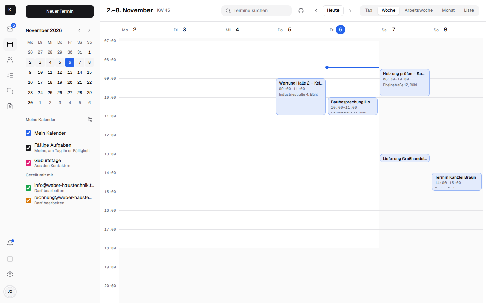

## Calendar { #kalender }

- **Day, week, work week, month and list**; move appointments by dragging, change or delete recurring ones:
  "This event only", **"This and all following"** or "All events in the series". From a given
  appointment on, the existing series ends before it, and from there a new one starts with the
  changes – as with Google and Outlook. [More](architecture.md#wiederkehrende-termine)
- **Work week and working hours:** The work week shows Monday to Friday without the weekend; the
  chosen view is in the address and stays when paging and reloading. Under *Settings →
  Appearance → Working hours in the calendar* you set when the working day begins and ends (at
  first 7 am to 6 pm, as for the suggestions of "Who has time?"): day and week open at the start
  of work, the hours before and after are shaded. The setting applies to that one device. A phone
  has no work week; it shows one day with the strip of the week above it.

  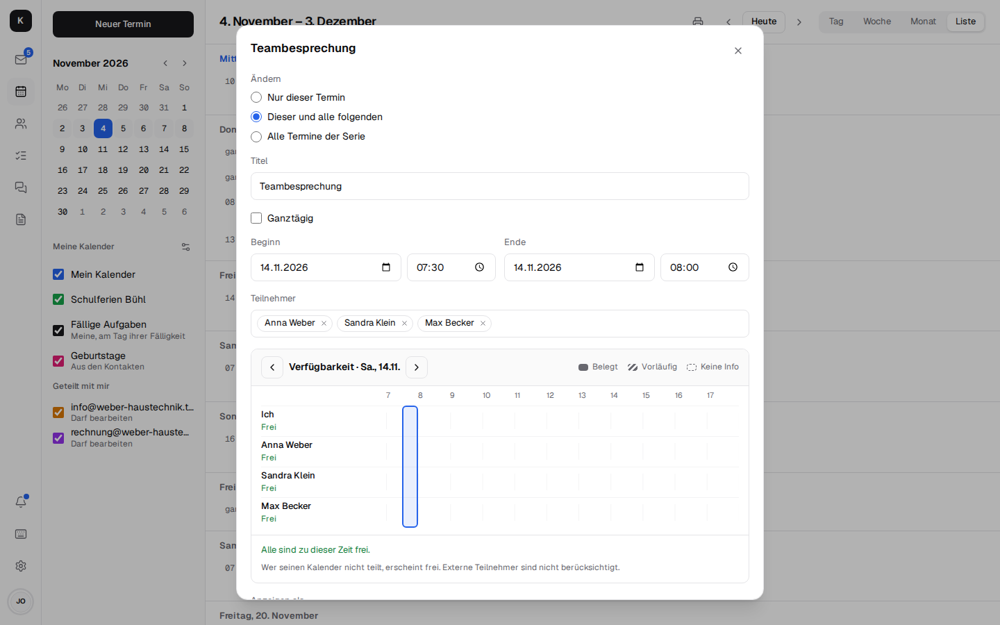

- **Searching appointments:** the "Search events" field at the top (on the phone behind the
  magnifier) finds appointments by title, location, description and participants ("Hoffmann"),
  past and coming ones, in the calendars shown; the coming ones are on top. A series shows once.
  A hit opens the appointment on its day. [More](architecture.md#termine-und-aufgaben-suchen)
- **Invitations in the mail:** when an invitation comes by mail – from Outlook, Google, Apple or
  from colleagues –, above the text it shows what, when and where, whether the appointment is
  already in the calendar and what you replied, plus **Accept**, **Maybe**, **Decline** and
  **Add to calendar**. The reply goes to the organiser, the appointment lands in the calendar; if
  the organiser cancels, "Remove from calendar" takes it out.
  [More](architecture.md#einladungen-in-der-mail)

  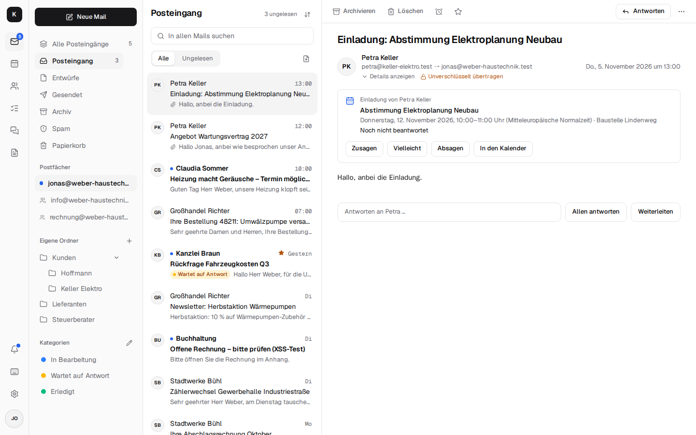

- **Invitations** with acceptance and decline; the bell shows what is still waiting for a reply,
  and the day's appointments.
- **Reminder per appointment:** from "At the start" to "1 week before", all-day appointments in
  the morning of the day or on days before; as a **notification** on the devices or as an
  **email**. Both come even when Kontext is closed: Stalwart sends the mail, the Kontext server
  delivers the notification as a push (where notifications are on). New appointments remind 15
  minutes before by notification, as before. [More](architecture.md#erinnerungen-an-termine)

  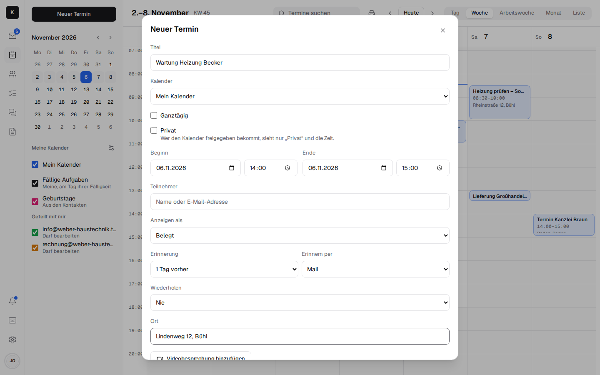
- **Reminder per calendar:** in *Manage calendars*, the bell next to a calendar opens the reminder
  that new appointments in it get, separately for appointments with a time and all-day ones. For
  example "Building sites": one day before by email. The new appointment takes it over into the
  form, where you can still change it. The setting is your own and is stored in Stalwart on the
  calendar (`defaultAlertsWithTime`, `defaultAlertsWithoutTime`); in a shared calendar, as long as
  you set none of your own, the one of the person it belongs to applies. Without a setting it stays
  at 15 minutes before, and none for all-day ones.

  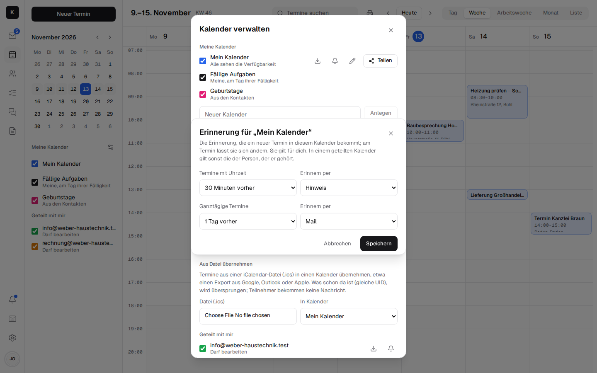

- **Duplicating an appointment:** on the appointment, "Duplicate" opens the editor with a copy:
  same title, location, video meeting, attendees, notes, reminder, "Show as", calendar, documents
  and duration – for the second appointment on the building site, say. The date is at first the
  original's; changing the start moves the end along. What is saved is a new appointment, so the
  attendees get an invitation as with any new one. Of a series, Kontext copies only the one
  appointment, without the repetition (it can be chosen again in the editor); the copy has nothing
  more to do with the series. Duplicating also works for appointments you may only read (such as
  an invitation); the copy then lands in your own calendar.

  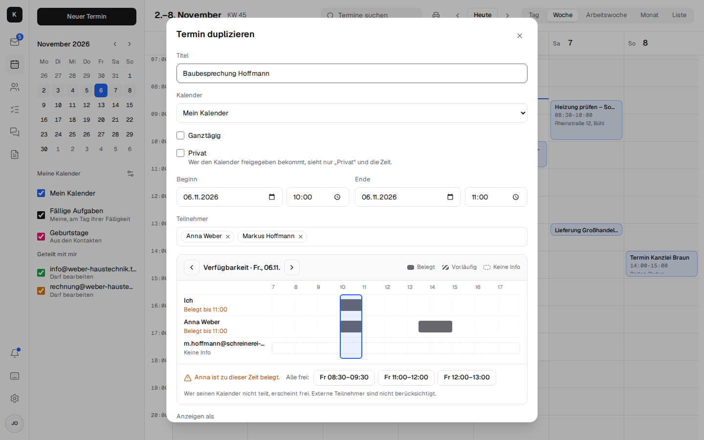

- **Task for the appointment:** in the appointment, "Task for the appointment" creates a task
  linked to it – from the task, one click takes you back to the appointment ([Tasks](tasks.md)).

- **Moving the start:** whoever changes the start date or time moves the end along; the duration
  stays, as with Google and Apple.
- **Invitations in the Kontext look:** Kontext sends them itself, in the organiser's name, with the
  time including the time zone, location, video meeting, attendees and the buttons Yes / No /
  Maybe. One click is enough, for customers without an account too; Gmail, Outlook and Apple also
  show their own buttons. Changes and cancellations go out the same way.
  [More](architecture.md#einladungen)
- **Inviting colleagues:** in the "Attendees" field, Kontext suggests colleagues from the company
  while you type (then contacts and contact groups); you don't need to know the address.
- **Who's free?** When you invite colleagues, Kontext shows who is busy at that time and suggests
  the next times when everyone is free – like Outlook's Scheduling Assistant. Within the company,
  everyone sees when colleagues are busy (without titles); this can be switched off per calendar.
  [More](architecture.md#verfugbarkeit)
- **Adding public holidays:** under *Manage calendars*, choose the federal state; Kontext creates
  the calendar "Feiertage <Bundesland>" (public holidays of that state) and enters the statutory
  public holidays for this year and next, all-day and as "free" (they block nobody's
  availability). Via CalDAV they are on the phone too. Clicking again in the new year adds what is
  missing. [More](architecture.md#feiertage)
- **Subscribing to a calendar:** under *Manage calendars*, include a calendar by its address
  (iCal, `webcal://`), such as school holidays, waste collection or a supplier's appointments. It
  appears as a calendar of its own, via CalDAV on the phone too, updates every six hours (or at the
  push of a button) and does not count for availability. "End subscription" deletes it again.
  [More](architecture.md#kalender-abonnieren)

  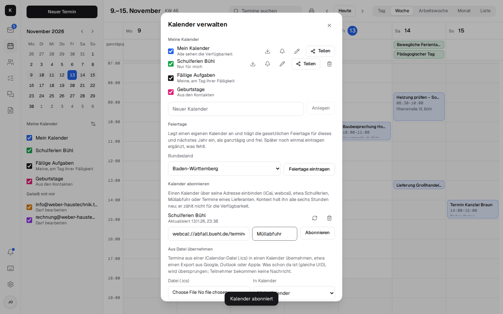

- **Importing appointments from a file:** under *Manage calendars → Import from a file*, choose an
  iCalendar file (`.ics`) – such as an export from Google, Outlook or Apple, or a supplier's
  appointments – and the calendar they should go into (your own, shared ones you may edit, and
  those of info@ & Co.). The preview shows each appointment with date and time, series as
  "Series", and how many are new and how many already there (same UID); "Import" enters only the
  new ones. Series keep their changed occurrences. Attendees get no message. Unlike a
  subscription, nothing stays connected: importing a new version of the file again only adds what
  is new. [More](architecture.md#termine-aus-einer-datei)

  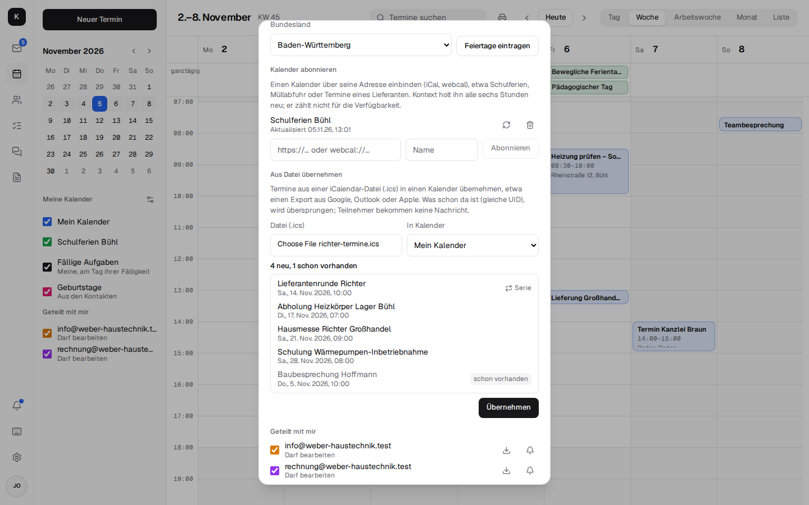

- **Exporting a calendar as .ics:** under *Manage calendars*, the down arrow next to a calendar
  (your own and shared ones) saves all its appointments as `<calendar>.ics`, past and coming,
  series with their changed and skipped occurrences, attendees with their answers. The file can be
  imported into Google, Outlook, Apple or another Kontext. Reminders stay out.

- **Printing the calendar:** the printer at the top of the calendar (or Ctrl+P, the `p` key)
  prints the open view on A4 landscape, for the pinboard in the workshop, say: in week and day,
  the week as seven columns with all appointments including time and location, all-day ones
  first; in month, the month grid with time and title, and what doesn't fit into a day as "+2
  more"; in the list, the next seven days from its first one. Printed are the calendars currently
  shown, with their colours as a legend at the top; at the bottom it says when it was printed.
  Tasks don't go on the paper. As when printing a mail, only this sheet goes to the printer, not
  the app, and it loads nothing from outside.

  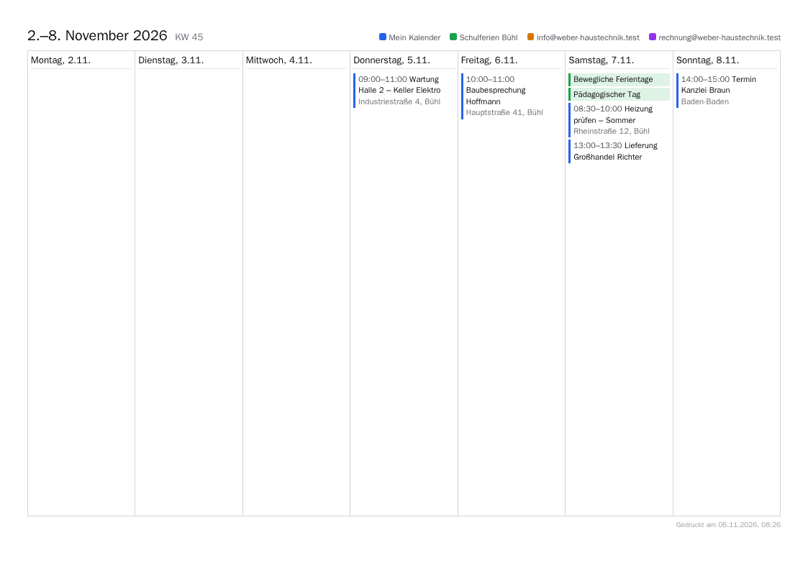

- **Sharing calendars** with colleagues: availability only, view or edit. All calendars together
  with the mailbox and contacts at once: [Deputy](mail.md#abwesenheit-und-signaturen).
- **Showing and hiding calendars** with the tick in the sidebar: applies on all devices, also for
  colleagues' calendars; for the others, the calendar stays as it is.
- **Suggesting places:** in the "Location" field, Kontext suggests addresses and businesses from
  three letters on (from OpenStreetMap), such as "Bäckerei Müller, Hauptstraße 5, 79098 Freiburg";
  free text like "Meeting room 2" still works. What you type there is sent to the place service
  Photon (komoot) by the Kontext server, not by the browser; it can be switched off with
  `PLACES_URL=`. [More](architecture.md#orte-im-termin)
- **Open in Maps:** on the appointment, the link opens the location in Apple Maps (iPhone, iPad,
  Mac) or Google Maps (otherwise); on the phone the maps app opens, with navigation one tap away.
  Kontext itself shows no map.
- **Video meeting on the appointment:** one click creates a link; customers join in the browser
  without an account as soon as someone from the company is there. See
  [Team chat and video calls](chat.md#videocalls-und-besprechungen).
- **Tasks in the calendar:** your own open tasks on the day they are due. In week and day, tasks
  with a time are in the grid at that time; tasks without a time and overdue ones (on today) are
  with the all-day appointments.
- **Birthdays:** the birthdays from the contacts (from all address books you can see) appear as
  all-day appointments in the calendar, with the age if the year of birth is known ("Petra Keller
  (52)"), otherwise just with the name. One click opens the contact. Whoever was born on 29
  February appears on 28 February in other years. Under *My calendars*, the tick next to
  "Birthdays" hides them (per device). The calendar is computed in Kontext from the contacts: it is
  always up to date, but cannot be edited and is not on the phone via CalDAV.
  [More](architecture.md#geburtstage)

  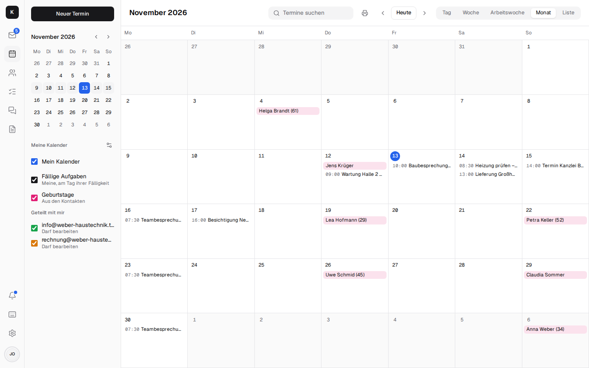

- **Documents on the appointment:** attach a file from [Documents](documents.md); those invited
  may open it.
- **On the phone:** day view with a week strip, month and list.

## Contacts { #kontakte }

- **The customer at a glance:** the latest mails with them (from info@ too), the next
  appointments, open tasks (linked to them or to a mail with them, from any mailbox), linked
  documents, "Call" via [telephony](telephony.md).
- **Creating and editing**, also "Save as contact" right next to a mail: several numbers with
  their kind (mobile, work, home, fax) and several mail addresses ("+ Number", "+ Email"), job
  title and department, website, birthday (it shows in the calendar under "Birthdays"), postcode
  and country as fields of their own. Whatever else a contact from a phone or a vCard has stays
  when it is edited. [More](architecture.md#kontaktformular)
- **Photos** on contacts: seen in the list, next to their mails and when they call; via CardDAV on
  the phone too. Everyone also sets a photo of their own for chat, calls and tasks under
  *Settings → Profile*. [More](architecture.md#fotos)
- **Groups** like "Lieferanten" (suppliers) that a mail can go to.
- **vCard import and export**, **CSV import** (a customer list from Excel or an export from
  Outlook or Google; UTF-8, UTF-16 or Windows-1252, ";" or ",") under *Address books*: Kontext
  matches the columns to the contact's fields by their header (first name, company, email, mobile,
  postcode …) and shows the first rows next to them; each match can be changed or set to "don't
  import". In Google's export the kind of a number (mobile, fax …) comes from its label.
  Duplicates are detected on import.
- **Other contacts** as at Google: whoever has written to you or whom you have written to, but who
  isn't in any address book, appears here – with "Add to contacts" and "Write mail". For this,
  Kontext reads the last 500 mails of each mailbox (without spam and trash); newsletters
  (`List-Id`, `List-Unsubscribe`), senders like `noreply@`, colleagues and your own addresses are
  left out. Nothing is stored: whoever becomes a contact disappears from the list.
- **Merging and fixing:** contacts with the same email address, phone number (`07223 4711` and
  `+49 7223 4711` count as the same) or the same name are suggested by Kontext for merging; the
  number is shown next to the entry. The most complete contact remains; it gets all the addresses,
  numbers, notes, links and address books of the others, and groups point to it. Merging only
  happens within one account and only where you may write. Names entirely in upper or lower case
  ("MAX MUSTERMANN") Kontext offers in the usual spelling. The browser remembers "Ignore".
- **Sharing address books** with colleagues – view or edit, all at once with the
  [deputy](mail.md#abwesenheit-und-signaturen).
- **Several contacts at once:** the checkbox in front of a contact selects it, with Shift all up
  to there, with Ctrl/⌘ single ones in addition; on the phone, "Select" or a long press starts the
  selection, then a tap selects (not while a contact or a group is being edited). Above the list
  there are then "Add to group", "Export as vCard" (one file `Kontakte.vcf`) and "Delete" (a
  question with the number; not if a contact from an address book shared read-only is among them).
  Kontext offers groups if all selected contacts are in the same account as the group and you may
  change it: a group names its members by the card's `uid`, and that only counts within one
  account (RFC 9553).

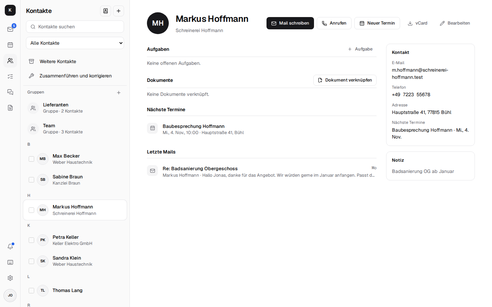

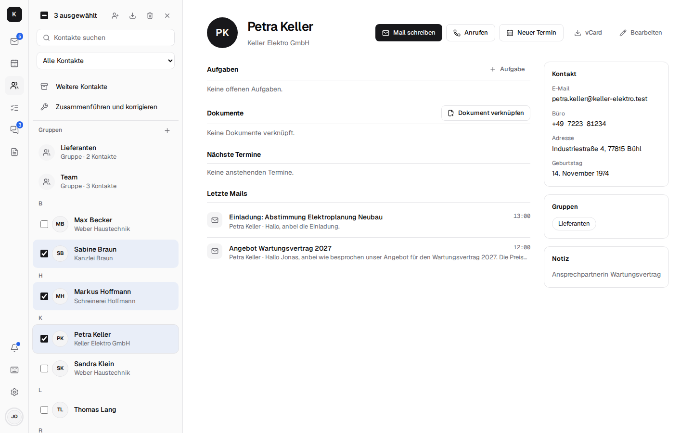

## With other programs { #mit-anderen-programmen }

Stalwart is also a CalDAV and CardDAV server: phones and Thunderbird find calendars and address
books via `https://kontext.firma.de/.well-known/caldav` or `…/carddav` and your own email
address. Kontext provides tasks as CalDAV task lists of their own, see
[Tasks](tasks.md#in-thunderbird-und-am-handy).
