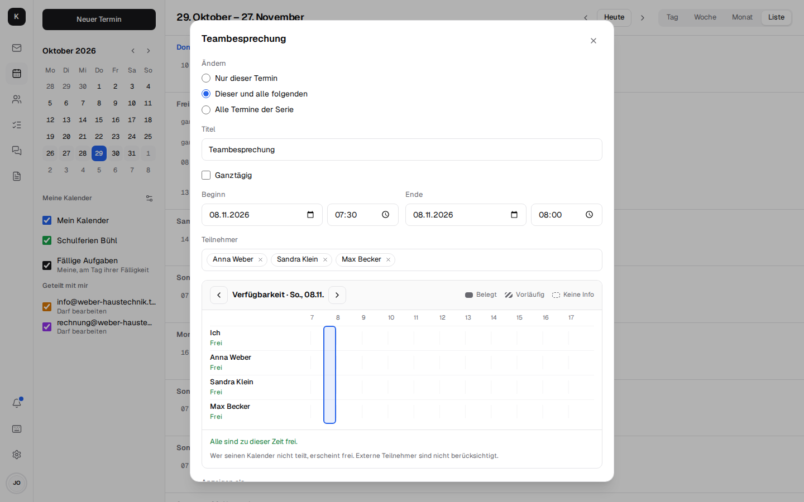
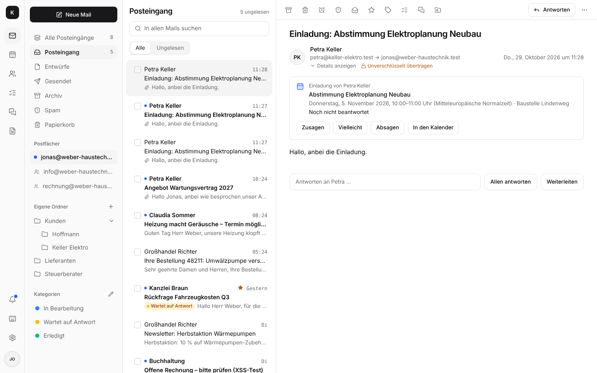
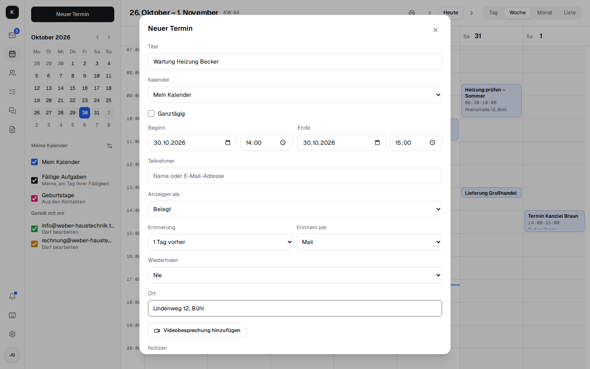
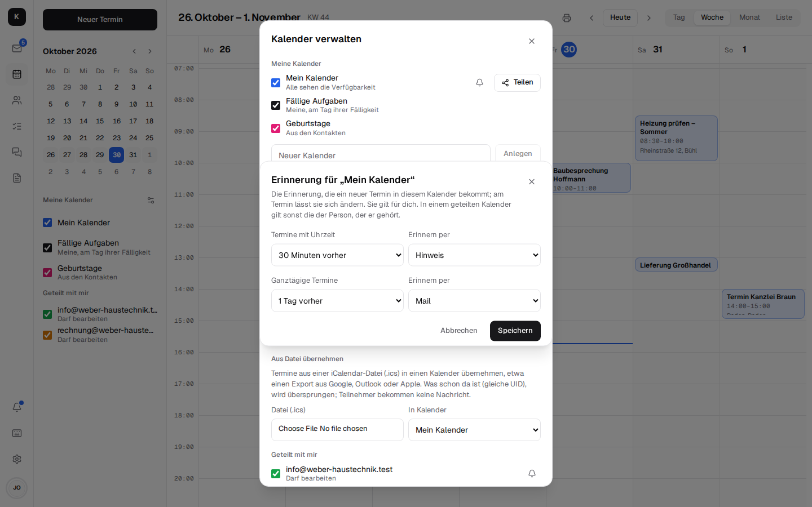
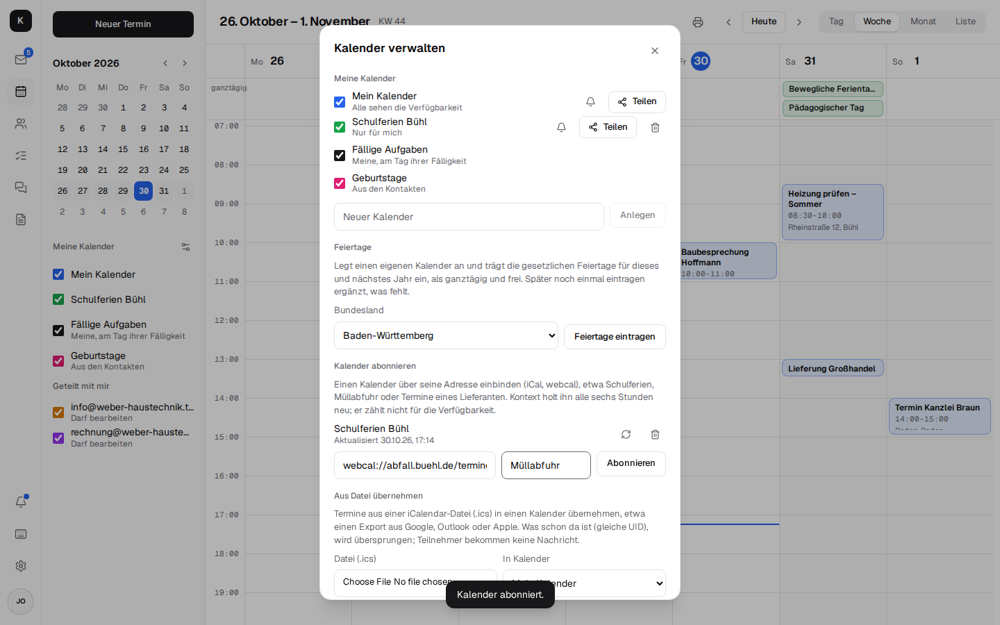
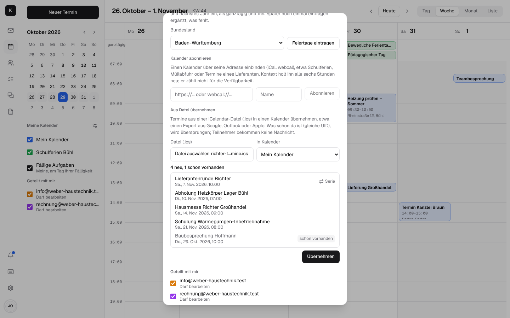
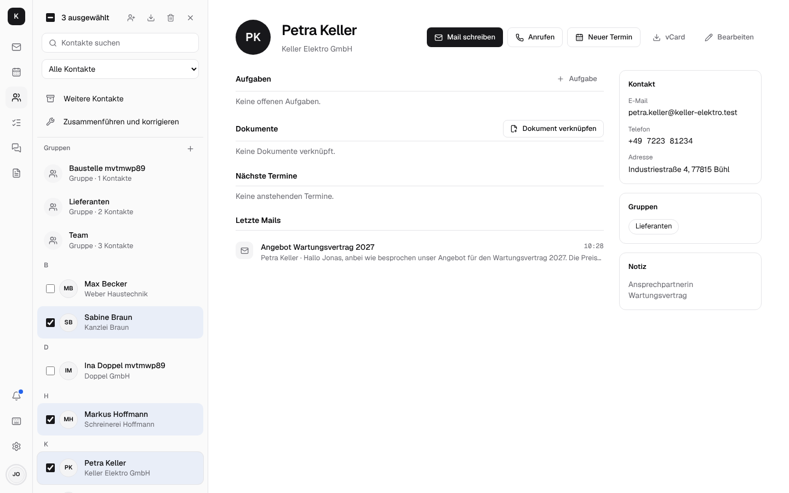

# Kalender und Kontakte

Kalender und Adressbücher liegen in Stalwart und sprechen JMAP, CalDAV und CardDAV: Was in
Kontext steht, steht auch am iPhone, unter Android (DAVx⁵) und in Thunderbird.

## Kalender

- **Tag, Woche, Monat und Liste**; Termine per Ziehen verschieben, wiederkehrende Termine ändern
  oder löschen: „Nur dieser Termin“, **„Dieser und alle folgenden“** oder „Alle Termine der
  Serie“. Ab einem Termin endet die bisherige Serie davor, und ab dort beginnt eine neue mit den
  Änderungen – wie bei Google und Outlook. [Mehr](architecture.md#wiederkehrende-termine)

  

- **Einladungen in der Mail:** Kommt eine Einladung per Mail – aus Outlook, Google, Apple oder von
  Kollegen –, steht über dem Text, was, wann und wo, ob der Termin schon im Kalender steht und
  was man geantwortet hat, dazu **Zusagen**, **Vielleicht**, **Absagen** und **In den Kalender**.
  Die Antwort geht an den Organisator, der Termin landet im Kalender; sagt der Organisator ab,
  nimmt „Aus dem Kalender entfernen“ ihn heraus. [Mehr](architecture.md#einladungen-in-der-mail)

  

- **Einladungen** mit Zusage und Absage; die Glocke zeigt, was noch auf Antwort wartet, und die
  Termine des Tages.
- **Erinnerung je Termin:** von „Zu Beginn“ bis „1 Woche vorher“, ganztägige Termine morgens am
  Tag oder an Tagen davor; als **Hinweis** auf den Geräten oder als **Mail**. Beides kommt auch,
  wenn Kontext zu ist: die Mail verschickt Stalwart, den Hinweis bringt der Kontext-Server als
  Push (wo Benachrichtigungen an sind). Neue Termine erinnern wie bisher 15 Minuten vorher per
  Hinweis. [Mehr](architecture.md#erinnerungen-an-termine)

  
- **Erinnerung je Kalender:** In *Kalender verwalten* öffnet die Glocke neben einem Kalender die
  Erinnerung, die neue Termine in ihm bekommen, getrennt für Termine mit Uhrzeit und ganztägige.
  Etwa „Baustellen“: einen Tag vorher per Mail. Der neue Termin übernimmt sie ins Formular, man
  kann sie dort noch ändern. Die Einstellung gilt für einen selbst und liegt in Stalwart am
  Kalender (`defaultAlertsWithTime`, `defaultAlertsWithoutTime`); in einem geteilten Kalender
  gilt, solange man keine eigene setzt, die der Person, der er gehört. Ohne Einstellung bleibt es bei 15 Minuten vorher, ganztägig bei
  keiner.

  

- **Beginn verschieben:** Wer Datum oder Uhrzeit des Beginns ändert, nimmt das Ende mit; die
  Dauer bleibt, wie bei Google und Apple.
- **Einladungen im Kontext-Look:** Kontext verschickt sie selbst, im Namen des Organisators, mit
  Zeit samt Zeitzone, Ort, Videobesprechung, Teilnehmern und den Knöpfen Ja / Nein / Vielleicht.
  Ein Klick genügt, auch für Kunden ohne Konto; Gmail, Outlook und Apple zeigen außerdem ihre
  eigenen Knöpfe. Änderungen und Absagen gehen genauso hinaus. [Mehr](architecture.md#einladungen)
- **Kollegen einladen:** Im Feld „Teilnehmer“ schlägt Kontext beim Tippen die Kollegen aus der
  Firma vor (danach Kontakte und Kontaktgruppen); die Adresse muss man nicht kennen.
- **Wer ist frei?** Beim Einladen von Kollegen zeigt Kontext, wer zu der Zeit belegt ist, und
  schlägt die nächsten Zeiten vor, in denen alle frei sind – wie Outlooks
  Terminplanungs-Assistent. In der Firma sieht jeder, wann Kollegen belegt sind (ohne Titel);
  abschaltbar je Kalender. [Mehr](architecture.md#verfugbarkeit)
- **Feiertage eintragen:** Unter *Kalender verwalten* das Bundesland wählen; Kontext legt den
  Kalender „Feiertage <Bundesland>“ an und trägt die gesetzlichen Feiertage für dieses und
  nächstes Jahr ein, ganztägig und als „frei“ (sie blockieren niemandes Verfügbarkeit). Über
  CalDAV stehen sie auch am Handy. Im neuen Jahr noch einmal klicken ergänzt, was fehlt.
  [Mehr](architecture.md#feiertage)
- **Kalender abonnieren:** Unter *Kalender verwalten* einen Kalender über seine Adresse einbinden
  (iCal, `webcal://`), etwa Schulferien, Müllabfuhr oder die Termine eines Lieferanten. Er steht
  als eigener Kalender da, auch über CalDAV am Handy, aktualisiert sich alle sechs Stunden (oder
  auf Knopfdruck) und zählt nicht für die Verfügbarkeit. „Abo beenden“ löscht ihn wieder.
  [Mehr](architecture.md#kalender-abonnieren)

  

- **Termine aus einer Datei übernehmen:** Unter *Kalender verwalten → Aus Datei übernehmen* eine
  iCalendar-Datei (`.ics`) wählen – etwa einen Export aus Google, Outlook oder Apple oder die
  Termine eines Lieferanten – und den Kalender, in den sie sollen (eigene, geteilte zum Bearbeiten
  und die von info@ & Co.). Die Vorschau zeigt jeden Termin mit Datum und Uhrzeit, Serien als
  „Serie“, und wie viele neu und wie viele schon vorhanden sind (gleiche UID); „Übernehmen“ trägt
  nur die neuen ein. Serien behalten ihre geänderten Termine. Teilnehmer bekommen keine
  Nachricht. Anders als ein Abo bleibt nichts verbunden: Eine neue Fassung der Datei noch einmal
  übernehmen ergänzt nur, was dazukam. [Mehr](architecture.md#termine-aus-einer-datei)

  

- **Kalender teilen** mit Kollegen: nur Verfügbarkeit, lesen oder bearbeiten. Alle Kalender
  samt Postfach und Kontakten auf einmal: [Vertretung](mail.md#abwesenheit-und-signaturen).
- **Orte vorschlagen:** Im Feld „Ort“ schlägt Kontext ab drei Buchstaben Adressen und Firmen vor
  (aus OpenStreetMap), etwa „Bäckerei Müller, Hauptstraße 5, 79098 Freiburg“; freier Text wie
  „Besprechungsraum 2“ geht weiter. Was man dort tippt, schickt der Kontext-Server an den
  Ortsdienst Photon (komoot), nicht der Browser; abschaltbar mit `PLACES_URL=`.
  [Mehr](architecture.md#orte-im-termin)
- **In Karten öffnen:** Am Termin öffnet der Link den Ort in Apple Karten (iPhone, iPad, Mac) oder
  Google Maps (sonst); am Handy öffnet sich die Karten-App, die Navigation ist einen Tipp entfernt.
  Kontext selbst zeigt keine Karte.
- **Videobesprechung am Termin:** Ein Klick legt einen Link an; Kunden kommen im Browser ohne
  Konto dazu, sobald jemand aus der Firma da ist. Siehe [Team-Chat und Videocalls](chat.md#videocalls-und-besprechungen).
- **Aufgaben im Kalender:** die eigenen offenen Aufgaben am Tag ihrer Fälligkeit. In Woche und
  Tag stehen Aufgaben mit Uhrzeit zu dieser Zeit im Raster; Aufgaben ohne Uhrzeit und
  überfällige (auf heute) stehen bei den ganztägigen Terminen.
- **Dokumente am Termin:** eine Datei aus [Dokumente](documents.md) anhängen, die Eingeladenen
  dürfen sie öffnen.
- **Am Handy:** Tagesansicht mit Wochenleiste, Monat und Liste.

## Kontakte

- **Der Kunde auf einen Blick:** die letzten Mails mit ihm (auch aus info@), die nächsten
  Termine, offene Aufgaben, verknüpfte Dokumente, „Anrufen“ über die [Telefonie](telephony.md).
- **Anlegen und bearbeiten**, auch „Als Kontakt speichern“ direkt neben einer Mail.
- **Fotos** an Kontakten: zu sehen in der Liste, neben ihren Mails und wenn sie anrufen; über
  CardDAV auch am Handy. Jeder legt außerdem unter *Einstellungen → Profil* ein eigenes Foto für
  Chat, Anrufe und Aufgaben an. [Mehr](architecture.md#fotos)
- **Gruppen** wie „Lieferanten“, an die eine Mail geht.
- **vCard-Import und -Export**; Doppeltes wird beim Import erkannt.
- **Weitere Kontakte** wie bei Google: Wer einem geschrieben hat oder wem man geschrieben hat,
  aber in keinem Adressbuch steht, erscheint hier – mit „Zu Kontakten hinzufügen“ und „Mail
  schreiben“. Kontext liest dafür die letzten 500 Mails jedes Postfachs (ohne Spam und
  Papierkorb); Newsletter (`List-Id`, `List-Unsubscribe`), Absender wie `noreply@`, Kollegen und
  die eigenen Adressen fehlen. Gespeichert wird nichts: Wer Kontakt wird, verschwindet aus der
  Liste.
- **Zusammenführen und korrigieren:** Kontakte mit derselben Mail-Adresse, Telefonnummer
  (`07223 4711` und `+49 7223 4711` zählen gleich) oder demselben Namen schlägt Kontext zum
  Zusammenführen vor, die Zahl steht neben dem Eintrag. Es bleibt der vollständigste Kontakt; er
  bekommt alle Adressen, Nummern, Notizen, Links und Adressbücher der anderen, und Gruppen
  zeigen auf ihn. Zusammengeführt wird nur innerhalb eines Kontos und nur, wo man schreiben
  darf. Namen ganz in Groß- oder Kleinbuchstaben („MAX MUSTERMANN“) bietet Kontext in üblicher
  Schreibweise an. „Ignorieren“ merkt sich der Browser.
- **Adressbücher teilen** mit Kollegen – lesen oder bearbeiten, alle auf einmal mit der
  [Vertretung](mail.md#abwesenheit-und-signaturen).
- **Mehrere Kontakte auf einmal:** Das Kästchen vor einem Kontakt wählt ihn aus, mit Umschalt
  alle bis dorthin, mit Strg/⌘ einzelne dazu; am Handy beginnt „Auswählen“ oder langes Drücken
  die Auswahl, dann wählt ein Tipp (nicht, während ein Kontakt oder eine Gruppe bearbeitet wird). Über der Liste stehen dann „Zu Gruppe hinzufügen“, „Als vCard
  exportieren“ (eine Datei `Kontakte.vcf`) und „Löschen“ (eine Frage mit der Anzahl; nicht, wenn
  ein Kontakt aus einem nur zum Lesen geteilten Adressbuch dabei ist). Gruppen
  bietet Kontext an, wenn alle ausgewählten Kontakte im selben Konto liegen wie die Gruppe und
  man sie ändern darf: Mitglieder nennt eine Gruppe über die `uid` der Karte, und die gilt nur
  innerhalb eines Kontos (RFC 9553).

## Mit anderen Programmen

Stalwart ist zugleich CalDAV- und CardDAV-Server: Handy und Thunderbird finden Kalender und
Adressbücher über `https://kontext.firma.de/.well-known/caldav` bzw. `…/carddav` und die eigene
Mail-Adresse. Aufgaben stellt Kontext als eigene CalDAV-Aufgabenlisten bereit, siehe
[Aufgaben](tasks.md#in-thunderbird-und-am-handy).
