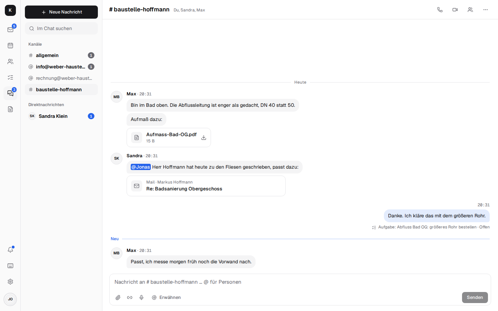
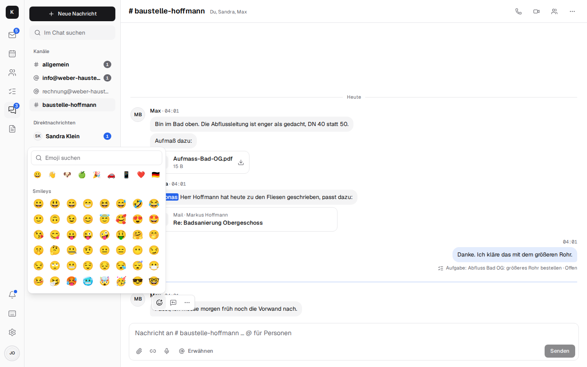

# Team chat and video calls { #team-chat-und-videocalls }

The chat is part of Kontext, not of yet another service: the same sign-in, the same people, the
same mailboxes. Instead of forwarding a customer's mail internally, you discuss it in the info@
channel – whoever may open the mailbox opens the mail, nothing is copied.

## Channels and messages { #kanale-und-nachrichten }

- **#allgemein** (general) for everyone, **one channel per shared mailbox** (info@, rechnung@) for
  everyone who works in it, and channels of your own like #baustelle-hoffmann with chosen members.
- **Direct messages** to one or more people, with “Seen”.
- **Speech bubbles like in a messenger**, on the PC and on the phone: your own on the right in light
  blue, the others' on the left in grey with their name (on the PC with a photo too).
- **Live:** messages, “Sandra is typing …” and who is online, without reloading; unread messages
  on the chat and on the app icon.
- **@mentions** with suggestions; a mention or a direct message reaches the phone, even when the
  app is closed.
- **Threads and reactions:** reply in a thread without filling up the channel; 👍 ✅ 🎉 instead of
  “ok”. On the PC through the small bar that appears above the message when you hover over it; on
  the phone you press and hold the message, and the reactions and Reply, Copy text, Task, Edit and
  Delete come up from below.
- **Any emoji:** “+” next to the seven quick reactions shows all of them, by category, with search
  in German or English (“daumen”, “werkzeug”, “thumbs”).

  
- **Also send to channel:** a checkbox below the reply field in the thread also puts the reply into
  the channel, with “Replied to a thread: …” above it; a click on that opens the thread. Good for
  the outcome of a longer discussion.
- **Photos and files** from the camera, by dragging or pasting; photos are scaled down first.
- **Voice messages** like on WhatsApp: the microphone (on the phone in place of “Send” as long as
  nothing has been typed) records until you press “Send” or discard it; after a quarter of an hour
  the recording goes off on its own. While recording, a waveform grows with what you say; after
  “Send”, the bar stays until the message, waveform and all, is in the conversation. There it plays
  right away, with a waveform to jump around in that fills evenly as it plays, the duration and a
  speed of 1×, 1.5× or 2×; only one plays at a time. The list and notifications say “Voice
  message”.
- **Search** across all channels; edit and delete your own messages; mute, leave, delete.
- **Retention** is set by the company admin (30 days to 5 years, or unlimited).

## Mails, tasks, contacts and documents as cards { #mails-aufgaben-kontakte-und-dokumente-als-karten }

- **“Discuss” on a mail** (`b`) sends it as a card to a channel; the mail then shows where it was
  discussed. Only someone who may see the mailbox anyway can open the card.
- **Share a mail as a copy** with its attachments – for colleagues who can't open the mailbox.
- **A task from a message**, linked both ways.
- **Share documents** from [Documents](documents.md); the members may open them.

## Video calls and meetings { #videocalls-und-besprechungen }

Calls run over [LiveKit](https://github.com/livekit/livekit) on your own server (optional) – no
Zoom, no Teams, no data with third parties.

- **Call and Video call** from any direct message, ringing even when the app is closed; **Start
  meeting** in a channel, others join.
- **Microphone, camera, screen sharing**; the call stays open while you switch to mail or the
  calendar.
- **Large pictures:** with two people, the other person fills the screen and your own picture sits
  small in the corner; in a group everyone shares the space, and a shared screen comes to the front.
- **In the history:** “Call · 5 min”, missed calls with “Call back”.
- **A video meeting on an appointment** with a link for guests without an account; they get in as
  soon as someone from the company is there.
- **In confidential conversations**, calls are end-to-end encrypted.

The company phone (Fritzbox) is part of it too: see [Telephony](telephony.md).

## Confidential conversations { #vertrauliche-unterhaltungen }

Direct messages and channels can be started or continued as **confidential**: end-to-end encrypted
with the personal keys, photos and files included – the server sees only encrypted data. How, and
with which limits:
[Encryption → Building block 5](encryption.md#baustein-5-vertrauliche-unterhaltungen-im-chat).

Setting up calls: [Installation → Calls](installation.md#anrufe). Technical details:
[Architecture → Team chat](architecture.md#team-chat) and [Calls](architecture.md#anrufe).
