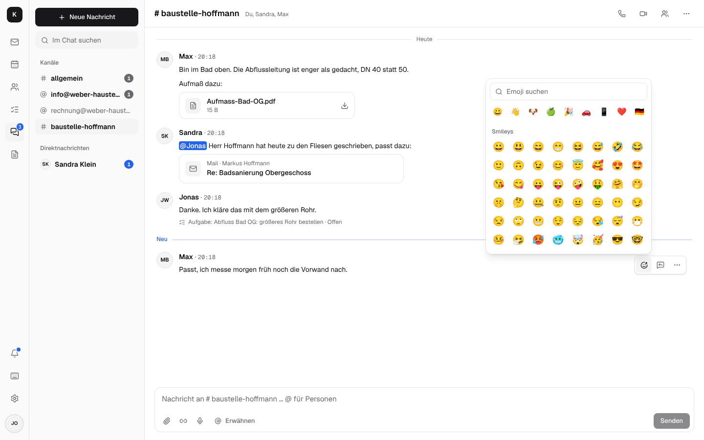

# Team-Chat und Videocalls

Der Chat gehört zu Kontext, nicht zu einem weiteren Dienst: dieselbe Anmeldung, dieselben Leute,
dieselben Postfächer. Statt eine Kundenmail intern weiterzuleiten, bespricht man sie im Kanal von
info@ – wer das Postfach öffnen darf, öffnet die Mail, kopiert wird nichts.

## Kanäle und Nachrichten

- **#allgemein** für alle, **ein Kanal pro gemeinsamem Postfach** (info@, rechnung@) für alle,
  die darin arbeiten, und eigene wie #baustelle-hoffmann mit ausgewählten Mitgliedern.
- **Direktnachrichten** an eine oder mehrere Personen, mit „Gelesen“.
- **Live:** Nachrichten, „Sandra schreibt …“ und wer online ist, ohne Neuladen; Ungelesenes am
  Chat und am App-Symbol.
- **@Erwähnungen** mit Vorschlägen; eine Erwähnung oder Direktnachricht kommt aufs Handy, auch
  bei geschlossener App.
- **Threads und Reaktionen:** im Thread antworten, ohne den Kanal zu füllen; 👍 ✅ 🎉 statt
  „ok“. Am PC über die kleine Leiste, die beim Darüberfahren über der Nachricht erscheint; am
  Handy hält man die Nachricht gedrückt, dann kommen von unten die Reaktionen und Antworten,
  Text kopieren, Aufgabe, Bearbeiten und Löschen.
- **Jedes Emoji:** „+“ neben den sieben schnellen Reaktionen zeigt alle, nach Kategorien, mit
  Suche auf Deutsch oder Englisch („daumen“, „werkzeug“, „thumbs“).

  
- **Auch im Kanal zeigen:** Ein Häkchen unter dem Antwortfeld im Thread stellt die Antwort
  zusätzlich in den Kanal, mit „Antwort im Thread zu: …“ darüber; ein Klick darauf öffnet den
  Thread. Gut für das Ergebnis einer längeren Abstimmung.
- **Fotos und Dateien** von der Kamera, per Ziehen oder Einfügen; Fotos werden vorher verkleinert.
- **Sprachnachrichten** wie bei WhatsApp: das Mikrofon (am Handy anstelle von „Senden“, solange
  nichts geschrieben ist) nimmt auf, bis man „Senden“ drückt oder verwirft; nach einer
  Viertelstunde geht die Aufnahme von selbst. Während der Aufnahme wächst eine Wellenform mit dem,
  was man sagt; nach „Senden“ bleibt die Leiste stehen, bis die Nachricht samt Wellenform in der
  Unterhaltung steht. Dort spielt sie direkt ab, mit Wellenform zum Springen, die sich beim
  Abspielen gleichmäßig füllt, Dauer und Tempo 1×, 1,5× oder 2×; es spielt immer nur eine. In der
  Liste und in Benachrichtigungen steht „Sprachnachricht“.
- **Suche** über alle Kanäle; eigene Nachrichten bearbeiten und löschen; stummschalten,
  verlassen, löschen.
- **Aufbewahrung** legt die Firmenverwaltung fest (30 Tage bis 5 Jahre oder unbegrenzt).

## Mails, Aufgaben, Kontakte und Dokumente als Karten

- **„Besprechen“ an einer Mail** (`b`) schickt sie als Karte in einen Kanal; die Mail zeigt danach,
  wo sie besprochen wurde. Öffnen kann die Karte nur, wer das Postfach ohnehin sehen darf.
- **Mail als Kopie teilen** mit Anhängen – für Kollegen, die das Postfach nicht öffnen können.
- **Aufgabe aus einer Nachricht**, in beide Richtungen verknüpft.
- **Dokumente** aus [Dokumente](documents.md) teilen; die Mitglieder dürfen sie öffnen.

## Videocalls und Besprechungen

Anrufe laufen über [LiveKit](https://github.com/livekit/livekit) auf dem eigenen Server
(optional) – kein Zoom, kein Teams, keine Daten bei Dritten.

- **Anrufen und Videoanruf** aus jeder Direktnachricht, mit Klingeln auch bei geschlossener App;
  **Besprechung starten** in einem Kanal, andere treten bei.
- **Mikrofon, Kamera, Bildschirm teilen**; das Gespräch bleibt offen, während man zu Mail oder
  Kalender wechselt.
- **Große Bilder:** zu zweit füllt das Gegenüber den Bildschirm, das eigene Bild steht klein in
  der Ecke; in der Gruppe teilen sich alle die Fläche, ein geteilter Bildschirm kommt nach vorn.
- **Im Verlauf:** „Anruf · 5 Min“, verpasste Anrufe mit „Zurückrufen“.
- **Videobesprechung am Termin** mit einem Link für Gäste ohne Konto; sie kommen hinein, sobald
  jemand aus der Firma da ist.
- **In vertraulichen Unterhaltungen** sind Anrufe Ende-zu-Ende verschlüsselt.

Das Firmentelefon (Fritzbox) gehört ebenfalls dazu: siehe [Telefonie](telephony.md).

## Vertrauliche Unterhaltungen

Direktnachrichten und Kanäle lassen sich **vertraulich** anlegen oder fortführen: Ende-zu-Ende
verschlüsselt mit den persönlichen Schlüsseln, Fotos und Dateien eingeschlossen – der Server sieht
nur Verschlüsseltes. Wie und mit welchen Grenzen:
[Verschlüsselung → Baustein 5](encryption.md#baustein-5-vertrauliche-unterhaltungen-im-chat).

Einrichtung der Anrufe: [Installation → Anrufe](installation.md#anrufe). Technik:
[Architektur → Team-Chat](architecture.md#team-chat) und [Anrufe](architecture.md#anrufe).
