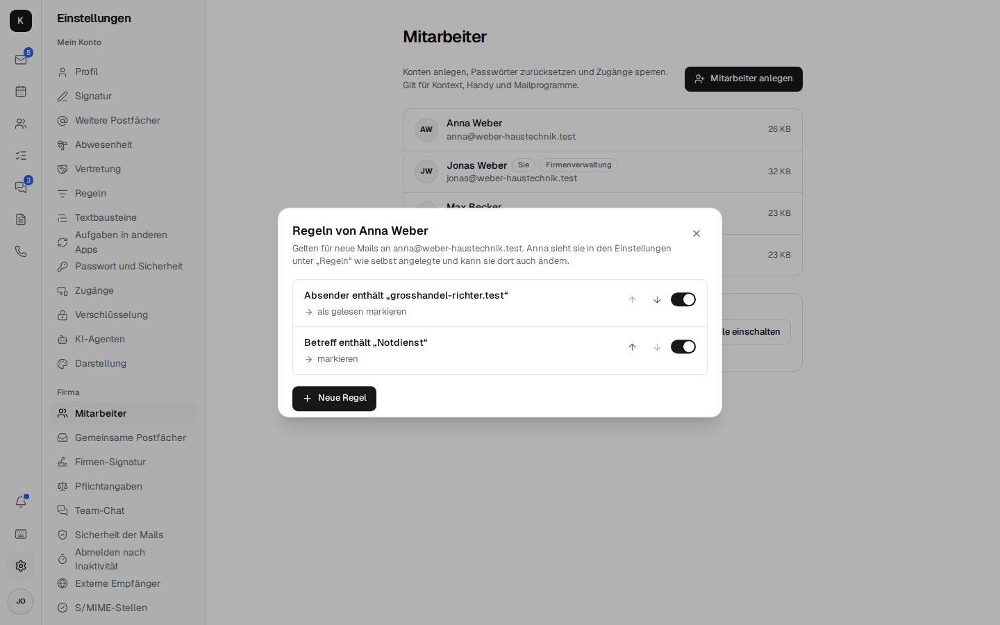
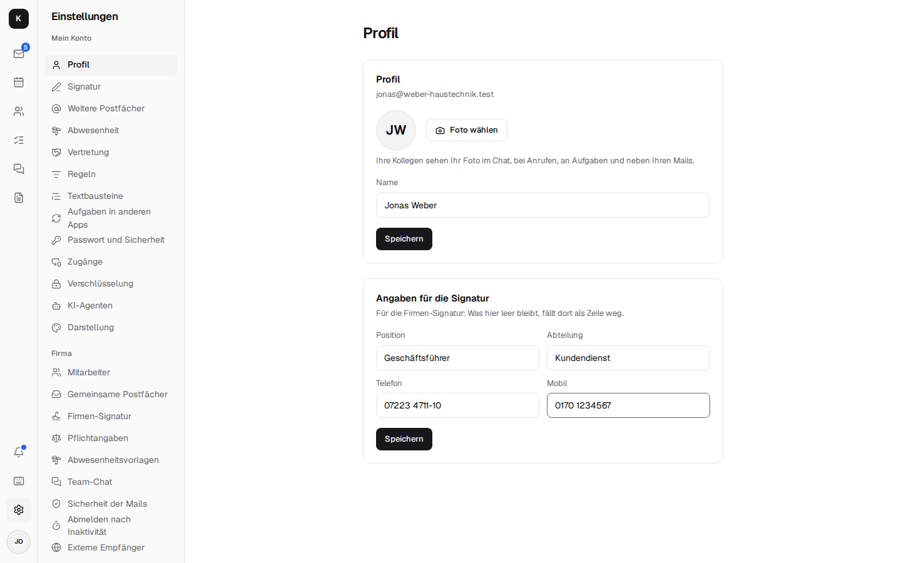
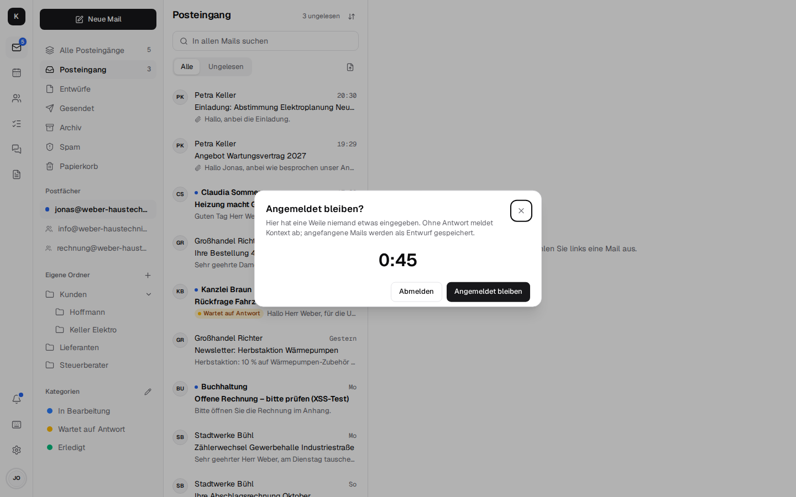

# Company admin and migration { #firmenverwaltung-und-umzug }

Under *Settings → Company* the boss (or the office manager) runs the company themselves – without
Stalwart's admin interface and without IT skills.

## Employees and mailboxes { #mitarbeiter-und-postfacher }

- **Add employees** with a starting password, reset the password and the sign-in with a code,
  **block access** (mail keeps arriving), further addresses such as buchhaltung@.
- **Shared mailboxes** with rights per person: no access, read only, read and send; rules of
  their own per mailbox.
- **Out of office for colleagues** (during illness, for example) with a stand-in named in the reply.
- **Rules for employees:** *Rules* on the person's entry – for example “mail from the supplier into
  the Orders folder” for a new colleague. These are the same rules as under *Settings → Rules* of
  that person: she sees the ones the boss created there like her own and can change or delete
  them; the other way round, the boss sees hers. “Also apply to mail already in the Inbox” works on
  her inbox. Only someone allowed to open the company admin can get at other people's rules.

  

- **Company signature** for everyone at once, with `[Name]` and `[E-Mail]` per sender and
  `[Telefon]`, `[Mobil]`, `[Position]`, `[Abteilung]` (phone, mobile, position, department): each
  person enters those once under *Settings → Profile* (“Details for the signature”), and their
  signature is updated right away. A line whose detail is missing is left out – nobody has
  “Mobile:” without a number.

  

- **Legal footer** under *Settings → Company → Legal footer*: what has to be under every business
  mail – company name with legal form, registered office, register court and commercial register
  number, managing directors, VAT ID (§ 35a GmbHG, § 37a HGB). Once entered, Kontext adds the text
  under every mail of every employee when sending, also from shared mailboxes, encrypted and
  signed; unlike the signature, nobody can leave it out or change it. Plain text only, line breaks
  are kept; when it's empty (as it is at the start), Kontext adds nothing. Whoever sends from
  another mail program over IMAP and SMTP (on the phone, say) doesn't get it: Kontext can't add
  anything there.
- **Leaving:** block access, hand the mailbox over to a colleague, forward new mail and reply
  automatically – nothing is deleted.
- **Availability in the calendar**, switched on for everyone.
- **Team chat:** retention period; **telephony:** Fritzbox, who is rung, voicemail, opening hours
  ([Telephony](telephony.md)).
- **External recipients** (the “External” hint, off until switched on): mail from outside carries
  the “External” tag, and before sending or inviting outside, Kontext asks once
  ([Mail](mail.md#schreiben)). Counted as internal are your own domains and the **partner domains**
  entered here (one per line, the tax advisor's office, say).
- **Report phishing** under *Settings → Company → Email security*: one address, such as your own
  IT team's or your IT provider's. Once it is entered, every mail has **Report as phishing** under
  "More actions": Kontext sends the mail as an attachment (.eml, with all its headers) to this
  address, without a copy in "Sent", and moves it to spam. Empty (as it is at first), the item is
  not there.
- **Sign out after inactivity** under *Settings → Company → Sign out after inactivity*: for
  computers several people share (reception, front desk). The company admin picks a time – off
  (as it is at the start), 15 or 30 minutes, 1, 4 or 8 hours. If nobody has moved the mouse,
  clicked or typed for that long, Kontext asks “Stay signed in?” and counts down one minute (at
  most half the time for short times). Moving the mouse doesn't answer the question, only “Stay
  signed in” (or closing it) does. Without an answer, Kontext saves mails being written as drafts
  and signs out, back to the sign-in. Input in one tab counts for all tabs in the same browser, and
  so does a running call; if the browser was closed for longer than the time allows, Kontext signs
  out as soon as it is opened again. Someone who only writes in *Documents* is asked as well:
  Kontext doesn't see input inside its own frame. This applies to the web app; mail programs over
  IMAP and calendar apps over CalDAV stay signed in.

  

- **S/MIME authorities** under *Settings → Company → S/MIME authorities*: certificates of
  authorities the company trusts for S/MIME, in addition to Mozilla's list – for example the root
  of a state administration or a chamber (.cer, .crt, .pem). Each is listed with its name, issuer,
  validity and fingerprint and can be removed again
  ([Encryption](encryption.md#baustein-4-vertraulich-senden-fur-alle-empfanger)).
- **Check security:** SPF, DMARC, MTA-STS, TLS-RPT, DANE and HTTPS of your own domain
  ([Encryption](encryption.md#baustein-1-grundschutz-unsichtbar-fur-alles)).
- **Backup:** where the backup goes, how the last run went, how full the storage is, the time of
  the nightly backup and “Back up now”, plus the log. For this, the units must be set up on the
  server ([Installation → Backups](installation.md#5-backups)); otherwise it says “Control isn’t
  set up on the server”.

## Moving to Kontext { #umzug-nach-kontext }

Under *Settings → Company → Migration* the boss fetches an employee's data from the old system; a
migration can safely be repeated, duplicates are skipped.

| From | How | What comes along |
| --- | --- | --- |
| **Gmail, GMX, WEB.DE, Telekom, IONOS, STRATO, your own server** | IMAP with an (app) password, synced every 15 minutes until the migration is finished | mail with folders or labels and keywords |
| **Microsoft 365** | an app in the company's Microsoft account (Graph) | mail with folders and Outlook categories, contacts, appointments and recurring events |
| **Outlook (PST file)** | upload | mail, contacts, appointments |
| **Google export** | upload vCard and iCalendar | contacts and calendars |

Whoever wants to keep their old address for good connects it as a
[further mailbox](mail.md#weitere-postfacher-gmail-gmx-webde-co).

Setup: [Installation → Switching on the company admin](installation.md#firmenverwaltung-einschalten)
and [Migration](installation.md#umzug). Technical details: [Architecture → Company admin](architecture.md#firmenverwaltung)
and [Migration](architecture.md#umzug).
