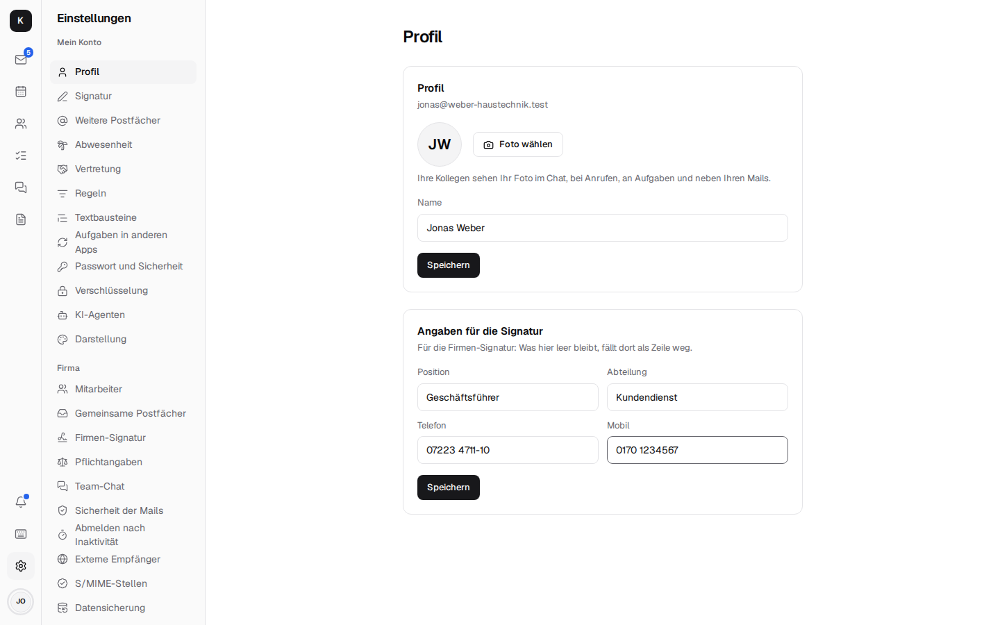

# Firmenverwaltung und Umzug

Unter *Einstellungen → Firma* verwaltet der Chef (oder die Büroleitung) die Firma selbst – ohne
Stalwarts Admin-Oberfläche und ohne IT-Kenntnisse.

## Mitarbeiter und Postfächer

- **Mitarbeiter anlegen** mit Startpasswort, Passwort und Anmeldung mit Code zurücksetzen,
  **Zugang sperren** (Mails kommen weiter an), weitere Adressen wie buchhaltung@.
- **Gemeinsame Postfächer** mit Rechten je Person: kein Zugriff, nur lesen, lesen und senden;
  eigene Regeln je Postfach.
- **Abwesenheit für Kollegen** (etwa bei Krankheit) mit Vertretung in der Antwort.
- **Firmen-Signatur** für alle auf einmal, mit `[Name]` und `[E-Mail]` je Absender und
  `[Telefon]`, `[Mobil]`, `[Position]`, `[Abteilung]`: die trägt jede Person einmal unter
  *Einstellungen → Profil* ein („Angaben für die Signatur“), und ihre Signatur ist sofort
  aktualisiert. Eine Zeile, deren Angabe fehlt, fällt weg – niemand hat „Mobil:“ ohne Nummer.

  

- **Pflichtangaben** unter *Einstellungen → Firma → Pflichtangaben*: was unter jeder
  geschäftlichen Mail stehen muss – Firma mit Rechtsform, Sitz, Registergericht und
  Handelsregisternummer, Geschäftsführer, USt-IdNr. (§ 35a GmbHG, § 37a HGB). Einmal eingetragen,
  setzt Kontext den Text beim Senden unter jede Mail aller Mitarbeiter, auch aus gemeinsamen
  Postfächern, verschlüsselt und signiert; anders als die Signatur kann ihn niemand weglassen oder
  ändern. Nur Text, Zeilenumbrüche bleiben; leer (so ist es zu Beginn) fügt Kontext nichts an.
  Wer mit einem anderen Mailprogramm über IMAP und SMTP sendet (etwa am Handy), bekommt ihn nicht:
  dort kann Kontext nichts anfügen.
- **Austritt:** Zugang sperren, Postfach einer Kollegin übergeben, neue Mails weiterleiten und
  automatisch antworten – gelöscht wird nichts.
- **Verfügbarkeit im Kalender** für alle einschalten.
- **Team-Chat:** Aufbewahrungsfrist; **Telefonie:** Fritzbox, wer klingelt, Mailbox,
  Öffnungszeiten ([Telefonie](telephony.md)).
- **Externe Empfänger** (Hinweis „Extern“, aus bis zum Einschalten): Mails von außerhalb tragen
  die Marke „Extern“, und vor dem Senden oder Einladen nach außen fragt Kontext einmal nach
  ([Mail](mail.md#schreiben)). Als intern gelten die eigenen Domains und die **Partner-Domains**,
  die hier eingetragen werden (eine je Zeile, etwa das Steuerbüro).
- **Sicherheit prüfen:** SPF, DMARC, MTA-STS, TLS-RPT, DANE und HTTPS der eigenen Domain
  ([Verschlüsselung](encryption.md#baustein-1-grundschutz-unsichtbar-fur-alles)).
- **Datensicherung:** wohin gesichert wird, wie der letzte Lauf ausging, wie voll der Speicher
  ist, die Uhrzeit der nächtlichen Sicherung und „Jetzt sichern“, dazu das Protokoll. Dafür
  müssen auf dem Server die Units eingerichtet sein
  ([Installation → Backups](installation.md#5-backups)); sonst steht dort „Steuerung auf dem
  Server nicht eingerichtet“.

## Umzug nach Kontext

Unter *Einstellungen → Firma → Umzug* holt der Chef die Daten eines Mitarbeiters aus dem alten
System; ein Umzug lässt sich gefahrlos wiederholen, Doppeltes wird übersprungen.

| Von | Wie | Was kommt mit |
| --- | --- | --- |
| **Gmail, GMX, WEB.DE, Telekom, IONOS, STRATO, eigener Server** | IMAP mit (App-)Passwort, abgeglichen alle 15 Minuten bis zum Abschluss | Mails mit Ordnern bzw. Labels und Schlagworten |
| **Microsoft 365** | eine App im Microsoft-Konto der Firma (Graph) | Mails mit Ordnern und Outlook-Kategorien, Kontakte, Termine und Serien |
| **Outlook (PST-Datei)** | hochladen | Mails, Kontakte, Termine |
| **Google-Export** | vCard und iCalendar hochladen | Kontakte und Kalender |

Wer seine alte Adresse dauerhaft behalten will, verbindet sie als
[weiteres Postfach](mail.md#weitere-postfacher-gmail-gmx-webde-co).

Einrichtung: [Installation → Firmenverwaltung einschalten](installation.md#firmenverwaltung-einschalten)
und [Umzug](installation.md#umzug). Technik: [Architektur → Firmenverwaltung](architecture.md#firmenverwaltung)
und [Umzug](architecture.md#umzug).
