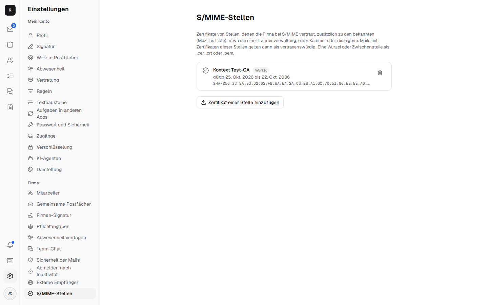

# Encryption { #verschlusselung }

How Kontext protects mail, chat, tasks and files – a concept in layers. Not everything has to be
end-to-end encrypted: Kontext runs on the business's own server, and many features (search,
rules, notifications with text, tasks from mails) need a server that can read the content.
End-to-end is there where it counts: towards the outside and for selected confidential
conversations.

Status: all five building blocks are done ([roadmap](https://github.com/firsttris/kontext/blob/main/ROADMAP.md)).

## What it protects against { #wovor-geschutzt-wird }

| Threat | Example | Building block |
| --- | --- | --- |
| Eavesdropping in transit | open Wi-Fi, other mail servers along the way | 1 |
| Stolen disk or backup | server theft, a backup at a service provider | 1 |
| Confidential matters going out | medical findings, tax documents, payslips to customers, authorities, tax advisors (GDPR Art. 32, professional secrecy under § 203 StGB) | 2, 3, 4 |
| Confidential matters inside | HR matters that not even the admin should read | 5 |

Not protected – and not the aim: a device that is already in someone else's hands and unlocked;
whoever is administrator on the server can read everything except what is end-to-end encrypted.

## Building block 1: basic protection – invisible, for everything { #baustein-1-grundschutz-unsichtbar-fur-alles }

- **In transit:** the app and the server talk only over HTTPS. For mails to other servers,
  Stalwart requires encryption where the recipient promises it (MTA-STS, DANE), and tries it
  otherwise (STARTTLS). Incoming, Stalwart accepts encrypted connections.
- **At rest:** the server's disk is encrypted (LUKS or similar), backups are stored encrypted
  (e.g. restic). That covers everything at once: Stalwart's mailboxes, Kontext's database (chat,
  tasks) and the chat's files. The [installation](installation.md) describes it.
- **Visible:** next to "Show details", a mail shows whether it reached your own server encrypted
  – from the topmost `Received` line, the protocol after `with` (RFC 3848: `ESMTPS`, `ESMTPSA`;
  `src/lib/transport.ts`). The line comes raw (`header:Received:all`): JMAP does not hand out
  `Received` as text (RFC 8621 §4.1.2), and Stalwart 1.0 otherwise rejects the whole request
  (`src/jmap/header-form.ts` checks every header Kontext asks for). What arrived unencrypted is
  marked yellow; what came into being on the server itself (invitations, mails between
  colleagues) shows nothing.
- **Checked:** the company admin ("Email security") shows, per domain, MX, SPF, DMARC, MTA-STS
  with the policy's mode, TLS-RPT and DANE (TLSA with DNSSEC), and whether Kontext runs over
  HTTPS – each with what needs doing. Looked up over DNS-over-HTTPS (`DOH_URL`, otherwise
  Cloudflare; `compose.yaml` does not pass the variable on by itself, see
  [settings](installation.md#der-kontext-server)), which also says whether an answer is signed
  (`server/company/security.ts`). The encrypted disk cannot be seen from there; the page points
  to the guide.

## Building block 2: one key per person { #baustein-2-ein-schlussel-pro-person }

Every person has a personal OpenPGP key (Curve25519) with which they sign and decrypt mails – and
which later also carries confidential chats (building block 5).

- **Creating it:** under *Settings → Encryption*, in the browser (OpenPGP.js, Curve25519 as a v4
  key, which GnuPG and Thunderbird can read too); or you bring an existing one (e.g. from
  Thunderbird) and import it with its current passphrase.
- **Keeping it:** the secret part leaves the browser only encrypted – with a passphrase only the
  person knows – and is stored that way on the Kontext server so that it is there on every
  device. The server cannot open it. In the browser, once unlocked, it stays only in the tab's
  memory.
- **Recovering it:** when the key is created there is a recovery code to print out (24
  characters of letters and digits that can't be mixed up). The secret key is stored twice on the
  server: encrypted with the passphrase and with the code; with the code, a new passphrase can be
  set. Without either, the key is lost – and with it whatever was encrypted to it.
- **Sharing it:** the public part goes along with every mail from the key's address
  (`Autocrypt` header), can be downloaded and is found via WKD: Kontext serves it at
  `/.well-known/openpgpkey/<domain>/hu/<hash>` – if `openpgpkey.firma.de` points to the Kontext
  server, Thunderbird and others find it on their own.
- **Other people's keys:** Kontext takes them from a mail's `Autocrypt` header when it is opened
  (only for the sender address, and only if the mail really comes from there: confirmed by DMARC,
  SPF or DKIM, `fromSender` in `src/lib/sender-check.ts`), looks them up via WKD of the
  recipient's domain and on keys.openpgp.org (from the server, only https to the internet) and
  accepts them by hand or as a file. They are stored per person on the server (`pgp_keys`), with
  their source and fingerprint; if a different key turns up for a known address, that is clearly
  shown next to it. A key from a mail never replaces one that someone imported or looked up
  (`server/kept-keys.ts`) – otherwise a forged sender could swap the key that signatures are
  checked with and replies are encrypted to.

## Building block 3: PGP in mails { #baustein-3-pgp-in-mails }

- **Reading:** a PGP/MIME mail (`multipart/encrypted`, RFC 3156) or one with inline PGP shows
  "Encrypted" – in the list with a lock instead of a preview. Once your own key is unlocked (it
  stays in the tab's memory until the page is reloaded), the app loads the whole mail, decrypts
  it in the browser and takes the inner part apart (postal-mime): text or HTML (cleaned, without
  images from the internet) and attachments to download.
- **Signatures:** checked with the sender's known key – "Signed by … – verified"; if it doesn't
  match, a red warning; if their key is missing, a note. Mails that are only signed
  (`multipart/signed`) are checked the same way.
- **Sending:** the lock in the "New mail" window encrypts to all recipients and to yourself (so
  the copy in "Sent" stays readable) and signs. It works if you have a key of your own for the
  sender address and know one for every recipient; otherwise it says for whom one is missing. The
  app builds the whole mail (text, HTML, attachments) as MIME, encrypts it and sends it through
  Stalwart (`Email/import`, `EmailSubmission`, `src/jmap/send-raw.ts`) – the server only sees
  ciphertext. "Undo" and "Schedule send" work here too. Drafts are not saved meanwhile.
- **Replying and forwarding:** a reply to an encrypted mail is encrypted as well. If the mail was
  opened here, its text is quoted, and when forwarding, content and attachments go along (never
  the encrypted parts); otherwise Kontext says you have to open it first. Opened mails show the
  start of their text in the list and the conversation instead of "Encrypted"
  (`src/features/mail/opened-mails.ts`, in memory only).
- **Subject:** it is encrypted too (Protected Headers, as Thunderbird does it): inside, it sits
  in the encrypted part (`protectHeaders`, `src/lib/mime.ts`), outside only "Vertrauliche
  Nachricht" (confidential message). Once a mail has been opened, the list, the view and the reply
  show the real subject. Applies to PGP and S/MIME.
- **Limits:** search finds encrypted mails only by sender and date; rules see neither content nor
  subject.
- **Signing only:** in the "New mail" window, "Sign" signs the mail without encrypting it –
  readable for everyone, but provably from you and unchanged. With the S/MIME certificate if
  there is one for the address (every mail program checks that without further ado), otherwise
  with the PGP key (`signMail`, `smimeSignedMail`).

## Building block 4: "Send confidentially" – for every recipient { #baustein-4-vertraulich-senden-fur-alle-empfanger }

One switch for mails going out; Kontext takes the best way for each recipient:

1. **Has a PGP key** → PGP (building block 3).
2. **Has an S/MIME certificate** (common with authorities and law firms) → S/MIME, encrypted
   (AES-256) and signed (SHA-256), built in the browser (`src/lib/smime.ts`, node-forge).
   The RSA signature of a received mail is not checked by node-forge but by WebCrypto in the
   browser: node-forge up to 1.4.0 accepts forged signatures there too (GHSA-86w9-cpqp-85rv, no
   fixed version yet); `bun audit` therefore skips this one advisory.
   - Your own certificate comes as a .p12 file from a certificate authority, under Settings →
     Encryption. The server keeps the file as it is – encrypted with its password, which only the
     browser gets (`server/smime/`). Once opened, it stays open until the page is reloaded, like
     the PGP key.
   - Kontext remembers other people's certificates from their signed mails (only for the sender's
     address, only from a mail with a confirmed sender, and never in place of an imported one), or
     you take them from a file (.cer, .pem). Expired ones don't count.
   - Incoming S/MIME mails are decrypted in the browser; signatures (detached or enveloped) are
     checked – with RSA and with EC keys (ECDSA on P-256, P-384 and P-521, RFC 5753; the value
     as `Ecdsa-Sig-Value` per RFC 3279 §2.2.3, converted to r‖s for WebCrypto,
     `src/lib/smime-cert.ts`) –, and the mail says who vouches for it: the issuing authority, or
     "self-issued". Whether it was signed first and then encrypted or the other way round makes
     no difference (RFC 8551 §3.7).
   - **Trust:** the server checks the certificate's chain (with the intermediate certificates
     from the signature) up to a recognised authority – the ones Bun ships (Mozilla's list), the
     company admin's authorities (below) and your own from `SMIME_ROOTS` (a PEM file, e.g. the
     root of a public-administration PKI) –, whether it is valid and meant for mail, and asks the
     authority via OCSP whether it has been revoked; the answer only counts with a valid
     signature from the authority (`server/smime/trust.ts`). The mail then says "confirmed by …,
     not revoked", warns about unknown authorities, expired certificates or ones not meant for
     mail, and shows red if it has been revoked.
   - **Revocation lists (CRL):** if the certificate names no OCSP service, or it gives no usable
     answer, the server loads the revocation list from the address in the certificate (CRL
     Distribution Points, RFC 5280 §4.2.1.13; only http/https, only hosts on the internet, at
     most 10 MB and 15 seconds) and checks it (`server/smime/crl.ts`): from the issuing authority
     (name and signature), current (`nextUpdate` not passed), not a delta or indirect list, and no
     unknown critical extension (§5.2); if the list names its own address (Issuing Distribution
     Point, §5.2.5), it must be the one from the certificate – otherwise another part of the same
     authority's lists could be slipped in. If the serial number is on it, the certificate is
     revoked, otherwise "not revoked". Each list stays in memory until its `nextUpdate`, at most
     one day and at most 100 lists; one that could not be loaded is asked for again after ten
     minutes. Without OCSP and without a usable list, it stays at "confirmed by …". What is
     checked is the sender's certificate, not the intermediate authorities.
   - **Recognised authorities in the company admin:** under Company admin → S/MIME authorities
     you add an authority's certificate (root or intermediate, .cer/.crt/.pem, PEM or DER) and
     see its name, issuer, validity and fingerprint. The server only accepts certificates of an
     authority (CA) that are currently valid, at most 100, and stores them in the table
     `smime_authorities` (`server/smime/authorities.ts`). They count in addition to Mozilla's
     list and `SMIME_ROOTS`; after a change, earlier check results no longer count. An
     intermediate authority entered here counts as an anchor: certificates below it are
     confirmed even if its root is unknown.

     
   - **Finding certificates:** under Settings → Encryption, "Search DNS" looks for an address's
     certificate in its domain (SMIMEA, RFC 8162) – only from a DNSSEC-signed answer and only if
     it belongs to the address. Kontext does not query the directories of individual authorities
     (LDAP), see below.
   - Whoever has only a certificate and no PGP key can send confidentially to S/MIME recipients;
     PGP and links need the PGP key.
3. **Has none of these** → a mail with a link (`/s/<id>#<schlüssel>`). It works like this:
   - The sender's browser encrypts text, HTML and attachments with a new AES-GCM key
     (`src/lib/secure.ts`). The key is only in the link after `#` – no browser sends that part to
     a server; the Kontext server only keeps ciphertext (`secure/` next to the database,
     `server/secure/`).
   - The second key is a **code** (eight characters, "K7QP-2MXR") that the sender is shown after
     sending and passes on by other means (phone, text message). The server checks it (scrypt);
     five wrong ones lock the message; a new code opens it again.
   - The recipient opens the page without signing in, enters the code, reads, downloads
     attachments and replies there – the reply is encrypted in the browser in the same way. As
     the sender, the page only names an address the person is allowed to send as (an identity of
     one of their mailboxes, with its name); the server checks that when the message is created.
   - Under **"Sent confidentially"** (in the mail sidebar), the sender sees whether it was opened
     and replied to, and reads the content and replies: the server keeps each message's key
     encrypted with the sender's personal OpenPGP key (building block 2) – readable only after
     unlocking. A notification arrives on the first opening and with every reply.
   - Links are valid for 30 days, or 7 or 90 as chosen when sending; then the server deletes the
     message. It can be withdrawn at any time.
   - The page and the mail to outside recipients address them formally (German "Sie").

In the "New mail" window, the lock is called "Send confidentially"; the note next to it says how
many recipients get PGP, S/MIME and a link. With links there is no "Undo" period.

### Encryption by Stalwart { #verschlusseln-durch-stalwart }

Without the lock in the "New mail" window, Stalwart encrypts by itself once the company
administration switches it on under *Settings → Company → Sicherheit der Mails* ("Automatically
encrypt mail to recipients with a known key", `Encryption.gatewayEnable` since Stalwart 1.0.2).
Every mail to a recipient outside the own domains whose key (OpenPGP or S/MIME) Stalwart knows then
goes out as its own encrypted copy; without a key it goes as before. This is Stalwart's default
`opportunistic` (`gatewayOutbound`); Kontext does not set a per-recipient requirement, where
Stalwart would bounce the mail without a key (`5.7.5`).

The keys (`ExternalPublicKey`) are listed below it. One pastes a key, or gives only the address and
lets Stalwart look it up – in the Web Key Directory of the recipient's domain or on
keys.openpgp.org; Stalwart then keeps the found key up to date itself. Stalwart also learns keys
from mails that arrive from outside with a key. Each can be removed. Stalwart looks up nothing for
unknown recipients. Kontext's key gets the rights for this from the
[setup command](installation.md#einrichtungsbefehl).

## Building block 5: confidential conversations in the chat { #baustein-5-vertrauliche-unterhaltungen-im-chat }

Day to day, the chat stays as it is – protected by building block 1, with search, notifications
and cards. Single direct messages and channels can be marked **confidential** when they are
created ("New message" → "Confidential – end-to-end encrypted"). It works like this:

- Every member needs a key of their own (building block 2); otherwise the server refuses to
  create it, and likewise refuses to add someone without a key. A confidential direct message is
  a different one from the usual one with the same people.
- The browser encrypts the text of every message (replies in the thread and edits too) to the
  public keys of all members and signs it with your own (`src/features/chat/confidential.tsx`,
  OpenPGP). In such channels, the server only accepts encrypted text (`fitsConfidential`,
  `server/chat/chat.ts`) – not even the admin can read along.
- Photos and files are uploaded encrypted in the same way (`kind=sealed`); the server knows them
  only as "encrypted", their real names and types are in the message's encrypted text
  (`src/lib/sealed-chat.ts`). There are no small preview images there; photos are made smaller
  before uploading (as everywhere else).
- **Calls** in a confidential conversation are end-to-end encrypted (LiveKit E2EE): whoever
  joins first makes a random key for the call, encrypts it to the keys of all members and signs it
  (`src/features/calls/call-key.ts`). The server only passes it on (`sealedKey`,
  `server/calls/routes.ts`); the others only accept it if a member signed it. Every call gets a
  new one. During the call, "End-to-end encrypted" shows as soon as LiveKit reports it for your
  own side. Calling and answering there only work with an unlocked key; meetings by link stay as
  before.
- **Continue confidentially:** an existing direct message or channel can be continued
  confidentially from the channel menu. For that, Kontext creates a new confidential conversation
  with the same members and writes a note with a link to it into the old one. The earlier history
  stays where it is, unencrypted; it could not be encrypted afterwards, as the server already knew
  it.
- **A member's new key:** Kontext remembers each member's key the first time, in "Other people's
  keys" (source "confidential chat", which then counts on every device). If it is a different one
  later, the top of the conversation says whose key is new, with the fingerprint to compare; only
  "Confirm new key" accepts it. That way you notice if someone slips in a key.
- Messages are read after unlocking your own key; if the signature doesn't match the sender, that
  is shown below the message.
- In return: no search, no text in notifications or in the channel list (only "Confidential
  message"), no cards (they would be readable), tasks from a message only with a reference.
  Whoever joins reads from then on; earlier messages were not encrypted to their key. Who is
  mentioned, who reacts and when something was written, the server still sees.

## Limits and open points { #grenzen-und-offene-punkte }

What Kontext deliberately does not protect, or can't do (yet):

- **Search:** search finds encrypted mails only by sender and date, not by content or subject;
  rules see neither. Confidential chat messages can't be searched at all. The server can't read
  the text, after all.
- **Opened mails only until reloading:** Kontext keeps the text and subject of an opened
  encrypted mail (for the list, the conversation, replies, forwarding) only in the tab's memory;
  after reloading it says "Encrypted" again until you open it again. Likewise, the key and the
  S/MIME certificate only stay unlocked until reloading.
- **Attachments of encrypted mails:** while "Send confidentially" is on, attachments and images
  in the text stay in the browser until they are encrypted with the mail; only the finished
  encrypted mail goes to Stalwart (`src/lib/held-files.ts`, `use-held-files.ts`). That also
  applies to files from "Attach from Documents" (the Kontext server then hands them to the
  browser instead of Stalwart, `POST /api/documents/download`), to the link of "Send
  confidentially" and to the attachments that go along when forwarding an opened encrypted mail.
  The mail with the link itself takes no attachments and no images.
  - **Switched on later:** if attachments were already uploaded, Kontext fetches them into the
    browser when it is switched on and deletes the earlier draft that held them (and the text)
    unencrypted; Stalwart clears away the files no longer used by itself. What was on the server
    until then was there – whoever writes confidentially is best off switching it on first.
  - **Switched off again:** the files go to Stalwart as usual on the next save of the draft or
    when sending.
  - **What is already on the server,** such as the attachments of a forwarded unencrypted mail or
    a mail sent with "Forward as attachment" (.eml), the browser loads from there to encrypt it;
    nothing is uploaded again.
  - **Size:** attachments and images together up to 25 MB. The encrypted mail is about 1.8 times
    as large (Base64 twice) and goes to Stalwart as one upload; the browser holds it in memory.
- **Drafts:** while "Send confidentially" is on, Kontext saves no draft on the server; a window
  you close is gone. "Save as draft" says so and leaves the mail open.
- **What the server sees in the confidential chat:** who is a member, who writes when, who is
  mentioned, who reacts and how large files are – just not what they say. That is why
  notifications only say "Confidential message".
- **Whoever joins later** (a confidential channel) only reads from then on; earlier messages were
  not encrypted to their key. "Continue confidentially" does not encrypt the old history after
  the fact.
- **Meetings by link** (with guests without an account) are not end-to-end encrypted, only calls
  in confidential conversations; guests have no key.
- **Trust in colleagues' keys:** their public keys come from your own server. That it does not
  slip in someone else's is ensured by the notice about a new key (comparing the fingerprint);
  the very first time, Kontext trusts what arrives.
- **"Send confidentially" by link:** the sender passes on the code personally by other means
  (phone, in person); there is deliberately no sending by text message.
- **S/MIME, open:**
  - Kontext does not search the directories of individual authorities (LDAP), only SMIMEA in the
    DNS and the certificates from signed mails. Deliberately left out: LDAP talks over its own TCP
    connections (port 389, with TLS 636), which a customer server is often not allowed to open to
    the outside, and would need an LDAP client as a new dependency (such as `ldapts`; the tech
    stack names none) or a BER client of our own. Each authority also has a different directory
    (host, base DN, search attribute `mail`, attribute `userCertificate;binary`), which the
    company admin would have to maintain per authority, and many hand out certificates only after
    signing in, or not at all. For small businesses, an authority's certificate usually comes with
    its first signed mail; the benefit is out of proportion. It is the only S/MIME item on the
    roadmap.
  - Revocation lists are only loaded over http/https (no `ldap://` addresses), and only for the
    sender's certificate, not for the intermediate authorities of the chain.
  - Mails encrypted with AuthEnvelopedData (RFC 5083, `smime-type=authEnveloped-data`) Kontext
    does not open (node-forge can't do it); the mail then says it can't be decrypted.
  - The browser checks EC signatures on the curves WebCrypto knows (P-256, P-384, P-521); one
    with other keys (such as Brainpool or Ed25519) the mail shows as "can't be verified", not as
    forged. Kontext can't encrypt to an EC certificate (ECDH, RFC 5753); node-forge only knows
    RSA.

## Order { #reihenfolge }

1. Basic protection: lock on mails, check in the company admin, guide.
2. Personal keys and PGP: reading, signing, encrypting.
3. "Send confidentially" with the link for recipients without a key.
4. S/MIME for authorities and law firms.
5. Confidential conversations in the chat.

All five are done; what is open is under "Limits and open points".
