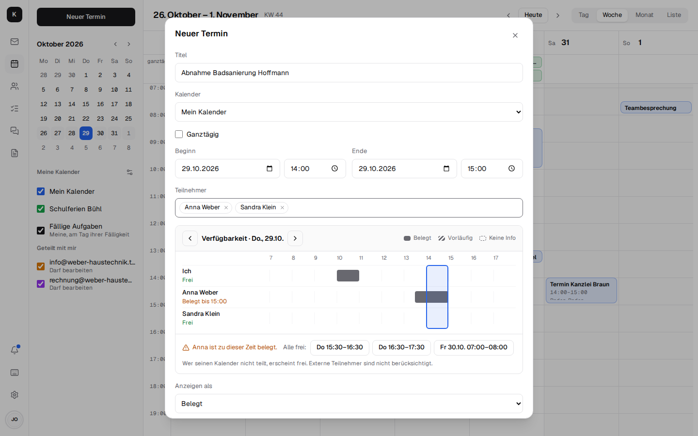
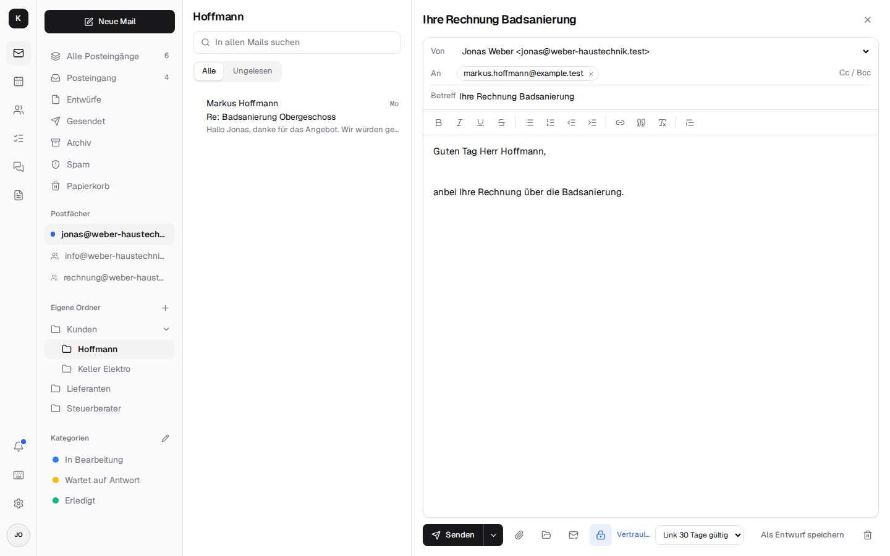
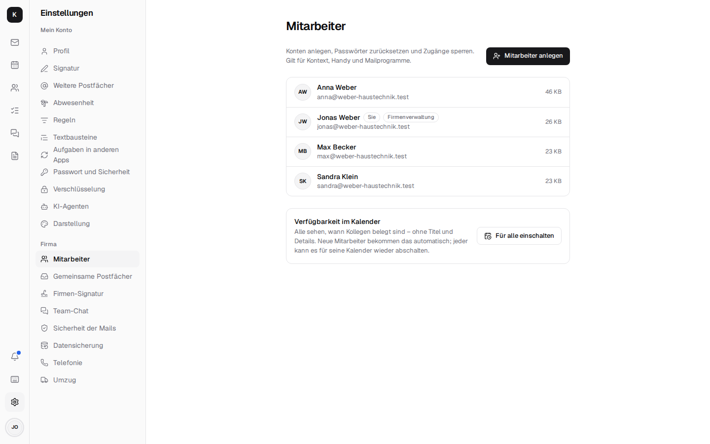

<!-- The page to send to customers: what Kontext does, in pictures, without a word about hosting. -->

# Alles, was dein Team von Outlook kennt. Ohne dass Microsoft dein Team kennt.

Mail, Kalender, Kontakte, Aufgaben, Team-Chat, das Firmentelefon und
Dokumente – in einer App, im Browser und am Handy. Deine Daten bleiben bei dir, und zehn
Mitarbeiter kosten so viel wie einer.

[Rundgang starten](#rundgang){ .md-button .md-button--primary } [Alle Funktionen im Detail](ueberblick.md){ .md-button }

{ width="1440" height="900" }
{ width="1440" height="900" }

Mail · hell und dunkel

## Ein Posteingang, der mitdenkt

Kategorien wie „In Bearbeitung“ und „Wartet auf Antwort“, Regeln für das ganze Team, eine Suche
wie bei Gmail. Mails später senden oder auf Wiedervorlage legen – und eine Warnung, wenn ein
Absender nur so tut, als wäre er die Bank. Hell oder dunkel, wie es dir gefällt.

{ width="1440" height="900" loading="lazy" }
{ width="1440" height="900" loading="lazy" }

Gemeinsame Postfächer

## info@ gehört dem ganzen Team

info@ und rechnung@ stehen bei allen, die sie brauchen, direkt unter dem eigenen Postfach.
Jeder sieht, was erledigt ist und wer gerade dran ist – und antwortet gleich als info@.

{ width="1440" height="900" loading="lazy" }

Schreiben

## Antworten in Sekunden

Formatieren, zitieren, den richtigen Absender wählen. Textbausteine für die Fragen, die jeden Tag
kommen, und eine Firmen-Signatur, die bei allen gleich aussieht.

{ width="1440" height="900" loading="lazy" }

Kalender

## Der Kalender fürs ganze Team

Tag, Woche, Monat. Baustellen, Kundentermine und Teambesprechungen an einem Ort, Einladungen mit
einem Klick beantworten, eine Videobesprechung an jeden Termin hängen.

{ width="1440" height="900" loading="lazy" }
{ width="1440" height="900" loading="lazy" }

Wer hat Zeit?

## Nie wieder „Passt dir Dienstag?“

Kollegen in den Termin eintragen – Kontext zeigt sofort, wer belegt ist, und schlägt die nächste
Zeit vor, in der alle können. Wie in Outlook, nur ohne Outlook.

{ width="1440" height="900" loading="lazy" }

Kontakte

## Der Kunde auf einen Blick

Ein Klick auf den Kunden zeigt seine letzten Mails, die nächsten Termine, offene Aufgaben und
Anrufe. Ein kleines CRM, ohne ein weiteres Programm.

{ width="1440" height="900" loading="lazy" }

Telefon

## Das Telefon klingelt – und du weißt schon, worum es geht

Die Fritzbox und die Nummern bleiben. Ein Anruf klingelt in Kontext mit Namen, Firma und der
letzten Mail des Anrufers. Anrufen per Klick, die Mailbox kommt als Mail, ein verpasster Anruf
wird zur Aufgabe.

{ width="1440" height="900" loading="lazy" }

Aufgaben

## Aus der Mail wird eine Aufgabe

Als Liste oder Kanban-Board, für jedes Postfach. Aus einer Mail, einer Chat-Nachricht oder einem
verpassten Anruf mit einem Klick, mit Erinnerung aufs Handy.

{ width="1440" height="900" loading="lazy" }

Team-Chat und Video

## Die WhatsApp-Gruppe fürs Büro – nur deine

Kanäle und Direktnachrichten, eine Kundenmail als Karte in den Chat teilen, Sprachnachrichten,
Videocalls und Bildschirm teilen. Alles auf deinem Server, auf Wunsch Ende-zu-Ende verschlüsselt.

{ width="1440" height="900" loading="lazy" }

Dokumente

## Word, Excel und PDF – gleich daneben

Angebote, Tabellen und Präsentationen im Browser bearbeiten, gemeinsam und gleichzeitig. Einen
Anhang mit einem Klick ablegen, eine Datei aus den Dokumenten anhängen. Mit
[Schreibzeug](https://firsttris.github.io/schreibzeug/de/).

{ width="1280" height="800" loading="lazy" }
{ width="1280" height="800" loading="lazy" }

Vertraulich senden

## Die Lohnabrechnung gehört nicht ins offene Netz

Ein Klick auf das Schloss, und die Mail geht verschlüsselt raus – an jeden Empfänger, auch an
den, der von Verschlüsselung noch nie gehört hat: Er öffnet sie über einen Link mit Code auf
deinem Server.

{ width="1440" height="900" loading="lazy" }

Firmenverwaltung

## Chefsache in zwei Minuten

Mitarbeiter anlegen, Passwörter zurücksetzen, gemeinsame Postfächer und Rechte vergeben – ohne
IT-Kenntnisse. Wer geht, wird gesperrt, nicht gelöscht: Seine Mails bleiben in der Firma.

{ width="1440" height="900" loading="lazy" }

Am Handy

## Am Handy wie eine App. Ohne App Store.

Jede Ansicht ist fürs Handy gebaut, mit Tab-Leiste und Benachrichtigungen – auf dem iPhone, unter
Android und am PC mit einem Fingertipp installiert.

{ width="780" height="1688" loading="lazy" }
{ width="780" height="1688" loading="lazy" }
{ width="780" height="1688" loading="lazy" }
{ width="780" height="1688" loading="lazy" }

## Und warum das alles bei dir besser aufgehoben ist

**🇪🇺 Deine Daten bleiben bei dir**

Auf deinem Server, in Europa oder im eigenen Büro. Kein US-Konzern liest mit. DSGVO ohne
Bauchschmerzen.

**💶 Keine Kosten pro Kopf**

Zehn Mitarbeiter kosten so viel wie einer. Bezahlt wird der Server, nicht jeder Benutzer.

**🧩 Eine App statt fünf**

Mail, Kalender, Aufgaben, Chat, Telefon und Dokumente mit einer Anmeldung.

**📦 Umzug inklusive**

Mails, Kontakte und Termine aus Microsoft 365, Gmail, GMX oder Outlook kommen mit.

**🔌 Outlook und iPhone gehen weiter**

Wer lieber Outlook, Thunderbird oder die Mail-App am iPhone nimmt, kann das auch.

**🤖 KI, wenn du willst**

Claude und andere Assistenten finden Kunden, Mails und Termine und schreiben Entwürfe. Senden
und löschen tun sie nie.

**🔐 Sicher von Haus aus**

Anmeldung mit zweitem Faktor, verschlüsselte Mails und verschlüsselte Datensicherung.

**🔓 Open Source, kein Lock-in**

Offener Quellcode und offene Standards. Du kannst jederzeit alles mitnehmen.

## Gemacht für Betriebe, die arbeiten, statt Lizenzen zu zählen

Handwerk · Kanzleien und Praxen · Selbstständige · kleine und mittlere
Betriebe. Made in Europe.

[Alle Funktionen im Detail](ueberblick.md){ .md-button .md-button--primary } [Dokumente mit Schreibzeug](https://firsttris.github.io/schreibzeug/de/){ .md-button }

