# Mail { #mail }

Kontext is the mail program in the browser and on the phone for your own mail server
[Stalwart](https://stalw.art) – built for teams with shared mailboxes. Mails arrive via JMAP push
without reloading; Thunderbird, Outlook and the phone's mail app keep connecting via IMAP and
SMTP.

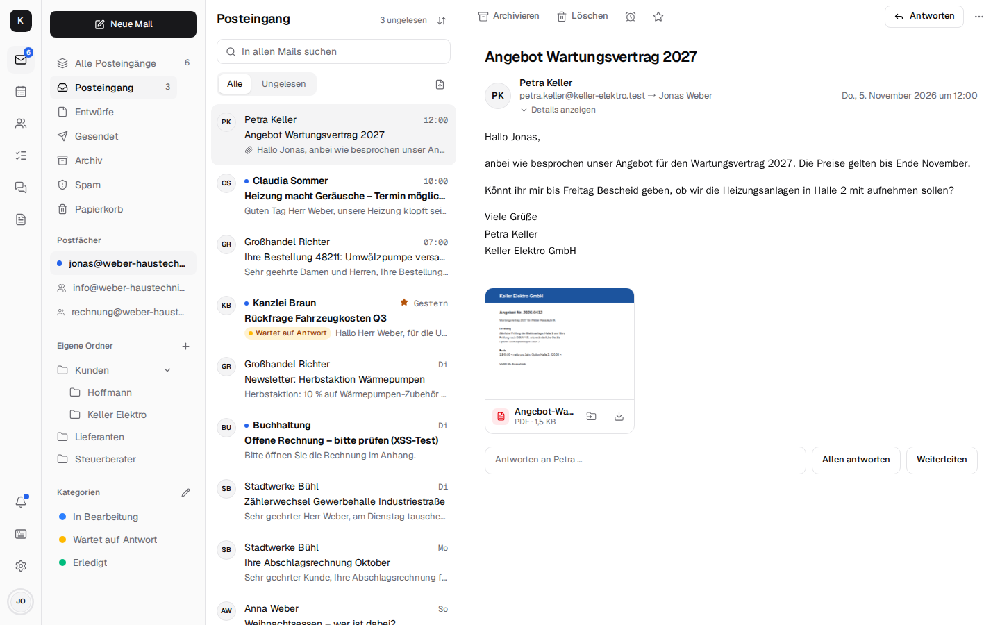

## In the team { #im-team }

- **Shared mailboxes** (info@, rechnung@) sit in every member's sidebar, with the full address
  like your own – that is what they are called everywhere, in the lists too, in tasks, in the
  chat, in the calendar and in the contacts.
  Replies go out as info@, with the name of the person who replied; the list shows who has already
  replied ("Jonas · 14:02"). Rights per person: no access, read only, read and send.
  [More](architecture.md#gemeinsame-postfacher)
- **Assigning mails:** in info@, "Assign" gives a mail to a person ("Assign to me", a colleague
  from the mailbox, nobody) and ticks it off as "Done". Everyone in the mailbox sees it on the
  mail and in the list ("Anna", "Done · Anna"); the filters "Assigned to me" and "Open" show what
  is still waiting for you or for the team. [More](architecture.md#mails-zuweisen)
- **All inboxes** in one list: your own mailbox and the shared ones together.
- **Categories** like "In progress", "Waiting for reply", "Done" – several per mail, your own
  ones too, set by rule. In info@ the whole team sees them: a small task list.
- **Discuss instead of forwarding:** "Discuss" (`b`) brings a mail into the
  [team chat](chat.md) as a card; "Task" (`t`) turns it into a [task](tasks.md).
- **Snippets** for standard replies, your own and shared ones for info@. When inserted, `{Name}`
  becomes the recipient's name (`{Vorname}` their first name), `{Datum}` today's date and
  `{Absender}` your own name. Any other word in curly braces is a field of its own, such as
  `{Auftragsnummer}`: Kontext asks for all of the snippet's fields in a small window and fills in
  the answers; a field left empty stays in the text as `{Feld}` so that it isn't forgotten.

  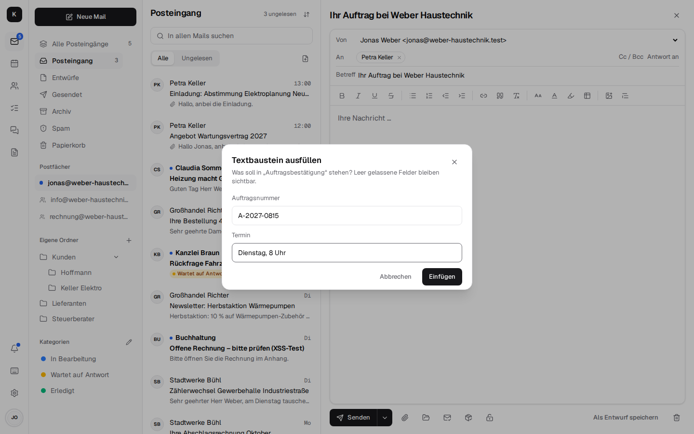

## Organising and finding { #ordnen-und-finden }

- **Search like in Gmail** across all folders and mailboxes, with operators like `von:`, `an:`,
  `betreff:`, `hat:anhang`, `ist:ungelesen`, `kategorie:`, `in:info@`, `nach:`/`vor:` (also in
  English: `from:`, `has:attachment` …) and suggestions while typing. It also finds words that
  only appear in a PDF, Word or Excel attachment; such hits are marked "in attachment".
- **Rules** ("if sender, recipient, subject or text … then move to folder, mark, set category,
  forward, create task") run on the server when mail arrives, even when Kontext is closed; created
  from a mail, they can also be applied to existing mails.

  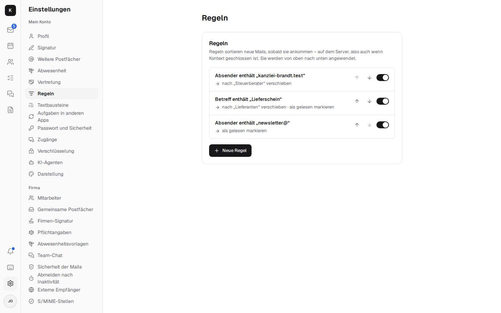
- **Sorting the mail list:** the icon with the two arrows at the top of the list (on the phone
  too) – newest or oldest first, unread, flagged or mails with a category first (in the order of
  the categories), by sender or subject (A–Z), or the largest first. Within a group, the newest
  are at the top. The choice applies to all folders, "All inboxes" and the search, and stays
  saved on the device. In the conversation view, the whole conversation counts: if one of its
  mails is flagged or unread, it is at the top, shown with its newest mail. Snoozed (by the time
  they return) and "Scheduled" keep their own order. Sorting happens on the server (JMAP
  `Email/query`, RFC 8621), also when more mails are loaded.

  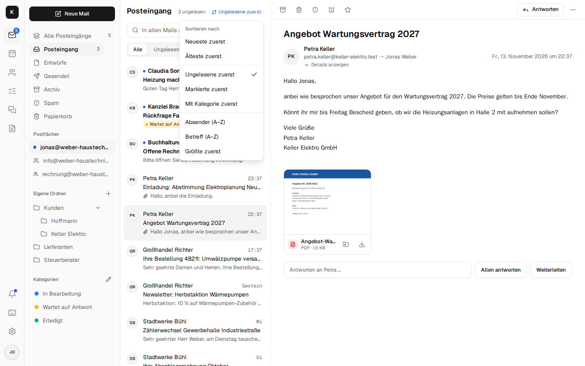

- **Folders and subfolders**, moving by menu or by dragging, also between info@ and your own
  folders.
- **Managing folders:** "…" next to a folder in the sidebar (on a desktop when the pointer is
  over it, on a phone always, in the folder screen) offers **Rename**, **Move** (under another own
  folder or to the top) and **Delete**. Deleting puts the mails in it into the trash and, after a
  question, deletes the subfolders too. **Mark all as read** is there for every folder with unread
  mails, the inbox too, and applies to all mails in the folder, not only the loaded ones. The
  standard folders (Inbox, Sent, Drafts, Archive, Spam, Trash) cannot be renamed, moved or deleted;
  in shared mailboxes the menu shows only what your rights allow.
- **Importing .eml files:** single mails saved as a file (from Thunderbird, Apple Mail or
  Kontext's "Forward as attachment") can be brought into the open folder with the button to the
  right of "All / Unread" – several at once too – or dragged onto the list or onto a folder in the
  sidebar. They arrive as read; the time received is the mail's date, otherwise the time of the
  last receiving server. Afterwards Kontext says how many arrived and which files didn't, with the
  reason. Not supported is Outlook's `.msg` (a binary format of its own that Stalwart does not
  read as mail); whole Outlook mailboxes come in through the [move](architecture.md#umzug) (as
  .pst) or "Connect mailbox". Nothing is imported into Drafts, Flagged and Snoozed, and into
  shared mailboxes only with the right to add mails.
- **Importing .mbox files:** a whole folder as one file – from Thunderbird (the folder without an
  ending in the profile, renamed to `.mbox`, or through ImportExportTools), from Apple Mail
  ("Export Mailbox") or Google Takeout (all mail including spam and trash in one file) – goes in
  through the same button or by dragging into the open folder. Every mail keeps its date; read,
  flagged and answered come along where the program wrote them into the file (Gmail's labels
  "Unread" and "Starred", Thunderbird's `X-Mozilla-Status`, `Status` and `X-Status`), otherwise
  the mail counts as read. Mails deleted in Thunderbird but not yet compacted stay out. The
  browser reads the file piece by piece, several GB too; the tab has to stay open for it, and
  every 500 mails Kontext says how far it is. Gmail's labels do not become folders, everything
  lands in the chosen folder, spam and trash too; to move a Gmail mailbox with its folders, use
  "Connect mailbox".

  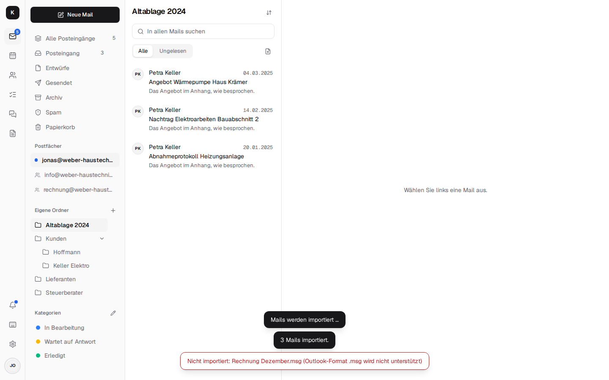
- **Exporting a folder as .mbox:** "…" next to a folder with mails → **Export as .mbox** saves all
  mails of the folder (without subfolders), oldest first, as one file `<folder>.mbox` (mboxrd,
  RFC 4155) that Thunderbird (ImportExportTools), Apple Mail and Kontext's own import read. Read,
  flagged and answered are in it as `Status` and `X-Status`, in place of the flags a mail taken
  over from an .mbox still carries from the old file (`X-Gmail-Labels`, `X-Mozilla-Status`).
  The browser loads the mails one by
  one and puts the file together before saving it: Chrome and Edge move large files to disk,
  Firefox and Safari keep more in memory. Folders up to about 1 GB are no problem; for larger ones
  or a whole mailbox, a mail program over IMAP is the way.
- **Sender's picture** on every row of the list, as in Gmail: the photo of the colleague or
  contact, else the initials; in "Sent" the first recipient. A sender the
  [check](#sicherheit) does not confirm gets no photo. Photos come only from one's own contacts and
  profiles, never from the internet (no logos or favicons).
- **The bar above a mail:** "Archive" (`e`) and "Delete" (`#`) with their names, next to them
  Snooze (`w`), Flag (`s`) and, in shared mailboxes, "Assign", on the right "Reply". Everything
  used less often is under "More actions" (the three dots): reply all, forward, print, mark as
  unread (`U`), spam (`!`), move, category, task (`t`), Discuss (`b`) and rule. Where space is
  short, on the phone or in a narrow reading pane, Archive and Delete keep only their icons.
- **Several mails at once** (checkbox on the left of each row, Ctrl/Shift-click, `x`; on the phone
  a long press): archive, delete, mark read, category, move, create tasks, forward as attachment.
  The checkbox sits where the picture is and shows as soon as the mouse is over it, the keyboard is
  there or mails are selected.
- **Swiping on the phone:** swiping a mail to the left archives it, to the right marks it
  read/unread; adjustable per direction ([On the phone](app.md#am-handy)).
- **Undo:** after archiving, deleting (to the trash), spam and moving – one mail, several selected
  or swiped – the notice at the bottom has "Undo"; `z` (or Ctrl+Z while no text field
  has the cursor) takes back the last of these steps. The mails return to their folder. What was
  deleted for good (from Trash or Spam) or moved into another mailbox cannot be brought back.
- **Emptying spam and trash:** at the top of the list in those two folders, after a question with
  the number of mails. Deleted then means deleted – Stalwart's Community edition keeps nothing. A
  mail that is also in another folder only leaves Spam or Trash. In shared mailboxes only for
  those who may delete there.

  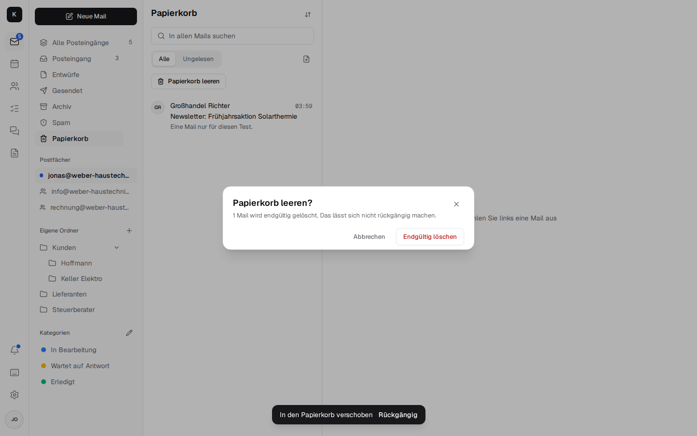

- **Conversations while reading:** earlier mails and the replies since, quotes collapsed; grouped
  like Gmail if you want.
- **Snooze:** a mail out of the way until tomorrow, Monday or a set time – then it is back at the
  top of the inbox, unread, even with the app closed. Also for several selected mails at once
  (the alarm clock in the bar above the selection), in "All inboxes" across your own and shared
  mailboxes; there, the returned mails of all inboxes are at the top as well.

  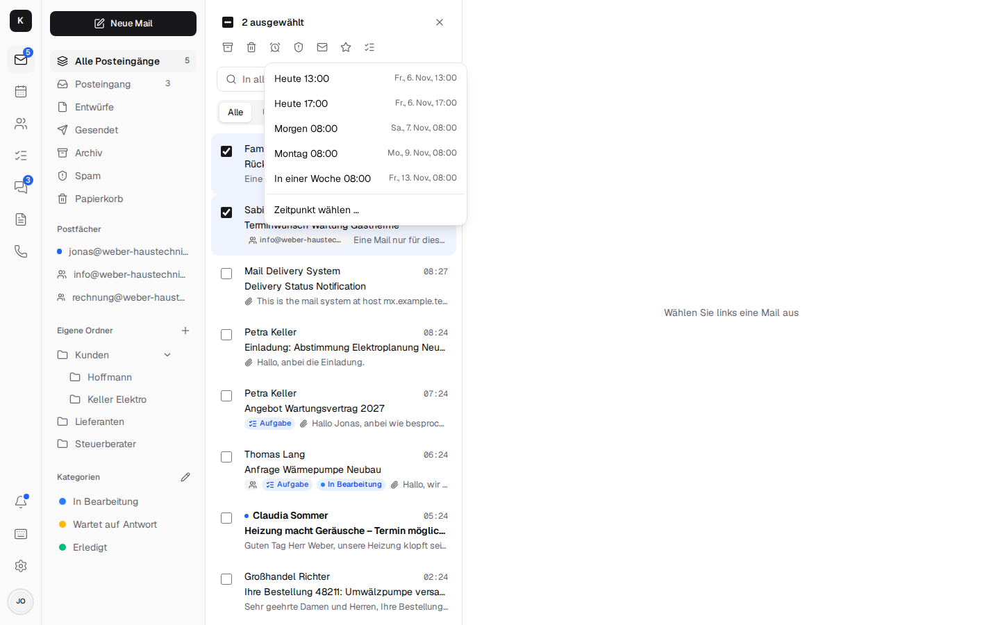

## Writing { #schreiben }

- **Formatted text**, replies with quotes, attachments, recipient suggestions from the company and
  the contacts, a signature per sender address.
- **Spell checking:** the text and the subject are checked by the browser's or the operating
  system's spell checker, in the language of the interface (*Settings → Language*); misspelt words
  are underlined, suggestions come with a right click. There is no grammar check.
- **More formatting** on the right of the bar: font size (Small, Normal, Large, Huge), text
  color, background color and **tables** – insert one, then add or delete rows and columns in the
  menu, header row on/off. Everything goes out as inline style, so Outlook, Gmail and Apple Mail
  show it as written; in the text part there is one line per table row, with the cells separated
  by tabs. The signatures have the same bar.

  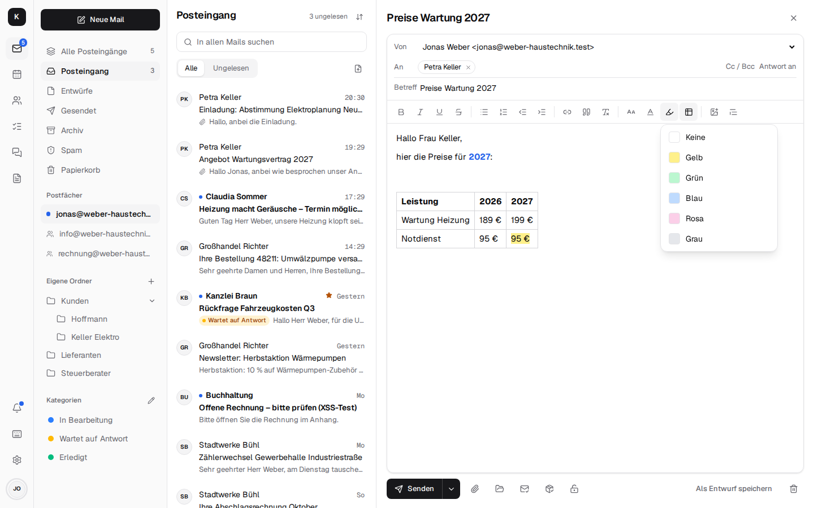
- **Images in the text:** via "Insert picture" in the bar, by pasting from the clipboard (such as
  a screenshot) or by dragging into the text; photos (JPEG), PNG, GIF and WebP. Dragging the
  corners makes an image larger or smaller, keeping its aspect ratio. It goes out as an inline
  image (`cid:`, together with the HTML in `multipart/related`), so Outlook, Gmail and Apple Mail
  show it in the text rather than as an attachment; a draft keeps its images. Other files, SVG
  too, still come along as attachments. Kontext does not yet carry over images in the quoted or
  forwarded original.

  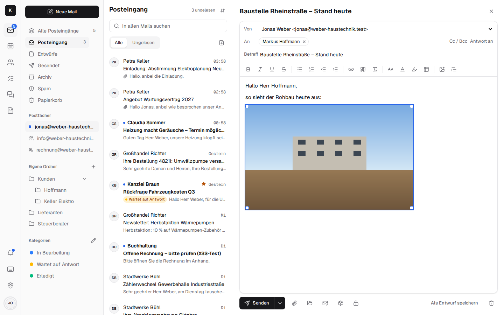
- **"Reply to"** (Reply-To): next to "Cc / Bcc", "Reply to" shows another address field, with the
  same suggestions. Replies to the mail then go to these addresses instead of the sender – such as
  a mail from Jonas that the office should answer from info@. The field applies to every way of
  sending, encrypted or signed too (there it is outside and in the protected headers), and is kept
  in the draft. A default per sender address is under *Settings → Signature* ("Reply to", several
  addresses separated by commas); it fills the field in every new mail, reply and forward from
  that address (also from within the shared mailbox), and whoever changes the sender gets that
  sender's default – unless you changed the field yourself.

  The other way round, Kontext replies to a mail with "Reply to" at that address, not at the
  sender (with the warning while reading if it is an outside address, see below).

  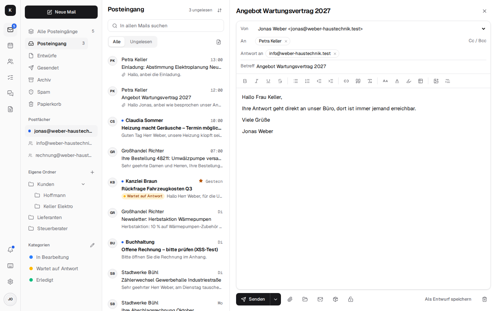
- **"Forgot the attachment?"** If your own text or the subject says "Anhang", "anbei",
  "angehängt", "beigefügt", "attached" …, but nothing is attached, Kontext asks before sending:
  "Attach file" or "Send without". Only your own text counts: not the quote, not the forwarded
  mail, not the signature and not a subject taken over ("AW: …").

  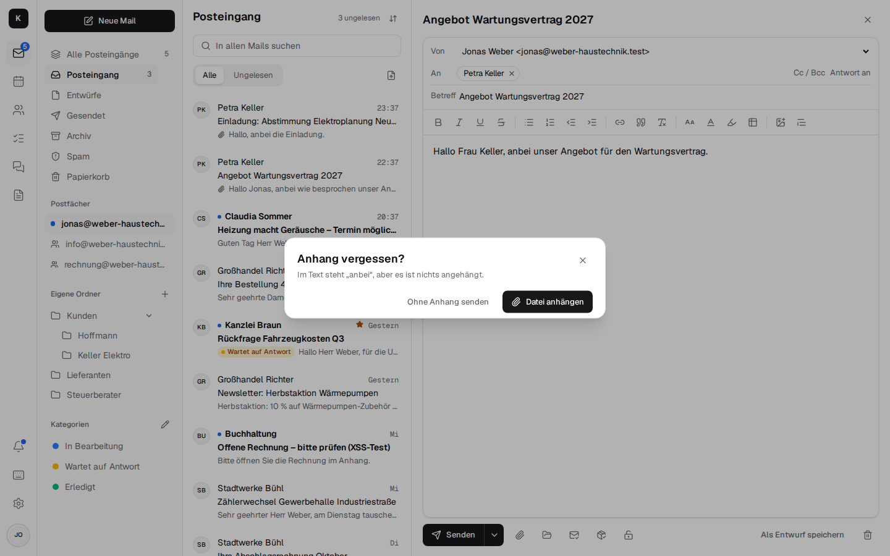

- **Forward as attachment:** in a mail's "More actions" menu, or for several selected mails in
  the bar above the list. The original goes along whole and unchanged as a file `<Betreff>.eml`
  (`message/rfc822`) – with all headers and attachments, for instance for the tax advisor or for
  IT wanting to check the headers. Several mails come as several files in one new mail. For this,
  Kontext uses the raw version Stalwart has of every mail (JMAP `blobId`); nothing is downloaded
  and uploaded again. An encrypted mail is forwarded as it came: encrypted, readable only by
  whoever has the key.

  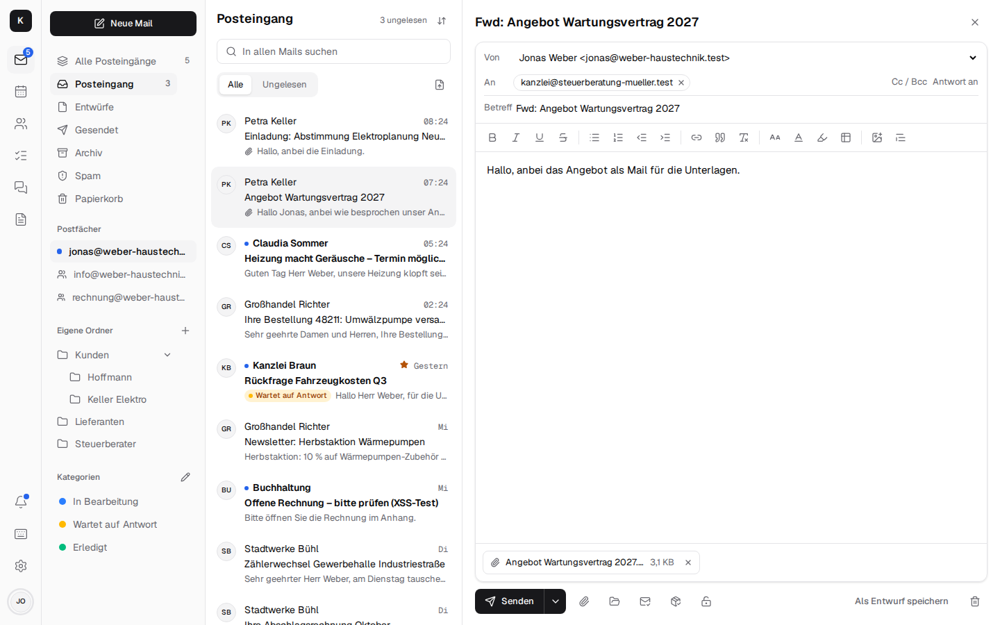

- **"External" note** (switched on by the [company admin](company.md#mitarbeiter-und-postfacher)):
  mails from outside the company carry the "External" badge in the list and while reading. If a
  mail goes to recipients outside, Kontext asks once before sending – "Send to external
  recipients?" with those addresses, "Go back" or "Send anyway". If "Forgot the attachment?" comes
  first, this question follows after it. The same applies to calendar invitations that new
  attendees from outside receive. Internal are the company's own domains and the partner domains
  entered, each with their subdomains.

  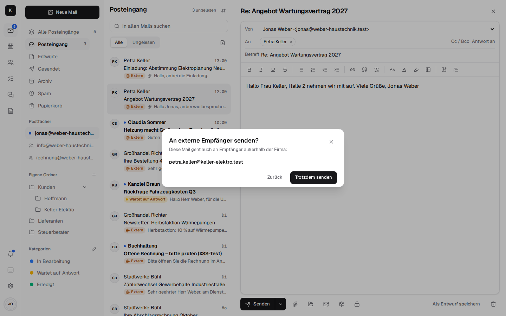

- **Legal footer:** if the company admin has entered it ([company admin](company.md)), it is shown
  in grey below the text while writing – visible, but not editable. Kontext only adds it when
  sending, at the very bottom (below the quote too), in the HTML and the text part; drafts never
  contain it, so it doesn't appear twice after opening a draft or after "Undo".

  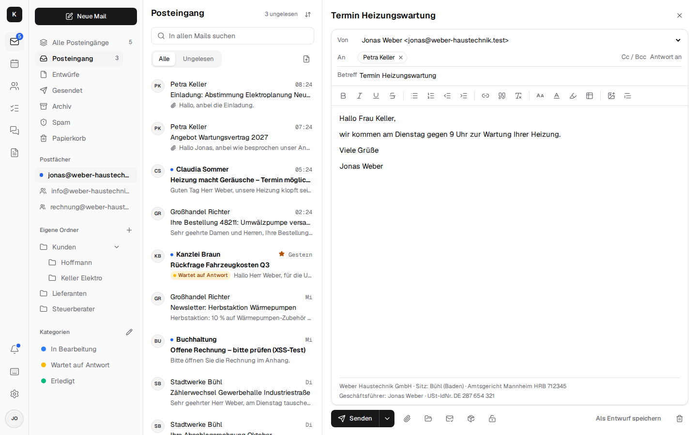

- **Undo send** (5 to 30 seconds) and **schedule send** ("tomorrow 8 am") – the server sends,
  even when the computer is off.
- **Read receipt** can be requested; a requested one is answered with one click, never
  automatically. The sent mail shows "Read by …", even if the recipient's program titles the
  receipt differently or only refers to the mail in the report. Kontext files the receipts
  themselves quietly: read, in the **Archive**, instead of filling the inbox – but only those that
  really belong to a mail you sent with the request; everything else stays in the inbox.
- **Delivery receipt** can be requested (the parcel with a tick in "New mail"): the receiving
  servers send a delivery report (DSN, RFC 3461) – the proof that the mail was accepted, or why
  not. Unlike the read receipt, it does not depend on the recipient but on their mail server; it
  says nothing about reading. The sent mail then shows "Delivered to … · time" (or "Not
  delivered", "Delayed"); the report itself is in the inbox and shows at the top whom it concerns,
  whether delivered, when and – on an error – the server's reason. Encrypted and signed mails go
  out without this request.

  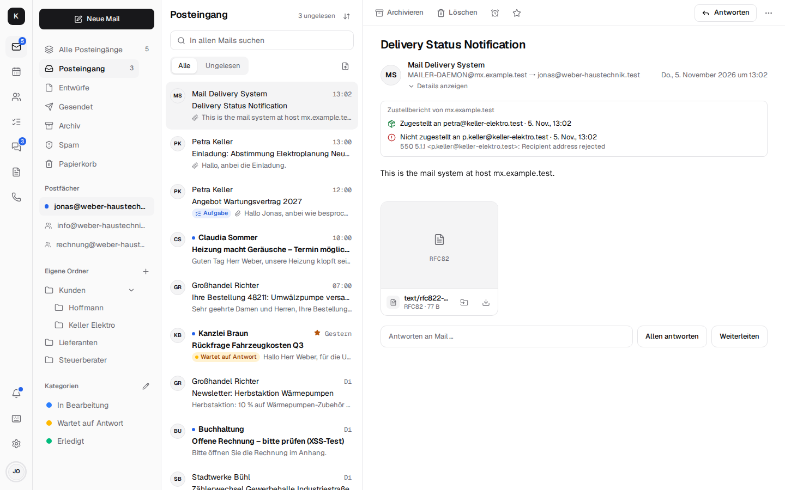

  What Stalwart does there and what it doesn't is under
  [Architecture → Delivery receipt](architecture.md#zustellbestatigung).
- **Send confidentially** and **PGP/S/MIME**: see [Encryption](encryption.md).
- **Attach from Documents**, **save** attachments **to Documents**: see [Documents](documents.md).
- **On the phone**, "New mail" has only Send, Schedule send, Attach and Discard in the bar; read
  and delivery receipt, Send confidentially, Sign and "Save as draft" are under "More actions"
  (the three dots, in colour as soon as one of them is on; in the warning colour if "Send
  confidentially" is on but doesn't work – the reason is then shown below the bar).

## Out of office and signatures { #abwesenheit-und-signaturen }

- **Out-of-office reply** under *Settings → Out of office*: "Turn on out-of-office reply",
  optionally with a period ("From", "To"), subject and message. Whoever writes to you gets this
  reply once. It comes from the mail server, so also when Kontext and the computer are off, and it
  gets along with your own [rules](#ordnen-und-finden). A "Deputy" is named in a line of its own in
  the message; if the company admin has added out-of-office templates, "Template" fills the
  message with name, end date and deputy – it can be changed freely afterwards.
- **For colleagues** (when someone is ill, for instance), the company admin enters the absence,
  with a stand-in named in the reply ([company admin](company.md)).
- **A deputy in one step** under *Settings → Deputy*: choose a colleague, "View" or "Edit", tick
  mailbox, calendars and contacts, "Share". She finds the mailbox under "Mailboxes" ("Mailbox of
  …"), calendars and contacts under "Shared with me". "View" shows mails, appointments and
  contacts and lets her mark mails as read and flag them (Stalwart does not separate the two);
  "Edit" also files mails, deletes them and changes appointments and contacts. The deputy cannot
  send in your name or create folders; folders created later are not included (simply share
  again).
  "Who has access" shows every colleague who may read or change any of it, including what was
  shared individually via "Share". "Revoke all" takes all of it from her at once; only that she,
  like everyone, sees when you are busy remains. [More](architecture.md#vertretung)

  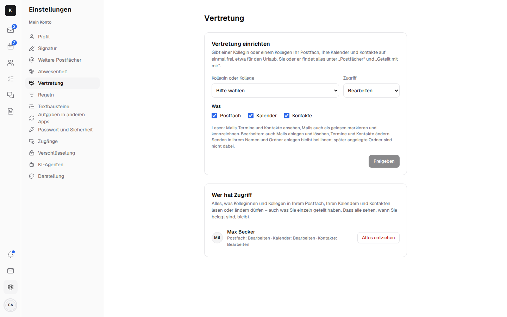
- **Signature** under *Settings → Signature*: for every address you send from (your own, info@
  …), the sender name, the default for "Reply to" and a signature with formatting. A new mail gets
  the signature of the sender address, a reply gets it above the quote.
- **Company signature:** if the company admin creates one and applies it to everyone, it replaces
  all employees' signatures, including ones they changed themselves.

## Security { #sicherheit }

- **Warning about forged senders:** when the sender isn't confirmed, someone from outside poses
  as your own company, or replies go to a different address (a pattern in invoice fraud); "Show
  details" shows SPF, DKIM, DMARC and the spam score.
  [More](architecture.md#prufung-des-absenders)
- **Mark as spam** (`!`) and "Not spam" – the filter learns from both.
- **Report as phishing** in the "More actions" menu, once the company administration has entered
  an address for it ([Company](company.md#mitarbeiter-und-postfacher)): the mail goes as an
  attachment (.eml) to the IT team or the IT provider and lands in spam.
- **Block sender** in the "More actions" menu: just this address or everyone from its domain
  (subdomains like `news.…` included, but not `….net`).
  The mail and every future one from there land in spam (nothing is deleted). It is a rule
  "Blocked: …" at the top of the [rules](#ordnen-und-finden); deleting it there lifts the block.
  Colleagues and the own domains are not offered.
- **Images from the internet** only load on request, or right away for senders you trust (all
  contacts too) – but only if the mail really comes from them.
- **Unsubscribe from newsletters** with one click right on the mail.
- Mails are shown in a sealed-off frame without scripts.

## Other mailboxes: Gmail, GMX, WEB.DE & Co. { #weitere-postfacher-gmail-gmx-webde-co }

Under *Settings → Other mailboxes*, everyone connects their other addresses: new mail comes into
Kontext every two minutes, sending as that address goes through the provider's server (so that
SPF and DMARC are right), and replies go from the address the mail was sent to.
[More](architecture.md#weitere-postfacher)

## Attachments, printing, keyboard { #anhange-drucken-tastatur }

- **Preview** of photos and the first page of a PDF; one click opens it large.
- **winmail.dat:** older Outlook versions pack their attachments into a file "winmail.dat"
  (TNEF). Kontext unpacks it in the browser and shows the files inside as normal attachments, with
  preview, download and "Save to Documents". For that, Kontext uploads them into the mailbox as
  blobs (Stalwart clears away unused ones after a while). Embedded Outlook items stay out. If that
  doesn't work (a file Kontext can't read, a read-only mailbox), the winmail.dat itself stays.

  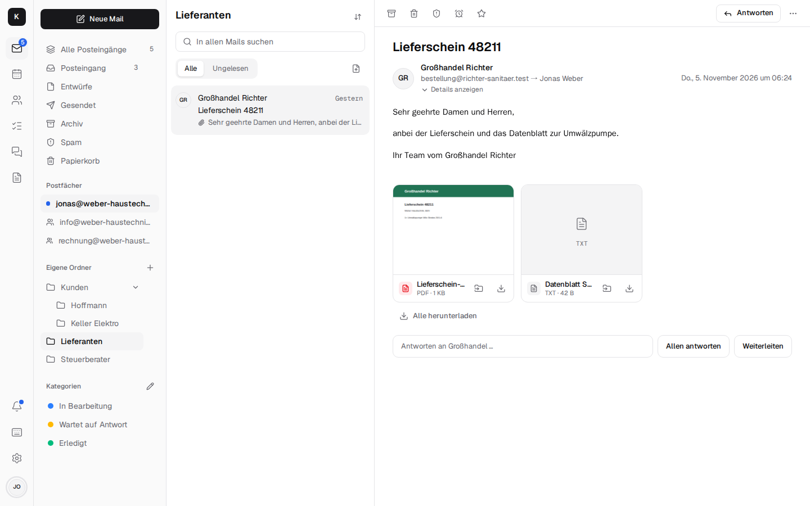
- **Printing** only the mail, cleanly on A4 (with Ctrl+P too); images from the internet come
  along if they are loaded in the mail.
- **Keyboard shortcuts like in Gmail**; `?` shows them all.
- **Next to the mail** (on wide screens): who is writing, with company, next appointments, latest
  mails and "Call".
