# Mail

Kontext ist das Mailprogramm im Browser und am Handy für den eigenen Mailserver
[Stalwart](https://stalw.art) – gebaut für Teams mit gemeinsamen Postfächern. Mails kommen per
JMAP-Push ohne Neuladen; Thunderbird, Outlook und die Mail-App am Handy verbinden sich weiter per
IMAP und SMTP.

## Im Team

- **Gemeinsame Postfächer** (info@, rechnung@) stehen bei jedem Mitglied in der Seitenleiste,
  mit voller Adresse wie das eigene – so heißen sie überall, auch in den Listen, bei Aufgaben,
  im Chat, im Kalender und in den Kontakten.
  Antworten gehen als info@ hinaus, mit dem Namen der Person, die geantwortet hat; die Liste
  zeigt, wer schon geantwortet hat („Jonas · 14:02“). Rechte je Person: kein Zugriff, nur lesen,
  lesen und senden. [Mehr](architecture.md#gemeinsame-postfacher)
- **Mails zuweisen:** In info@ gibt „Zuweisen“ eine Mail einer Person („Mir zuweisen“, eine
  Kollegin aus dem Postfach, niemandem) und hakt sie als „Erledigt“ ab. Alle im Postfach sehen es an der Mail und
  in der Liste („Anna“, „Erledigt · Anna“); die Filter „Mir zugewiesen“ und „Offen“ zeigen, was
  noch auf einen selbst oder aufs Team wartet. [Mehr](architecture.md#mails-zuweisen)
- **Alle Posteingänge** in einer Liste: das eigene Postfach und die gemeinsamen zusammen.
- **Kategorien** wie „In Bearbeitung“, „Wartet auf Antwort“, „Erledigt“ – mehrere je Mail, eigene
  dazu, per Regel gesetzt. In info@ sieht sie das ganze Team: eine kleine Aufgabenliste.
- **Besprechen statt weiterleiten:** „Besprechen“ (`b`) bringt eine Mail als Karte in den
  [Team-Chat](chat.md); „Aufgabe“ (`t`) macht eine [Aufgabe](tasks.md) daraus.
- **Textbausteine** für Standardantworten, eigene und gemeinsame für info@. Beim Einfügen wird
  `{Name}` zum Namen des Empfängers (`{Vorname}` zu seinem Vornamen), `{Datum}` zum heutigen
  Datum und `{Absender}` zum eigenen Namen. Jedes andere Wort in geschweiften Klammern ist ein
  eigenes Feld, etwa `{Auftragsnummer}`: Kontext fragt in einem kleinen Fenster nach allen
  Feldern des Bausteins und setzt die Antworten ein; ein leer gelassenes Feld bleibt als
  `{Feld}` im Text stehen, damit es nicht vergessen wird.

  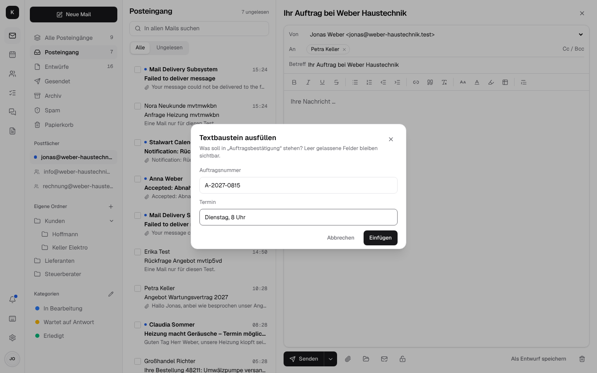

## Ordnen und finden

- **Suche wie in Gmail** über alle Ordner und Postfächer, mit Operatoren wie `von:`, `an:`,
  `betreff:`, `hat:anhang`, `ist:ungelesen`, `kategorie:`, `in:info@`, `nach:`/`vor:` (auch
  englisch: `from:`, `has:attachment` …) und Vorschlägen beim Tippen. Sie findet auch Wörter,
  die nur in einem PDF-, Word- oder Excel-Anhang stehen; solche Treffer tragen „im Anhang“.
- **Regeln** („wenn Absender, Empfänger, Betreff oder Text … dann in Ordner, markieren, Kategorie
  setzen, weiterleiten, Aufgabe anlegen“) laufen auf dem Server beim Eingang, auch wenn Kontext zu
  ist; aus einer Mail heraus angelegt, auf Wunsch auch auf vorhandene Mails.

  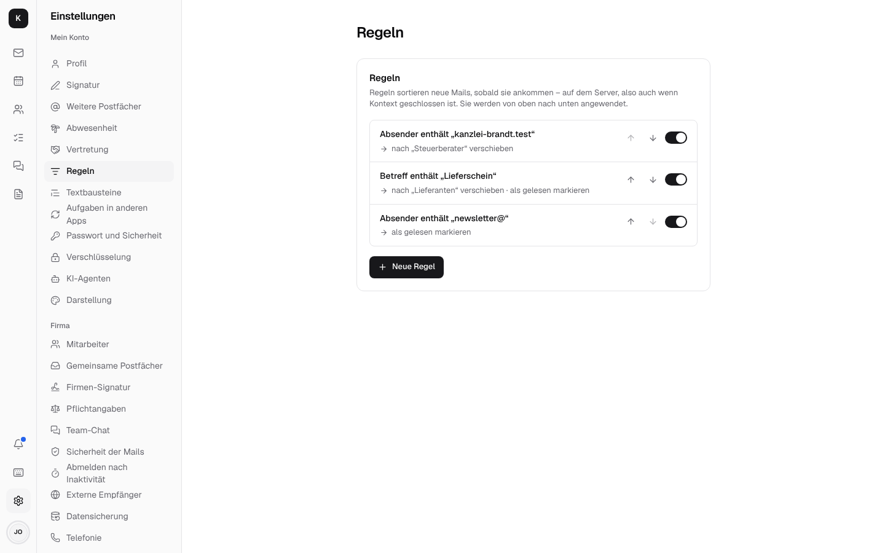
- **Mailliste sortieren:** das Symbol mit den zwei Pfeilen oben in der Liste (auch am Handy) –
  neueste oder älteste zuerst, ungelesene, markierte oder Mails mit Kategorie zuerst (in der
  Reihenfolge der Kategorien), nach Absender oder Betreff (A–Z) oder die größten zuerst. Innerhalb
  einer Gruppe stehen die neuesten oben. Die Wahl gilt für alle Ordner, „Alle Posteingänge“ und
  die Suche und bleibt auf dem Gerät gespeichert. In der Gesprächsansicht zählt das ganze
  Gespräch: hat eine seiner Mails eine Markierung oder ist ungelesen, steht es oben, gezeigt mit
  seiner neuesten Mail. Wiedervorlage (nach dem Zeitpunkt der Rückkehr) und „Geplant“ behalten
  ihre eigene Reihenfolge. Sortiert wird auf dem Server (JMAP `Email/query`, RFC 8621), auch
  beim Nachladen.

  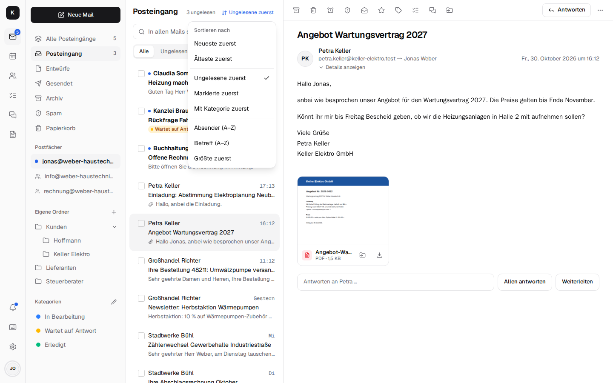

- **Ordner und Unterordner**, verschieben per Menü oder Ziehen, auch zwischen info@ und den
  eigenen Ordnern.
- **.eml-Dateien importieren:** einzelne Mails, die als Datei gesichert wurden (aus Thunderbird,
  Apple Mail oder Kontexts „Als Anhang weiterleiten“), mit dem Knopf rechts neben „Alle / Ungelesen“
  in den geöffneten Ordner holen – auch mehrere auf einmal – oder auf die Liste oder einen Ordner in
  der Seitenleiste ziehen. Sie kommen gelesen an; als Eingangszeit gilt das Datum der Mail, sonst
  die Zeit des letzten Empfangs-Servers. Kontext sagt danach, wie viele angekommen sind und welche
  Dateien nicht, mit Grund. Nicht unterstützt sind Outlooks `.msg` (ein eigenes Binärformat, das
  Stalwart nicht als Mail liest) und `.mbox` (ein ganzes Postfach): ganze Postfächer kommen über den
  [Umzug](architecture.md#umzug) (Outlook als .pst) oder „Postfach verbinden“. In Entwürfe, Markiert
  und Wiedervorlage wird nicht importiert, in gemeinsame Postfächer nur mit dem Recht, Mails
  hinzuzufügen.

  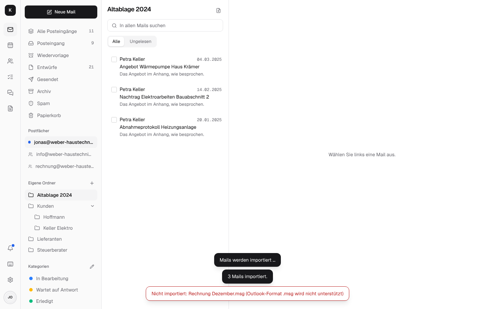
- **Mehrere Mails auf einmal** (Kästchen links an jeder Zeile, Strg-/Shift-Klick, `x`; am Handy
  lange drücken): archivieren, löschen, gelesen, Kategorie, verschieben, Aufgaben erstellen, als
  Anhang weiterleiten.
- **Am Handy wischen:** eine Mail nach links wischen archiviert, nach rechts gelesen/ungelesen;
  je Richtung einstellbar ([Am Handy](app.md#am-handy)).
- **Spam und Papierkorb leeren:** oben in der Liste der beiden Ordner, nach einer Rückfrage mit
  der Zahl der Mails. Gelöscht ist dann gelöscht – Stalwarts Community-Edition hebt nichts auf.
  Eine Mail, die zugleich in einem anderen Ordner liegt, verlässt nur Spam bzw. Papierkorb. In
  gemeinsamen Postfächern nur, wer dort löschen darf.

  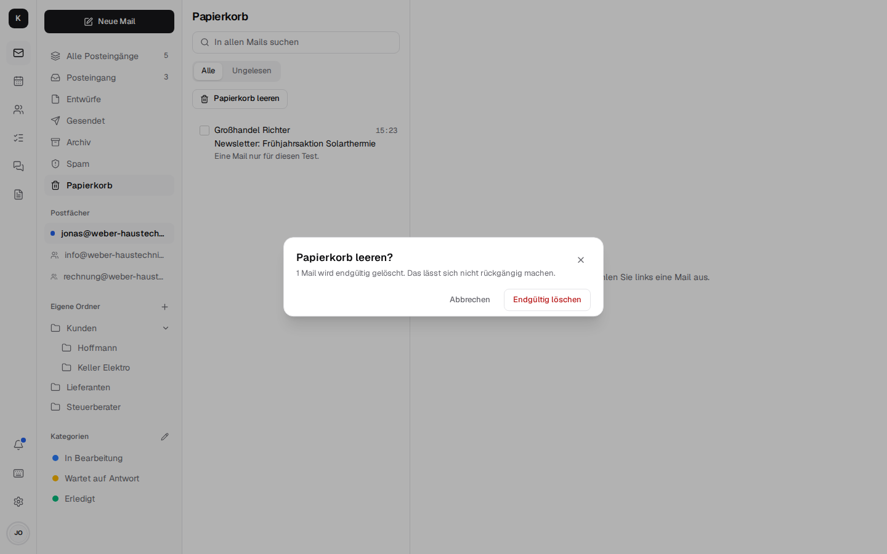

- **Unterhaltungen beim Lesen:** frühere Mails und die Antworten seitdem, Zitate eingeklappt;
  gruppiert wie Gmail auf Wunsch.
- **Wiedervorlage:** eine Mail aus dem Weg bis morgen, Montag oder einem Zeitpunkt – dann ist sie
  wieder oben im Posteingang, ungelesen, auch bei geschlossener App. Auch für mehrere
  ausgewählte Mails auf einmal (der Wecker in der Leiste über der Auswahl), in „Alle
  Posteingänge“ über eigene und gemeinsame Postfächer hinweg; dort stehen die wieder vorgelegten
  Mails aller Posteingänge ebenfalls oben.

  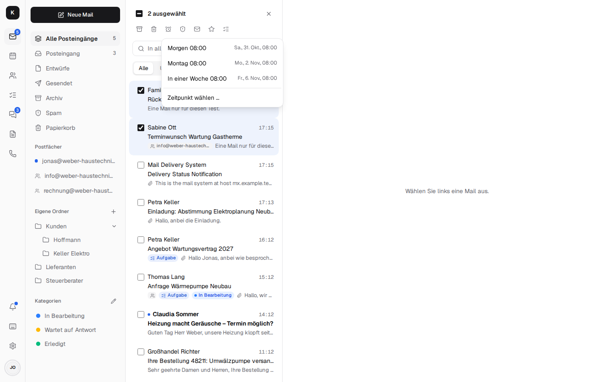

## Schreiben

- **Formatierter Text**, Antworten mit Zitat, Anhänge, Empfänger-Vorschläge aus der Firma und den Kontakten,
  Signatur je Absenderadresse.
- **Mehr Formatierung** rechts in der Leiste: Schriftgröße (Klein, Normal, Groß, Sehr groß),
  Textfarbe, Hintergrundfarbe und **Tabellen** – einfügen, dann im Menü Zeilen und Spalten
  hinzufügen oder löschen, Kopfzeile an/aus. Alles geht als Inline-Stil hinaus, so sehen es
  Outlook, Gmail und Apple Mail wie geschrieben; im Textteil steht eine Tabellenzeile je Zeile,
  die Zellen mit Tabulator getrennt. Dieselbe Leiste haben die Signaturen.

  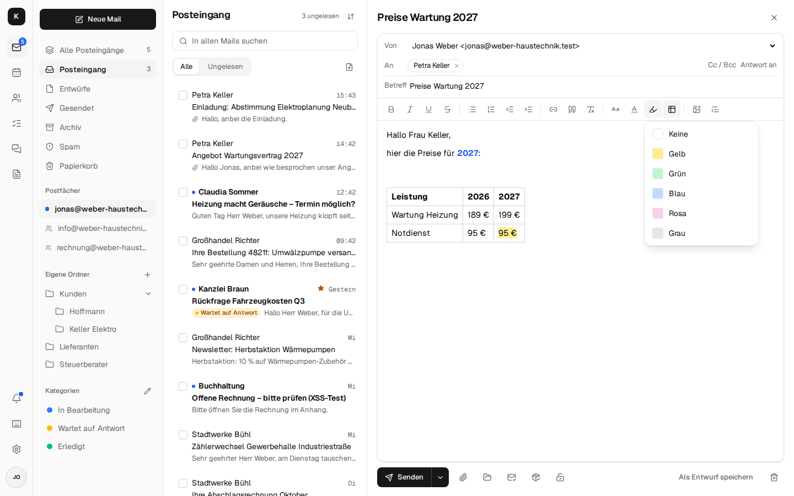
- **Bilder im Text:** über „Bild einfügen“ in der Leiste, mit Einfügen aus der Zwischenablage
  (etwa ein Bildschirmfoto) oder durch Ziehen in den Text; Fotos (JPEG), PNG, GIF und WebP. An
  den Ecken lässt sich ein Bild größer oder kleiner ziehen, das Seitenverhältnis bleibt. Es geht
  als Inline-Bild hinaus (`cid:`, zusammen mit dem HTML in `multipart/related`), so zeigen es
  Outlook, Gmail und Apple Mail im Text statt als Anhang; ein Entwurf behält seine Bilder.
  Andere Dateien, auch SVG, kommen weiter als Anhang mit. Bilder im zitierten oder
  weitergeleiteten Original nimmt Kontext noch nicht mit.

  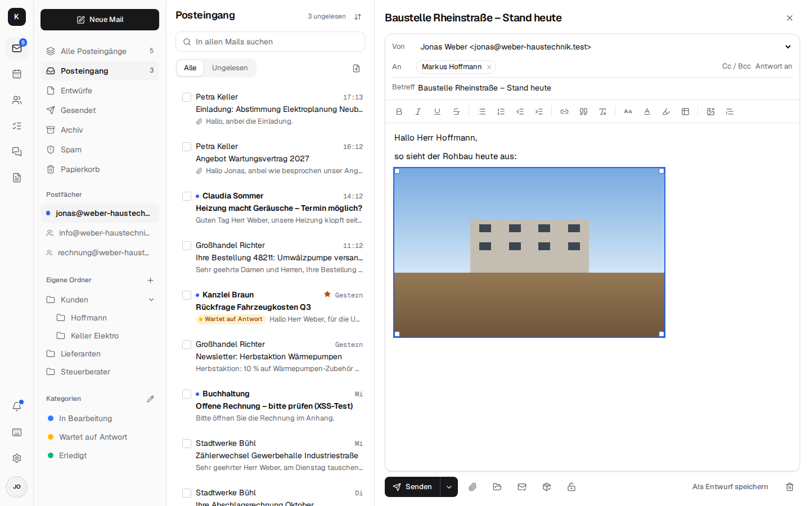
- **„Antwort an“** (Reply-To): neben „Cc / Bcc“ blendet „Antwort an“ ein weiteres Adressfeld ein,
  mit denselben Vorschlägen. Antworten auf die Mail gehen dann an diese Adressen statt an den
  Absender – etwa eine Mail von Jonas, auf die das Büro unter info@ antworten soll. Das Feld
  gilt für jeden Versand, auch verschlüsselt oder unterschrieben (dort steht es außen und in den
  geschützten Kopfzeilen), und bleibt im Entwurf erhalten. Eine Vorgabe je Absenderadresse steht
  unter *Einstellungen → Signatur* („Antwort an“, mehrere Adressen mit Komma); sie füllt das Feld
  bei jeder neuen Mail, Antwort und Weiterleitung von dieser Adresse (auch aus dem gemeinsamen
  Postfach heraus), und wer den Absender
  wechselt, bekommt dessen Vorgabe – außer, man hat das Feld selbst geändert.

  Umgekehrt antwortet Kontext auf eine Mail mit „Antwort an“ an diese Adresse, nicht an den
  Absender (bei einer fremden Adresse mit der Warnung beim Lesen, siehe unten).

  
- **„Anhang vergessen?“** Steht im eigenen Text oder im Betreff „Anhang“, „anbei“, „angehängt“,
  „beigefügt“, „attached“ …, aber nichts ist angehängt, fragt Kontext vor dem Senden nach: „Datei
  anhängen“ oder „Ohne Anhang senden“. Nur der eigene Text zählt: nicht das Zitat, nicht die
  weitergeleitete Mail, nicht die Signatur und nicht ein übernommener Betreff („AW: …“).

  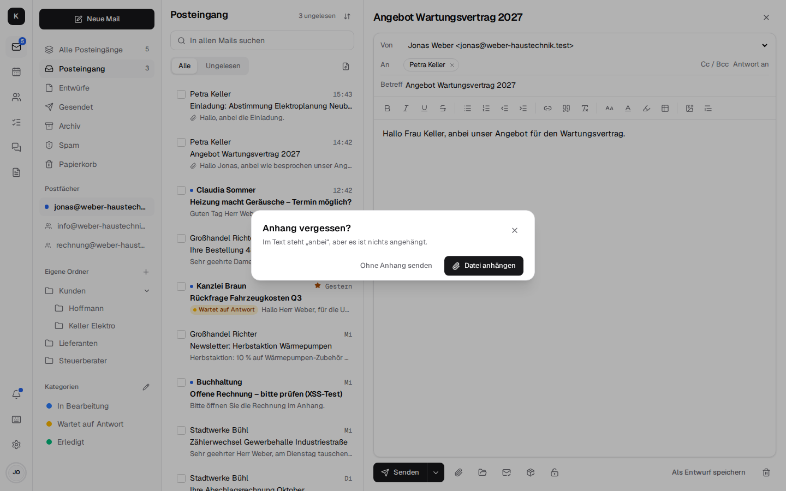

- **Als Anhang weiterleiten:** im Menü „Weitere Aktionen“ einer Mail, oder für mehrere gewählte
  Mails in der Leiste über der Liste. Das Original geht ganz und unverändert als Datei
  `<Betreff>.eml` (`message/rfc822`) mit – mit allen Kopfzeilen und Anhängen, etwa für den
  Steuerberater oder die IT, die die Kopfzeilen prüfen will. Mehrere Mails kommen als mehrere
  Dateien in eine neue Mail. Kontext nimmt dafür die Rohfassung, die Stalwart von jeder Mail hat
  (JMAP `blobId`), es wird nichts herunter- und wieder hochgeladen. Eine verschlüsselte Mail geht
  so weiter, wie sie kam: verschlüsselt, lesen kann sie nur, wer den Schlüssel hat.

  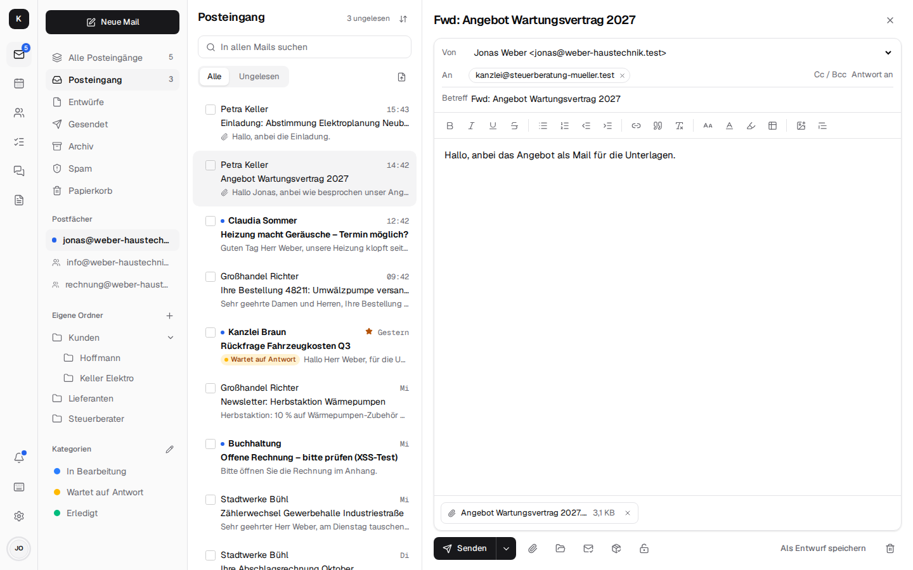

- **Hinweis „Extern“** (schaltet die [Firmenverwaltung](company.md#mitarbeiter-und-postfacher)
  ein): Mails von außerhalb der Firma tragen in der Liste und beim Lesen die Marke „Extern“. Geht
  eine Mail an Empfänger außerhalb, fragt Kontext vor dem Senden einmal nach – „An externe
  Empfänger senden?“ mit diesen Adressen, „Zurück“ oder „Trotzdem senden“. Kommt vorher „Anhang
  vergessen?“, folgt diese Frage danach. Dasselbe gilt für Einladungen im Kalender, die neue
  Teilnehmer von außerhalb bekommen. Intern sind die eigenen Domains der Firma und die
  eingetragenen Partner-Domains, jeweils mit ihren Subdomains.

  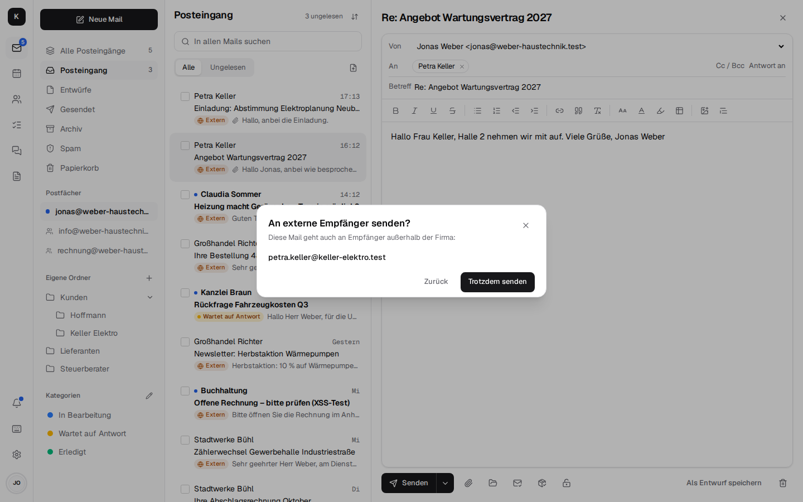

- **Pflichtangaben:** Hat die Firmenverwaltung sie eingetragen ([Firmenverwaltung](company.md)),
  stehen sie beim Schreiben grau unter dem Text – zu sehen, aber nicht änderbar. Kontext hängt
  sie erst beim Senden an, ganz unten (auch unter dem Zitat), im HTML- und im Textteil; Entwürfe
  enthalten sie nie, so stehen sie auch nach dem Öffnen eines Entwurfs oder nach „Rückgängig“
  nicht doppelt da.

  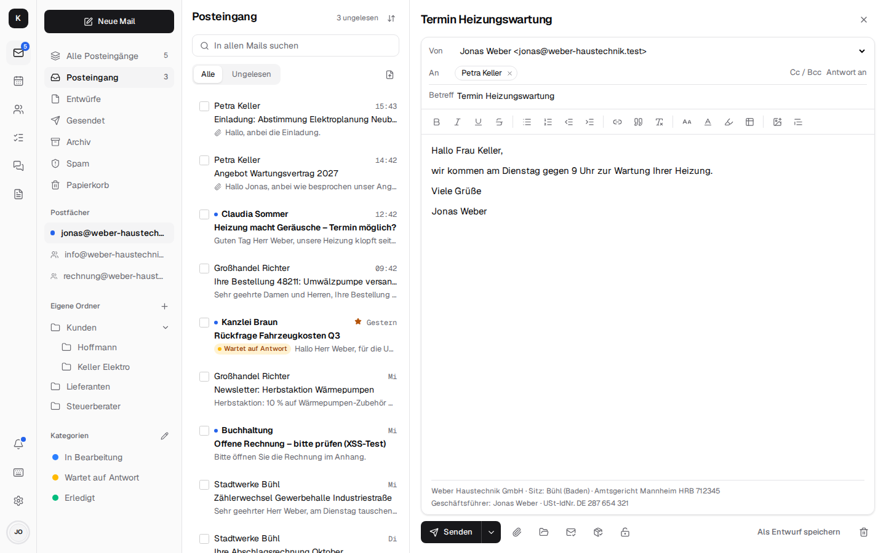

- **Senden rückgängig** (5 bis 30 Sekunden) und **später senden** („morgen 8 Uhr“) – der Server
  sendet, auch wenn der Rechner aus ist.
- **Lesebestätigung** anfordern; eine erbetene beantwortet man mit einem Klick, nie von selbst.
  Die gesendete Mail zeigt „Gelesen von …“, auch wenn das Programm des Empfängers die
  Bestätigung anders betitelt oder nur im Bericht auf die Mail verweist. Die Bestätigungen selbst
  legt Kontext still ab: gelesen ins **Archiv**, statt den Posteingang zu füllen – aber nur
  solche, die wirklich zu einer eigenen gesendeten Mail mit der Bitte gehören; alles andere
  bleibt im Posteingang.
- **Zustellbestätigung** anfordern (das Paket mit Häkchen in „Neue Mail“): Die empfangenden
  Server schicken einen Zustellbericht (DSN, RFC 3461) – der Nachweis, dass die Mail angenommen
  wurde, oder warum nicht. Anders als die Lesebestätigung hängt sie nicht vom Empfänger ab,
  sondern von seinem Mailserver; sie sagt nichts übers Lesen. Die gesendete Mail zeigt dann
  „Zugestellt an … · Zeit“ (oder „Nicht zugestellt“, „Verzögert“); der Bericht selbst liegt im
  Posteingang und zeigt oben, wen er betrifft, ob zugestellt, wann und – bei einem Fehler – die
  Begründung des Servers. Verschlüsselte und signierte Mails gehen ohne diese Anfrage.

  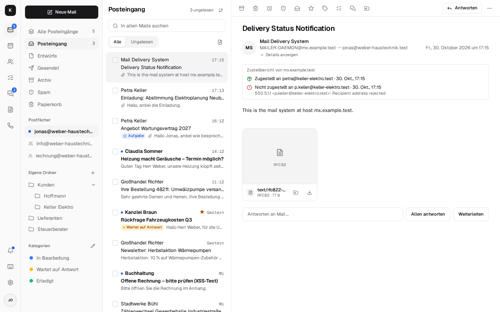

  Was Stalwart dabei tut und was nicht, steht unter
  [Architektur → Zustellbestätigung](architecture.md#zustellbestatigung).
- **Vertraulich senden** und **PGP/S/MIME**: siehe [Verschlüsselung](encryption.md).
- **Aus Dokumente anhängen**, Anhänge **in Dokumente ablegen**: siehe [Dokumente](documents.md).
- **Am Handy** stehen unter „Neue Mail“ nur Senden, später senden, Anhängen und Verwerfen in
  der Leiste; Lese- und Zustellbestätigung, Vertraulich senden, Unterschreiben und „Als Entwurf
  speichern“ liegen unter „Weitere Aktionen“ (die drei Punkte, farbig, sobald etwas davon an ist;
  in Warnfarbe, wenn „Vertraulich senden“ an ist, aber nicht geht – der Grund steht dann unter der
  Leiste).

## Abwesenheit und Signaturen

- **Abwesenheitsnotiz** unter *Einstellungen → Abwesenheit*: „Abwesenheitsnotiz einschalten“,
  auf Wunsch mit Zeitraum („Ab“, „Bis“), Betreff und Nachricht. Wer einem schreibt, bekommt einmal
  diese Antwort. Sie kommt vom Mailserver, also auch, wenn Kontext und der Rechner aus sind, und
  sie verträgt sich mit eigenen [Regeln](#ordnen-und-finden).
- **Für Kollegen** (etwa bei Krankheit) trägt die Firmenverwaltung die Abwesenheit ein, mit einer
  Vertretung in der Antwort ([Firmenverwaltung](company.md)).
- **Vertretung in einem Schritt** unter *Einstellungen → Vertretung*: eine Kollegin wählen,
  „Lesen“ oder „Bearbeiten“, Postfach, Kalender und Kontakte ankreuzen, „Freigeben“. Sie findet
  das Postfach unter „Postfächer“ („Postfach von …“), Kalender und Kontakte unter „Geteilt mit
  mir“. „Lesen“ zeigt Mails, Termine und Kontakte und lässt Mails als gelesen markieren und
  kennzeichnen (Stalwart trennt das nicht); „Bearbeiten“ legt Mails auch ab, löscht sie und ändert
  Termine und Kontakte. In Ihrem Namen senden und Ordner anlegen kann die Vertretung nicht; später
  angelegte Ordner sind nicht dabei (einfach noch einmal freigeben).
  „Wer hat Zugriff“ zeigt jede Kollegin, die etwas davon lesen oder ändern darf, auch was einzeln
  über „Teilen“ freigegeben wurde. „Alles entziehen“ nimmt ihr all das auf einmal; nur dass sie
  wie alle sieht, wann man belegt ist, bleibt. [Mehr](architecture.md#vertretung)

  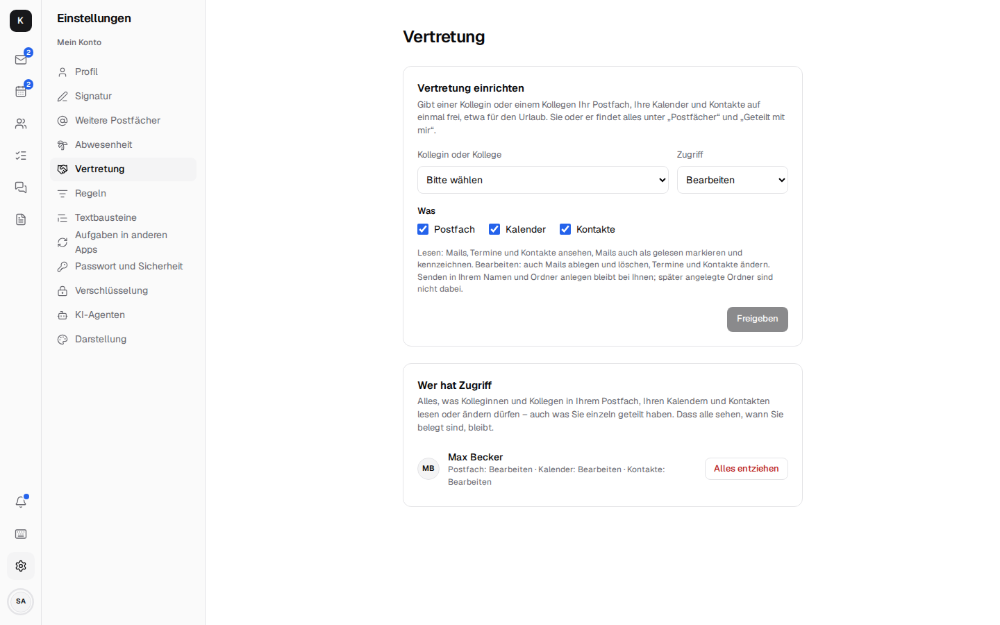
- **Signatur** unter *Einstellungen → Signatur*: für jede Adresse, von der man sendet (die eigene,
  info@ …), Absendername, die Vorgabe für „Antwort an“ und Signatur mit Formatierung. Eine neue Mail bekommt die Signatur der
  Absenderadresse, eine Antwort über dem Zitat.
- **Firmen-Signatur:** Legt die Firmenverwaltung eine an und übernimmt sie für alle, ersetzt sie
  die Signaturen aller Mitarbeiter, auch selbst geänderte.

## Sicherheit

- **Warnung vor gefälschten Absendern:** wenn der Absender nicht bestätigt ist, sich jemand von
  außen als die eigene Firma ausgibt oder Antworten an eine andere Adresse gehen (ein Muster bei
  Rechnungsbetrug); „Details anzeigen“ zeigt SPF, DKIM, DMARC und die Spam-Bewertung.
  [Mehr](architecture.md#prufung-des-absenders)
- **Als Spam markieren** (`!`) und „Kein Spam“ – der Filter lernt aus beidem.
- **Bilder aus dem Internet** laden erst auf Wunsch, oder sofort für Absender, denen man vertraut
  (auch alle Kontakte) – aber nur, wenn die Mail wirklich von ihnen kommt.
- **Newsletter abbestellen** mit einem Klick direkt an der Mail.
- Mails werden in einem abgeschotteten Rahmen ohne Skripte angezeigt.

## Weitere Postfächer: Gmail, GMX, WEB.DE & Co.

Unter *Einstellungen → Weitere Postfächer* verbindet jede Person ihre anderen Adressen: Neue Mail
kommt alle zwei Minuten in Kontext, gesendet wird als diese Adresse über den Server des Anbieters
(damit SPF und DMARC stimmen), Antworten gehen von der Adresse, an die die Mail ging.
[Mehr](architecture.md#weitere-postfacher)

## Anhänge, Drucken, Tastatur

- **Vorschau** von Fotos und der ersten PDF-Seite; ein Klick öffnet sie groß.
- **winmail.dat:** Ältere Outlook-Versionen packen ihre Anhänge in eine Datei „winmail.dat“
  (TNEF). Kontext packt sie im Browser aus und zeigt die Dateien darin als normale Anhänge, mit
  Vorschau, Herunterladen und „In Dokumente“. Dafür lädt Kontext sie als Blobs ins Postfach hoch
  (Stalwart räumt nicht verwendete nach einer Weile weg). Eingebettete Outlook-Elemente bleiben
  draußen. Geht das nicht (eine Datei, die Kontext nicht lesen kann, ein Postfach nur zum
  Lesen), bleibt die winmail.dat selbst stehen.

  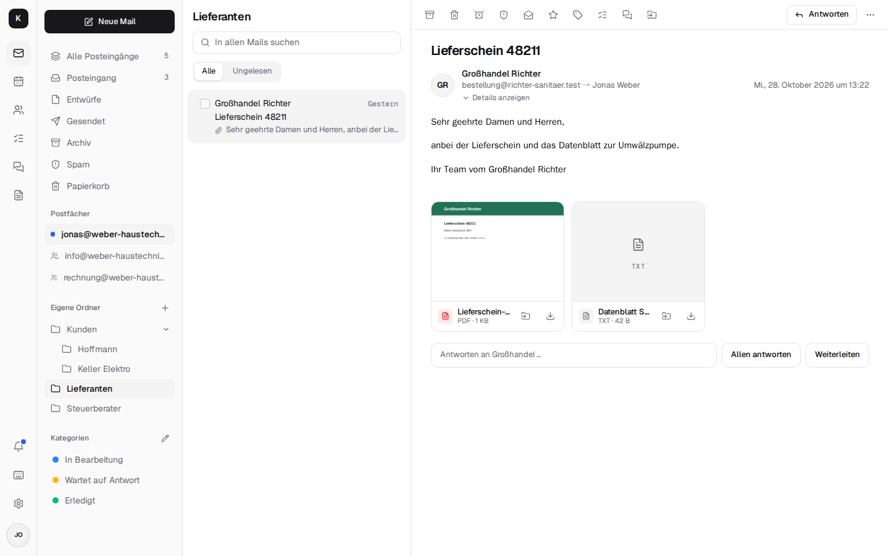
- **Drucken** nur der Mail, sauber auf A4 (auch mit Strg+P); Bilder aus dem Internet kommen mit,
  wenn sie in der Mail geladen sind.
- **Tastaturkürzel wie in Gmail**; `?` zeigt alle.
- **Neben der Mail** (auf breiten Bildschirmen): wer schreibt, mit Firma, nächsten Terminen,
  letzten Mails und „Anrufen“.
