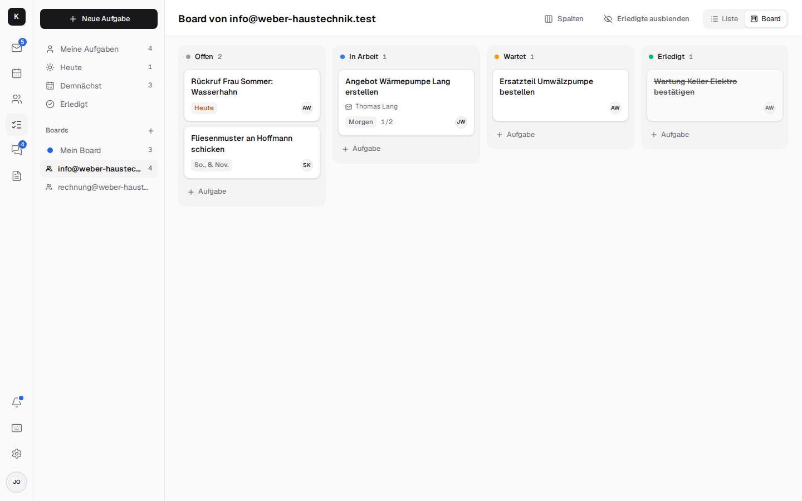
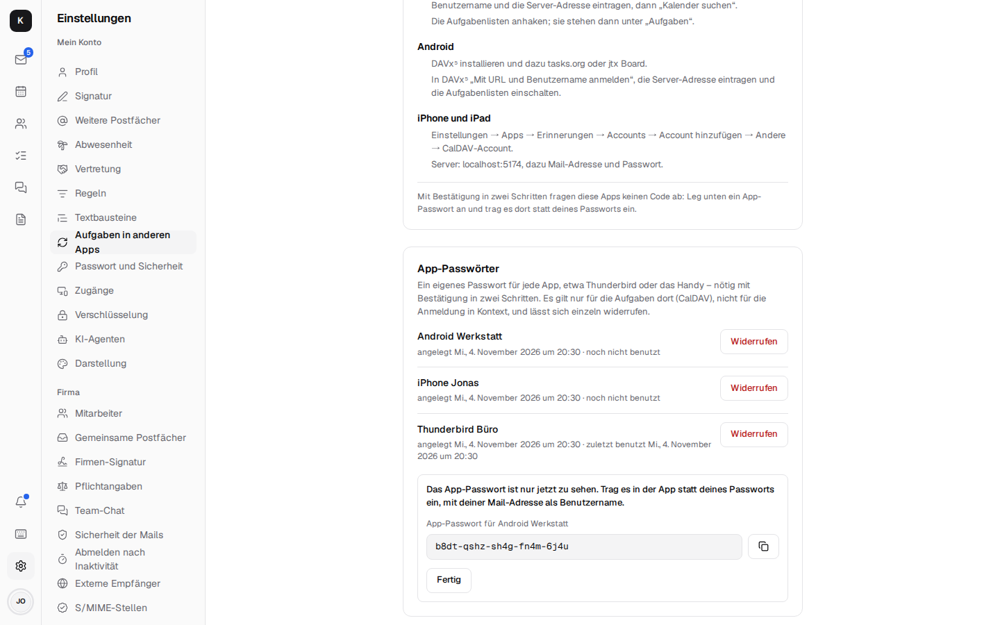

# Tasks { #aufgaben }

In Kontext, tasks belong where the work comes from: with the mail, with the customer, with the
shared mailbox. Every mailbox has its board – your own, and one each for info@ and rechnung@ that
everyone who works there sees. On top of that come boards for projects (“Baustelle Hoffmann”, the
Hoffmann building site), so that their tasks don't sit among all the others.

## Views { #ansichten }

- **My tasks, Today, Upcoming, Done.**
- **List or Kanban:** grouped by due date or as a board with Open, In progress, Waiting, Done –
  drag cards between the columns.
- **Custom columns** per board (“Material ordered” …), up to ten.
- **Boards for projects:** “+” next to “Boards” (on the phone the “+” chip) creates a board in a
  mailbox – in your own just for you, in info@ for everyone there. It sits below the mailbox's
  board, has its own columns and can be renamed or deleted with the pencil; the tasks of a deleted
  board move to the mailbox's board. A task moves there via the “Board” field.
- **Hide completed:** the switch with the crossed-out eye above the list and the board hides
  checked-off tasks; at the end of the list or in the “Done” column, “… completed – show” brings
  them back. The choice applies per device; the “Done” view always shows them.

## Deleting tasks { #aufgaben-loschen }

On the computer, a bin appears when you hover over a row of the list; in the open task it sits at
the top right (on the phone too). The first click asks “Really delete?”, only the second deletes.
Whoever may write on the board can delete: on your own board and in the shared mailboxes you're a
member of. A task a colleague has assigned to you on her own board you can edit, but not delete.

## Creating tasks { #aufgaben-anlegen }

- **Quick entry:** it understands German words – “Rückruf Hoffmann morgen” (call back Hoffmann
  tomorrow) is due tomorrow; weekdays and dates like “30.10.” work too.
- **From a mail:** “Task” (`t`) takes over the subject, links the mail and the contact and archives
  the mail if you want; the mail then shows its task. “Create tasks” makes one per selected mail.
- **From a chat message**, linked both ways.
- **From an appointment:** “Task for the appointment” in the open appointment, on the computer and
  on the phone alike – for example “order material for the acceptance inspection”. The task shows
  the appointment and opens it with one click.
- **By rule:** a mail rule creates a task for every matching mail, even when the app is closed.
- **From a missed call:** “Call back”, which checks itself off as soon as someone has spoken to the
  number ([Telephony](telephony.md)).
- **Recurring:** daily, on weekdays, weekly, monthly, yearly.
- **Checklists, notes, assignees, due date, reminder**, linked
  [documents](documents.md). The reminder can be chosen right in the “New task” dialog; a
  different due day takes it along, there as in the task.

## Everywhere in Kontext { #uberall-im-kontext }

- **On the contact** you find their open tasks – those linked to the card and those for every mail
  with them, older ones too and mails in shared mailboxes like info@ –, **in the calendar** what is
  due on each day, **in the bell** what was newly assigned and what is due today.
- **Reminders and assignments** arrive as a notification on the device, even when Kontext is
  closed.
- **Live:** new or moved tasks of your colleagues appear right away.

## In Thunderbird and on the phone { #in-thunderbird-und-am-handy }

Kontext offers the boards, the project boards included, as **CalDAV task lists** – both ways,
with title, note, due date, done, recurrence and reminder:

- **Thunderbird:** in the calendar, “New Calendar …” → “On the Network”, enter the server address
  from *Settings → Tasks in other apps*, check the task lists.
- **Android:** DAVx⁵ with tasks.org or jtx Board, “Login with URL and user name”.
- **iPhone and iPad:** *Settings → Apps → Reminders → Accounts → Add Account → Other → Add CalDAV
  Account*, with the whole address including `/dav/` as the server (the domain alone leads to the
  calendars in Stalwart).

You sign in with your mail address and password. **With 2-step verification** you create a
password of its own for each app under *Settings → Tasks in other apps → App passwords* (for
example “Thunderbird office”) and enter it there instead of your own. It is only shown when it is
created, works only for the tasks there, not for signing in to Kontext, and can be revoked one by
one; the list shows when each was last used.

Thunderbird, DAVx⁵ and the iPhone only ask for what has changed since the last sync
(`sync-collection`), instead of loading all tasks every time.
[More](architecture.md#aufgaben)
