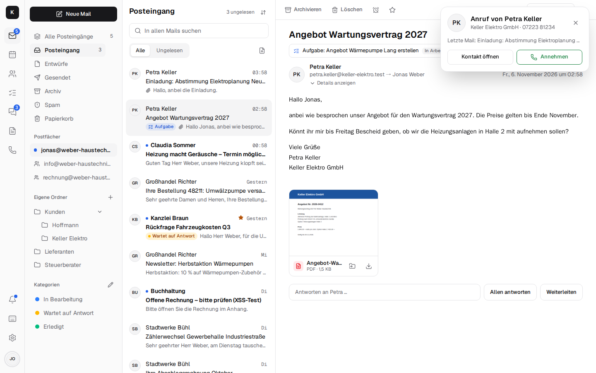

# Telephony (CTI) with the Fritzbox { #telefonie-cti-mit-der-fritzbox }

Kontext connects the company phone with mail, contacts and calendar (**CTI**, computer telephony
integration): when a customer calls, Kontext shows at once who it is – contact, company, latest
mail, next appointment – and you answer in the browser, on the computer or on the phone. Calling
someone is one click on the contact. The Fritzbox stays on the line, numbers and desk phones stay
as they are; a small **phone box** in the office registers with the Fritzbox as an IP phone and
connects it to Kontext. No phone system from the cloud, no cost per extension.

!!! note "In testing"
    Telephony is being tested at the first customer. Feedback is welcome as an
    [issue](https://github.com/firsttris/kontext/issues).

## What you do with it { #was-man-damit-tut }

- **A call with context:** for the people who are meant to be rung, a card appears with the name,
  company, latest mail, next appointment and “Answer” – also as a notification on the device when
  Kontext is closed. If a number isn't in the address book, you see the number.
- **Answer in the browser or on the desk phone:** whoever picks up first has the call. Kontext is a
  softphone with microphone and speaker (WebRTC); the call stays open while you switch between
  mail, calendar and chat.
- **Call** from any contact, from the sidebar next to a mail or on the *Phone* page; a keypad
  sends tones for voice menus (DTMF).
- **Call list** with answered, missed and rejected calls, a note on the call and “Call back”.
- **Call back as a task:** a missed call creates “Call back: …” on the chosen board, due today; as
  soon as someone has spoken to the number, the task checks itself off.

## Voicemail, opening hours, voice menu { #mailbox-offnungszeiten-sprachmenu }

- **Voicemail:** if nobody picks up, the box plays the greeting and records a message (up to two
  minutes). It arrives as a **mail with the recording** in the chosen mailbox and can be played on
  the call. You record greetings right in the browser or upload them.
- **Opening hours** with a lunch break, closed days and the public holidays of your own federal
  state with one click: outside them nothing rings, callers hear the “closed” greeting and can
  leave a message. The box checks this itself, even when Kontext can't be reached.
- **Voice menu:** “For customer service, press 1 …” – each key rings its own people (the topic is
  shown on the call) or leads to voicemail.
- **Block list:** “Block” in the call list, all withheld numbers if you want; the box rejects them
  before anything rings.

## During a call { #im-gesprach }

- **Transfer** to a colleague (it rings for her, you leave as soon as she's on), to any number or
  to a phone on the Fritzbox (`**610`).
- **Hold, consultation, three-way call:** hold music for the caller, ask a colleague first, then
  bring the caller back and talk as three – or leave the two of them alone.
- **Record calls**, if the company allows it: the box first plays the caller a notice (consent
  under § 201 StGB); the recording is kept with the call, it isn't mailed.

## Who is rung when { #wer-klingelt-wann }

- **Everyone at once or one after the other** (each person for a while, then everyone), plus, if
  you want, a **mobile phone** that joins in after a set time.
- **Direct numbers:** further numbers on the line, each rings its own people, who also call out
  with it.
- **Presence:** “on a call” is shown next to the person in the chat; with *Do not disturb* or
  *Away until …* it rings for the others (your own desk phone stays quiet too).

## Devices in the office { #gerate-im-buro }

- **Snom desk phones** register with the box and fetch their settings themselves (provisioning):
  they ring together with Kontext, reach each other by speed dial and can be chosen when
  transferring.
- **Door intercom** on the Fritzbox: it rings in Kontext with “Open door” and “Talk”.
- **Fax as a PDF mail:** one number on the line takes faxes; each arrives as a PDF in the chosen
  mailbox.
- **Emergency calls** (110, 112) and speed dials go straight through the Fritzbox; if the internet
  goes down, the phones on the Fritzbox keep working.

## Statistics { #auswertung }

Calls of the last 30 days: how many, how quickly they were answered, when calls were missed
(weekday × hour), outside opening hours, messages and who answered.

## What it needs { #was-es-braucht }

- a **Fritzbox** on the line (Telefonie → Telefoniegeräte → IP-Telefon “Kontext”, in English
  Telephony → Telephony Devices → IP telephone);
- the **phone box** in the office network: a container with Asterisk and the box agent, on a used
  thin client, a Raspberry Pi, the company server or a NAS with Docker. It sets up the connection
  to Kontext from the inside, **no port is open at the customer's**;
- **LiveKit** and **LiveKit SIP** on the server (in `compose.yaml` with the `calls` profile).

Setup step by step: [Installation → Telephony](installation.md#telefonie). How the box, Asterisk,
LiveKit SIP and Kontext work together: [Architecture → Telephony](architecture.md#telefonie).
What comes next (a SIP trunk directly with the provider, SIP over TLS, a call queue, more desk
phones): [Roadmap](https://github.com/firsttris/kontext/blob/main/ROADMAP.md).
