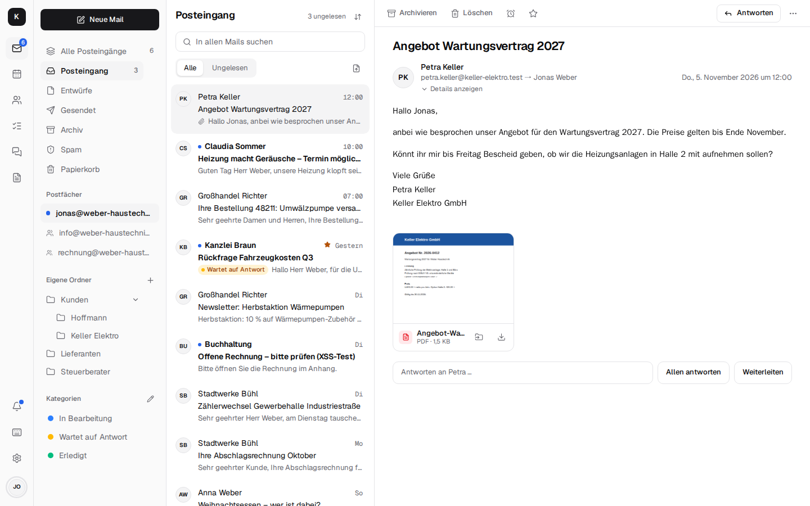

# Kontext – mail, calendar, chat and telephony on your own server { #kontext-mail-kalender-chat-und-telefonie-auf-dem-eigenen-server }

Kontext is **mail, calendar and contacts that belong to you** – like Google Workspace or
Microsoft 365, just on your own server: shared mailboxes like info@, one calendar for the team,
contacts that show the mails, appointments and tasks for every customer, plus team chat with video
calls and the company phone on the Fritzbox. For freelancers, the trades, law firms, practices and
small and mid-sized businesses.

Every installation has its own mail server, [Stalwart](https://stalw.art); Kontext is the
interface in the browser and on the phone (installable as an app) and talks to Stalwart over JMAP.
The data stays on your own server – GDPR, nothing is lost when someone leaves, no cost per user.
Thunderbird, Outlook, iPhone and Android keep connecting over IMAP, SMTP, CalDAV and CardDAV.

A tour in pictures, made to pass on to customers and colleagues, is the
[start page](index.md).

## What's in it { #was-drin-ist }

| | |
| --- | --- |
| [**Mail**](mail.md) | shared mailboxes, all inboxes in one list, categories and rules for the team, search like in Gmail, snooze, send later, snippets, fetching Gmail and GMX and sending as that address, a warning about forged senders |
| [**Calendar and contacts**](calendar-contacts.md) | day, week, month, recurring events, invitations, colleagues' availability like in Outlook, a video meeting on any appointment; customer view with the latest mails and appointments, groups, vCard, shared address books |
| [**Tasks**](tasks.md) | list and Kanban board per mailbox and project, from mails, chat and rules, recurring, reminders as push notifications, CalDAV for Thunderbird and the phone |
| [**Team chat and video calls**](chat.md) | channels per shared mailbox, direct messages, threads, mails as cards, calls, video calls and screen sharing over LiveKit |
| [**Telephony (CTI)**](telephony.md) | Fritzbox calls ring in Kontext with the contact, the latest mail and the next appointment; softphone in the browser, voicemail as a mail, opening hours, call transfer, Snom desk phones, fax as PDF |
| [**Documents**](documents.md) | Word, Excel, PowerPoint and PDF in the browser (Schreibzeug), one folder per shared mailbox, filing and attaching attachments |
| [**Encryption**](encryption.md) | OpenPGP and S/MIME in the browser, “Send confidentially” to any recipient, end-to-end encrypted chat |
| [**AI agents (MCP)**](agents.md) | Claude & co. look up customers, mails, appointments and tasks, create drafts and invite colleagues to appointments – they never send anything outside or delete |
| [**Company admin and migration**](company.md) | employees, shared mailboxes with rights, out of office with a stand-in, leaving the company, migration from Microsoft 365, Gmail, Outlook (PST) |
| [**App, phone and account**](app.md) | installable as an app on the PC, on Android and on the iPhone; notifications even when the app is closed; on the phone every view as a screen of its own with a tab bar (you choose which apps are in it); light and dark, sign-in with a code |
| [**Accessibility**](accessibility.md) | target WCAG 2.2 AA (EN 301 549, BITV 2.0): screen readers, keyboard, contrast, reduced motion; every page checked automatically with axe |

## Running it { #betrieb }

One server per company: a small VPS (for example at IONOS or Hetzner, from around €5 a month) or
a computer in your own building, with Docker or Podman. Kontext, Stalwart and Caddy start from one
Docker Compose file; calls (LiveKit), telephony and documents are switched on when you need them.
Backups go encrypted with Restic to S3 with Object Lock.
→ [Installation](installation.md)

## What comes next { #wie-es-weitergeht }

What comes next and which points are still open is in the
[roadmap](https://github.com/firsttris/kontext/blob/main/ROADMAP.md); what changed in each
version is in the [changelog](https://github.com/firsttris/kontext/blob/main/CHANGELOG.md).

Next: [Installation](installation.md) · [Architecture](architecture.md) · [Development](development.md)
